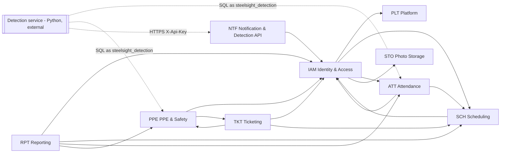

# Steelsight ERP — Module Map, Business Rules and User Stories

| Field | Value |
|-------|-------|
| **Document ID** | `STEELSIGHT-ARCH-MAP-001` |
| **Version** | `1.0` |
| **Date** | `2026-11-06` |
| **Status** | `Draft` |
| **Source** | Reverse-engineered from branch `feature/erp-backend` at commit `f005861` |
| **Author** | Claude Code (Opus 5.5), from the code, migrations, tests and `docs/` |
| **Reviewed by** | `[ ] Pending` |

This is the shared reference for the ADRs (`02_design/adr/`), the TDS documents (`03_implement/`) and the Test-Specs (`04_testing/`). Every BR and US ID used in those documents is defined here.

> **Where these IDs come from.** The repository has no SRS or signed-off user stories. The business rules (BR) below are what the code and database **actually enforce**, each with the place it is enforced. The user stories (US) are derived from `docs/user-guide.md`. Neither has been confirmed by a product owner yet; treat them as the baseline to confirm, not as approved requirements.

---

## 1. Module split

The Java packages under `src/main/java/orochi/steelsight/` already follow bounded contexts, except `web/`, which holds every page controller. The split below assigns each controller and helper to the module whose service it calls.

| Code | Module | Bounded Context | Packages / files | Tables | TDS | Test-Spec |
|------|--------|-----------------|------------------|--------|-----|-----------|
| `IAM` | Identity & Access | Who a user is and what they may do | `identity/**`, `security/**`, `config/PasswordConfig`, `web/AccountController`, `web/AuthController`, account parts of `web/TeamController`, `web/NewAccountForm`, `web/ProfileForm`, `web/PasswordForm` | `role`, `permission`, `role_permission`, `app_user` | [IAM](../03_implement/STEELSIGHT-IAM-IMP-001_TDS.md) | [IAM](../04_testing/STEELSIGHT-IAM-TDD-001_Test-Spec.md) |
| `SCH` | Scheduling | Teams, zones and the shift timetable | `scheduling/**`, `web/ShiftController`, `web/TimetableController`, `web/ShiftGrid`, `web/ShiftForm`, team parts of `web/TeamController` | `team`, `zone`, `shift` | [SCH](../03_implement/STEELSIGHT-SCH-IMP-001_TDS.md) | [SCH](../04_testing/STEELSIGHT-SCH-TDD-001_Test-Spec.md) |
| `ATT` | Attendance | Site visits, late/early rules, face enrolment queue | `attendance/**`, `web/AttendanceController`, `web/CheckInForm`, `web/TodayRoster` | `check_in`, `face_embedding` | [ATT](../03_implement/STEELSIGHT-ATT-IMP-001_TDS.md) | [ATT](../04_testing/STEELSIGHT-ATT-TDD-001_Test-Spec.md) |
| `PPE` | PPE & Safety | Violations, disputes, safety score, worker directory | `ppe/**`, `web/ViolationController`, `web/WorkerController`, `web/SafetyController`, `web/Charts` | `ppe_vest`, `ppe_linking`, `camera`, `violation`, `safety_policy` | [PPE](../03_implement/STEELSIGHT-PPE-IMP-001_TDS.md) | [PPE](../04_testing/STEELSIGHT-PPE-TDD-001_Test-Spec.md) |
| `TKT` | Ticketing | Requests, safety concerns, PPE disputes | `ticketing/**`, `web/TicketController`, `web/TicketForm` | `ticket_category`, `ticket`, `ticket_comment` | [TKT](../03_implement/STEELSIGHT-TKT-IMP-001_TDS.md) | [TKT](../04_testing/STEELSIGHT-TKT-TDD-001_Test-Spec.md) |
| `NTF` | Notification & Detection API | In-app notices and the detection alert API | `notification/**`, `api/**`, `security/ApiKeyFilter`, `web/NotificationController`, `web/NavCounts` | `notification`, `safety_alert` | [NTF](../03_implement/STEELSIGHT-NTF-IMP-001_TDS.md) | [NTF](../04_testing/STEELSIGHT-NTF-TDD-001_Test-Spec.md) |
| `RPT` | Reporting | Monthly figures for accounting | `reporting/**`, `web/ReportController`, `web/MonthlyReportWorkbook` | *(reads only)* | [RPT](../03_implement/STEELSIGHT-RPT-IMP-001_TDS.md) | [RPT](../04_testing/STEELSIGHT-RPT-TDD-001_Test-Spec.md) |
| `STO` | Photo Storage | Ticket and face photo files | `storage/**` | *(none — files in local disk or Supabase buckets)* | [STO](../03_implement/STEELSIGHT-STO-IMP-001_TDS.md) | [STO](../04_testing/STEELSIGHT-STO-TDD-001_Test-Spec.md) |
| `PLT` | Platform (shared kernel) | Base entities, errors, i18n, logging, site time, dashboard, deployment | `model/**`, `repository/**`, `exception/**`, `validation/**`, `config/LocaleConfig`, `web/PageController`, `web/PageExceptionHandler`, `web/RequestLogFilter`, `web/HomeController`, `web/LanguageController`, `web/Display`, `web/SiteTime`, `db/migration/afterMigrate__enable_rls.sql`, `Dockerfile`, `.github/workflows/ci.yml` | `flyway_schema_history` | [PLT](../03_implement/STEELSIGHT-PLT-IMP-001_TDS.md) | [PLT](../04_testing/STEELSIGHT-PLT-TDD-001_Test-Spec.md) |

### 1.1 Module dependencies

Arrows read "depends on". Two cycles exist and are known:

- `IAM ↔ SCH`: `AppUser.team` and `Team.manager` reference each other; `UserService` uses `TeamRepository`.
- `PPE ↔ TKT`: `ViolationService.decide()` resolves the dispute ticket, and `TicketService.openDispute()` marks the violation. Both on purpose, so each side is one transaction ([ADR-015](adr/ADR-015_dispute-decision-and-ticket-in-one-transaction.md)).

Every module also depends on `IAM.AccessPolicy` for permission and scope checks ([ADR-001](adr/ADR-001_permission-and-scope-in-sql-functions.md)).

---

## 2. Roles

Seeded by `V1__init_schema.sql`, changed by V9–V11. Admin holds every permission.

| Role | Holds (after V11) |
|------|-------------------|
| `WORKER` | `TICKET_CREATE`, `TICKET_READ_OWN`, `SHIFT_READ_OWN`, `VIOLATION_READ_OWN`, `CHECKIN_READ_OWN` |
| `HSE_OFFICER` | `TICKET_CREATE`, `TICKET_READ_OWN`, `TICKET_READ_HANDLED`, `TICKET_UPDATE_HANDLED`, `TICKET_DELETE_HANDLED`, `SHIFT_READ_OWN`, `VIOLATION_READ_ALL`, `VIOLATION_REVIEW`, `CHECKIN_READ_OWN`, `CHECKIN_READ_ALL`, `CHECKIN_EDIT`, `USER_READ_ALL` |
| `MANAGER` (team leader) | `TICKET_CREATE`, `TICKET_READ_OWN`, `SHIFT_READ_OWN`, `SHIFT_READ_TEAM`, `SHIFT_UPDATE_TEAM`, `CHECKIN_READ_OWN`, `CHECKIN_READ_TEAM`, `USER_READ_ALL`, `REPORT_EXPORT_TEAM` |
| `ADMIN` | All of the above plus `TICKET_READ_ALL`, `TICKET_UPDATE_ALL`, `TICKET_DELETE_ALL`, `SHIFT_READ_ALL`, `SHIFT_UPDATE_ALL`, `USER_MANAGE`, `ROLE_MANAGE`, `REPORT_EXPORT_ALL` |
| `steelsight_detection` *(DB role, not an app role)* | Column-level grants on `app_user`, `check_in`, `ppe_linking`, `violation`, `face_embedding`; read on `zone`, `camera`, `ppe_vest`, `shift`; execute `close_stale_check_ins(text)` |
| `detection-software` *(API caller)* | Authenticated by `X-Api-Key` on `/api/**` only; no authorities |

> `ROLE_MANAGE` is seeded and held by Admin but nothing in the code checks it.

---

## 3. Business Rule catalog

Format: **ID** — rule — *enforced at*.

### 3.1 IAM — Identity & Access

| ID | Rule | Enforced at |
|----|------|-------------|
| BR-IAM-001 | Users sign in with employee code and password. A soft-deleted user is not found; a deactivated user is refused. Wrong password and unknown code get the same answer. | `AppUserDetailsService`, `AuthenticatedUser.enabled` |
| BR-IAM-002 | A password has at least 8 characters and at most 72 UTF-8 bytes (BCrypt's limit), and is stored only as a BCrypt hash. | `UserService.checkedPassword()`, `PasswordConfig` |
| BR-IAM-003 | When an admin chooses a password (new account or reset), the user must choose their own at the next sign-in, and can reach nothing else until they do. The new password must differ from the current one. | `UserService.create/resetPassword/changeOwnPassword`, `FirstSignInHandler`, `PasswordChangeRequiredFilter` |
| BR-IAM-004 | 5 failed sign-ins for one code from one address, or 20 for one code from anywhere, lock that sign-in for 15 minutes, even with the right password. A success clears only that client's count. | `SignInLimiter`, `SignInLimitFilter` |
| BR-IAM-005 | Only a holder of `USER_MANAGE` (Admin) creates accounts or changes details, role, team, active status, password, face photo, or deletes an account. | `UserService`, `can_update_user()` (V10), `TeamController.requireAdmin()` |
| BR-IAM-006 | An admin cannot change their own role, deactivate their own account or delete it. | `UserService.changeRole/setActive/softDelete` |
| BR-IAM-007 | A user who leads a team cannot be deleted or moved off the MANAGER role until the team has a new leader. | `UserService.changeRole/softDelete` |
| BR-IAM-008 | Employee code matches `[A-Za-z0-9._-]{1,50}` and is unique; email is optional, unique and must look like `x@y`; name is required, at most 200 characters; phone at most 30. | `UserService.create/updateProfile`, `Text`, DB unique constraints |
| BR-IAM-009 | Every action needs the permission **and** the scope (which records). The rules live in SQL functions, called by every service. | `AccessPolicy`, `has_permission()`, `can_*()` |
| BR-IAM-010 | On startup, if no live admin exists and `ADMIN_PASSWORD` is set, one admin is created with `ADMIN_EMPLOYEE_CODE`. Otherwise nothing happens. | `AdminBootstrap` |
| BR-IAM-011 | Holders of `USER_READ_ALL` (Manager, HSE, Admin) can look at any worker, on any team. Only users with the WORKER role have a worker page. | `UserService.getWorker()` |

### 3.2 SCH — Scheduling

| ID | Rule | Enforced at |
|----|------|-------------|
| BR-SCH-001 | A worker cannot have two overlapping shifts that are not cancelled. | `EXCLUDE USING gist … WHERE (status <> 'CANCELLED')`, `ShiftService.save()` |
| BR-SCH-002 | A shift needs a worker, a zone, a start and an end, and must end after it starts. Its length is computed by the database. | `ShiftService.requireComplete/apply`, `CHECK (end_at > start_at)`, generated `duration_hours` |
| BR-SCH-003 | A manager gives shifts only to active, live workers on the team they lead; `SHIFT_UPDATE_ALL` (Admin) to any active worker. | `can_assign_shift()` (V3) |
| BR-SCH-004 | Only a SCHEDULED shift can be edited, cancelled or completed. A stale edit form fails. | `ShiftService.scheduled()`, `Versioned.requireVersion()`, `@Version` |
| BR-SCH-005 | A shift belongs to the site-local day it starts on; weeks start on Monday in the site time zone (`Asia/Ho_Chi_Minh`). | `SiteTime`, `ShiftGrid`, repository `[from, to)` queries |
| BR-SCH-006 | Each team has one leader, who must have the MANAGER role, and a manager leads at most one team. | `TeamService.freeLeader/manager`, `uq_team_manager` (V11) |
| BR-SCH-007 | A team can be deleted only when no live user is on it. | `TeamService.delete()` |
| BR-SCH-008 | The team's late rule is 0 to 240 minutes, changed by that team's leader or an admin. | `TeamService.setLateAfterMinutes()`, `CHECK` (V6) |

### 3.3 ATT — Attendance

| ID | Rule | Enforced at |
|----|------|-------------|
| BR-ATT-001 | A worker has at most one open visit (no check-out yet). | `uq_check_in_open`, `CheckInService.save()` |
| BR-ATT-002 | Check-out is after check-in. A FACE visit has a similarity 0–100; a MANUAL visit says who recorded it. | `CHECK`s on `check_in`, `CheckInService.requireOrder()` |
| BR-ATT-003 | A visit's shift and vest link must belong to the same worker. | `check_in_same_worker()` trigger, `CheckInService.recordManual()` |
| BR-ATT-004 | Late: arriving more than the team's grace period after the shift starts. Lateness within the grace period is made up at the end of the shift; the required check-out is `shift end + min(minutes late, grace)`. Times compare in whole minutes. Workers with no team use `LATE_AFTER_MINUTES` (15). | `AttendanceRules.assess()` |
| BR-ATT-005 | Early: checking out before the required check-out. An estimated (auto-closed) check-out is never judged early; a visit still on site can be late but not early. | `AttendanceRules.assess()`, `VisitStatus` |
| BR-ATT-006 | A visit nobody checked out of closes once its day has ended: at the shift's end, or at site midnight when it has no shift (cancelled shifts count as none). It is marked `auto_closed`. | `close_stale_check_ins(text)` (V7), called by detection |
| BR-ATT-007 | Only `CHECKIN_EDIT` (HSE, Admin) adds or corrects a visit by hand. A correction clears `auto_closed` and records the old and new values in `check_in_correction`. A stale form fails, even when only plain SQL changed the visit. | `CheckInService.recordManual/correct`, `bump_check_in_version()` (V5), `check_in_correction` (V12) |
| BR-ATT-008 | Visits are visible as own (`CHECKIN_READ_OWN`), team (`CHECKIN_READ_TEAM`, the team you lead) or all (`CHECKIN_READ_ALL`). | `CheckInService.list*` |
| BR-ATT-009 | A worker has one enrolment row. A new face photo resets it to PENDING and clears the old vector and model, in the same transaction as the photo path. | `FaceEmbeddingRepository.queueForEnrolment()` |
| BR-ATT-010 | Soft-deleting a user erases their face embedding in the same transaction; the old photo file is removed only after commit. | `trg_user_erase_embedding`, `UserService.removeFacePhotoAfterCommit()` |

### 3.4 PPE — PPE & Safety

| ID | Rule | Enforced at |
|----|------|-------------|
| BR-PPE-001 | A violation with a vest link gets its worker from that link; a different worker is refused. Without a link the worker stays empty. | `violation_set_worker()` trigger |
| BR-PPE-002 | An unidentified violation cannot be disputed. A `VIOLATION_REVIEW` holder (HSE, Admin) can name its worker, once. | `CHECK (dispute_status = 'NONE' OR user_id IS NOT NULL)`, `ViolationService.assignWorker()` |
| BR-PPE-003 | Only the violation's own worker can dispute it, and only once (NONE → DISPUTED). | `TicketService.openDispute()`, `Violation.canBeDisputedBy()` |
| BR-PPE-004 | A dispute is decided UPHELD or OVERTURNED, only while DISPUTED, never by the worker it concerns. The decision records reviewer and time and resolves the dispute ticket in the same transaction; of two simultaneous decisions only one succeeds. | `ViolationService.decide()`, `@Version`, `CHECK` reviewer fields |
| BR-PPE-005 | Safety score per site-calendar month: `max(0, 100 − 10 × hits)`. A hit is a distinct (violation type, 30-minute block) for the worker. Overturned violations don't count; disputed ones do until decided. Only WORKER-role users have a score; it is never stored. | `safety_scores()` (V8), `safety_policy` |
| BR-PPE-006 | Score ≤ 40 is DANGER, ≤ 70 is WARNING, otherwise SAFE. | `safety_scores()`, `safety_policy` |
| BR-PPE-007 | A worker sees only their own violations; `VIOLATION_READ_ALL` (HSE, Admin) sees all. | `ViolationService.get/listOwn/listAll` |
| BR-PPE-008 | Shift time slots (same start and end) are ranked by violations per 100 worker-hours; a violation counts for every slot running when it happened, named or not. | `safety_time_slots()` (V8) |

### 3.5 TKT — Ticketing

| ID | Rule | Enforced at |
|----|------|-------------|
| BR-TKT-001 | Each category names the role that handles it. HSE: *PPE dispute*, *Safety concern*. Admin: *Shift or timetable issue*, *Equipment request*, *Leave request*, *Account or access*. | `ticket_category.handler_role_id` (V1, V11) |
| BR-TKT-002 | An ordinary ticket cannot use the *PPE dispute* category. Subject is required (≤ 200), description is required (≤ 4000). | `TicketService.create/newTicket` |
| BR-TKT-003 | A ticket is readable by its creator, by the role that handles its category, and by `TICKET_READ_ALL` (Admin). Soft-deleted tickets are invisible. | `can_read_ticket()` (V11) |
| BR-TKT-004 | An assignee must be able to handle the ticket; assigning an OPEN ticket moves it to IN_PROGRESS. | `TicketService.assign()`, `Ticket.assignTo()` |
| BR-TKT-005 | Only an unresolved, non-dispute ticket can be resolved this way; an optional note becomes a comment. RESOLVED ⇔ resolver and resolved_at are set. | `TicketService.resolve()`, `CHECK`s on `ticket` |
| BR-TKT-006 | Comments come from the creator or a handler, and stop once the ticket is resolved. | `TicketService.addComment()` |
| BR-TKT-007 | A violation has at most one live dispute ticket. A dispute ticket can't be deleted while its dispute is pending. | `uq_ticket_violation`, `TicketService.softDelete()` |
| BR-TKT-008 | A ticket may carry a zone and one photo. The photo is served only to someone who can read the ticket. | `TicketService.create()`, `TicketController.photo()` |

### 3.6 NTF — Notification & Detection API

| ID | Rule | Enforced at |
|----|------|-------------|
| BR-NTF-001 | When a worker's score first reaches WARNING or DANGER in a month, they get one notification for that level that month, even if the ERP is asleep. Jumping straight to DANGER sends only the danger notice. | `notify_safety_level()` trigger, `uq_notification_level` |
| BR-NTF-002 | `/api/**` requires the configured `X-Api-Key` (compared in constant time). With no key configured, every call is refused with 401 JSON. | `ApiKeyFilter`, `SecurityConfig.apiFilterChain` |
| BR-NTF-003 | An alert with an `eventId` already received changes nothing and answers `200 {"status":"duplicate"}`. | `SafetyAlertService.record()` `ON CONFLICT DO NOTHING` |
| BR-NTF-004 | A new alert is always stored. It notifies every active HSE officer, unless an alert that notified was received in the last 15 minutes. | `SafetyAlertService.record()` |
| BR-NTF-005 | People read and mark as read only their own notifications. | `NotificationService` |
| BR-NTF-006 | Notification text isn't stored; it is shown in the reader's language. | `notification` has no text column; templates |

### 3.7 RPT — Reporting

| ID | Rule | Enforced at |
|----|------|-------------|
| BR-RPT-001 | A team leader exports their own team's WORKER-role members; `REPORT_EXPORT_ALL` (Admin) exports every worker. A leader with no team is refused. | `MonthlyReportService.scopeOf()` |
| BR-RPT-002 | The month must have started; with none chosen, last month. The running month is counted up to now. | `MonthlyReportService.period()`, `ReportController.monthOf()` |
| BR-RPT-003 | Violation counts leave out OVERTURNED; DISPUTED ones are counted and also shown as awaiting a decision. | `MonthlyReportService.build()` |
| BR-RPT-004 | A non-cancelled shift counts as worked if a visit is linked to it or overlaps it; a shift that has ended with neither is a no-show. | `MonthlyReportService.build()` SQL |
| BR-RPT-005 | Hours worked are the sum of closed visits' lengths, to 2 decimals. | `MonthlyReportService.row()` |
| BR-RPT-006 | The file is never cached, has a plain-ASCII name, is written in the reader's language, and each download is logged. | `ReportController`, `MonthlyReportWorkbook` |

### 3.8 STO — Photo Storage

| ID | Rule | Enforced at |
|----|------|-------------|
| BR-STO-001 | A photo must be JPEG, PNG or WebP, judged by its first bytes, and under 5 MB. | `PhotoFormat.extensionOf()`, `spring.servlet.multipart.max-file-size` |
| BR-STO-002 | Stored names are random UUIDs; only names matching `[A-Za-z0-9][A-Za-z0-9._-]{0,99}` without `..` are loaded or deleted. | `PhotoFormat.isStoredName()`, `LocalPhotoStorage.resolve()` |
| BR-STO-003 | Face photos and ticket photos are kept apart (folder or bucket); one bucket for both is refused at startup. | `PhotoAlbum`, `SupabasePhotoStorage` constructor |
| BR-STO-004 | Browsers get photos only through ERP endpoints after the owning record's permission check, with `Cache-Control: no-store`. | `TicketController.photo()`, `TeamController.facePhoto()` |
| BR-STO-005 | If saving the record fails, the just-stored photo is deleted. A failed delete is logged, never thrown over the original error. | `TicketController`, `TeamController`, `SupabasePhotoStorage.delete()` |
| BR-STO-006 | The `prod` profile uses Supabase and refuses to start without its URL and key. | `application-prod.yaml`, `SupabasePhotoStorage.configured()` |

### 3.9 PLT — Platform

| ID | Rule | Enforced at |
|----|------|-------------|
| BR-PLT-001 | Flyway alone changes the schema; Hibernate only validates. Row Level Security is switched on for every public table after each migrate. | `ddl-auto: validate`, `afterMigrate__enable_rls.sql` |
| BR-PLT-002 | Each request gets one log line with method, path, status, user and time, and every line in the request carries its request ID. Query strings, form bodies and passwords are never logged. | `RequestLogFilter`, `SignInLog`, `PageController.submit()` |
| BR-PLT-003 | Every browser form needs a CSRF token; the API is stateless and has none. | Spring Security defaults, `SecurityConfig` |
| BR-PLT-004 | Failures show an error page with the right status: 400 rule, 403 denied, 404 not found, 409 stale edit, 413 upload too large, 500 bug with a reference to quote. | `PageExceptionHandler` |
| BR-PLT-005 | Times are stored in UTC and shown, entered and grouped in the site time zone. | `hibernate.jdbc.time_zone: UTC`, `SiteTime` |
| BR-PLT-006 | English and Vietnamese have the same keys; every message written in the code has a Vietnamese translation. The choice is kept in a cookie for a year. | `TranslationsTest`, `LocaleConfig`, `Display.message()` |
| BR-PLT-007 | Only `/actuator/health` is exposed, publicly and without details. | `management.endpoints.web.exposure.include: health` |
| BR-PLT-008 | `app_user`, `shift`, `check_in`, `violation` and `ticket` carry a version; an edit from a stale form fails with 409. | `@Version`, `Versioned`, `StaleEditException` |

---

## 4. User stories (derived from `docs/user-guide.md`)

| ID | As a … | I want to … | Module(s) |
|----|--------|-------------|-----------|
| US-WRK-001 | Worker | see my shifts for the week and my next shift | SCH |
| US-WRK-002 | Worker | see my violations and my safety score for the month | PPE |
| US-WRK-003 | Worker | dispute a violation I think is wrong, and follow the decision | PPE, TKT |
| US-WRK-004 | Worker | open a ticket, such as a leave request or a safety concern with a zone and photo | TKT, STO |
| US-WRK-005 | Worker | be told when my safety score reaches warning or danger | NTF |
| US-MGR-001 | Team leader | plan, edit, cancel and complete shifts for my team on a weekly grid | SCH |
| US-MGR-002 | Team leader | set how many minutes late my team may check in | SCH, ATT |
| US-MGR-003 | Team leader | see my team's attendance with late, early and missing tags | ATT |
| US-MGR-004 | Team leader | look up any worker's score, violations, shifts and visits | PPE, ATT, SCH |
| US-MGR-005 | Team leader | export my team's monthly report for accounting | RPT |
| US-HSE-001 | HSE officer | decide disputed violations, with a note the worker can read | PPE, TKT |
| US-HSE-002 | HSE officer | name the worker on a violation the camera couldn't identify | PPE |
| US-HSE-003 | HSE officer | work the safety-concern and dispute tickets | TKT |
| US-HSE-004 | HSE officer | add or correct a check-in by hand | ATT |
| US-HSE-005 | HSE officer | see which shift time slots are least safe | PPE |
| US-HSE-006 | HSE officer | be alerted when detection sees a burst of violations | NTF |
| US-ADM-001 | Admin | set up teams, each with one leader | SCH |
| US-ADM-002 | Admin | create, edit, deactivate and delete accounts and reset passwords | IAM |
| US-ADM-003 | Admin | upload a worker's face photo for gate check-in and see the enrolment status | IAM, ATT, STO |
| US-ADM-004 | Admin | work every non-safety ticket, and look at HSE's | TKT |
| US-ADM-005 | Admin | export every worker's monthly report | RPT |
| US-SYS-001 | Detection service | report a burst of violations to the ERP, safely retried | NTF |
| US-SYS-002 | Detection service | write check-ins, vest links, violations and enrolment results straight to the database, safely retried | ATT, PPE |
| US-ALL-001 | Any user | sign in with my employee code, change my password, and use the site in Vietnamese or English | IAM, PLT |

---

## 5. ADR index

| ADR | Decision | Modules |
|-----|----------|---------|
| [ADR-001](adr/ADR-001_permission-and-scope-in-sql-functions.md) | Permission **and** scope checks live in SQL functions, called from every service | IAM (all) |
| [ADR-002](adr/ADR-002_server-rendered-monolith.md) | One Spring Boot app with server-rendered Thymeleaf and htmx, no SPA | PLT |
| [ADR-003](adr/ADR-003_flyway-owns-schema-db-enforces-integrity.md) | Flyway owns the schema; the database enforces integrity | PLT (all) |
| [ADR-004](adr/ADR-004_shared-database-with-least-privilege-detection-role.md) | The detection service integrates through the shared database, as a least-privilege role behind RLS | PLT, ATT, PPE |
| [ADR-005](adr/ADR-005_idempotent-detection-writes-by-event-id.md) | Detection writes are idempotent by outbox event UUID | ATT, PPE, NTF |
| [ADR-006](adr/ADR-006_optimistic-locking-through-forms.md) | Optimistic locking, with the version carried through forms | PLT (all) |
| [ADR-007](adr/ADR-007_soft-delete-and-biometric-erasure.md) | Soft delete for people and tickets; hard erasure for biometric data | IAM, ATT, TKT |
| [ADR-008](adr/ADR-008_session-sign-in-by-employee-code-with-limiter.md) | Session sign-in by employee code, BCrypt, in-memory sign-in limiter | IAM |
| [ADR-009](adr/ADR-009_forced-password-change.md) | Admin-chosen passwords must be changed at the next sign-in | IAM |
| [ADR-010](adr/ADR-010_admin-only-account-management.md) | Only admins manage accounts | IAM |
| [ADR-011](adr/ADR-011_face-enrolment-as-a-database-queue.md) | Face enrolment is a database queue; the ERP never handles vectors | ATT, IAM |
| [ADR-012](adr/ADR-012_attendance-tags-computed-on-read.md) | Late and early tags are computed on read, with make-up time | ATT |
| [ADR-013](adr/ADR-013_auto-close-stale-visits-in-the-database.md) | Unclosed visits are auto-closed by a database function the detection service calls | ATT |
| [ADR-014](adr/ADR-014_safety-score-computed-in-sql.md) | The safety score is computed by SQL, never stored; level notices come from a trigger | PPE, NTF |
| [ADR-015](adr/ADR-015_dispute-decision-and-ticket-in-one-transaction.md) | A dispute and its ticket change together, in one transaction | PPE, TKT |
| [ADR-016](adr/ADR-016_ticket-routing-by-category-handler-role.md) | Tickets route by category to a handler role: HSE or Admin | TKT |
| [ADR-017](adr/ADR-017_one-leader-per-team.md) | One leader per team, and one team per leader | SCH |
| [ADR-018](adr/ADR-018_shift-overlap-exclusion-and-site-time.md) | Shift overlap blocked by an exclusion constraint; site-local days | SCH, PLT |
| [ADR-019](adr/ADR-019_detection-alert-api-with-shared-key.md) | Detection alert REST API with a shared key and a quiet period | NTF |
| [ADR-020](adr/ADR-020_photo-storage-abstraction-private-buckets.md) | Photo storage behind one interface, with private, separate buckets | STO |
| [ADR-021](adr/ADR-021_monthly-report-as-streamed-xlsx.md) | Monthly report as a streamed XLSX in the reader's language | RPT |
| [ADR-022](adr/ADR-022_notifications-store-no-text.md) | Notifications store no text | NTF |
| [ADR-023](adr/ADR-023_hosting-render-and-supabase.md) | Host on Render (container) and Supabase (database, storage) | PLT |
| [ADR-024](adr/ADR-024_request-id-logging-without-personal-data.md) | One log line per request with a request ID and no personal data | PLT |

---

## 6. Known gaps found while reading the code

These come up again in the Test-Specs' *Logic Issues* sections. None has been fixed as part of this documentation.

| # | Gap | Where | Module |
|---|-----|-------|--------|
| G1 | Manual check-ins are always saved without a shift (`AttendanceController.record` passes `shiftId = null`), and detection doesn't link shifts yet, so `AttendanceRules` gives most visits no late/early tag. The dashboard roster and monthly report work around it by matching on overlap. | `web/AttendanceController.java:79` | ATT, RPT |
| G2 | `TicketService.softDelete()` and the `TICKET_DELETE_*` permissions exist, but no page or endpoint calls them. | `ticketing/service/TicketService.java` | TKT |
| G3 | `ROLE_MANAGE` is seeded and held by Admin but never checked. | `V1__init_schema.sql` | IAM |
| G4 | No error codes are returned; pages show a translated English message and the API returns `{"error": "<text>"}`. The error-code tables in the TDS documents are documentation IDs only. | `PageExceptionHandler`, `ApiExceptionHandler` | PLT, all |
| G5 | `SafetyAlertService.record()` checks the quiet period, then inserts, without a lock. Two alerts arriving at the same moment can both notify HSE. | `notification/service/SafetyAlertService.java` | NTF |
| G6 | Sign-in counts and sessions are in memory: a restart (or Render spin-down) clears locks and signs everyone out, and a second instance wouldn't share them. | `SignInLimiter`, servlet session | IAM, PLT |
| G7 | The ERP never calls `close_stale_check_ins()`. While the detection service is off, forgotten visits stay open and block that worker's next check-in. | `V7__auto_close_after_the_day_ends.sql` | ATT |
| G8 | Some services load the record before checking permission (`ViolationService.get`, `TeamService.setLateAfterMinutes`), so a missing ID answers 404 and an existing one 403, which reveals which IDs exist. | `ppe/service/ViolationService.java`, `scheduling/service/TeamService.java` | PPE, SCH |
| G9 | The first admin from `AdminBootstrap` isn't asked to change the bootstrap password. | `security/AdminBootstrap.java` | IAM |
| G10 | The alert API has no published contract. `springdoc-openapi` was removed because it served Swagger to every signed-in user. | `api/DetectionAlertController.java` | NTF |
| G11 | No consent record exists for face enrolment, though the schema comment says the embedding is deleted when a worker "withdraws consent". | `V1__init_schema.sql` | ATT, IAM |
| G12 | Workers hold `CHECKIN_READ_OWN`, but no page shows a worker their own visits; `CheckInService.listOwn/listTeam/listOnSite` are unused. | `attendance/service/CheckInService.java` | ATT |
