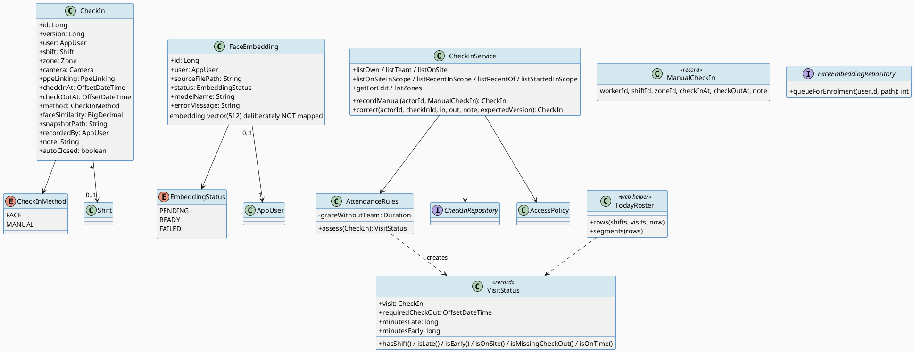
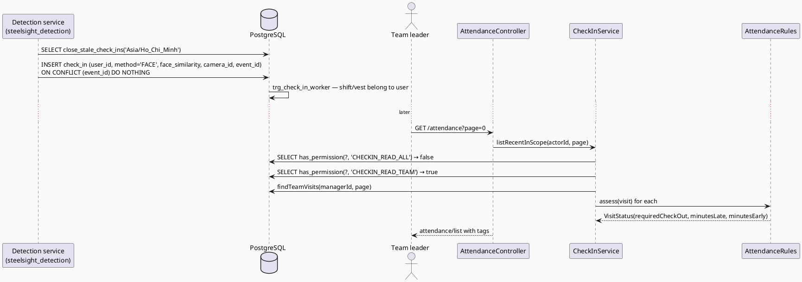
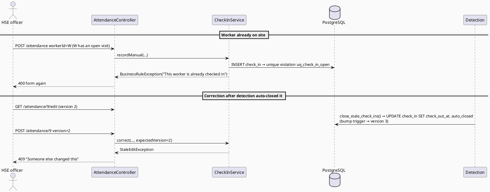
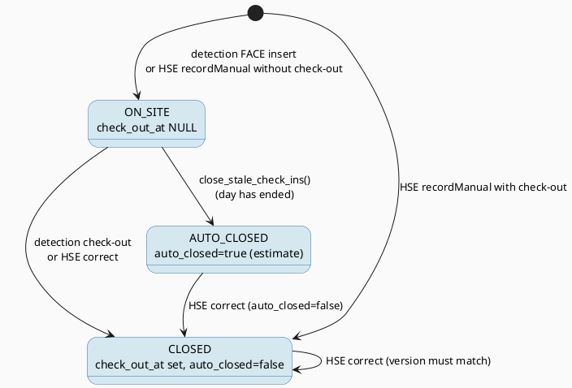
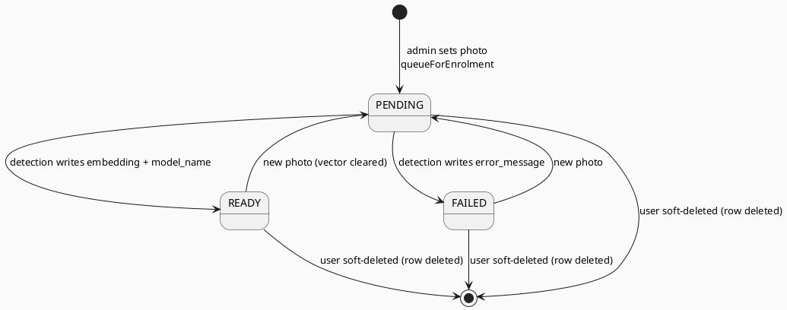

# ENGINEERING DOCUMENTATION STANDARD (EDS) v2.0
# Quy chuẩn Tài liệu Kỹ thuật và Đặc tả Hiện thực hóa

| Field | Value |
|-------|-------|
| **Document ID** | `STEELSIGHT-ATT-IMP-001` |
| **Version** | `1.0` |
| **Date** | `2026-11-06` |
| **Status** | `Draft` |
| **Document Owner** | `Nguyen Vu An` |
| **Author** | `Claude Code (Opus 5.5) — reverse-engineered from commit f005861` |
| **Reviewed by** | `[ ] Pending — Tech Lead` |
| **DPO Sign-off** | `[ ] Pending` *(**required**: face embeddings are biometric, sensitive personal data)* |
| **Approved by** | `[ ] Pending — Principal Architect` |
| **Last Review** | `2026-11-06` |
| **Based on EDS** | `v2.0` |

---

## CHANGELOG

> **Policy 4.4 — Immutable History:** Không bao giờ xóa thông tin cũ. Mọi thay đổi phải ghi vào bảng này.

| Ngày | Người thực hiện | Nội dung thay đổi |
|------|-----------------|-------------------|
| 2026-11-06 | Claude Code (Opus 5.5) — documentation | Tạo tài liệu lần đầu, from the code as built (V1, V2, V5, V7) |

---

## MỤC LỤC

1. [Tổng quan Module](#1-tổng-quan-module)
2. [Ma trận Truy vết (Traceability Matrix)](#2-ma-trận-truy-vết-traceability-matrix)
3. [Architecture Decision Records (ADR)](#3-architecture-decision-records-adr) ⭐ *Mới*
4. [Non-Functional Requirements & SLA](#4-non-functional-requirements--sla) ⭐ *Mới*
5. [Static Modeling (Mô hình Tĩnh)](#5-static-modeling-mô-hình-tĩnh)
6. [Dynamic Modeling (Mô hình Động)](#6-dynamic-modeling-mô-hình-động)
7. [Domain Event Catalog](#7-domain-event-catalog) ⭐ *Mới*
8. [Interface Specification (Đặc tả Giao diện)](#8-interface-specification-đặc-tả-giao-diện)
9. [API Specification](#9-api-specification)
10. [Bảng mã lỗi (Error Codes)](#10-bảng-mã-lỗi-error-codes)
11. [Quy trình Triển khai (Step-by-Step)](#11-quy-trình-triển-khai-step-by-step)
12. [Rollback & Incident Runbook](#12-rollback--incident-runbook) ⭐ *Mới*
13. [Kịch bản Kiểm thử Chi tiết](#13-kịch-bản-kiểm-thử-chi-tiết)
14. [Phương pháp Xác minh](#14-phương-pháp-xác-minh)
15. [Mẫu thử thực tế (API Verification Samples)](#15-mẫu-thử-thực-tế-api-verification-samples)
16. [Bảng tổng hợp phân quyền (Authorization Matrix)](#16-bảng-tổng-hợp-phân-quyền-authorization-matrix)
17. [AI Prompt Constraints (CASE 2.0)](#17-ai-prompt-constraints-case-20) ⭐⭐ *CASE 2.0 Core*

> **Adaptations to this stack:** §5.2 is Flyway SQL, §8 is Java, §9 lists session + CSRF form endpoints. This module has a **second writer**: the Python detection service inserts and updates `check_in` and `face_embedding` directly as `steelsight_detection` (ADR-004).

---

## 1. Tổng quan Module

> Attendance records each site visit (check-in to check-out): by face at the gate (written by the detection service) or by hand (HSE). It judges each visit against its planned shift (late, early, missing check-out), closes forgotten visits after the day ends, and holds the face enrolment queue.

| Field | Value |
|-------|-------|
| **Module Name** | `ATT — Attendance` |
| **Bounded Context** | `Site presence` |
| **Data Classification** | `PII` (visits, times, gate snapshots) / `Sensitive-PII` (face embeddings) |
| **Compliance Scope** | `Luật 91/2025/QH15` (sensitive data: biometrics), `NĐ 356/2025` — DPO pending |
| **Upstream Dependencies** | `IAM` (AccessPolicy, AppUser), `SCH` (Shift, Zone, Team.lateAfterMinutes), `PPE` (Camera, PpeLinking), `PLT` |
| **Downstream Consumers** | `RPT` (visits per month), dashboard (`TodayRoster`, on-site count), `PPE` worker page, detection service (reads READY embeddings) |

**Code location:** `attendance/**`, `web/AttendanceController.java`, `web/CheckInForm.java`, `web/TodayRoster.java`, templates `attendance/list.html`, `attendance/form.html`; SQL `close_stale_check_ins()`, `check_in_same_worker()`, `bump_check_in_version()`.

---

## 2. Ma trận Truy vết (Traceability Matrix)

| Requirement ID | Loại (BR/ADR/US) | Mô tả yêu cầu | Thành phần Code | Compliance Target | ADR liên quan |
|----------------|------------------|---------------|-----------------|-------------------|---------------|
| BR-ATT-001 | Business Rule | One open visit per worker | `uq_check_in_open`, `CheckInService.save()` | PDPL — accuracy | ADR-003 |
| BR-ATT-002 | Business Rule | Order; FACE similarity; MANUAL recorder | `CHECK`s, `CheckInService.requireOrder()` | — | ADR-003 |
| BR-ATT-003 | Business Rule | Shift and vest belong to the visit's worker | `check_in_same_worker()`, `recordManual()` | — | ADR-003 |
| BR-ATT-004 | Business Rule | Late with capped make-up | `AttendanceRules.assess()` | PDPL — accuracy (pay) | ADR-012 |
| BR-ATT-005 | Business Rule | Early; estimates not judged | `AttendanceRules.assess()`, `VisitStatus` | — | ADR-012 |
| BR-ATT-006 | Business Rule | Auto-close after the day ends | `close_stale_check_ins(text)` (V7) | — | ADR-013 |
| BR-ATT-007 | Business Rule | Manual add/correct by `CHECKIN_EDIT`; stale fails incl. plain SQL | `CheckInService.recordManual/correct`, `bump_check_in_version()` | — | ADR-006 |
| BR-ATT-008 | Business Rule | Own / team / all visibility | `CheckInService.list*` | PDPL — least privilege | ADR-001 |
| BR-ATT-009 | Business Rule | New photo resets enrolment | `FaceEmbeddingRepository.queueForEnrolment()` | PDPL — sensitive data | ADR-011 |
| BR-ATT-010 | Business Rule | Delete erases embedding | `trg_user_erase_embedding` | PDPL — erasure | ADR-007 |
| US-MGR-003 | User Story | Team attendance with tags | `AttendanceController.list()` | — | ADR-012 |
| US-HSE-004 | User Story | Manual check-in / correction | `AttendanceController.record()/correct()` | — | — |
| US-SYS-002 | User Story | Detection writes visits and enrolment results | `steelsight_detection` grants, `event_id` | — | ADR-004, ADR-005 |

---

## 3. Architecture Decision Records (ADR)

| ADR | Status | Decision (one line) | Effect on this module |
|-----|--------|---------------------|------------------------|
| [ADR-004](../02_design/adr/ADR-004_shared-database-with-least-privilege-detection-role.md) | Accepted | Detection writes through the DB as a limited role | Column grants on `check_in`, `face_embedding` |
| [ADR-005](../02_design/adr/ADR-005_idempotent-detection-writes-by-event-id.md) | Accepted | Idempotency by `event_id` | `check_in.event_id UNIQUE` |
| [ADR-006](../02_design/adr/ADR-006_optimistic-locking-through-forms.md) | Accepted | Version through forms + bump trigger | `check_in.version`, `bump_check_in_version()` |
| [ADR-011](../02_design/adr/ADR-011_face-enrolment-as-a-database-queue.md) | Accepted | Enrolment is a DB queue | `face_embedding` |
| [ADR-012](../02_design/adr/ADR-012_attendance-tags-computed-on-read.md) | Accepted | Tags computed on read | `AttendanceRules` |
| [ADR-013](../02_design/adr/ADR-013_auto-close-stale-visits-in-the-database.md) | Accepted (replaces V1 function) | Auto-close in SQL, called by detection | `close_stale_check_ins(text)` |

---

## 4. Non-Functional Requirements & SLA

### 4.1. Performance & Availability

| Category | Requirement | Target SLA | Measurement Method | Compliance Basis |
|----------|-------------|------------|---------------------|------------------|
| Latency | `GET /attendance` (20 per page) | *proposed* `< 500 ms` p95 warm | Request log ms | — |
| Availability | Gate check-in | Independent of the ERP: detection writes to the DB while the ERP sleeps (ADR-004) | — | — |
| Freshness | Auto-close runs | Whenever detection calls it (timer + before each check-in); **never if detection is down** (gap G7) | `auto_closed` rows | — |

### 4.2. Data Integrity & Retention

| Category | Requirement | Target | Verification Method | Compliance Basis |
|----------|-------------|--------|---------------------|------------------|
| Integrity | One open visit per worker | 100% | `uq_check_in_open` | PDPL — accuracy |
| Idempotency | Retried detection events don't duplicate | 100% | `uq_check_in_event`; `schema_checks.sql` | — |
| Consistency | Stale corrections refused, even after plain-SQL updates | 100% | `bump_check_in_version()` | — |
| Retention | Visits kept indefinitely | *Not defined — DPO* | — | PDPL — storage limitation |
| Retention | Embeddings | Erased with the account; replaced on a new photo | `trg_user_erase_embedding`, `queueForEnrolment` | PDPL — sensitive data |

### 4.3. Security

| Category | Requirement | Target | Verification Method | Compliance Basis |
|----------|-------------|--------|---------------------|------------------|
| Biometric isolation | ERP never maps `embedding` | configured (`FaceEmbedding` has no field) | Code review | PDPL — sensitive data |
| DB access | Detection: insert visits, update only `check_out_at, auto_closed, ppe_linking_id`; update only result columns of `face_embedding` | configured | `schema_checks.sql` | PDPL — least privilege |
| Access control | Visits by scope | Least privilege | §16 | PDPL |

### 4.4. Scalability & Capacity Planning

> One gate camera; a few hundred visits a day at most. `idx_check_in_user_time` and `idx_check_in_shift` index the common reads. Attendance tags are computed per page in memory.

---

## 5. Static Modeling (Mô hình Tĩnh)

### 5.1. Class Diagram (PlantUML)



### 5.2. Data Structure (Flyway SQL)

```sql
-- === ATT SCHEMA (V1, V2, V5, V7) ===
CREATE TABLE check_in (
  id              bigint GENERATED ALWAYS AS IDENTITY PRIMARY KEY,
  user_id         bigint NOT NULL REFERENCES app_user(id),
  shift_id        bigint REFERENCES shift(id),        -- planned shift (may be NULL)
  zone_id         bigint REFERENCES zone(id),
  camera_id       bigint REFERENCES camera(id),       -- NULL for MANUAL
  ppe_linking_id  bigint REFERENCES ppe_linking(id),  -- vest worn at check-in
  check_in_at     timestamptz NOT NULL DEFAULT now(),
  check_out_at    timestamptz,                        -- NULL = still on site
  method          text NOT NULL DEFAULT 'FACE' CHECK (method IN ('FACE','MANUAL')),
  face_similarity numeric(5,2) CHECK (face_similarity BETWEEN 0 AND 100),
  snapshot_path   text,                               -- gate image
  recorded_by     bigint REFERENCES app_user(id),     -- who typed or corrected it
  note            text,
  auto_closed     boolean NOT NULL DEFAULT false,     -- check-out is an estimate
  created_at      timestamptz NOT NULL DEFAULT now(),
  updated_at      timestamptz NOT NULL DEFAULT now(),
  event_id        uuid CONSTRAINT uq_check_in_event UNIQUE,      -- V2
  version         bigint NOT NULL DEFAULT 0,                     -- V5
  CHECK (check_out_at IS NULL OR check_out_at > check_in_at),
  CHECK (method <> 'FACE'   OR face_similarity IS NOT NULL),
  CHECK (method <> 'MANUAL' OR recorded_by IS NOT NULL)
);
CREATE UNIQUE INDEX uq_check_in_open ON check_in(user_id) WHERE check_out_at IS NULL;
CREATE INDEX idx_check_in_user_time ON check_in(user_id, check_in_at DESC);
CREATE INDEX idx_check_in_shift     ON check_in(shift_id);
-- Triggers: trg_check_in_updated (updated_at), trg_check_in_worker (check_in_same_worker),
--           trg_check_in_version (bump_check_in_version: +1 when an UPDATE didn't change version)

CREATE TABLE face_embedding (
  id               bigint GENERATED ALWAYS AS IDENTITY PRIMARY KEY,
  user_id          bigint NOT NULL UNIQUE REFERENCES app_user(id) ON DELETE CASCADE,
  source_file_path text   NOT NULL,
  status           text   NOT NULL DEFAULT 'PENDING' CHECK (status IN ('PENDING','READY','FAILED')),
  embedding        vector(512),           -- InsightFace output (biometric)
  model_name       text,
  error_message    text,
  created_at       timestamptz NOT NULL DEFAULT now(),
  updated_at       timestamptz NOT NULL DEFAULT now(),
  CHECK (status <> 'READY' OR (embedding IS NOT NULL AND model_name IS NOT NULL))
);

-- close_stale_check_ins(p_time_zone text DEFAULT 'Asia/Ho_Chi_Minh') RETURNS integer   (V7)
--   closes open visits whose site-local day has passed, at shift end (non-cancelled) or site midnight,
--   never earlier than check_in_at + 1 minute; sets auto_closed = true. EXECUTE only for steelsight_detection.

-- Detection grants: SELECT, INSERT on check_in; UPDATE (check_out_at, auto_closed, ppe_linking_id);
--                   SELECT on face_embedding; UPDATE (status, embedding, model_name, error_message).
```

---

## 6. Dynamic Modeling (Mô hình Động)

### 6.1. Sequence Diagram — Happy Path (PlantUML): gate check-in by detection, then a manager reads the tags



### 6.2. Sequence Diagram — Error Path (PlantUML)



### 6.3. State Machine *(bắt buộc nếu module có trạng thái)*





> **⚠️ Invariant bất biến:**
> - At most one ON_SITE visit per worker.
> - `auto_closed = true` only from `close_stale_check_ins()`; any human correction sets it false.
> - A READY embedding always has a vector and a model name; a new photo never leaves the old vector in place.
> - A soft-deleted user has no `face_embedding` row.

---

## 7. Domain Event Catalog

> No in-process event bus. "Events" here are the detection service's outbox writes (consumed by the database) and database triggers.

### 7.1. Events Published (Phát ra)

| Event Name | Trigger | Publisher | Subscriber(s) | Payload Schema | Async? |
|------------|---------|-----------|---------------|----------------|--------|
| `FaceEnrolmentQueued` | Admin sets or replaces a face photo | `FaceEmbeddingRepository.queueForEnrolment` (row with `status='PENDING'`) | Detection service (polls `PENDING`) | `face_embedding` row | Yes (polled) |
| `CheckInVersionBumped` | Any `UPDATE check_in` that didn't change `version` | `bump_check_in_version()` trigger | Open correction forms (fail on save) | `version + 1` | No |

### 7.2. Events Consumed (Tiêu thụ)

| Event Name | Source | Handler | Action thực hiện |
|------------|--------|---------|------------------|
| `WorkerCheckedIn` | Detection outbox (`event_id`) | DB insert into `check_in` (`ON CONFLICT DO NOTHING`) | New FACE visit |
| `WorkerCheckedOut` | Detection | `UPDATE check_in SET check_out_at` | Closes the visit |
| `FaceEnrolled` / `FaceEnrolmentFailed` | Detection | `UPDATE face_embedding SET status, embedding, model_name / error_message` | Enrolment result |
| `UserSoftDeleted` | IAM | `trg_user_erase_embedding` | Deletes the embedding row |

### 7.3. Payload Schema

```text
WorkerCheckedIn (row written by detection into check_in)
  event_id        uuid        -- outbox id, dedup key
  user_id         bigint      -- matched worker
  method          'FACE'
  face_similarity numeric     -- 0..100, required for FACE
  camera_id       bigint
  zone_id         bigint?     -- optional
  ppe_linking_id  bigint?     -- vest at the gate, must belong to user_id
  check_in_at     timestamptz
  snapshot_path   text?
```

---

## 8. Interface Specification (Đặc tả Giao diện)

### 8.1. Service Interface

```java
// attendance/service/CheckInService.java — @Service @Transactional
// @version 1.0
public record ManualCheckIn(Long workerId, Long shiftId, Long zoneId, OffsetDateTime checkInAt,
                            OffsetDateTime checkOutAt, String note) {}

public class CheckInService {
  /** CHECKIN_EDIT. method=MANUAL, recordedBy=actor.
   *  @throws BusinessRuleException "Choose a worker" | "A check-in time is required" |
   *          "Check-out must be after check-in" | "That shift belongs to another worker" |
   *          "This worker is already checked in" | note > 4000 */
  CheckIn recordManual(Long actorId, ManualCheckIn details);
  /** CHECKIN_EDIT; sets autoClosed=false, recordedBy=actor. @throws StaleEditException */
  CheckIn correct(Long actorId, Long checkInId, OffsetDateTime in, OffsetDateTime out, String note, long expectedVersion);

  List<CheckIn> listOwn(Long actorId);                                   // CHECKIN_READ_OWN
  List<CheckIn> listTeam(Long actorId);                                  // CHECKIN_READ_TEAM
  List<CheckIn> listOnSite(Long actorId);                                // CHECKIN_READ_ALL
  Page<VisitStatus> listOnSiteInScope(Long actorId, Pageable page);      // ALL, else TEAM
  Page<VisitStatus> listRecentInScope(Long actorId, Pageable page);      // ALL, else TEAM
  Page<VisitStatus> listRecentOf(Long actorId, Long workerId, Pageable page);  // USER_READ_ALL
  List<VisitStatus> listStartedInScope(Long actorId, OffsetDateTime from, OffsetDateTime to); // ALL, else TEAM
  CheckIn getForEdit(Long actorId, Long checkInId);                      // CHECKIN_EDIT
  List<Zone> listZones(Long actorId);                                    // CHECKIN_EDIT
}

// attendance/service/AttendanceRules.java — pure, no DB
public class AttendanceRules {
  public AttendanceRules(@Value("${steelsight.attendance.late-after-minutes}") long minutesWithoutTeam);
  /** No shift or CANCELLED shift → no tags. Times truncated to minutes. */
  public VisitStatus assess(CheckIn visit);
}
```

### 8.2. Repository Interface

```java
// @version 1.0
public interface CheckInRepository extends BaseRepository<CheckIn, Long> {
  Optional<CheckIn> findByUserIdAndCheckOutAtIsNull(Long userId);
  List<CheckIn> findAllByUserIdOrderByCheckInAtDesc(Long userId);
  List<CheckIn> findAllByShiftId(Long shiftId);
  List<CheckIn> findAllByCheckOutAtIsNull();
  List<CheckIn> findAllByCheckInAtGreaterThanEqualAndCheckInAtLessThan(OffsetDateTime f, OffsetDateTime t);
  List<CheckIn> findTeamStartedIn(Long managerId, OffsetDateTime f, OffsetDateTime t);
  Page<CheckIn> findAllByOrderByCheckInAtDescIdDesc(Pageable p);
  Page<CheckIn> findAllByUserIdOrderByCheckInAtDescIdDesc(Long userId, Pageable p);
  Page<CheckIn> findAllByCheckOutAtIsNullOrderByCheckInAtDescIdDesc(Pageable p);
  Page<CheckIn> findTeamOnSite(Long managerId, Pageable p);
  Page<CheckIn> findTeamVisits(Long managerId, Pageable p);
  List<CheckIn> findAllByTeamManagerId(Long managerId);
  // No delete.
}
public interface FaceEmbeddingRepository extends BaseRepository<FaceEmbedding, Long> {
  Optional<FaceEmbedding> findByUserId(Long userId);
  List<FaceEmbedding> findAllByStatus(EmbeddingStatus status);
  List<FaceEmbedding> findAllByUserIdIn(Collection<Long> userIds);
  /** INSERT … ON CONFLICT (user_id) DO UPDATE SET status='PENDING', embedding=NULL, model_name=NULL, error_message=NULL */
  int queueForEnrolment(Long userId, String sourceFilePath);
}
```

---

## 9. API Specification

### 9.1. Endpoints Table

| Method | Path | Auth Level | Required Roles / Permission | Rate Limit | Idempotent? |
|--------|------|------------|------------------------------|------------|-------------|
| `GET` | `/attendance?onSite=false&page=n` | Session | `CHECKIN_READ_ALL` or `CHECKIN_READ_TEAM` | — | Yes |
| `GET` | `/attendance/new` | Session | `CHECKIN_EDIT` | — | Yes |
| `POST` | `/attendance` | Session + CSRF | `CHECKIN_EDIT` | — | No |
| `GET` | `/attendance/{id}/edit` | Session | `CHECKIN_EDIT` | — | Yes |
| `POST` | `/attendance/{id}` | Session + CSRF | `CHECKIN_EDIT` | — | No (versioned) |
| *(SQL)* | `INSERT/UPDATE check_in`, `UPDATE face_embedding`, `SELECT close_stale_check_ins(text)` | DB role `steelsight_detection` over TLS | grants (§5.2) | — | Yes (by `event_id`) |

### 9.2. Request / Response Schemas

#### `POST /attendance` — Tạo mới (manual check-in)

**Request Body** (form):
```text
_csrf=<token>
workerId=12
zoneId=2                      # optional
checkInAt=2026-11-06T07:55    # site-local
checkOutAt=2026-11-06T17:05   # optional
note=Gate camera offline      # optional, ≤ 4000
```

**Response — 302 (Happy Path):** `Location: /attendance`, flash "The check-in was added.". DB: `method='MANUAL'`, `recorded_by=actor`, `shift_id=NULL` *(the form has no shift field — gap G1)*.

**Response — 400 (Validation Error):** form again, `error = "Check-out must be after check-in"`.

**Response — 400 (Conflict as rule):** `error = "This worker is already checked in"`.

---

## 10. Bảng mã lỗi (Error Codes)

| Code | HTTP Status | Message (EN) | Message (VI) | Trigger Condition |
|------|-------------|--------------|--------------|-------------------|
| `ATT-001` | 400 | Choose a worker | Vui lòng chọn công nhân | `workerId` null |
| `ATT-002` | 400 | A check-in time is required | Vui lòng nhập giờ vào | `checkInAt` null |
| `ATT-003` | 400 | Check-out must be after check-in | Giờ ra phải sau giờ vào | out ≤ in |
| `ATT-004` | 400 | That shift belongs to another worker | Ca đó thuộc về công nhân khác | `shiftId` of someone else |
| `ATT-005` | 400 | This worker is already checked in | Công nhân này đã vào ca | `uq_check_in_open` |
| `ATT-006` | 400 | A note can be at most 4000 characters | Ghi chú chỉ được tối đa 4000 ký tự | note too long |
| `ATT-007` | 400 | One of the values isn't valid. Check the form and try again. | Có giá trị không hợp lệ. Hãy kiểm tra biểu mẫu và thử lại. | Unparseable date in form |
| `ATT-008` | 403 | Not allowed | Không được phép | No `CHECKIN_*` permission |
| `ATT-009` | 404 | Page not found | Không tìm thấy trang | Unknown visit/zone |
| `ATT-010` | 409 | Someone else changed this | Người khác đã thay đổi nội dung này | Stale version (incl. detection update) |
| `ATT-DB-01` | — (SQL error to detection) | `shift % does not belong to user %` / `vest link % does not belong to user %` | — | `check_in_same_worker()` |

---

## 11. Quy trình Triển khai (Step-by-Step)

### 11.1. Prerequisites

- [x] ADR-011, ADR-012, ADR-013 Accepted
- [ ] **DPO sign-off — mandatory** (biometric processing, legal basis/consent: gap G11)
- [ ] Principal Architect approval
- [ ] Detection service deployed with the same `time_zone` and bucket names

### 11.2. Pre-Migration Checklist *(bắt buộc tick trước khi chạy migration)*

- [ ] Backup production DB
- [ ] A change to `close_stale_check_ins` re-applies `REVOKE … FROM PUBLIC` and `GRANT … TO steelsight_detection`
- [ ] Detection team told about any column/grant change (it runs its own code)
- [ ] DPO sign-off if `face_embedding` changes

### 11.3. Implementation Steps

#### Chặng 1 — Migrations

```bash
# V1 (check_in, face_embedding, triggers, grants), V2 (event_id), V5 (version + bump), V7 (auto-close)
sh ./mvnw spring-boot:run
```

#### Chặng 2 — Detection role (once per database)

```sql
ALTER ROLE steelsight_detection LOGIN PASSWORD '<a strong password>';   -- in the Supabase SQL editor, never in Git
```

> ⚠️ **Chú ý:** the detection service must call `close_stale_check_ins('Asia/Ho_Chi_Minh')` on a timer and before each check-in.

#### Chặng 3 — Verification sau deploy

```sql
SET ROLE steelsight_detection;
SELECT close_stale_check_ins('Asia/Ho_Chi_Minh');     -- returns an integer, no permission error
RESET ROLE;
```

### 11.4. Deployment Checklist

- [ ] Migration ran; health 200
- [ ] Detection can insert a FACE visit and a retry with the same `event_id` inserts nothing
- [ ] HSE can add and correct a visit; a manager sees only their team, read-only
- [ ] DPO informed of any change to biometric processing

---

## 12. Rollback & Incident Runbook

### 12.1. Điều kiện kích hoạt Rollback (Trigger Conditions)

| Điều kiện | Ngưỡng | Người quyết định |
|-----------|--------|------------------|
| Workers can't check in (open-visit block) | > 3 workers in one morning | Developer |
| Detection gets permission errors | Any | Developer |
| Embedding readable by anyone but owner/detection | Any | Developer + DPO |
| Wrong late/early tags affecting pay | Any confirmed case | Developer + Tech Lead |

### 12.2. Rollback Procedure

```bash
# Bước 1: Unblock workers now (as table owner), then investigate:
#   SELECT close_stale_check_ins('Asia/Ho_Chi_Minh');
# Bước 2: Forward migration to restore the previous function/grants
# Bước 3: Re-deploy previous image tag via Render deploy hook
# Bước 4: Smoke — detection inserts one test visit (synthetic worker) and closes it
```

### 12.3. Notification Protocol

| Thời điểm | Người nhận | Kênh | Template |
|-----------|------------|------|----------|
| Ngay khi phát hiện | Developer + detection operator | Team chat | "🚨 Steelsight ATT incident: [description]" |
| Trong 30 phút | DPO | Email | *(Mandatory if biometric data may be exposed)* |
| Trong 72 giờ | Competent authority | Official channel | *(Confirmed breach of sensitive data — DPO decides, per Luật 91/2025)* |

### 12.4. Post-Incident Review (PIR)

> PIR within **48 giờ**: Timeline, Root Cause, Impact (biometric exposure?), Remediation, Prevention.

---

## 13. Kịch bản Kiểm thử Chi tiết

> Full TCs: [`04_testing/STEELSIGHT-ATT-TDD-001_Test-Spec.md`](../04_testing/STEELSIGHT-ATT-TDD-001_Test-Spec.md). Test data `SYNTHETIC`; face vectors in tests are fake.

### 13.1. Unit Tests

#### TC-UNIT-001 — Make-up time capped by the grace period

```gherkin
Feature: Attendance rules
  Background:
    Given test data classification: SYNTHETIC
    And a shift 08:00–17:00 and a team grace period of 15 minutes

  Scenario: Late within the grace period
    Given a check-in at 08:10
    When AttendanceRules.assess is called
    Then minutesLate = 0 and requiredCheckOut = 17:10

  Scenario: Late past the grace period
    Given a check-in at 08:40
    When AttendanceRules.assess is called
    Then minutesLate = 40 and requiredCheckOut = 17:15

  Scenario: Estimated check-out
    Given an auto-closed check-out at 17:00 after arriving 08:10
    Then minutesEarly = 0
```

**Hàm được test:** `AttendanceRules.assess()`
**Invariant kiểm tra:** `requiredCheckOut − shiftEnd ≤ grace`.

### 13.2. Integration Tests

#### TC-INT-001 — Auto-close after the day ends

```gherkin
  Scenario: Visit to a shift that ended yesterday
    Given test data classification: SYNTHETIC
    And an open visit whose shift ended yesterday at 17:00 site time
    When close_stale_check_ins('Asia/Ho_Chi_Minh') runs
    Then check_out_at = the shift's end and auto_closed = true
    And the worker can check in again
```

**External dependencies:** PostgreSQL (Testcontainers)
**Mock strategy:** none; real SQL.

### 13.3. E2E / Security Tests

#### TC-E2E-001 — Managers can't record visits

```gherkin
  Scenario: Manager posts a manual check-in
    Given test data classification: SYNTHETIC
    And a MANAGER session with CSRF
    When POST /attendance is called
    Then the response status is 403
```

---

## 14. Phương pháp Xác minh

### 14.1. Database Inspection

```sql
-- Workers with more than one open visit (expect 0)
SELECT user_id, count(*) FROM check_in WHERE check_out_at IS NULL GROUP BY 1 HAVING count(*) > 1;

-- Open visits that should already be closed (detection not running?)
SELECT id, user_id, check_in_at FROM check_in
WHERE check_out_at IS NULL AND (check_in_at AT TIME ZONE 'Asia/Ho_Chi_Minh')::date < (now() AT TIME ZONE 'Asia/Ho_Chi_Minh')::date;

-- Enrolment queue health
SELECT status, count(*) FROM face_embedding GROUP BY status;

-- READY rows without a vector (expect 0; CHECK prevents it)
SELECT id FROM face_embedding WHERE status = 'READY' AND embedding IS NULL;
```

### 14.2. Log / Audit Verification

```bash
grep -E '\] POST /attendance' app.log | head
grep -E 'Rule broken: This worker is already checked in' app.log | head
# The ERP never logs vectors or photo bytes. Expected: no output
grep -iE 'embedding=|\[0\.[0-9]+, ' app.log
```

### 14.3. Tool-based Verification

```bash
# Detection role cannot change a dispute or read password hashes (run as detection)
psql "$DETECTION_DB" -c "UPDATE violation SET dispute_status='OVERTURNED' WHERE false;"   # expect permission denied
```

---

## 15. Mẫu thử thực tế (API Verification Samples)

### 15.1. Happy Path

```bash
CSRF=$(curl -s -b $JAR $BASE/attendance/new | grep -oP 'name="_csrf" value="\K[^"]+')
curl -s -b $JAR -o /dev/null -w '%{http_code} %{redirect_url}\n' \
  -d "workerId=12&zoneId=2&checkInAt=2026-11-06T07:55&note=Camera%20offline&_csrf=$CSRF" $BASE/attendance
```

**Expected Response (302):** `302 …/attendance`

### 15.2. Error Paths

```bash
curl -s -b $JAR -o /dev/null -w '%{http_code}\n' \
  -d "workerId=12&checkInAt=2026-11-06T17:00&checkOutAt=2026-11-06T08:00&_csrf=$CSRF" $BASE/attendance
```

**Expected Response (400):** form with "Check-out must be after check-in".

```bash
# As a MANAGER
curl -s -b $MANAGER_JAR -o /dev/null -w '%{http_code}\n' $BASE/attendance/new
```

**Expected Response (403).**

---

## 16. Bảng tổng hợp phân quyền (Authorization Matrix)

| Endpoint | `WORKER` | `HSE_OFFICER` | `MANAGER` | `ADMIN` | `steelsight_detection` |
|----------|----------|---------------|-----------|---------|------------------------|
| `GET /attendance` | ❌ | ✅ All | ✅ Own team (read only) | ✅ All | — |
| `GET/POST /attendance/new`, `/attendance` | ❌ | ✅ | ❌ | ✅ | — |
| `GET/POST /attendance/{id}/edit`, `/attendance/{id}` | ❌ | ✅ | ❌ | ✅ | — |
| `INSERT check_in` | — | — | — | — | ✅ |
| `UPDATE check_in (check_out_at, auto_closed, ppe_linking_id)` | — | — | — | — | ✅ |
| `UPDATE face_embedding (status, embedding, model_name, error_message)` | — | — | — | — | ✅ |
| `EXECUTE close_stale_check_ins(text)` | — | — | — | — | ✅ |

**Chú thích:** ✅ = Được phép · ❌ = 403 · Workers hold `CHECKIN_READ_OWN`, but no page shows a worker their own visits: `CheckInService.listOwn()` is never called (gap G12).

---

## 17. AI Prompt Constraints (CASE 2.0)

### 17.1 Constraint Summary Table

| # | Constraint | Source (ADR/BR) | Last Verified |
|---|-----------|-----------------|---------------|
| C1 | Late/early only via `AttendanceRules.assess`; never stored | `ADR-012`, `BR-ATT-004/005` | `2026-11-06` |
| C2 | Auto-close only via `close_stale_check_ins`; `auto_closed` true for automatic, false for human | `ADR-013`, `BR-ATT-006/007` | `2026-11-06` |
| C3 | Enrolment only via `queueForEnrolment`; never map/log the vector | `ADR-011`, `BR-ATT-009` | `2026-11-06` |
| C4 | Manual add/correct need `CHECKIN_EDIT`; corrections carry the version | `ADR-006`, `BR-ATT-007` | `2026-11-06` |
| C5 | Detection-facing columns need grants + policy; events idempotent by `event_id` | `ADR-004`, `ADR-005` | `2026-11-06` |

### 17.2 Constraint Injection Block (Copy-Paste vào AI Prompt)

```
[CONSTRAINT BLOCK — Module: ATT — Attendance]
Theo TDS STEELSIGHT-ATT-IMP-001 và các ADR liên quan (ADR-004, 005, 006, 011, 012, 013):

1. Compute late/early/required check-out ONLY with AttendanceRules.assess(CheckIn) → VisitStatus. Do not add
   stored tag columns. No shift or a CANCELLED shift means no tags; auto_closed check-outs are never early.
2. Do NOT write a Java job that closes visits. close_stale_check_ins(p_time_zone) does it and sets
   auto_closed=true; CheckInService.correct() sets auto_closed=false.
3. Manual visits: CheckInService.recordManual (CHECKIN_EDIT), method=MANUAL, recordedBy=actor; a shift must
   belong to the same worker. Corrections: CheckInService.correct(..., expectedVersion).
4. Never map, read, return or log face_embedding.embedding. Re-enrol only with
   FaceEmbeddingRepository.queueForEnrolment(userId, storedName) in the same transaction as face_file_path.
5. Any new column the detection service writes needs a column GRANT and a CREATE POLICY ... TO
   steelsight_detection, and detection inserts must be idempotent by event_id.

[CONTEXT BLOCK]
- Bounded Context: Site presence
- Data Classification: PII + Sensitive-PII (biometric)
- Compliance: Luật 91/2025/QH15, NĐ 356/2025 (DPO sign-off mandatory)
- Existing interfaces: §8.1 CheckInService, AttendanceRules + §8.2 repositories
- Error codes: §10
- Auth matrix: §16

[TASK BLOCK]
Implement {feature/method} thỏa mãn constraints trên.
Output phải tuân thủ §8 Interface Specification.
Tests phải cover §13 Test Scenarios and STEELSIGHT-ATT-TDD-001.
```

### 17.3 Constraint Quality Checklist

- [x] Mỗi constraint traceable về ADR hoặc BR cụ thể
- [x] Không có constraint generic
- [x] Mỗi constraint có `Last Verified` date ≤ 2 sprints
- [x] Constraint block có ≥ 3 constraints cụ thể
- [x] Constraint block reference §8 Interface
- [x] Constraint block reference §16 Auth Matrix

### 17.4 Anti-Pattern Detection (cho AI-Generated Code từ Block này)

| AP-ID | Anti-Pattern | Dấu hiệu | Hành động |
|-------|-------------|-----------|----------|
| AP-AI-001 | Unconstrained Gen | `checkIns.save` without `CHECKIN_EDIT` check | Reject |
| AP-AI-003 | Implicit Decision | `@Scheduled` auto-close, `is_late` column, Java face matching | Reject — ADR first |
| AP-AI-005 | Hallucinated Contract | `FaceEmbedding.getEmbedding()`, `CheckInService.checkOut()` (don't exist) | Reject |

---

## PHỤ LỤC

### A. Glossary (Thuật ngữ)

| Thuật ngữ | Định nghĩa |
|-----------|------------|
| Visit | One `check_in` row, from check-in to check-out |
| Grace period | `team.late_after_minutes`; lateness within it is made up at the end |
| Required check-out | `shift end + min(minutes late, grace)` |
| Auto-closed | Check-out estimated by `close_stale_check_ins()` |
| Enrolment | Turning a face photo into an embedding (done by detection) |
| Embedding | 512-dimension InsightFace vector; biometric data |
| Red Gate | Tests phải FAIL trước khi implement |

### B. Tài liệu tham chiếu

| Document | Link / Path |
|----------|-------------|
| Module map | `02_design/MODULE-MAP.md` |
| Database design | `docs/database-design.md` §1.2 |
| User guide | `docs/user-guide.md` §4.4, §5.4, §6.5 |
| Test-Spec | `04_testing/STEELSIGHT-ATT-TDD-001_Test-Spec.md` |

---

*EDS v2.1 — Tích hợp CASE 2.0 AI Prompt Constraints (§17).*
*Sections đánh dấu ⭐ là bổ sung EDS v2.0. Section đánh dấu ⭐⭐ là bổ sung CASE 2.0.*
*Câu hỏi hoặc đề xuất sửa đổi: tạo Issue với label `docs-policy`.*
