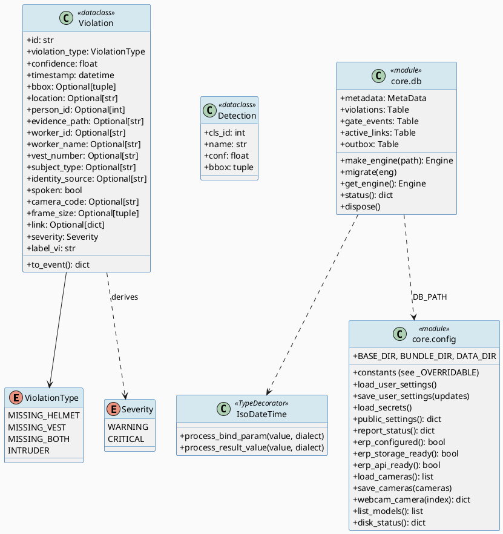
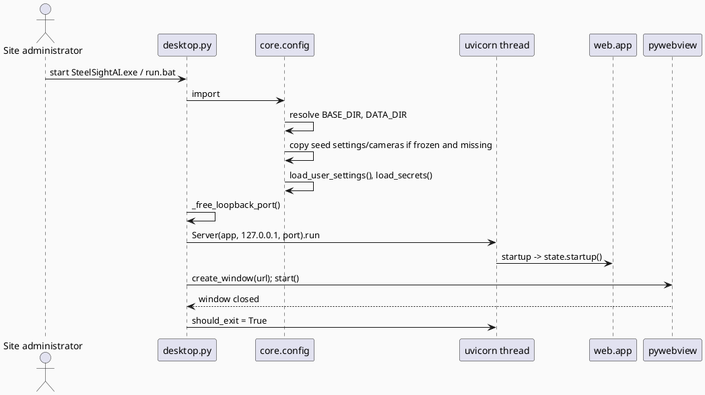
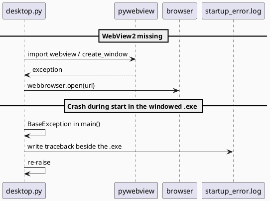
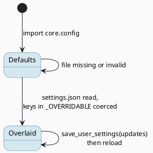

# ENGINEERING DOCUMENTATION STANDARD (EDS) v2.0
# Quy chuẩn Tài liệu Kỹ thuật và Đặc tả Hiện thực hóa

| Field | Value |
|-------|-------|
| **Document ID** | `STEELSIGHT-DET-DPL-IMP-001` |
| **Version** | `1.1` |
| **Date** | `2026-11-09` |
| **Status** | `Draft` |
| **Document Owner** | `Nguyen Vu An` |
| **Author** | `Claude Code (Opus 5.5) — reverse-engineered from the code (baseline 57283ce plus package refactor)` |
| **Reviewed by** | `[ ] Pending — Tech Lead` |
| **DPO Sign-off** | `[ ] Pending` |
| **Approved by** | `[ ] Pending — Principal Architect` |
| **Last Review** | `2026-11-09` |
| **Based on EDS** | `v2.0` |

---

## CHANGELOG

> **Policy 4.4 — Immutable History:** Không bao giờ xóa thông tin cũ. Mọi thay đổi phải ghi vào bảng này.

| Ngày | Người thực hiện | Nội dung thay đổi |
|------|-----------------|-------------------|
| 2026-11-09 | Claude Code (Opus 5.5) — documentation | Tạo tài liệu lần đầu, from the code as built after the package refactor |
| 2026-11-09 | Claude Code (Opus 5.5) — documentation | v1.1: rebuilt from the source code. Added class diagrams and missing diagrams, Gherkin scenarios, separate NFR tables, module-specific deployment, verification and error sections |

---

## MỤC LỤC

1. [Tổng quan Module](#1-tổng-quan-module)
2. [Ma trận Truy vết (Traceability Matrix)](#2-ma-trận-truy-vết-traceability-matrix)
3. [Architecture Decision Records (ADR)](#3-architecture-decision-records-adr) ⭐ *Mới*
4. [Non-Functional Requirements & SLA](#4-non-functional-requirements--sla) ⭐ *Mới*
5. [Static Modeling (Mô hình Tĩnh)](#5-static-modeling-mô-hình-tĩnh)
6. [Dynamic Modeling (Mô hình Động)](#6-dynamic-modeling-mô-hình-động)
7. [Domain Event Catalog](#7-domain-event-catalog) ⭐ *Mới*
8. [Interface Specification (Đặc tả Giao diện)](#8-interface-specification-đặc-tả-giao-diện)
9. [API Specification](#9-api-specification)
10. [Bảng mã lỗi (Error Codes)](#10-bảng-mã-lỗi-error-codes)
11. [Quy trình Triển khai (Step-by-Step)](#11-quy-trình-triển-khai-step-by-step)
12. [Rollback & Incident Runbook](#12-rollback--incident-runbook) ⭐ *Mới*
13. [Kịch bản Kiểm thử Chi tiết](#13-kịch-bản-kiểm-thử-chi-tiết)
14. [Phương pháp Xác minh](#14-phương-pháp-xác-minh)
15. [Mẫu thử thực tế (API Verification Samples)](#15-mẫu-thử-thực-tế-api-verification-samples)
16. [Bảng tổng hợp phân quyền (Authorization Matrix)](#16-bảng-tổng-hợp-phân-quyền-authorization-matrix)
17. [AI Prompt Constraints (CASE 2.0)](#17-ai-prompt-constraints-case-20) ⭐⭐ *CASE 2.0 Core*

> **Adaptations to this stack:** this is a Python desktop application, so §5.2 describes SQLite, files or in-memory data rather than Prisma, §8 uses Python signatures, and deployment is a site install. Everything here was written from the source code.

---

## 1. Tổng quan Module

> Holds settings, shared domain types and the local SQLite engine, and starts the application.

| Field | Value |
|-------|-------|
| **Module Name** | `DPL — Detection Platform` |
| **Bounded Context** | `Configuration, domain types, local database, entry points and packaging` |
| **Code** | `steelsight/core/*`, `run.py`, `desktop.py`, `scripts/build_engine.py`, `steelsight.spec`, `setup.*`, `build_exe.ps1` |
| **Tables** | `violations`, `gate_events`, `active_links`, `outbox` (schema owner, SQLite) |
| **Data Classification** | `Confidential` |
| **Compliance Scope** | Luật 91/2025/QH15 — settings and local files hold credentials; camera passwords are plain text (NFR-8) |
| **Upstream Dependencies** | Filesystem, `.env`, SQLite |
| **Downstream Consumers** | All modules |

---

## 2. Ma trận Truy vết (Traceability Matrix)

| Requirement ID | Loại (BR/ADR/US) | Mô tả yêu cầu | Thành phần Code | Compliance Target | ADR liên quan |
|---|---|---|---|---|---|
| BR-DPL-001 | Business Rule | Settings overlay defaults by key, converted to the default's type | `core/config.py` `_OVERRIDABLE` | — | — |
| BR-DPL-002 | Business Rule | ERP secrets come only from `.env` or environment variables | `core/config.py`; `web/routes/settings.py` | — | — |
| BR-DPL-003 | Business Rule | Local SQLite uses WAL and adds missing columns on start | `core/db.py` `migrate` | — | — |
| BR-DPL-004 | Business Rule | A frozen build stores writable data outside the install folder | `core/config.py` `DATA_DIR` | — | — |
| BR-DPL-005 | Business Rule | Runtime data is never committed to git | `.gitignore` `data/*` | — | — |
| NFR-4 | Requirement | One-script Windows install | `setup.bat`, `setup.ps1` | — | — |
| NFR-5 | Requirement | Run without Python (partial) | `steelsight.spec`, `desktop.py` | — | — |
| NFR-6 | Requirement | Keep data across reinstalls | `config.DATA_DIR` | — | — |
| NFR-9 | Requirement | Survive a crash | `core/db.py` WAL | — | — |
| ADR-101 | Decision | Group the Python code into packages by purpose and split the web layer into route files | see ADR | — | [ADR-101](../02_design/adr/ADR-101_packages-by-purpose-and-routed-web-layer.md) |
| ADR-102 | Decision | Ship detection as a Windows desktop app, not a Docker service | see ADR | — | [ADR-102](../02_design/adr/ADR-102_windows-desktop-app-instead-of-docker.md) |
| ADR-113 | Decision | Configuration is module constants overridden by settings.json and .env | see ADR | — | [ADR-113](../02_design/adr/ADR-113_module-config-with-json-overrides.md) |

---

## 3. Architecture Decision Records (ADR)

### ADR-101 — Group the Python code into packages by purpose and split the web layer into route files

| Field | Value |
|-------|-------|
| **Status** | `Accepted` |
| **Deciders** | `Nguyen Vu An — Developer; Claude Code (Opus 5.5) — AI pair programmer` |
| **Date** | `2026-11-09` |
| **Supersedes** | `—` |

> Full text: [ADR-101](../02_design/adr/ADR-101_packages-by-purpose-and-routed-web-layer.md). **Decision:** *We chose option B.* Packages are `core`, `vision`, `safety`, `people`, `gate`, `erp`, `records` and `web`; `engine.py` stays at the top because it joins them. `build_engine.py` moved to `scripts/`.

### ADR-102 — Ship detection as a Windows desktop app, not a Docker service

| Field | Value |
|-------|-------|
| **Status** | `Accepted` |
| **Deciders** | `Nguyen Vu An — Developer; Claude Code (Opus 5.5) — AI pair programmer` |
| **Date** | `2026-11-06` |
| **Supersedes** | `—` |

> Full text: [ADR-102](../02_design/adr/ADR-102_windows-desktop-app-instead-of-docker.md). **Decision:** *We chose option B.* `desktop.py` is the `.exe` entry point; `run.py` opens the dashboard in a browser for development.

### ADR-113 — Configuration is module constants overridden by settings.json and .env

| Field | Value |
|-------|-------|
| **Status** | `Accepted` |
| **Deciders** | `Nguyen Vu An — Developer; Claude Code (Opus 5.5) — AI pair programmer` |
| **Date** | `2026-11-09` |
| **Supersedes** | `—` |

> Full text: [ADR-113](../02_design/adr/ADR-113_module-config-with-json-overrides.md). **Decision:** *We chose option B.*

---

## 4. Non-Functional Requirements & SLA

> No SLA has been agreed for this module. "Target" values describe what the code does today, not a contractual commitment.

### 4.1. Performance & Availability

| Category | Requirement | Target SLA | Measurement Method | Compliance Basis |
|----------|-------------|------------|---------------------|------------------|
| Startup | Config and SQLite ready before the web app starts | At import of `core.config` / first `get_engine()` | Code review | NFR-1 |
| Availability | Missing or broken `settings.json` does not stop the app | Falls back to defaults (`load_user_settings` returns) | Code review | NFR-1 |
| Portability | Runs without an NVIDIA GPU | CPU or DirectML | Manual run | NFR-3 |

### 4.2. Data Integrity & Retention

| Category | Requirement | Target | Verification Method | Compliance Basis |
|----------|-------------|--------|---------------------|------------------|
| Durability | `settings.json` written atomically | temp file + `fsync` + `os.replace` | Code review of `save_user_settings` | NFR-9 |
| Durability | SQLite survives a process kill | `journal_mode=WAL`, `synchronous=NORMAL` | `PRAGMA journal_mode` | NFR-9 |
| Gap | `cameras.json` is **not** written atomically | `save_cameras` opens the real file for writing | Code review | L3 in Test-Spec |
| Persistence | Packaged data survives reinstall | `%PROGRAMDATA%\SteelSight` | Reinstall test | NFR-6 |

### 4.3. Security

| Category | Requirement | Target | Verification Method | Compliance Basis |
|----------|-------------|--------|---------------------|------------------|
| Secrets | ERP secrets only from environment or `.env` | Never in `settings.json` | `_SECRET_ENV`; not in `_OVERRIDABLE` | ADR-110 |
| Secrets at rest | Telegram token, SMTP and camera passwords | **Plain text today** in `settings.json` / `cameras.json` | Inspect the files | NFR-8 partial |
| API exposure | `public_settings()` returns only "is set" flags for secrets | No token or password | DPL-TC-003 | BR-DPL-002 |

### 4.4. Scalability & Capacity Planning

> One site machine and one `violations.db`. Rows grow with violations and gate events; violations older than `EVIDENCE_RETENTION_DAYS` are removed, while `gate_events` and done `outbox` rows are not. No capacity figures have been measured (NFR-13).

---

## 5. Static Modeling (Mô hình Tĩnh)

### 5.1. Class Diagram (PlantUML)



### 5.2. Data Structure

```sql
-- core/db.py, SQLite at DATA_DIR/violations.db. Timestamps are naive local ISO-8601 text (IsoDateTime).
CREATE TABLE violations (
  id VARCHAR(36) PRIMARY KEY, ts VARCHAR(40), type VARCHAR(32), severity VARCHAR(16), confidence FLOAT,
  location NVARCHAR(120), person_id INTEGER, evidence_path NVARCHAR(500), worker_id VARCHAR(40),
  worker_name NVARCHAR(120), vest_number VARCHAR(10), subject_type VARCHAR(16),   -- worker|vest|intruder|unknown
  identity_source VARCHAR(16),                                                    -- face|vest|none
  camera_code VARCHAR(100));
CREATE TABLE gate_events (
  event_id VARCHAR(36) PRIMARY KEY, ts VARCHAR(40), direction VARCHAR(8),         -- in|out
  user_id INTEGER, employee_code NVARCHAR(80), vest_code NVARCHAR(40), camera NVARCHAR(120),
  face_score FLOAT, snapshot_path NVARCHAR(500), note NVARCHAR(200));
CREATE TABLE active_links (
  vest_code NVARCHAR(40) PRIMARY KEY, user_id INTEGER NOT NULL UNIQUE, employee_code NVARCHAR(80),
  link_id INTEGER, link_event_id VARCHAR(36), linked_at VARCHAR(40));
CREATE TABLE outbox (
  seq INTEGER PRIMARY KEY AUTOINCREMENT, event_id VARCHAR(36) NOT NULL UNIQUE, lane VARCHAR(16) NOT NULL,  -- db|api
  kind VARCHAR(32) NOT NULL, payload TEXT NOT NULL, created_at VARCHAR(40) NOT NULL,
  status VARCHAR(12) NOT NULL,                                                    -- pending|done|failed
  attempts INTEGER NOT NULL, next_try FLOAT NOT NULL, last_error NVARCHAR(1000), done_at VARCHAR(40));
-- Indexes: ts, worker_id, vest_number (violations); ts, user_id (gate_events); lane, status (outbox).
```

```jsonc
// DATA_DIR/cameras.json: one object per camera
{ "name": "Cổng chính", "id": "CAM-1", "source": "rtsp://... or webcam index",
  "role": "gate",                        // gate | zone (absent means zone)
  "code": "CAM-GATE",                    // ERP camera.camera_code
  "gate_line": { "a": [0.5, 0.0], "b": [0.5, 1.0], "inside": [0.8, 0.5] } }  // fractions of the frame
```

**Files under `DATA_DIR`:** `settings.json`, `cameras.json`, `violations.db`, `users.db`, `evidence/`, `attendance/`, `reports/`, `tts_cache/`, `backups/`. **Read order for secrets:** `BASE_DIR/.env`, then `DATA_DIR/.env` (later wins), and a real environment variable beats both.

---

## 6. Dynamic Modeling (Mô hình Động)

### 6.1. Sequence Diagram — Happy Path (PlantUML)



### 6.2. Sequence Diagram — Error Path (PlantUML)



### 6.3. State Machine



> **⚠️ Invariant bất biến:**
> - `core.config` never writes ERP secrets to `settings.json`.
> - `MODEL_PATH` is always re-resolved after settings load, so a path from another machine cannot stick.
> - The app never creates or alters ERP tables; `migrate` touches local SQLite only, and only adds missing columns.

---

## 7. Domain Event Catalog

### 7.1. Events Published (Phát ra)

*This module publishes no events.*

### 7.2. Events Consumed (Tiêu thụ)

*This module consumes no events.*

### 7.3. Payload Schema

*No payloads: this module publishes no events.*

---

## 8. Interface Specification (Đặc tả Giao diện)

### 8.1. Service Interface

```python
# steelsight/core/config.py  @version 1.0: read values as config.X at the point of use
def load_user_settings() -> None: ...        # silently keeps defaults if the file is missing or invalid
def save_user_settings(updates: dict) -> None: ...  # merges, atomic write, reloads
def load_secrets() -> None: ...              # environment beats .env
def public_settings() -> dict: ...           # never returns tokens or passwords
def erp_configured() -> bool: ...            # ERP_SYNC_ENABLED and ERP_DB_URL
def erp_storage_ready() -> bool: ...
def erp_api_ready() -> bool: ...
def load_cameras() -> list: ...              # [webcam_camera()] when missing, empty or invalid
def save_cameras(cameras: list) -> None: ...
def list_models() -> list[dict]: ...         # {name, path}, newest first, models/ then project root
def disk_status() -> dict: ...               # {free_gb, total_gb, low, min_free_gb}

# steelsight/core/db.py  @version 1.0
def make_engine(path: str) -> Engine: ...    # WAL pragmas, then migrate()
def migrate(eng: Engine) -> None: ...        # create_all plus ALTER TABLE ADD for missing columns
def get_engine() -> Engine: ...              # one process-wide engine, created under a lock
def status() -> dict: ...
def dispose() -> None: ...
```
### 8.2. Repository Interface

Not applicable: `core.db` exposes SQLAlchemy `Table` objects used directly by `Storage`, `LinkBook` and `Outbox`.


---

## 9. API Specification

### 9.1. Endpoints Table

*This module has no HTTP endpoints of its own. See `STEELSIGHT-DET-WEB-IMP-001` §9.*

### 9.2. Request / Response Schemas

*Not applicable.*

---

## 10. Bảng mã lỗi (Error Codes)

*No coded errors. Bad settings keep the default value; a failed `settings.json` write removes the temp file and keeps the old file; `migrate` prints each column it adds.*

---

## 11. Quy trình Triển khai (Step-by-Step)

### 11.1. Prerequisites

- [ ] Related ADRs reviewed (§3)
- [ ] DPO sign-off if personal data handling changes
- [ ] `.venv` created by `setup.bat`

### 11.2. Pre-Migration Checklist

- [ ] Back up `data/` before upgrading (`violations.db`, `users.db`, `settings.json`, `cameras.json`)
- [ ] Local SQLite changes go through `core/db.py` `migrate`; ERP schema changes belong to the ERP's Flyway migrations

### 11.3. Implementation Steps

#### Chặng 1 — First install

```powershell
setup.bat                                    # Python 3.10, .venv, PyTorch, requirements, TensorRT engine if CUDA, shortcut
```

#### Chặng 2 — Add ERP secrets

```powershell
# Create .env beside the app or in DATA_DIR. Never commit it.
# STEELSIGHT_DB_URL, SUPABASE_URL, SUPABASE_SERVICE_KEY, STEELSIGHT_ERP_URL, STEELSIGHT_DETECTION_API_KEY
```

#### Chặng 3 — Verification

```powershell
.venv\Scripts\python.exe -m pytest -q tests     # expected: all passed
.venv\Scripts\python.exe -c "from steelsight.core import config; print(config.BASE_DIR, config.DATA_DIR)"
```

> ⚠️ `core/config.py` computes `BASE_DIR` from its depth in the tree. Moving the file means updating that line in the same change.

### 11.4. Deployment Checklist

- [ ] `pytest -q tests` passes
- [ ] The module's checks in §14 give the expected output

---

## 12. Rollback & Incident Runbook

### 12.1. Điều kiện kích hoạt Rollback

| Điều kiện | Ngưỡng | Người quyết định |
|-----------|--------|------------------|
| App does not start after upgrade (`startup_error.log`) | Any | Site administrator |
| Data appears in the wrong folder | Any | Developer |

### 12.2. Rollback Procedure

```powershell
git checkout <previous-commit>   # restore the code; data/ is not tracked
run.bat
```

### 12.3. Notification Protocol

| Thời điểm | Người nhận | Kênh | Template |
|---|---|---|---|
| When found | Developer | Direct message | Module, symptom, time |
| If personal data is exposed | DPO (no named DPO yet) | Email | Luật 91/2025/QH15 incident duties |

### 12.4. Post-Incident Review (PIR)

Timeline, root cause, impact, remediation and prevention, within 48 hours.

---

## 13. Kịch bản Kiểm thử Chi tiết

Test data classification: `SYNTHETIC`. Full specification: `04_testing/STEELSIGHT-DET-DPL-TDD-001_Test-Spec.md`.

### 13.1. Unit Tests

#### TC-UNIT-001 — Settings overlay

```gherkin
Feature: Settings overlay defaults
  Background:
    Given test data classification: SYNTHETIC
    And a temporary settings.json

  Scenario: A known key is converted to the default's type
    Given "detect_imgsz" is the string "416" in settings.json
    When load_user_settings runs
    Then config.DETECT_IMGSZ is the integer 416

  Scenario: An unknown key is ignored
    Given "bad_key" is present in settings.json
    When load_user_settings runs
    Then no attribute is created from it and no error is raised
```

**Hàm được test:** `config.load_user_settings()` · **Invariant:** only `_OVERRIDABLE` keys change config.

### 13.2. Integration Tests

#### TC-INT-001 — Old database file is upgraded

```gherkin
  Scenario: A missing column is added
    Given test data classification: SYNTHETIC
    And a SQLite file whose violations table has no camera_code column
    When make_engine opens it
    Then violations has a camera_code column and existing rows are kept
```

**External dependencies:** none · **Mock strategy:** temp files and the `engine` fixture.

### 13.3. E2E / Security Tests

#### TC-SEC-001 — Secrets stay out of the API

```gherkin
  Scenario: public_settings hides secrets
    Given test data classification: SYNTHETIC
    And TELEGRAM_BOT_TOKEN and SMTP_PASSWORD are set
    When public_settings is called
    Then the result has telegram_token_set and smtp_password_set as true
    And no value in the result equals the token or the password
```

### 13.4. Case Summary

| TC ID | Test | Description | Severity | Status |
|---|---|---|---|---|
| DPL-TC-001 | A settings key overrides its default with the default's type | *(new)* | HIGH | 🔴 |
| DPL-TC-002 | An unknown settings key is ignored | *(new)* | MEDIUM | 🔴 |
| DPL-TC-003 | `public_settings()` never contains ERP secrets, SMTP password or Telegram token | *(new)* | CRITICAL | 🔴 |
| DPL-TC-004 | `migrate` adds a missing column to an old database file | *(new)* | HIGH | 🔴 |
| DPL-TC-005 | `BASE_DIR` resolves to the project root after the package move | *(new)* | HIGH | 🔴 |
| DPL-TC-006 | `cameras.json` survives a crash during save (currently not atomic) | *(new)* | MEDIUM | 🔴 |

---

## 14. Phương pháp Xác minh

### 14.1. Database Inspection

```sql
PRAGMA journal_mode;                      -- expected: wal
SELECT name FROM pragma_table_info('violations');
SELECT status, count(*) FROM outbox GROUP BY status;
```

### 14.2. Log / Audit Verification

```powershell
# Column additions are printed at startup
.venv\Scripts\python.exe run.py | findstr "[DB]"
# Secrets must not be in the settings file
findstr /i "STEELSIGHT_DB_URL SUPABASE_SERVICE_KEY" data\settings.json    # Expected: no output
```

### 14.3. Tool-based Verification

```powershell
.venv\Scripts\python.exe -m pytest -q tests
git check-ignore data/cameras.json data/violations.db                     # Expected: both listed
```

---

## 15. Mẫu thử thực tế (API Verification Samples)

> Since ADR-115 every local request needs the launch cookie. Take the `steelsight_launch` value from the running window (browser DevTools → Application → Cookies) and add `-H "Cookie: steelsight_launch=<value>"` to the `curl` commands below.

### 15.1. Happy Path

```bash
curl -s http://127.0.0.1:8765/api/state | python -c "import json,sys; s=json.load(sys.stdin)['settings']; print('telegram_token_set' in s, 'telegram_bot_token' in s)"
# Expected: True False
```

### 15.2. Error Paths

*This module has no HTTP errors of its own. A broken `settings.json` is ignored at start, so the app runs on defaults.*

---

## 16. Bảng tổng hợp phân quyền (Authorization Matrix)

| Item | Who can change it | How |
|------|-------------------|-----|
| `settings.json` allowed keys | Anyone reaching the dashboard (demo, ADR-114) | `POST /api/settings` |
| Other `settings.json` keys | Whoever can edit the file | Text editor |
| ERP secrets | Whoever can edit `.env` or environment variables | Not reachable through the API |

---

## 17. AI Prompt Constraints (CASE 2.0)

### 17.1 Constraint Summary Table

| # | Constraint | Source (ADR/BR) | Last Verified |
|---|---|---|---|
| C1 | `Read `config.X` at use; do NOT copy it into a module constant` | `ADR-113` | `2026-11-09` |
| C2 | `ERP secrets come only from `.env` or environment variables` | `BR-DPL-002` | `2026-11-09` |
| C3 | `Local schema changes go through `core/db.py` and `migrate`; never alter ERP tables` | `ADR-110` | `2026-11-09` |
| C4 | `Writable data goes under `config.DATA_DIR`; never commit it` | `BR-DPL-005` | `2026-11-09` |
| C5 | `New modules go in the owning package; do NOT add to the top of `steelsight/`` | `ADR-101` | `2026-11-09` |

### 17.2 Constraint Injection Block (Copy-Paste vào AI Prompt)

```
[CONSTRAINT BLOCK — Module: Detection Platform]
Theo TDS STEELSIGHT-DET-DPL-IMP-001 và các ADR liên quan:

1. Read `config.X` at use; do NOT copy it into a module constant
2. ERP secrets come only from `.env` or environment variables
3. Local schema changes go through `core/db.py` and `migrate`; never alter ERP tables
4. Writable data goes under `config.DATA_DIR`; never commit it
5. New modules go in the owning package; do NOT add to the top of `steelsight/`

[CONTEXT BLOCK]
- Bounded Context: Configuration, domain types, local database, entry points and packaging
- Data Classification: Confidential
- Existing interfaces: §8
- Auth matrix: §16

[TASK BLOCK]
Implement {feature/method} thỏa mãn constraints trên.
Output phải tuân thủ §8 Interface Specification.
Tests phải cover §13 Test Scenarios.
```

### 17.3 Constraint Quality Checklist

- [x] Mỗi constraint traceable về ADR hoặc BR cụ thể
- [x] Không có constraint generic
- [x] Mỗi constraint có `Last Verified` date ≤ 2 sprints
- [x] Constraint block có ≥ 3 constraints cụ thể
- [x] Constraint block reference §8 Interface
- [x] Constraint block reference §16 Auth Matrix

### 17.4 Anti-Pattern Detection

| AP-ID | Anti-Pattern | Dấu hiệu | Hành động |
|-------|-------------|-----------|----------|
| AP-AI-001 | Unconstrained Gen | Code không match bất kỳ constraint nào | Reject — inject lại constraints |
| AP-AI-003 | Implicit Decision | Code assume architecture không có trong §3 ADR | Reject — viết ADR trước |
| AP-AI-005 | Hallucinated Contract | Code import service/type không có trong §8 | Reject — verify contract existence |

---

## PHỤ LỤC

### A. Glossary (Thuật ngữ)

| Thuật ngữ | Định nghĩa |
|-----------|------------|
| `_OVERRIDABLE` | Map from `settings.json` keys to `core.config` constants |
| WAL | SQLite write-ahead log |
| Frozen build | The PyInstaller `.exe`, where `sys.frozen` is true |
| PII | Personally Identifiable Information |
| DPO | Data Protection Officer |
| Red Gate | Check that tests fail against a stub before implementation |

### B. Tài liệu tham chiếu

| Document | Path |
|----------|------|
| Module map | `02_design/DETECTION-MODULE-MAP.md` |
| Source | `steelsight/core/*`, `run.py`, `desktop.py`, `scripts/build_engine.py`, `steelsight.spec`, `setup.*`, `build_exe.ps1` |
| Requirements | `docs/REQUIREMENTS_SPECIFICATION.md` |

---

*EDS v2.1 — Tích hợp CASE 2.0 AI Prompt Constraints (§17).*
