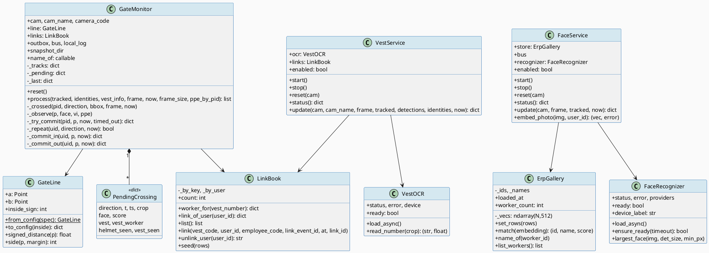
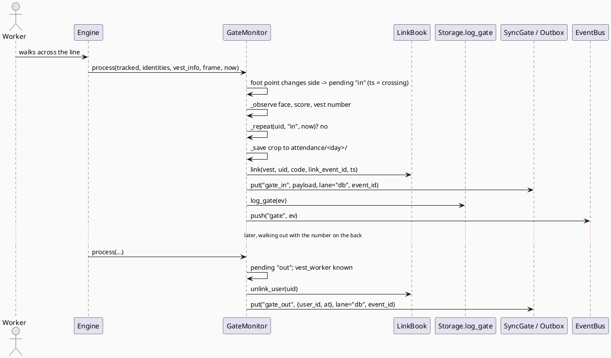
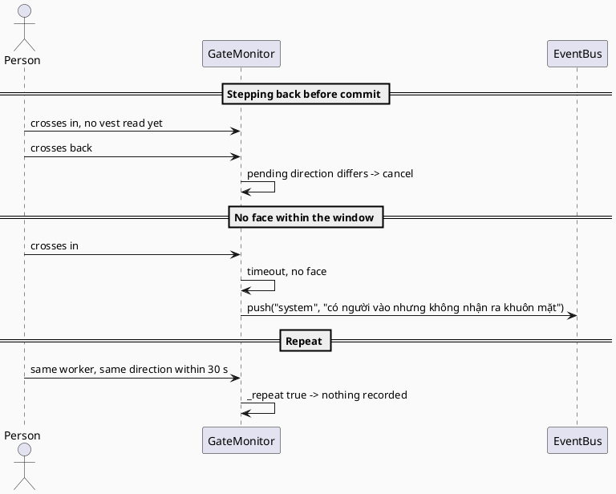
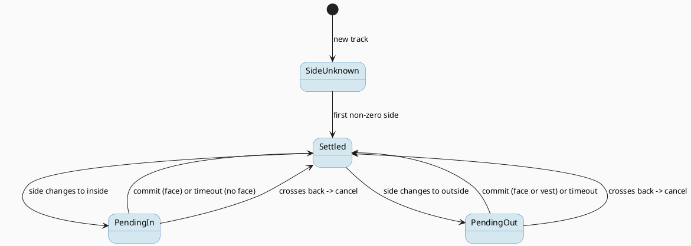
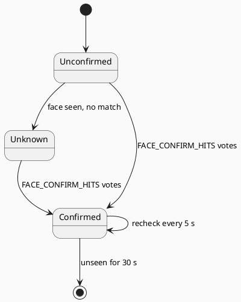

# ENGINEERING DOCUMENTATION STANDARD (EDS) v2.0
# Quy chuẩn Tài liệu Kỹ thuật và Đặc tả Hiện thực hóa

| Field | Value |
|-------|-------|
| **Document ID** | `STEELSIGHT-DET-IDG-IMP-001` |
| **Version** | `1.1` |
| **Date** | `2026-11-09` |
| **Status** | `Draft` |
| **Document Owner** | `Nguyen Vu An` |
| **Author** | `Claude Code (Opus 5.5) — reverse-engineered from the code (baseline 57283ce plus package refactor)` |
| **Reviewed by** | `[ ] Pending — Tech Lead` |
| **DPO Sign-off** | `[ ] Pending` *(**required**: biometric data)* |
| **Approved by** | `[ ] Pending — Principal Architect` |
| **Last Review** | `2026-11-17` |
| **Based on EDS** | `v2.0` |

---

## CHANGELOG

> **Policy 4.4 — Immutable History:** Không bao giờ xóa thông tin cũ. Mọi thay đổi phải ghi vào bảng này.

| Ngày | Người thực hiện | Nội dung thay đổi |
|------|-----------------|-------------------|
| 2026-11-09 | Claude Code (Opus 5.5) — documentation | Tạo tài liệu lần đầu, from the code as built after the package refactor |
| 2026-11-09 | Claude Code (Opus 5.5) — documentation | v1.1: rebuilt from the source code. Added class diagrams and missing diagrams, Gherkin scenarios, separate NFR tables, module-specific deployment, verification and error sections |
| 2026-11-17 | Claude Code (Opus 5.5) — documentation | Face matching at any angle with straight-on misses only toward Unknown (ADR-116), several photos per worker, offline gallery copy (ADR-117), vest OCR crop and reading rules (ADR-118), manual vest correction (ADR-120), scanner re-scan window in seconds, gate screen vest column, face and OCR diagnostics. `FaceService.update` now also returns `debug` and `face_bbox_full`; `VestService.update` returns `ocr_debug` |
| 2026-11-17 | Claude Code (Opus 5.5) — documentation | Vest numbers from ArUco markers by default (ADR-122, `steelsight/people/marker.py`, `VEST_ID_METHOD`), OCR confirmation changed to 3 reads in a row at 0.90 (BR-IDG-016), unknown vest in a manual correction linked locally and cleared in the ERP (BR-IDG-013) |

---

## MỤC LỤC

1. [Tổng quan Module](#1-tổng-quan-module)
2. [Ma trận Truy vết (Traceability Matrix)](#2-ma-trận-truy-vết-traceability-matrix)
3. [Architecture Decision Records (ADR)](#3-architecture-decision-records-adr) ⭐ *Mới*
4. [Non-Functional Requirements & SLA](#4-non-functional-requirements--sla) ⭐ *Mới*
5. [Static Modeling (Mô hình Tĩnh)](#5-static-modeling-mô-hình-tĩnh)
6. [Dynamic Modeling (Mô hình Động)](#6-dynamic-modeling-mô-hình-động)
7. [Domain Event Catalog](#7-domain-event-catalog) ⭐ *Mới*
8. [Interface Specification (Đặc tả Giao diện)](#8-interface-specification-đặc-tả-giao-diện)
9. [API Specification](#9-api-specification)
10. [Bảng mã lỗi (Error Codes)](#10-bảng-mã-lỗi-error-codes)
11. [Quy trình Triển khai (Step-by-Step)](#11-quy-trình-triển-khai-step-by-step)
12. [Rollback & Incident Runbook](#12-rollback--incident-runbook) ⭐ *Mới*
13. [Kịch bản Kiểm thử Chi tiết](#13-kịch-bản-kiểm-thử-chi-tiết)
14. [Phương pháp Xác minh](#14-phương-pháp-xác-minh)
15. [Mẫu thử thực tế (API Verification Samples)](#15-mẫu-thử-thực-tế-api-verification-samples)
16. [Bảng tổng hợp phân quyền (Authorization Matrix)](#16-bảng-tổng-hợp-phân-quyền-authorization-matrix)
17. [AI Prompt Constraints (CASE 2.0)](#17-ai-prompt-constraints-case-20) ⭐⭐ *CASE 2.0 Core*

> **Adaptations to this stack:** this is a Python desktop application, so §5.2 describes SQLite, files or in-memory data rather than Prisma, §8 uses Python signatures, and deployment is a site install. Everything here was written from the source code.

---

## 1. Tổng quan Module

> Recognises workers at the gate, reads vest numbers and turns line crossings into check-ins and check-outs.

| Field | Value |
|-------|-------|
| **Module Name** | `IDG — Identity & Gate` |
| **Bounded Context** | `Face recognition, vest numbers, vest links and gate check-in/out` |
| **Code** | `steelsight/people/*`, `steelsight/gate/*` |
| **Tables** | `active_links`, `gate_events` (written here, defined in DPL) |
| **Data Classification** | `Sensitive-PII` |
| **Compliance Scope** | Luật 91/2025/QH15, NĐ 356/2025 — face vectors are biometric data; DPO review required |
| **Upstream Dependencies** | VIS, InsightFace, EasyOCR, OpenCV ArUco, SYN (gallery and links) |
| **Downstream Consumers** | SAF, SYN, WEB |

---

## 2. Ma trận Truy vết (Traceability Matrix)

| Requirement ID | Loại (BR/ADR/US) | Mô tả yêu cầu | Thành phần Code | Compliance Target | ADR liên quan |
|---|---|---|---|---|---|
| BR-IDG-001 | Business Rule | Two matching votes confirm a face or a vest number | `people/faceid.py`, `people/vest.py` | — | — |
| BR-IDG-002 | Business Rule | Only a side change of the foot point is a crossing | `gate/monitor.py` | — | — |
| BR-IDG-003 | Business Rule | Check-in needs a recognised face | `GateMonitor._try_commit` | — | — |
| BR-IDG-004 | Business Rule | Check-out accepts a face or the linked vest worker | `GateMonitor._try_commit` | — | — |
| BR-IDG-005 | Business Rule | Crossing back before commit cancels; the same direction within 30 s is ignored | `GateMonitor._crossed`, `_repeat` | — | — |
| BR-IDG-006 | Business Rule | One vest per worker and one worker per vest at a time | `LinkBook.link` | — | — |
| BR-IDG-007 | Business Rule | Face recognition runs only on gate cameras | `engine.py` | — | — |
| BR-IDG-008 | Business Rule | Every crossing is recorded; missing PPE only adds a note | `GateMonitor._commit_in` | — | — |
| FR-5.3 | Requirement | Recognise without slowing detection | `FaceService` | — | — |
| FR-5.4 | Requirement | Faces only at the gate | `Engine` | — | — |
| FR-5.6 | Requirement | Link vest on entry | `GateMonitor._commit_in` | — | — |
| FR-5.7 | Requirement | Unlink on exit | `GateMonitor._commit_out` | — | — |
| FR-6.1 | Requirement | Entering versus leaving | `GateLine`, `GateMonitor` | — | — |
| FR-6.5 | Requirement | Ignore repeats | `GateMonitor._repeat` | — | — |
| FR-6.7 | Requirement | Note PPE on arrival | `GateMonitor._commit_in` | — | — |
| ADR-104 | Decision | Face and OCR models run off the detection loop | see ADR | — | [ADR-104](../02_design/adr/ADR-104_identity-models-off-the-detection-loop.md) |
| ADR-105 | Decision | A virtual line decides entering from leaving | see ADR | — | [ADR-105](../02_design/adr/ADR-105_virtual-gate-line-decides-entry-and-exit.md) |
| ADR-106 | Decision | Identify by face at the gate and by vest number in the zones | see ADR | — | [ADR-106](../02_design/adr/ADR-106_face-at-gate-vest-number-in-zones.md) |
| ADR-111 | Decision | Detection records every crossing; the ERP judges attendance | see ADR | — | [ADR-111](../02_design/adr/ADR-111_detection-records-erp-judges-attendance.md) |
| BR-IDG-009 | Business Rule | Every face is matched; only straight-on misses count toward Unknown | `FaceService._worker`, `estimate_yaw` | — | ADR-116 |
| BR-IDG-010 | Business Rule | Best match over all of a worker's angles | `ErpGallery.match` | — | ADR-116 |
| BR-IDG-011 | Business Rule | No-vest OCR crop, OSD band, zero-only reads ignored | `torso_crop`, `VestOCR.read_detail` | — | ADR-118 |
| BR-IDG-012 | Business Rule | Scanner re-scan window of 15 s | `ScannerMonitor.direction_for` | — | — |
| BR-IDG-013 | Business Rule | Manual vest correction while on site | `AppState.fix_vest`, `LinkBook.link` | — | ADR-120 |
| BR-IDG-014 | Business Rule | Gate screen shows the vest linked at check-in | `GateBoard`, `gate.html` | — | — |
| BR-IDG-015 | Business Rule | Vest number from an ArUco marker ID (1–99) in the person box | `MarkerReader.read_detail`, `marker_crop` | — | ADR-122 |
| BR-IDG-016 | Business Rule | Identical reads in a row confirm the number | `VestService._worker` | — | ADR-122, ADR-118 |
| ADR-116 | Decision | Every face is matched at any angle | see ADR | — | [ADR-116](../02_design/adr/ADR-116_match-faces-at-any-angle.md) |
| ADR-117 | Decision | Offline copy of the face gallery | see ADR | — | [ADR-117](../02_design/adr/ADR-117_offline-face-gallery-cache.md) |
| ADR-118 | Decision | Vest OCR crop and reading rules | see ADR | — | [ADR-118](../02_design/adr/ADR-118_vest-ocr-crop-and-reading-rules.md) |
| ADR-120 | Decision | Manual vest number correction | see ADR | — | [ADR-120](../02_design/adr/ADR-120_manual-vest-number-correction.md) |
| ADR-122 | Decision | Vest numbers from ArUco markers | see ADR | — | [ADR-122](../02_design/adr/ADR-122_vest-number-from-aruco-markers.md) |

---

## 3. Architecture Decision Records (ADR)

### ADR-104 — Face and OCR models run off the detection loop

| Field | Value |
|-------|-------|
| **Status** | `Accepted` |
| **Deciders** | `Nguyen Vu An — Developer; Claude Code (Opus 5.5) — AI pair programmer` |
| **Date** | `2026-11-09` |
| **Supersedes** | `—` |

> Full text: [ADR-104](../02_design/adr/ADR-104_identity-models-off-the-detection-loop.md). **Decision:** *We chose option B.* Face queue size 16; OCR queue size 8. A full queue skips the crop for that frame. Two matching votes confirm an identity.

### ADR-105 — A virtual line decides entering from leaving

| Field | Value |
|-------|-------|
| **Status** | `Accepted` |
| **Deciders** | `Nguyen Vu An — Developer; Claude Code (Opus 5.5) — AI pair programmer` |
| **Date** | `2026-11-06` |
| **Supersedes** | `—` |

> Full text: [ADR-105](../02_design/adr/ADR-105_virtual-gate-line-decides-entry-and-exit.md). **Decision:** *We chose option C.* Entering needs a face. Leaving needs a face or the linked vest number, because leavers usually show their back. There is no default line: a gate camera without one records nothing and shows a warning.

### ADR-106 — Identify by face at the gate and by vest number in the zones

| Field | Value |
|-------|-------|
| **Status** | `Accepted` |
| **Deciders** | `Nguyen Vu An — Developer; Claude Code (Opus 5.5) — AI pair programmer` |
| **Date** | `2026-11-06` |
| **Supersedes** | `—` |

> Full text: [ADR-106](../02_design/adr/ADR-106_face-at-gate-vest-number-in-zones.md). **Decision:** *We chose option B.* Only cameras with a `GateMonitor` run face recognition. `LinkBook` holds active links locally, one vest per worker and one worker per vest.

### ADR-111 — Detection records every crossing; the ERP judges attendance

| Field | Value |
|-------|-------|
| **Status** | `Accepted` |
| **Deciders** | `Nguyen Vu An — Developer; Claude Code (Opus 5.5) — AI pair programmer` |
| **Date** | `2026-11-09` |
| **Supersedes** | `—` |

> Full text: [ADR-111](../02_design/adr/ADR-111_detection-records-erp-judges-attendance.md). **Decision:** *We chose option B.* In the ERP, a recorded visit under `MINIMUM_VISIT_MINUTES` (default 10) does not count as attending a shift, and a face visit that is auto-closed with no vest link shows as *needs review*. Hours are unchanged.

---

## 4. Non-Functional Requirements & SLA

> No SLA has been agreed for this module. "Target" values describe what the code does today, not a contractual commitment.

### 4.1. Performance & Availability

| Category | Requirement | Target SLA | Measurement Method | Compliance Basis |
|----------|-------------|------------|---------------------|------------------|
| Non-blocking | Face and OCR queue only | Queues of 16 and 8; one pending job per track | Code review | NFR-2, ADR-104 |
| Identify window | Time allowed after a crossing | `GATE_IDENTIFY_SECONDS` = 8; PPE wait 5 s when on (the larger applies) | `tests/test_gate.py` | FR-6.1 |
| Recheck | Face every 1 s, 5 s once confirmed; OCR every 0.6 s, 2.4 s once confirmed | Config | Code review | — |
| Fallback | Models missing or failing | Status `error`; detection continues | `FaceRecognizer._load`, `VestOCR._load` | NFR-1 |

### 4.2. Data Integrity & Retention

| Category | Requirement | Target | Verification Method | Compliance Basis |
|----------|-------------|--------|---------------------|------------------|
| Correctness | Recognition alone records nothing | 0 events without a crossing | IDG-TC-013 (new) | ADR-105 |
| Crossing time | Check-in time is the crossing, not the commit | `pending["ts"]` | IDG-TC-011 | ADR-105 |
| Uniqueness | One vest per worker, one worker per vest | Enforced in `LinkBook.link` and `active_links` unique columns | IDG-TC-009 | BR-IDG-006 |
| Gallery | Atomic swap | Arrays assigned in one step | Code review | ADR-104 |
| Retention gap | Gate snapshots are **not** purged | `Maintenance` only deletes `evidence/` | Code review | Luật 91/2025/QH15, L5 |

### 4.3. Security

| Category | Requirement | Target | Verification Method | Compliance Basis |
|----------|-------------|--------|---------------------|------------------|
| Biometric minimisation | Faces only on gate cameras | `face.update` only with a gate | IDG / VIS-TC-001 | ADR-106 |
| Vectors | Stored in the ERP; held in memory here | Not in local SQLite | `ErpGallery` | Luật 91/2025/QH15 |
| Enrolment safety | A face matching another worker is refused | `embed_photo` | IDG-TC-015 (new) | FR-5.2 |

### 4.4. Scalability & Capacity Planning

> Matching is one matrix product over all enrolled workers. Worker count has not been load-tested. Face and OCR share the GPU with YOLO when CUDA is available.

---

## 5. Static Modeling (Mô hình Tĩnh)

### 5.1. Class Diagram (PlantUML)



### 5.2. Data Structure

`gate_events` and `active_links` are defined in `STEELSIGHT-DET-DPL-IMP-001` §5.2.

```python
# FaceService.update(...)   -> {track_id: {"worker_id", "name", "score", "unknown", "face_bbox", "debug"}}
#                              (engine adds "face_bbox_full", full-resolution, for the vest OCR crop)
# VestService.update(...)   -> {track_id: {"vest_number", "vest_conf", "ocr_debug", "has_vest_box", "ocr_pending",
#                                          "worker_id", "name", "link"}}   # worker and link come from LinkBook
# LinkBook public row        -> {"worker_id", "user_id", "name", "vest_code", "link_id", "link_event_id", "linked_at"}
# Gate commit event          -> {"event_id", "direction", "user_id", "employee_code", "vest_code", "camera",
#                                "face_score", "ts", "snapshot_path", "note"}  (+ "helmet", "vest" on entry)
```

**Files:** `attendance/<YYYY-MM-DD>/{in,out}_<user>_<HHMMSS_mmm>.jpg`.

| Step | Rule |
|------|------|
| Foot point | `((x1+x2)/2/width, y2/height)` |
| Side | `+1` / `-1` by signed distance; `0` inside `GATE_LINE_MARGIN` |
| Line extent | A and B set an infinite line, not a segment |
| Commit in | Needs a face. Commits at once with a vest (and PPE if required), otherwise on timeout |
| Commit out | Face or vest-link worker; commits as soon as one is known |
| Vest key | `vest_key`: digits only, no leading zeros |

---

## 6. Dynamic Modeling (Mô hình Động)

### 6.1. Sequence Diagram — Happy Path (PlantUML)



### 6.2. Sequence Diagram — Error Path (PlantUML)



### 6.3. State Machine





> **⚠️ Invariant bất biến:**
> - A track's first non-zero side is only remembered; it is never a crossing.
> - Entering without a readable vest removes any older link for that worker.
> - Only the gate links or unlinks a vest. `VestService` only reads and looks up.
> - Waiting for PPE never moves the check-in time and never prevents the check-in.

---

## 7. Domain Event Catalog

### 7.1. Events Published (Phát ra)

| Event Name | Trigger | Publisher | Subscriber(s) | Payload Schema | Async? |
|---|---|---|---|---|---|
| `gate` | A committed crossing | `GateMonitor` | Dashboard | `event_id, direction, user_id, employee_code, vest_code, camera, face_score, ts, time, snapshot_path, note` | Polled |
| `gate_in` / `gate_out` | A committed crossing | `GateMonitor` | `ErpSync` | Outbox payload | Yes |

### 7.2. Events Consumed (Tiêu thụ)

| Event Name | Source | Handler | Action thực hiện |
|---|---|---|---|
| Gallery rows | SYN | `ErpGallery.set_rows` | Replaces the face gallery |
| Active links | SYN | `LinkBook.seed` | Replaces local links when the lane is empty |

### 7.3. Payload Schema

```python
# Outbox gate_in (event_id = check_in.event_id)
{"user_id": int, "at": iso_with_zone, "vest_code": str or None, "link_event_id": uuid or None,
 "camera_code": str, "face_similarity": float,   # 0..100
 "local_snapshot": path or None, "snapshot_path": "check-ins/<day>/<event>.jpg" or None, "note": str or None}

# Outbox gate_out
{"user_id": int, "at": iso_with_zone}
```

---

## 8. Interface Specification (Đặc tả Giao diện)

### 8.1. Service Interface

```python
# steelsight/gate/monitor.py  @version 1.0
class GateLine:
    def __init__(self, a, b, inside): ...           # ValueError if a == b or inside lies on the line
    @classmethod
    def from_config(cls, spec) -> "GateLine | None": ...  # None if missing or invalid
    def signed_distance(self, p) -> float: ...
    def side(self, p, margin: float) -> int: ...    # +1, -1, or 0 in the dead band

def foot_point(bbox, width: int, height: int) -> tuple[float, float]: ...

class GateMonitor:
    def __init__(self, cam_index, cam_name, camera_code, line, links, outbox=None, bus=None,
                 local_log=None, snapshot_dir=None): ...
    def process(self, tracked, identities, vest_info, frame, now,
                frame_size=None, ppe_by_pid=None) -> list[dict]: ...
    def reset(self) -> None: ...

# steelsight/people/identity.py
class ErpGallery:
    def set_rows(self, rows) -> None: ...           # [(user_id, employee_code, vector[512])]
    def match(self, embedding): ...                 # (worker_id, name, cosine) or None
class LinkBook:
    def worker_for(self, vest_number): ...
    def link_of_user(self, user_id: int): ...
    def link(self, vest_code, user_id, employee_code, link_event_id, at, link_id=None): ...
    def unlink_user(self, user_id: int): ...        # vest_code or None
    def seed(self, rows) -> None: ...               # replaces everything with the ERP's active links

# steelsight/people/faceid.py
class FaceService:
    def update(self, cam, frame, tracked, now) -> dict[int, dict]: ...
    def embed_photo(self, img, user_id=None): ...   # (vector, None) or (None, reason)
    def status(self) -> dict: ...
def attendance_url(path) -> str | None: ...         # None if outside ATTENDANCE_DIR

# steelsight/people/vest.py
class VestService:
    def update(self, cam, cam_name, frame, tracked, detections, identities, now) -> dict[int, dict]: ...
    def status(self) -> dict: ...
```

### 8.2. Repository Interface

Not applicable: this module has no repository layer. Local tables are SQLAlchemy `Table` objects in `core/db.py`.

---

## 9. API Specification

### 9.1. Endpoints Table

*This module has no HTTP endpoints of its own. See `STEELSIGHT-DET-WEB-IMP-001` §9.*

### 9.2. Request / Response Schemas

*Not applicable.*

---

## 10. Bảng mã lỗi (Error Codes)

| Code | Where | Message | Trigger Condition |
|------|-------|---------|-------------------|
| `IDG-001` | `GateLine` | `vạch cổng: 2 điểm trùng nhau` (ValueError) | A equals B |
| `IDG-002` | `GateLine` | `vạch cổng: điểm 'inside' nằm trên vạch` (ValueError) | Inside point is on the line |
| `IDG-003` | `GateMonitor` | `system`: `có người vào nhưng không nhận ra khuôn mặt` | Entry without a face in time |
| `IDG-004` | `GateMonitor` | `system`: `có người ra nhưng không nhận ra (mặt / số áo)` | Exit with no identity in time |
| `IDG-005` | `embed_photo` | `Ảnh rỗng hoặc không đọc được` | Empty image |
| `IDG-006` | `embed_photo` | `Không tìm thấy khuôn mặt đủ rõ (>= 40 px)` | No usable face |
| `IDG-007` | `embed_photo` | `Khuôn mặt trùng với <code> (độ giống …)` | Matches a different worker |
| `IDG-008` | `AppState._make_gate` | `alert`: `chưa vẽ vạch cổng` | Gate role with no valid line |

> `IDG-00x` labels are for traceability; the messages carry no code.

---

## 11. Quy trình Triển khai (Step-by-Step)

### 11.1. Prerequisites

- [ ] Related ADRs reviewed (§3)
- [ ] DPO sign-off — **required**
- [ ] `.venv` created by `setup.bat`

### 11.2. Pre-Migration Checklist

- [ ] Back up `data/` before upgrading (`violations.db`, `users.db`, `settings.json`, `cameras.json`)
- [ ] Local SQLite changes go through `core/db.py` `migrate`; ERP schema changes belong to the ERP's Flyway migrations

### 11.3. Implementation Steps

#### Chặng 1 — Configure the gate camera

1. In Settings, set the camera's ERP code and choose **Cổng**.
2. Press **Vạch cổng**, click point A, point B, then one point on the site side. Save.

#### Chặng 2 — Line placement

- Run the line across the full walking path, since it extends past both clicked points.
- Keep people's faces visible around the line.

#### Chặng 3 — Verification

```bash
curl -s http://127.0.0.1:8765/api/cameras                        # role=gate, gate_line present
curl -s "http://127.0.0.1:8765/api/attendance"                   # entries and exits today
```

> ⚠️ Moving the camera means redrawing the line.

### 11.4. Deployment Checklist

- [ ] `pytest -q tests` passes
- [ ] The module's checks in §14 give the expected output

---

## 12. Rollback & Incident Runbook

### 12.1. Điều kiện kích hoạt Rollback

| Điều kiện | Ngưỡng | Người quyết định |
|-----------|--------|------------------|
| Entries recorded as exits | Any (inside point wrong) | Site administrator |
| Wrong worker recognised | Any | HSE officer + Developer; raise with the DPO |

### 12.2. Rollback Procedure

```powershell
git checkout <previous-commit>   # restore the code; data/ is not tracked
run.bat
```

### 12.3. Notification Protocol

| Thời điểm | Người nhận | Kênh | Template |
|---|---|---|---|
| When found | Developer | Direct message | Module, symptom, time |
| If personal data is exposed | DPO (no named DPO yet) | Email | Luật 91/2025/QH15 incident duties |

### 12.4. Post-Incident Review (PIR)

Timeline, root cause, impact, remediation and prevention, within 48 hours.

---

## 13. Kịch bản Kiểm thử Chi tiết

Test data classification: `SYNTHETIC`. Full specification: `04_testing/STEELSIGHT-DET-IDG-TDD-001_Test-Spec.md`.

### 13.1. Unit Tests

#### TC-UNIT-001 — Crossing the line

```gherkin
Feature: Gate crossing
  Background:
    Given test data classification: SYNTHETIC
    And a vertical gate line at x = 0.5 with the site on the right

  Scenario: Face and vest check a worker in and link the vest
    When worker 7 walks from x=200 to x=700 with face 7 and vest "012"
    Then one "in" event is returned with vest_code "12"
    And a gate_in event is queued on lane "db"
    And vest 12 is linked to worker 7

  Scenario: No face records nothing
    When a person crosses with vest "12" and no face, and 9 s pass
    Then no event is queued and no link exists

  Scenario: Stepping back cancels
    When worker 7 crosses in and back before committing
    Then no event is queued
```

**Hàm được test:** `GateMonitor.process()` · **Invariant:** a check-in always has a face.

### 13.2. Integration Tests

#### TC-INT-001 — Leaving by the number on the back

```gherkin
  Scenario: Check-out without a face
    Given test data classification: SYNTHETIC
    And worker 7 is checked in with vest 12
    When a new track with vest 12 linked to worker 7 crosses out
    Then one "out" event is returned for worker 7
    And vest 12 is no longer linked
```

**External dependencies:** none · **Mock strategy:** `FakeOutbox`, real `LinkBook` on a temporary SQLite file.

### 13.3. E2E / Security Tests

#### TC-SEC-001 — Enrolment refuses another worker's face

```gherkin
  Scenario: Duplicate face at enrolment
    Given test data classification: SYNTHETIC
    And the gallery holds a vector for worker 9
    When embed_photo receives a matching face for user 7
    Then it returns no vector and an error naming worker 9
```

### 13.4. Case Summary

| TC ID | Test | Description | Severity | Status |
|---|---|---|---|---|
| IDG-TC-001 | `test_gate.py::test_line_sides_and_dead_band` | Sides and dead band | MEDIUM | 🟢V |
| IDG-TC-002 | `test_gate.py::test_entering_with_face_and_vest_checks_in_and_links` | Face and vest check in and link | CRITICAL | 🟢V |
| IDG-TC-003 | `test_gate.py::test_entering_waits_for_the_vest_number_then_checks_in_without_it` | Waits for the vest, then checks in without it | HIGH | 🟢V |
| IDG-TC-004 | `test_gate.py::test_entering_without_a_face_records_nothing` | No face, no check-in | CRITICAL | 🟢V |
| IDG-TC-005 | `test_gate.py::test_leaving_by_vest_number_on_the_back_checks_out_and_unlinks` | Check-out by vest number | HIGH | 🟢V |
| IDG-TC-006 | `test_gate.py::test_stepping_back_over_the_line_cancels` | Stepping back cancels | HIGH | 🟢V |
| IDG-TC-007 | `test_gate.py::test_jitter_on_the_line_is_ignored` | Jitter is ignored | MEDIUM | 🟢V |
| IDG-TC-008 | `test_gate.py::test_repeat_crossing_in_the_same_direction_is_suppressed` | Repeats suppressed | MEDIUM | 🟢V |
| IDG-TC-009 | `test_gate.py::test_vest_handover_moves_the_link` | A handover moves the link | HIGH | 🟢V |
| IDG-TC-010 | `test_gate.py::test_require_ppe_off_checks_in_at_once_without_a_ppe_note` | PPE wait off | MEDIUM | 🟢V |
| IDG-TC-011 | `test_gate.py::test_require_ppe_waits_until_the_hat_goes_on_and_keeps_the_crossing_time` | Keeps the crossing time | MEDIUM | 🟢V |
| IDG-TC-012 | `test_gate.py::test_require_ppe_times_out_and_still_checks_in_with_a_note` | Still checks in, with a note | HIGH | 🟢V |
| IDG-TC-013 | A recognised person who never crosses records nothing | *(new)* | CRITICAL | 🔴 |
| IDG-TC-014 | An `in` crossing after a commit followed by a back-crossing records check-in and check-out | *(new)* | HIGH | 🔴 |
| IDG-TC-015 | `embed_photo` refuses a face matching a different worker | *(new)* | CRITICAL | 🔴 |
| IDG-TC-016 | A gate camera with no valid line creates no `GateMonitor` and warns | *(new)* | HIGH | 🔴 |
| IDG-TC-017 | Two matching vest reads out of six confirm the number | *(new)* | MEDIUM | 🔴 |

---

## 14. Phương pháp Xác minh

### 14.1. Database Inspection

```sql
SELECT direction, count(*) FROM gate_events WHERE ts >= date('now') GROUP BY direction;
SELECT vest_code, user_id, linked_at FROM active_links;   -- at most one row per vest and per user
```

### 14.2. Log / Audit Verification

```bash
curl -s http://127.0.0.1:8765/api/faceid/status    # status, device, workers
curl -s http://127.0.0.1:8765/api/vest             # active links, OCR status
```

### 14.3. Tool-based Verification

```powershell
.venv\Scripts\python.exe -m pytest -q tests/test_gate.py
```

---

## 15. Mẫu thử thực tế (API Verification Samples)

> Since ADR-115 every local request needs the launch cookie. Take the `steelsight_launch` value from the running window (browser DevTools → Application → Cookies) and add `-H "Cookie: steelsight_launch=<value>"` to the `curl` commands below.

### 15.1. Happy Path

```bash
curl -i -X POST http://127.0.0.1:8765/api/cameras/config -H "Content-Type: application/json" \
  -d '{"id":"CAM-1","role":"gate","gate_line":{"a":[0.5,0],"b":[0.5,1],"inside":[0.8,0.5]}}'
# 200 {"ok":true,"camera":{...}}
```

### 15.2. Error Paths

```bash
curl -i -X POST http://127.0.0.1:8765/api/cameras/config -H "Content-Type: application/json" \
  -d '{"id":"CAM-1","gate_line":{"a":[0.5,0],"b":[0.5,0],"inside":[0.8,0.5]}}'
# 400 {"ok":false,"error":"Vạch cổng không hợp lệ ..."}
```

---

## 16. Bảng tổng hợp phân quyền (Authorization Matrix)

*Gate and identity data are exposed through `/api/cameras*`, `/api/workers`, `/api/vest`, `/api/attendance` and `/attendance-img`. See `STEELSIGHT-DET-WEB-IMP-001` §16.*

---

## 17. AI Prompt Constraints (CASE 2.0)

### 17.1 Constraint Summary Table

| # | Constraint | Source (ADR/BR) | Last Verified |
|---|---|---|---|
| C1 | `Direction comes only from `GateLine` side changes` | `ADR-105` | `2026-11-09` |
| C2 | `A check-in needs a face; a check-out accepts a face or linked vest` | `BR-IDG-003` | `2026-11-09` |
| C3 | `Only the gate creates or ends vest links` | `ADR-106` | `2026-11-09` |
| C4 | `Face recognition stays on gate cameras` | `BR-IDG-007` | `2026-11-09` |
| C5 | `Do NOT filter crossings for lunch or short visits; the ERP judges them` | `ADR-111` | `2026-11-09` |

### 17.2 Constraint Injection Block (Copy-Paste vào AI Prompt)

```
[CONSTRAINT BLOCK — Module: Identity & Gate]
Theo TDS STEELSIGHT-DET-IDG-IMP-001 và các ADR liên quan:

1. Direction comes only from `GateLine` side changes
2. A check-in needs a face; a check-out accepts a face or linked vest
3. Only the gate creates or ends vest links
4. Face recognition stays on gate cameras
5. Do NOT filter crossings for lunch or short visits; the ERP judges them

[CONTEXT BLOCK]
- Bounded Context: Face recognition, vest numbers, vest links and gate check-in/out
- Data Classification: Sensitive-PII
- Existing interfaces: §8
- Auth matrix: §16

[TASK BLOCK]
Implement {feature/method} thỏa mãn constraints trên.
Output phải tuân thủ §8 Interface Specification.
Tests phải cover §13 Test Scenarios.
```

### 17.3 Constraint Quality Checklist

- [x] Mỗi constraint traceable về ADR hoặc BR cụ thể
- [x] Không có constraint generic
- [x] Mỗi constraint có `Last Verified` date ≤ 2 sprints
- [x] Constraint block có ≥ 3 constraints cụ thể
- [x] Constraint block reference §8 Interface
- [x] Constraint block reference §16 Auth Matrix

### 17.4 Anti-Pattern Detection

| AP-ID | Anti-Pattern | Dấu hiệu | Hành động |
|-------|-------------|-----------|----------|
| AP-AI-001 | Unconstrained Gen | Code không match bất kỳ constraint nào | Reject — inject lại constraints |
| AP-AI-003 | Implicit Decision | Code assume architecture không có trong §3 ADR | Reject — viết ADR trước |
| AP-AI-005 | Hallucinated Contract | Code import service/type không có trong §8 | Reject — verify contract existence |

---

## PHỤ LỤC

### A. Glossary (Thuật ngữ)

| Thuật ngữ | Định nghĩa |
|-----------|------------|
| Crossing | The foot point changing side of the line |
| Dead band | `GATE_LINE_MARGIN` around the line, ignored |
| Vest link | Active pairing of a vest and worker |
| Gallery | READY face vectors from the ERP |
| PII | Personally Identifiable Information |
| DPO | Data Protection Officer |
| Red Gate | Check that tests fail against a stub before implementation |

### B. Tài liệu tham chiếu

| Document | Path |
|----------|------|
| Module map | `02_design/DETECTION-MODULE-MAP.md` |
| Source | `steelsight/people/*`, `steelsight/gate/*` |
| Requirements | `docs/REQUIREMENTS_SPECIFICATION.md` |

---

*EDS v2.1 — Tích hợp CASE 2.0 AI Prompt Constraints (§17).*
