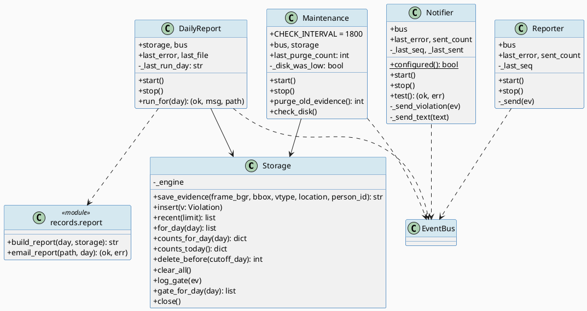
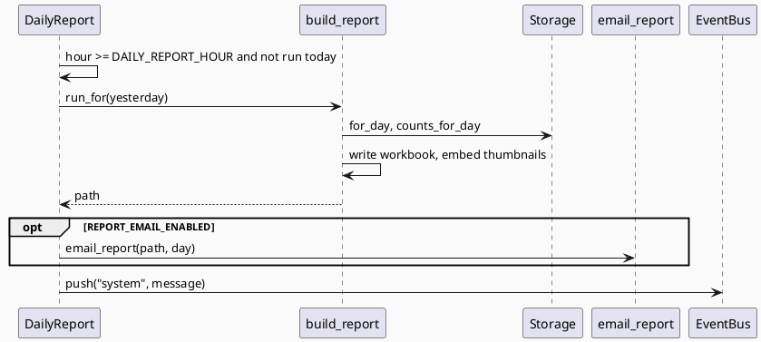
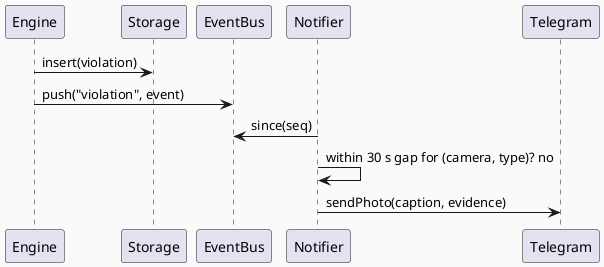
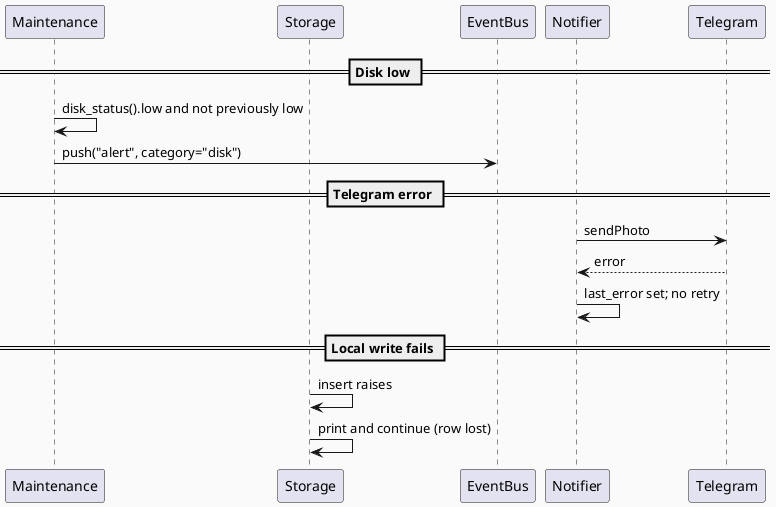
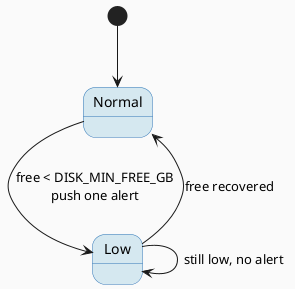

# ENGINEERING DOCUMENTATION STANDARD (EDS) v2.0
# Quy chuẩn Tài liệu Kỹ thuật và Đặc tả Hiện thực hóa

| Field | Value |
|-------|-------|
| **Document ID** | `STEELSIGHT-DET-REC-IMP-001` |
| **Version** | `1.1` |
| **Date** | `2026-11-09` |
| **Status** | `Draft` |
| **Document Owner** | `Nguyen Vu An` |
| **Author** | `Claude Code (Opus 5.5) — reverse-engineered from the code (baseline 57283ce plus package refactor)` |
| **Reviewed by** | `[ ] Pending — Tech Lead` |
| **DPO Sign-off** | `[ ] Pending` |
| **Approved by** | `[ ] Pending — Principal Architect` |
| **Last Review** | `2026-11-09` |
| **Based on EDS** | `v2.0` |

---

## CHANGELOG

> **Policy 4.4 — Immutable History:** Không bao giờ xóa thông tin cũ. Mọi thay đổi phải ghi vào bảng này.

| Ngày | Người thực hiện | Nội dung thay đổi |
|------|-----------------|-------------------|
| 2026-11-09 | Claude Code (Opus 5.5) — documentation | Tạo tài liệu lần đầu, from the code as built after the package refactor |
| 2026-11-09 | Claude Code (Opus 5.5) — documentation | v1.1: rebuilt from the source code. Added class diagrams and missing diagrams, Gherkin scenarios, separate NFR tables, module-specific deployment, verification and error sections |

---

## MỤC LỤC

1. [Tổng quan Module](#1-tổng-quan-module)
2. [Ma trận Truy vết (Traceability Matrix)](#2-ma-trận-truy-vết-traceability-matrix)
3. [Architecture Decision Records (ADR)](#3-architecture-decision-records-adr) ⭐ *Mới*
4. [Non-Functional Requirements & SLA](#4-non-functional-requirements--sla) ⭐ *Mới*
5. [Static Modeling (Mô hình Tĩnh)](#5-static-modeling-mô-hình-tĩnh)
6. [Dynamic Modeling (Mô hình Động)](#6-dynamic-modeling-mô-hình-động)
7. [Domain Event Catalog](#7-domain-event-catalog) ⭐ *Mới*
8. [Interface Specification (Đặc tả Giao diện)](#8-interface-specification-đặc-tả-giao-diện)
9. [API Specification](#9-api-specification)
10. [Bảng mã lỗi (Error Codes)](#10-bảng-mã-lỗi-error-codes)
11. [Quy trình Triển khai (Step-by-Step)](#11-quy-trình-triển-khai-step-by-step)
12. [Rollback & Incident Runbook](#12-rollback--incident-runbook) ⭐ *Mới*
13. [Kịch bản Kiểm thử Chi tiết](#13-kịch-bản-kiểm-thử-chi-tiết)
14. [Phương pháp Xác minh](#14-phương-pháp-xác-minh)
15. [Mẫu thử thực tế (API Verification Samples)](#15-mẫu-thử-thực-tế-api-verification-samples)
16. [Bảng tổng hợp phân quyền (Authorization Matrix)](#16-bảng-tổng-hợp-phân-quyền-authorization-matrix)
17. [AI Prompt Constraints (CASE 2.0)](#17-ai-prompt-constraints-case-20) ⭐⭐ *CASE 2.0 Core*

> **Adaptations to this stack:** this is a Python desktop application, so §5.2 describes SQLite, files or in-memory data rather than Prisma, §8 uses Python signatures, and deployment is a site install. Everything here was written from the source code.

---

## 1. Tổng quan Module

> Stores violations and their photos locally, builds reports, sends alerts and cleans old files.

| Field | Value |
|-------|-------|
| **Module Name** | `REC — Records & Notifications` |
| **Bounded Context** | `Local violation store, evidence, reports, Telegram and housekeeping` |
| **Code** | `steelsight/records/*` |
| **Tables** | `violations`, `gate_events` (reads and writes) |
| **Data Classification** | `PII` |
| **Compliance Scope** | Luật 91/2025/QH15 — worker photos are kept locally; Telegram and SMTP are outside processors |
| **Upstream Dependencies** | SAF, IDG, `EventBus`, SMTP, Telegram, central server |
| **Downstream Consumers** | WEB |

---

## 2. Ma trận Truy vết (Traceability Matrix)

| Requirement ID | Loại (BR/ADR/US) | Mô tả yêu cầu | Thành phần Code | Compliance Target | ADR liên quan |
|---|---|---|---|---|---|
| BR-REC-001 | Business Rule | Evidence photos and violation rows older than the retention period (default 30 days) are deleted; gate photos are not | `records/maintenance.py` | — | — |
| BR-REC-002 | Business Rule | One alert when free disk crosses below 5 GB | `Maintenance.check_disk` | — | — |
| BR-REC-003 | Business Rule | Report download accepts only an `.xlsx` base name inside `REPORTS_DIR` | `web/routes/reports.py` | — | — |
| BR-REC-004 | Business Rule | Telegram sends at most once per 30 s per camera and type | `records/notify.py` | — | — |
| BR-REC-005 | Business Rule | The daily report runs once after `DAILY_REPORT_HOUR` | `DailyReport` | — | — |
| FR-8.1 | Requirement | Store every violation | `Storage.insert` | — | — |
| FR-8.2 | Requirement | Save cropped photos | `Storage.save_evidence` | — | — |
| FR-8.5 | Requirement | Delete old evidence | `Maintenance.purge_old_evidence` | — | — |
| FR-8.6 | Requirement | Warn on low disk | `Maintenance.check_disk` | — | — |
| FR-8.7 | Requirement | Daily Excel report (partial) | `build_report` | — | — |
| FR-8.8 | Requirement | Email the report | `email_report` | — | — |
| FR-7.6 | Requirement | Telegram | `Notifier` | — | — |
| ADR-108 | Decision | ERP writes go through a local SQLite outbox with ordered lanes | see ADR | — | [ADR-108](../02_design/adr/ADR-108_sqlite-outbox-with-ordered-lanes.md) |
| ADR-112 | Decision | The web layer polls thread-safe state | see ADR | — | [ADR-112](../02_design/adr/ADR-112_polling-bridge-between-threads-and-asyncio.md) |

---

## 3. Architecture Decision Records (ADR)

### ADR-108 — ERP writes go through a local SQLite outbox with ordered lanes

| Field | Value |
|-------|-------|
| **Status** | `Accepted` |
| **Deciders** | `Nguyen Vu An — Developer; Claude Code (Opus 5.5) — AI pair programmer` |
| **Date** | `2026-11-09` |
| **Supersedes** | `—` |

> Full text: [ADR-108](../02_design/adr/ADR-108_sqlite-outbox-with-ordered-lanes.md). **Decision:** *We chose option C.* Lanes are `db` (Supabase) and `api` (ERP REST). The head of a lane blocks later events until it is done or failed. Transient errors back off, doubling to 60 s. Permanent errors mark the event failed so later events continue, and an operator can re-queue it.

### ADR-112 — The web layer polls thread-safe state

| Field | Value |
|-------|-------|
| **Status** | `Accepted` |
| **Deciders** | `Nguyen Vu An — Developer; Claude Code (Opus 5.5) — AI pair programmer` |
| **Date** | `2026-11-09` |
| **Supersedes** | `—` |

> Full text: [ADR-112](../02_design/adr/ADR-112_polling-bridge-between-threads-and-asyncio.md). **Decision:** *We chose option B.* `EventBus` is a `deque(maxlen=400)` of `(seq, event)`, and each reader keeps its own `seq`.

---

## 4. Non-Functional Requirements & SLA

> No SLA has been agreed for this module. "Target" values describe what the code does today, not a contractual commitment.

### 4.1. Performance & Availability

| Category | Requirement | Target SLA | Measurement Method | Compliance Basis |
|----------|-------------|------------|---------------------|------------------|
| Housekeeping | Retention and disk check | At start, then every 1,800 s | `Maintenance._loop` | FR-8.5 |
| Report | Daily check | Every 60 s; once per day after `DAILY_REPORT_HOUR` = 1 | `DailyReport._loop` | FR-8.7 |
| Forwarders | Polling | Every 1 s | `Notifier`, `Reporter` | ADR-112 |
| Telegram | Rate per (camera, type) | `TELEGRAM_MIN_GAP_SECONDS` = 30 | `_send_violation` | FR-7.6 |

### 4.2. Data Integrity & Retention

| Category | Requirement | Target | Verification Method | Compliance Basis |
|----------|-------------|--------|---------------------|------------------|
| Evidence | Retention | 30 days default; 0 keeps forever | REC-TC-001 (new) | FR-8.5 |
| Rows | Violation rows removed with their photos | `delete_before(cutoff)` | Code review | FR-8.5 |
| **Gap** | Gate snapshots and `gate_events` | **Never purged** | REC-TC-006 (new) | Luật 91/2025/QH15 storage limitation |
| Failure | A failed local insert is printed and that row is lost | Accepted | Code review | NFR-9 |
| Clear | `DELETE /api/violations` removes rows, not photos or ERP rows | As built | Code review | L4 |

### 4.3. Security

| Category | Requirement | Target | Verification Method | Compliance Basis |
|----------|-------------|--------|---------------------|------------------|
| Path safety | Report download is limited to `.xlsx` base names | `basename` + suffix check | REC-TC-002 (new) | CWE-22 |
| Path safety | `day` must be a real date, in the route and in `build_report` | Fixed 2026-11-09 | REC-TC-007 | CWE-22 |
| External data | Telegram and email send worker photos when enabled | Off by default | Configuration | Luật 91/2025/QH15 processors |
| Central report | Metadata only unless `REPORT_SEND_EVIDENCE` | Off by default | `Reporter._send` | Transparency |
| TLS | SMTP STARTTLS when `SMTP_USE_TLS` | Default on | Configuration | — |

### 4.4. Scalability & Capacity Planning

> File use grows with violations; each crop is small. The report embeds 120-px thumbnails, so a day with many violations gives a larger workbook. No limits have been measured.

---

## 5. Static Modeling (Mô hình Tĩnh)

### 5.1. Class Diagram (PlantUML)



### 5.2. Data Structure

`violations` and `gate_events` are defined in `STEELSIGHT-DET-DPL-IMP-001` §5.2.

**Files**

| Path | Content | Removed by |
|------|---------|------------|
| `evidence/<YYYY>/<YYYY-MM-DD>/<camera>_id<pid>_<type>_<time>.jpg` | Violation crop with 15% padding | `Maintenance` |
| `attendance/<YYYY-MM-DD>/{in,out}_<user>_<time>.jpg` | Gate snapshot | **Nothing** |
| `reports/BaoCao_ViPham_<day>.xlsx` | Daily report | **Nothing** |

**Report columns:** STT, Thời gian, Loại vi phạm, Mức độ, Camera / Vị trí, Người #, Độ tin cậy, Bằng chứng. Worker and vest number are not included (FR-8.7 partial).

---

## 6. Dynamic Modeling (Mô hình Động)

### 6.1. Sequence Diagram — Happy Path (PlantUML)





### 6.2. Sequence Diagram — Error Path (PlantUML)



### 6.3. State Machine



> **⚠️ Invariant bất biến:**
> - SQLite stores the photo path only, never the image.
> - Only folders named as a valid date are deleted by retention.
> - The Notifier and Reporter start from the current `seq`, so older events are never re-sent.

---

## 7. Domain Event Catalog

### 7.1. Events Published (Phát ra)

| Event Name | Trigger | Publisher | Subscriber(s) | Payload Schema | Async? |
|---|---|---|---|---|---|
| `alert` | Disk crossing | `Maintenance` | Dashboard, Notifier | `level, category, message` | Polled |

### 7.2. Events Consumed (Tiêu thụ)

| Event Name | Source | Handler | Action thực hiện |
|---|---|---|---|
| `violation`, `system`, `alert` | `EventBus` | `Notifier`, `Reporter` | Forward when enabled |

### 7.3. Payload Schema

```python
{"kind": "alert", "level": "warning", "category": "disk", "message": str}
{"kind": "system", "message": str}

# Reporter POST {CENTRAL_URL}/api/ingest, header X-Site-Key
{"site_id": str, "event": {"id", "type", "severity", "confidence", "person_id", "camera", "time", "ts_iso",
                           "evidence_b64 (only if REPORT_SEND_EVIDENCE)"}}
```

---

## 8. Interface Specification (Đặc tả Giao diện)

### 8.1. Service Interface

```python
# steelsight/records/storage.py  @version 1.0
class Storage:
    def save_evidence(self, frame_bgr, bbox, vtype, location: str, person_id: int) -> str | None: ...
    def insert(self, v: Violation) -> None: ...      # errors are printed, not raised
    def recent(self, limit: int = 100) -> list[dict]: ...
    def for_day(self, day: str) -> list[dict]: ...
    def counts_for_day(self, day: str) -> dict: ...
    def delete_before(self, cutoff_day: str) -> int: ...
    def clear_all(self) -> None: ...
    def log_gate(self, ev: dict) -> None: ...        # raises; GateMonitor catches it
    def gate_for_day(self, day: str) -> list[dict]: ...

# steelsight/records/report.py
def build_report(day=None, storage=None) -> str | None: ...
def email_report(path: str, day: str) -> tuple[bool, str]: ...
class DailyReport:
    def run_for(self, day: str) -> tuple[bool, str, str | None]: ...

# steelsight/records/maintenance.py
class Maintenance:
    def purge_old_evidence(self) -> int: ...          # folders removed
    def check_disk(self) -> None: ...

# steelsight/records/notify.py
class Notifier:
    @staticmethod
    def configured() -> bool: ...
    def test(self) -> tuple[bool, str]: ...

# steelsight/records/reporter.py
class Reporter: ...                                   # starts only when config.report_status()["active"]
```

### 8.2. Repository Interface

Not applicable: this module has no repository layer. Local tables are SQLAlchemy `Table` objects in `core/db.py`.

---

## 9. API Specification

### 9.1. Endpoints Table (outgoing)

| Method | Target | Auth | Purpose |
|--------|--------|------|---------|
| `POST` | `api.telegram.org/bot<token>/sendMessage`, `sendPhoto` | Bot token in URL | Alerts |
| SMTP | `SMTP_HOST:SMTP_PORT` | `SMTP_USER` / `SMTP_PASSWORD` | Daily report |
| `POST` | `{CENTRAL_URL}/api/ingest` | `X-Site-Key` | Central reporting (off by default) |

### 9.2. Request / Response Schemas

`/api/violations`, `/api/report/run`, `/api/reports`, `/api/reports/download`, `/api/notify/test`. Listed in `STEELSIGHT-DET-WEB-IMP-001` §9.

> `POST /api/report/run` answers 400 unless `day` is a real `YYYY-MM-DD` date (REC-TC-007).

---

## 10. Bảng mã lỗi (Error Codes)

| Code | Where | Message | Trigger Condition |
|------|-------|---------|-------------------|
| `REC-001` | `run_for` | `Tạo file thất bại.` | Workbook could not be built |
| `REC-002` | `email_report` | `Chưa cấu hình SMTP_HOST hoặc người nhận (REPORT_EMAIL_TO).` | Missing settings |
| `REC-003` | `email_report` | `Không tìm thấy file báo cáo.` | No file |
| `REC-004` | `/api/reports/download` | `tên file không hợp lệ` (400) | Not `.xlsx` |
| `REC-005` | `/api/reports/download` | `không tìm thấy file` (404) | Missing report |
| `REC-006` | `Notifier.test` | `Chưa nhập Bot token / Chat ID.` | Not configured |

> `REC-00x` labels are for traceability.

---

## 11. Quy trình Triển khai (Step-by-Step)

### 11.1. Prerequisites

- [ ] Related ADRs reviewed (§3)
- [ ] DPO sign-off if personal data handling changes
- [ ] `.venv` created by `setup.bat`

### 11.2. Pre-Migration Checklist

- [ ] Back up `data/` before upgrading (`violations.db`, `users.db`, `settings.json`, `cameras.json`)
- [ ] Local SQLite changes go through `core/db.py` `migrate`; ERP schema changes belong to the ERP's Flyway migrations

### 11.3. Implementation Steps

#### Chặng 1 — Set retention and alerts

```bash
curl -X POST http://127.0.0.1:8765/api/settings -H "Content-Type: application/json" \
  -d '{"evidence_retention_days": 30, "disk_min_free_gb": 5, "daily_report_enabled": true, "daily_report_hour": 1}'
```

#### Chặng 2 — Verification

```bash
curl -s -X POST http://127.0.0.1:8765/api/report/run -H "Content-Type: application/json" -d '{"day":"2026-11-08"}'
curl -s http://127.0.0.1:8765/api/reports
```

> ⚠️ Retention deletes photos permanently. Do not set it below the period the HSE team needs for disputes.

### 11.4. Deployment Checklist

- [ ] `pytest -q tests` passes
- [ ] The module's checks in §14 give the expected output

---

## 12. Rollback & Incident Runbook

### 12.1. Điều kiện kích hoạt Rollback

| Điều kiện | Ngưỡng | Người quyết định |
|-----------|--------|------------------|
| Photos removed earlier than expected | Any | HSE officer + Developer |
| Disk alert | Below 5 GB free | Site administrator |

### 12.2. Rollback Procedure

```powershell
git checkout <previous-commit>   # restore the code; data/ is not tracked
run.bat
```

### 12.3. Notification Protocol

| Thời điểm | Người nhận | Kênh | Template |
|---|---|---|---|
| When found | Developer | Direct message | Module, symptom, time |
| If personal data is exposed | DPO (no named DPO yet) | Email | Luật 91/2025/QH15 incident duties |

### 12.4. Post-Incident Review (PIR)

Timeline, root cause, impact, remediation and prevention, within 48 hours.

---

## 13. Kịch bản Kiểm thử Chi tiết

Test data classification: `SYNTHETIC`. Full specification: `04_testing/STEELSIGHT-DET-REC-TDD-001_Test-Spec.md`.

### 13.1. Unit Tests

#### TC-UNIT-001 — Retention

```gherkin
Feature: Evidence retention
  Background:
    Given test data classification: SYNTHETIC
    And EVIDENCE_RETENTION_DAYS is 30

  Scenario: Old folders go and new folders stay
    Given evidence folders dated 40 days ago and yesterday
    When purge_old_evidence runs
    Then only the old folder is removed
    And violation rows before the cutoff are removed

  Scenario: A folder not named as a date is left alone
    Given a folder named "backup" under a year folder
    When purge_old_evidence runs
    Then it still exists
```

**Hàm được test:** `Maintenance.purge_old_evidence()` · **Invariant:** only dated folders are touched.

### 13.2. Integration Tests

#### TC-INT-001 — Storage round trip

```gherkin
  Scenario: Identity fields survive
    Given test data classification: SYNTHETIC
    When a Violation with worker, vest and camera code is inserted
    Then for_day returns those values
```

**External dependencies:** none · **Mock strategy:** temporary folders; `FakeStorage` for reports.

### 13.3. E2E / Security Tests

#### TC-SEC-001 — Report path traversal

```gherkin
  Scenario: A crafted day cannot touch other folders
    Given test data classification: SYNTHETIC
    And a temporary data folder with evidence/keep.jpg
    When POST /api/report/run receives day "../../../evidence"
    Then the response is 400
    And evidence/keep.jpg still exists

  Scenario: A crafted download name is refused
    When GET /api/reports/download?name=../../settings.json
    Then the response is 400
```

### 13.4. Case Summary

| TC ID | Test | Description | Severity | Status |
|---|---|---|---|---|
| REC-TC-001 | Evidence older than the retention period is deleted, and newer files stay | *(new)* | HIGH | 🔴 |
| REC-TC-002 | A traversal name cannot download a file outside `REPORTS_DIR` | *(new)* | CRITICAL | 🔴 |
| REC-TC-003 | Only one disk alert is raised per crossing of the threshold | *(new)* | MEDIUM | 🔴 |
| REC-TC-004 | `insert` then `for_day` round-trips the identity fields | *(new)* | HIGH | 🔴 |
| REC-TC-005 | The daily report runs once per day after the configured hour | *(new)* | MEDIUM | 🔴 |
| REC-TC-006 | Gate snapshots and `gate_events` follow a retention period (currently never purged) | *(new)* | HIGH | 🔴 |
| REC-TC-007 | A crafted `day` cannot delete folders | `test_crafted_day_cannot_delete_folders` | CRITICAL | 🟢V |

---

## 14. Phương pháp Xác minh

### 14.1. Database Inspection

```sql
SELECT date(ts) AS day, count(*) FROM violations GROUP BY day ORDER BY day DESC LIMIT 40;
SELECT min(ts), max(ts), count(*) FROM gate_events;  -- grows without limit today
```

### 14.2. Log / Audit Verification

```bash
curl -s http://127.0.0.1:8765/api/state   # disk, telegram.error, daily_report.last_file, daily_report.error
```

### 14.3. Tool-based Verification

```powershell
Get-ChildItem data\attendance -Directory | Measure-Object   # shows gate-photo folders are not purged
```

---

## 15. Mẫu thử thực tế (API Verification Samples)

> Since ADR-115 every local request needs the launch cookie. Take the `steelsight_launch` value from the running window (browser DevTools → Application → Cookies) and add `-H "Cookie: steelsight_launch=<value>"` to the `curl` commands below.

### 15.1. Happy Path

```bash
curl -s -X POST http://127.0.0.1:8765/api/report/run -H "Content-Type: application/json" -d '{"day":"2026-11-08"}'
curl -s http://127.0.0.1:8765/api/reports
```

### 15.2. Error Paths

```bash
curl -i "http://127.0.0.1:8765/api/reports/download?name=x.txt"     # 400
curl -i "http://127.0.0.1:8765/api/reports/download?name=none.xlsx" # 404
```

---

## 16. Bảng tổng hợp phân quyền (Authorization Matrix)

*Endpoints are in `STEELSIGHT-DET-WEB-IMP-001` §16.*

---

## 17. AI Prompt Constraints (CASE 2.0)

### 17.1 Constraint Summary Table

| # | Constraint | Source (ADR/BR) | Last Verified |
|---|---|---|---|
| C1 | `Readers of `EventBus` keep their own `seq`` | `ADR-112` | `2026-11-09` |
| C2 | `Store only the evidence path in SQLite` | `FR-8.1` | `2026-11-09` |
| C3 | `Download names must be reduced to a base name and limited to `.xlsx`` | `BR-REC-003` | `2026-11-09` |
| C4 | `Do NOT send ERP data from this module; use the outbox` | `ADR-108` | `2026-11-09` |
| C5 | `Never log SMTP passwords or bot tokens` | `BR-WEB-006` | `2026-11-09` |

### 17.2 Constraint Injection Block (Copy-Paste vào AI Prompt)

```
[CONSTRAINT BLOCK — Module: Records & Notifications]
Theo TDS STEELSIGHT-DET-REC-IMP-001 và các ADR liên quan:

1. Readers of `EventBus` keep their own `seq`
2. Store only the evidence path in SQLite
3. Download names must be reduced to a base name and limited to `.xlsx`
4. Do NOT send ERP data from this module; use the outbox
5. Never log SMTP passwords or bot tokens

[CONTEXT BLOCK]
- Bounded Context: Local violation store, evidence, reports, Telegram and housekeeping
- Data Classification: PII
- Existing interfaces: §8
- Auth matrix: §16

[TASK BLOCK]
Implement {feature/method} thỏa mãn constraints trên.
Output phải tuân thủ §8 Interface Specification.
Tests phải cover §13 Test Scenarios.
```

### 17.3 Constraint Quality Checklist

- [x] Mỗi constraint traceable về ADR hoặc BR cụ thể
- [x] Không có constraint generic
- [x] Mỗi constraint có `Last Verified` date ≤ 2 sprints
- [x] Constraint block có ≥ 3 constraints cụ thể
- [x] Constraint block reference §8 Interface
- [x] Constraint block reference §16 Auth Matrix

### 17.4 Anti-Pattern Detection

| AP-ID | Anti-Pattern | Dấu hiệu | Hành động |
|-------|-------------|-----------|----------|
| AP-AI-001 | Unconstrained Gen | Code không match bất kỳ constraint nào | Reject — inject lại constraints |
| AP-AI-003 | Implicit Decision | Code assume architecture không có trong §3 ADR | Reject — viết ADR trước |
| AP-AI-005 | Hallucinated Contract | Code import service/type không có trong §8 | Reject — verify contract existence |

---

## PHỤ LỤC

### A. Glossary (Thuật ngữ)

| Thuật ngữ | Định nghĩa |
|-----------|------------|
| Evidence | Cropped photo of a violation |
| Retention | Days photos are kept |
| Central server | Optional site-reporting server, separate from the ERP |
| PII | Personally Identifiable Information |
| DPO | Data Protection Officer |
| Red Gate | Check that tests fail against a stub before implementation |

### B. Tài liệu tham chiếu

| Document | Path |
|----------|------|
| Module map | `02_design/DETECTION-MODULE-MAP.md` |
| Source | `steelsight/records/*` |
| Requirements | `docs/REQUIREMENTS_SPECIFICATION.md` |

---

*EDS v2.1 — Tích hợp CASE 2.0 AI Prompt Constraints (§17).*
