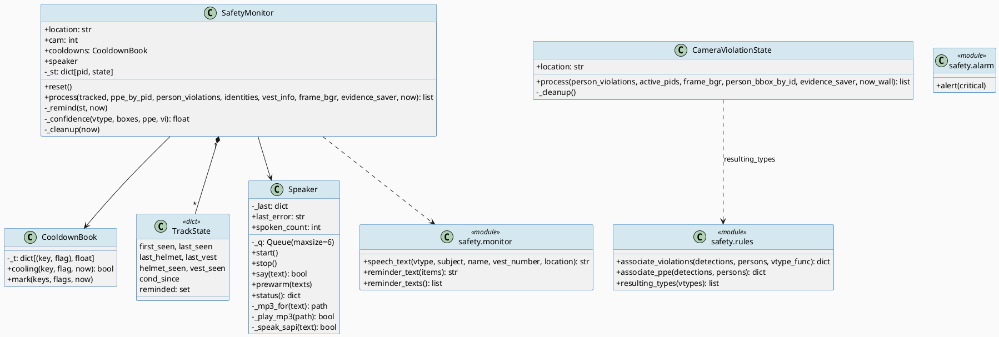
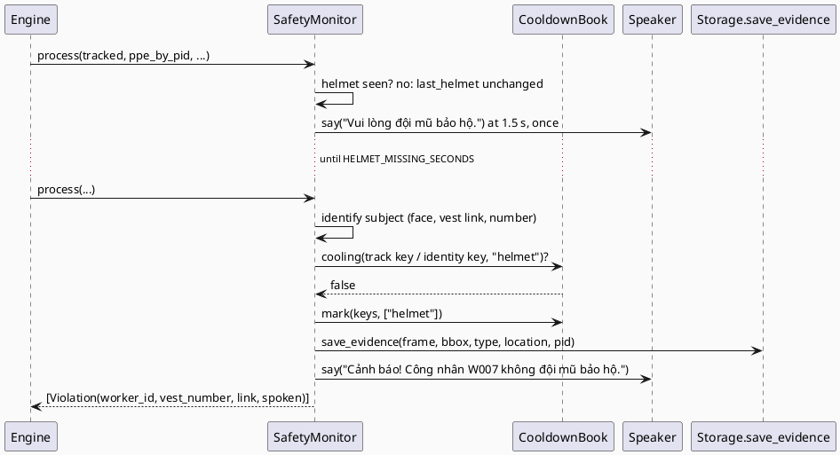
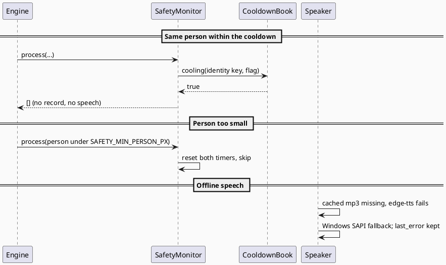
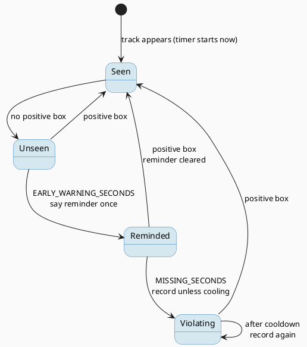

# ENGINEERING DOCUMENTATION STANDARD (EDS) v2.0
# Quy chuẩn Tài liệu Kỹ thuật và Đặc tả Hiện thực hóa

| Field | Value |
|-------|-------|
| **Document ID** | `STEELSIGHT-DET-SAF-IMP-001` |
| **Version** | `1.1` |
| **Date** | `2026-11-09` |
| **Status** | `Draft` |
| **Document Owner** | `Nguyen Vu An` |
| **Author** | `Claude Code (Opus 5.5) — reverse-engineered from the code (baseline 57283ce plus package refactor)` |
| **Reviewed by** | `[ ] Pending — Tech Lead` |
| **DPO Sign-off** | `[ ] Pending` |
| **Approved by** | `[ ] Pending — Principal Architect` |
| **Last Review** | `2026-11-09` |
| **Based on EDS** | `v2.0` |

---

## CHANGELOG

> **Policy 4.4 — Immutable History:** Không bao giờ xóa thông tin cũ. Mọi thay đổi phải ghi vào bảng này.

| Ngày | Người thực hiện | Nội dung thay đổi |
|------|-----------------|-------------------|
| 2026-11-09 | Claude Code (Opus 5.5) — documentation | Tạo tài liệu lần đầu, from the code as built after the package refactor |
| 2026-11-09 | Claude Code (Opus 5.5) — documentation | v1.1: rebuilt from the source code. Added class diagrams and missing diagrams, Gherkin scenarios, separate NFR tables, module-specific deployment, verification and error sections |

---

## MỤC LỤC

1. [Tổng quan Module](#1-tổng-quan-module)
2. [Ma trận Truy vết (Traceability Matrix)](#2-ma-trận-truy-vết-traceability-matrix)
3. [Architecture Decision Records (ADR)](#3-architecture-decision-records-adr) ⭐ *Mới*
4. [Non-Functional Requirements & SLA](#4-non-functional-requirements--sla) ⭐ *Mới*
5. [Static Modeling (Mô hình Tĩnh)](#5-static-modeling-mô-hình-tĩnh)
6. [Dynamic Modeling (Mô hình Động)](#6-dynamic-modeling-mô-hình-động)
7. [Domain Event Catalog](#7-domain-event-catalog) ⭐ *Mới*
8. [Interface Specification (Đặc tả Giao diện)](#8-interface-specification-đặc-tả-giao-diện)
9. [API Specification](#9-api-specification)
10. [Bảng mã lỗi (Error Codes)](#10-bảng-mã-lỗi-error-codes)
11. [Quy trình Triển khai (Step-by-Step)](#11-quy-trình-triển-khai-step-by-step)
12. [Rollback & Incident Runbook](#12-rollback--incident-runbook) ⭐ *Mới*
13. [Kịch bản Kiểm thử Chi tiết](#13-kịch-bản-kiểm-thử-chi-tiết)
14. [Phương pháp Xác minh](#14-phương-pháp-xác-minh)
15. [Mẫu thử thực tế (API Verification Samples)](#15-mẫu-thử-thực-tế-api-verification-samples)
16. [Bảng tổng hợp phân quyền (Authorization Matrix)](#16-bảng-tổng-hợp-phân-quyền-authorization-matrix)
17. [AI Prompt Constraints (CASE 2.0)](#17-ai-prompt-constraints-case-20) ⭐⭐ *CASE 2.0 Core*

> **Adaptations to this stack:** this is a Python desktop application, so §5.2 describes SQLite, files or in-memory data rather than Prisma, §8 uses Python signatures, and deployment is a site install. Everything here was written from the source code.

---

## 1. Tổng quan Module

> Decides when missing PPE becomes a violation, who it belongs to, and what is said aloud.

| Field | Value |
|-------|-------|
| **Module Name** | `SAF — Safety Rules` |
| **Bounded Context** | `PPE association, violation timers, reminders and spoken alerts` |
| **Code** | `steelsight/safety/*` |
| **Tables** | *(writes through REC)* |
| **Data Classification** | `PII` |
| **Compliance Scope** | Luật 91/2025/QH15 — violations can name a worker; sentences are spoken aloud |
| **Upstream Dependencies** | VIS, IDG, edge-tts |
| **Downstream Consumers** | REC, SYN, WEB |

---

## 2. Ma trận Truy vết (Traceability Matrix)

| Requirement ID | Loại (BR/ADR/US) | Mô tả yêu cầu | Thành phần Code | Compliance Target | ADR liên quan |
|---|---|---|---|---|---|
| BR-SAF-001 | Business Rule | A violation needs an item to be unseen for its full timer (default 10 s) | `safety/monitor.py` | — | — |
| BR-SAF-002 | Business Rule | Seeing the item clears the timer and reminder | `safety/monitor.py` | — | — |
| BR-SAF-003 | Business Rule | A shared cooldown (default 60 s) stops repeats across cameras | `CooldownBook` | — | — |
| BR-SAF-004 | Business Rule | A hard hat in the hand does not count as worn | `safety/rules.py` `associate_ppe` | — | — |
| BR-SAF-005 | Business Rule | Both items missing is one critical `missing_both` violation, unless the person is an `intruder` | `safety/monitor.py` | — | — |
| BR-SAF-006 | Business Rule | A person with no identity and no vest is an `intruder` | `safety/monitor.py` | — | — |
| FR-4.1 | Requirement | Violation only after continued absence | `SafetyMonitor.process` | — | — |
| FR-4.1a | Requirement | Spoken reminder first | `SafetyMonitor` | — | — |
| FR-4.4 | Requirement | Combine missing items | `SafetyMonitor` | — | — |
| FR-4.5 | Requirement | Intruder | `SafetyMonitor` | — | — |
| FR-4.6 | Requirement | Shared cooldown | `CooldownBook` | — | — |
| FR-7.1 | Requirement | Vietnamese speech | `Speaker` | — | — |
| ADR-107 | Decision | Violations are timers on continued absence, with a cooldown shared by all cameras | see ADR | — | [ADR-107](../02_design/adr/ADR-107_timer-rules-with-shared-cooldown.md) |

---

## 3. Architecture Decision Records (ADR)

### ADR-107 — Violations are timers on continued absence, with a cooldown shared by all cameras

| Field | Value |
|-------|-------|
| **Status** | `Accepted` |
| **Deciders** | `Nguyen Vu An — Developer; Claude Code (Opus 5.5) — AI pair programmer` |
| **Date** | `2026-11-09` |
| **Supersedes** | `—` |

> Full text: [ADR-107](../02_design/adr/ADR-107_timer-rules-with-shared-cooldown.md). **Decision:** *We chose option B.* Defaults: reminder 1.5 s, violation 10 s, cooldown 60 s. Cooldown keys are the track and, when known, the worker or vest.

---

## 4. Non-Functional Requirements & SLA

> No SLA has been agreed for this module. "Target" values describe what the code does today, not a contractual commitment.

### 4.1. Performance & Availability

| Category | Requirement | Target SLA | Measurement Method | Compliance Basis |
|----------|-------------|------------|---------------------|------------------|
| Non-blocking | `Speaker.say` only queues (queue size 6, oldest dropped when full) | No wait in the engine | Code review | ADR-103 |
| Speech | Same sentence not repeated | `TTS_REPEAT_GAP_SECONDS` = 8 s | `Speaker.say` | FR-7.2 |
| Fallback | Speech source order | Cached mp3 → edge-tts (10 s limit) → SAPI | `Speaker._run` | NFR-1 |
| Beep | Minimum gap between beeps | 1 s | `alarm.alert` | FR-7.5 |

### 4.2. Data Integrity & Retention

| Category | Requirement | Target | Verification Method | Compliance Basis |
|----------|-------------|--------|---------------------|------------------|
| Accuracy | No violation before the timer ends | 10 s default per item | `tests/test_safety.py` | FR-4.1 |
| Accuracy | One record per person and item per cooldown | 60 s, across cameras | SAF-TC-008 (new) | FR-4.6 |
| Confidence | Real box confidence, else the YOLO threshold | `_confidence` | Code review | FR-4.8 partial |
| Memory | Track state dropped | 10 s unseen | `_cleanup` | — |

### 4.3. Security

| Category | Requirement | Target | Verification Method | Compliance Basis |
|----------|-------------|--------|---------------------|------------------|
| Link integrity | A vest link is attached only if it matches the identified worker | `link.worker_id == wid` | `SafetyMonitor.process` | ERP trigger rejects a mismatch |
| Spoken names | Sentences use the employee code | `name` comes from `ErpGallery` / `LinkBook` | Code review | ADR-110 |

### 4.4. Scalability & Capacity Planning

> `CooldownBook` trims itself above 5,000 keys. Per-track state is per camera and short-lived. A new `Engine` (camera or model change) starts with an empty cooldown book.

---

## 5. Static Modeling (Mô hình Tĩnh)

### 5.1. Class Diagram (PlantUML)



### 5.2. Data Structure

No tables; violations are stored by `REC.Storage`. The two rule paths:

| Path | Used when | Behaviour |
|------|-----------|-----------|
| `SafetyMonitor` | `VEST_ID_ENABLED` is on (default) | Time-based, identity, speech, shared cooldown |
| `CameraViolationState` | Vest ID is off | Older rule: first negative box per track, throttled by `VIOLATION_THROTTLE_SECONDS` = 3 s |

**Subject and type decision**

| Condition | `subject_type` | `identity_source` |
|-----------|----------------|-------------------|
| Face worker known | `worker` | `face` |
| Vest link gives a worker | `worker` | `vest` |
| Vest number only | `vest` | `none` |
| No identity, vest missing | `intruder` | `none` |
| Otherwise (wait `VEST_ID_WAIT_SECONDS` = 2 s, then still reported) | `unknown` | `none` |

`vtype` = `INTRUDER` if `vest` is flagged and the subject is an intruder; otherwise `MISSING_BOTH` for two flags; otherwise the single item.

---

## 6. Dynamic Modeling (Mô hình Động)

### 6.1. Sequence Diagram — Happy Path (PlantUML)



### 6.2. Sequence Diagram — Error Path (PlantUML)



### 6.3. State Machine



> **⚠️ Invariant bất biến:**
> - A new track starts with both timers at its first sighting, so nobody is reported in their first 10 s on camera.
> - A remembered vest number never counts as wearing a vest; only a vest box in the current frame does.
> - A reminder writes nothing to the database.

---

## 7. Domain Event Catalog

### 7.1. Events Published (Phát ra)

| Event Name | Trigger | Publisher | Subscriber(s) | Payload Schema | Async? |
|---|---|---|---|---|---|
| `violation` | A new violation | `Engine` | Dashboard, Notifier, Reporter | `Violation.to_event()` | Polled |

### 7.2. Events Consumed (Tiêu thụ)

*This module consumes no events.*

### 7.3. Payload Schema

```python
# Violation.to_event(), pushed as {"kind": "violation", ...}
{"id": str, "type": "missing_helmet|missing_vest|missing_both|intruder", "label": str,
 "severity": "warning|critical", "time": "HH:MM:SS", "ts_iso": str, "camera": str, "person_id": int,
 "confidence": float, "evidence": "/evidence/<year>/<day>/<file>.jpg" or None, "worker_id": str or None,
 "worker_name": str or None, "vest_number": str or None, "subject_type": str, "identity_source": str, "spoken": bool}
```

---

## 8. Interface Specification (Đặc tả Giao diện)

### 8.1. Service Interface

```python
# steelsight/safety/monitor.py  @version 1.0
class CooldownBook:
    def cooling(self, key: str, flag: str, now: float) -> bool: ...
    def mark(self, keys: list[str], flags, now: float) -> None: ...

class SafetyMonitor:
    def __init__(self, location: str, cam_index: int, cooldowns: CooldownBook, speaker=None): ...
    def reset(self) -> None: ...
    def process(self, tracked, ppe_by_pid, person_violations, identities, vest_info,
                frame_bgr, evidence_saver, now: float) -> list[Violation]: ...

def speech_text(vtype, subject: str, name, vest_number, location: str) -> str: ...
def reminder_text(items) -> str: ...      # items: a set of "helmet" and/or "vest"
def reminder_texts() -> list[str]: ...

# steelsight/safety/rules.py
def associate_violations(detections, persons, vtype_func) -> dict[int, dict[ViolationType, float]]: ...
def associate_ppe(detections, persons) -> dict[int, dict[str, float]]: ...

# steelsight/safety/tts.py
class Speaker:
    def say(self, text: str) -> bool: ...  # False if TTS is off, the sentence is recent, or queuing failed
    def prewarm(self, texts) -> None: ...
```

**Association rules**

| Function | Input | Attached when |
|----------|-------|---------------|
| `associate_violations` | NoHelmet, NoVest | Best person with score ≥ 0.02 (`IoU + 1` if the centre is inside) |
| Torso inference (`TORSO_VEST_INFERENCE`) | Vest, NoVest | No Vest overlaps the lower 65% (≥ 0.05) and a NoVest touches the person (≥ 0.02) |
| `associate_ppe` | Helmet, Vest | Score ≥ 1.0 (centre inside); a Helmet's centre must be in the top `HELMET_HEAD_ZONE` |

### 8.2. Repository Interface

Not applicable: this module has no repository layer. Local tables are SQLAlchemy `Table` objects in `core/db.py`.

---

## 9. API Specification

### 9.1. Endpoints Table

*This module has no HTTP endpoints of its own. See `STEELSIGHT-DET-WEB-IMP-001` §9.*

### 9.2. Request / Response Schemas

*Not applicable.*

---

## 10. Bảng mã lỗi (Error Codes)

| Code | Where | Effect | Trigger Condition |
|------|-------|--------|-------------------|
| *(status)* | `Speaker.last_error` | `edge-tts: ...` / `SAPI: ...` | Synthesis or playback failed |
| `False` return | `Speaker.say` | Violation has `spoken=False`, so the browser can play its own alert | TTS off or repeat |

> This module has no coded errors.

---

## 11. Quy trình Triển khai (Step-by-Step)

### 11.1. Prerequisites

- [ ] Related ADRs reviewed (§3)
- [ ] DPO sign-off if personal data handling changes
- [ ] `.venv` created by `setup.bat`

### 11.2. Pre-Migration Checklist

- [ ] Back up `data/` before upgrading (`violations.db`, `users.db`, `settings.json`, `cameras.json`)
- [ ] Local SQLite changes go through `core/db.py` `migrate`; ERP schema changes belong to the ERP's Flyway migrations

### 11.3. Implementation Steps

#### Chặng 1 — Tune rule timings

```bash
curl -X POST http://127.0.0.1:8765/api/settings -H "Content-Type: application/json" \
  -d '{"helmet_missing_seconds": 10, "vest_missing_seconds": 10, "violation_cooldown_seconds": 60}'
```

#### Chặng 2 — Verification

```powershell
.venv\Scripts\python.exe -m pytest -q tests/test_safety.py
```

> ⚠️ Changing the rule timings changes who gets safety points deducted in the ERP.

### 11.4. Deployment Checklist

- [ ] `pytest -q tests` passes
- [ ] The module's checks in §14 give the expected output

---

## 12. Rollback & Incident Runbook

### 12.1. Điều kiện kích hoạt Rollback

| Điều kiện | Ngưỡng | Người quyết định |
|-----------|--------|------------------|
| False violations rise after a change | Reported by HSE | HSE officer + Developer |
| Spoken alerts stop | Any | Site administrator |

### 12.2. Rollback Procedure

```powershell
git checkout <previous-commit>   # restore the code; data/ is not tracked
run.bat
```

### 12.3. Notification Protocol

| Thời điểm | Người nhận | Kênh | Template |
|---|---|---|---|
| When found | Developer | Direct message | Module, symptom, time |
| If personal data is exposed | DPO (no named DPO yet) | Email | Luật 91/2025/QH15 incident duties |

### 12.4. Post-Incident Review (PIR)

Timeline, root cause, impact, remediation and prevention, within 48 hours.

---

## 13. Kịch bản Kiểm thử Chi tiết

Test data classification: `SYNTHETIC`. Full specification: `04_testing/STEELSIGHT-DET-SAF-TDD-001_Test-Spec.md`.

### 13.1. Unit Tests

#### TC-UNIT-001 — Timers

```gherkin
Feature: Violation timers
  Background:
    Given test data classification: SYNTHETIC
    And HELMET_MISSING_SECONDS is 10 and EARLY_WARNING_SECONDS is 1.5

  Scenario: Reminder, then a violation
    Given a tracked worker W007 wearing a vest but no hard hat
    When 1.5 seconds pass
    Then "Vui lòng đội mũ bảo hộ." is said once and nothing is stored
    When 10 seconds have passed
    Then one MISSING_HELMET violation is returned with worker_name W007

  Scenario: Fixing PPE prevents the violation
    Given the worker was reminded
    When a Helmet box is seen and stays visible
    Then no violation is returned
```

**Hàm được test:** `SafetyMonitor.process()` · **Invariant:** nothing stored before the timer ends.

#### TC-UNIT-002 — Wearing versus carrying

```gherkin
  Scenario: A hard hat at waist height is not worn
    Given test data classification: SYNTHETIC
    And a person box and a Helmet box at waist height
    When associate_ppe runs
    Then the result has no helmet for that person
```

### 13.2. Integration Tests

#### TC-INT-001 — Cooldown across cameras

```gherkin
  Scenario: One worker on two cameras
    Given test data classification: SYNTHETIC
    And two SafetyMonitors sharing one CooldownBook
    When worker 7 violates on camera 1 and again on camera 2 within 60 s
    Then exactly one violation is produced
```

**External dependencies:** none · **Mock strategy:** `FakeSpeaker`.

### 13.3. E2E / Security Tests

*No scenario at this level yet; see the case summary.*

### 13.4. Case Summary

| TC ID | Test | Description | Severity | Status |
|---|---|---|---|---|
| SAF-TC-001 | `test_safety.py::test_reminder_comes_fast_and_only_once_then_named_violation_at_10s` | Reminder once, then a named violation at 10 s | HIGH | 🟢V |
| SAF-TC-002 | `test_safety.py::test_putting_the_hat_on_after_the_reminder_means_no_violation` | Fixing PPE prevents a violation | HIGH | 🟢V |
| SAF-TC-003 | `test_safety.py::test_taking_it_off_again_gets_a_new_reminder` | A new absence gets a new reminder | MEDIUM | 🟢V |
| SAF-TC-004 | `test_safety.py::test_missing_both_gets_the_combined_reminder` | Combined reminder | MEDIUM | 🟢V |
| SAF-TC-005 | `test_safety.py::test_reminder_can_be_switched_off` | Setting turns reminders off | LOW | 🟢V |
| SAF-TC-006 | `test_safety.py::test_violation_sentences_name_the_person` | Sentences name the person | MEDIUM | 🟢V |
| SAF-TC-007 | `test_gate.py::test_helmet_in_hand_does_not_count_as_worn` | A carried hard hat is not worn | HIGH | 🟢V |
| SAF-TC-008 | The same worker on two cameras within the cooldown produces one violation | *(new)* | HIGH | 🔴 |
| SAF-TC-009 | A person below `SAFETY_MIN_PERSON_PX` holds both timers | *(new)* | MEDIUM | 🔴 |
| SAF-TC-010 | No identity and no vest becomes `intruder` after the OCR wait | *(new)* | HIGH | 🔴 |

---

## 14. Phương pháp Xác minh

### 14.1. Database Inspection

```sql
SELECT type, severity, subject_type, identity_source, count(*) FROM violations GROUP BY 1,2,3,4;
```

### 14.2. Log / Audit Verification

```bash
curl -s http://127.0.0.1:8765/api/state   # tts.enabled, tts.spoken, tts.error
```

### 14.3. Tool-based Verification

```powershell
.venv\Scripts\python.exe -m pytest -q tests/test_safety.py tests/test_gate.py::test_helmet_in_hand_does_not_count_as_worn
```

---

## 15. Mẫu thử thực tế (API Verification Samples)

> Since ADR-115 every local request needs the launch cookie. Take the `steelsight_launch` value from the running window (browser DevTools → Application → Cookies) and add `-H "Cookie: steelsight_launch=<value>"` to the `curl` commands below.

### 15.1. Happy Path

*No HTTP surface of its own. Violations appear through `GET /api/violations`, documented in `STEELSIGHT-DET-WEB-IMP-001`.*

### 15.2. Error Paths

*None: rule outcomes are not HTTP responses.*

---

## 16. Bảng tổng hợp phân quyền (Authorization Matrix)

*No endpoints of its own.*

---

## 17. AI Prompt Constraints (CASE 2.0)

### 17.1 Constraint Summary Table

| # | Constraint | Source (ADR/BR) | Last Verified |
|---|---|---|---|
| C1 | `Do NOT raise a violation from a single frame` | `ADR-107` | `2026-11-09` |
| C2 | `Apply cooldown through the shared `CooldownBook`` | `BR-SAF-003` | `2026-11-09` |
| C3 | `A hard hat counts only in the top `HELMET_HEAD_ZONE`` | `BR-SAF-004` | `2026-11-09` |
| C4 | `Never block the engine on speech; `Speaker.say` only queues` | `ADR-103` | `2026-11-09` |
| C5 | `Store violations through `Storage`, and ERP rows through the outbox` | `ADR-108` | `2026-11-09` |

### 17.2 Constraint Injection Block (Copy-Paste vào AI Prompt)

```
[CONSTRAINT BLOCK — Module: Safety Rules]
Theo TDS STEELSIGHT-DET-SAF-IMP-001 và các ADR liên quan:

1. Do NOT raise a violation from a single frame
2. Apply cooldown through the shared `CooldownBook`
3. A hard hat counts only in the top `HELMET_HEAD_ZONE`
4. Never block the engine on speech; `Speaker.say` only queues
5. Store violations through `Storage`, and ERP rows through the outbox

[CONTEXT BLOCK]
- Bounded Context: PPE association, violation timers, reminders and spoken alerts
- Data Classification: PII
- Existing interfaces: §8
- Auth matrix: §16

[TASK BLOCK]
Implement {feature/method} thỏa mãn constraints trên.
Output phải tuân thủ §8 Interface Specification.
Tests phải cover §13 Test Scenarios.
```

### 17.3 Constraint Quality Checklist

- [x] Mỗi constraint traceable về ADR hoặc BR cụ thể
- [x] Không có constraint generic
- [x] Mỗi constraint có `Last Verified` date ≤ 2 sprints
- [x] Constraint block có ≥ 3 constraints cụ thể
- [x] Constraint block reference §8 Interface
- [x] Constraint block reference §16 Auth Matrix

### 17.4 Anti-Pattern Detection

| AP-ID | Anti-Pattern | Dấu hiệu | Hành động |
|-------|-------------|-----------|----------|
| AP-AI-001 | Unconstrained Gen | Code không match bất kỳ constraint nào | Reject — inject lại constraints |
| AP-AI-003 | Implicit Decision | Code assume architecture không có trong §3 ADR | Reject — viết ADR trước |
| AP-AI-005 | Hallucinated Contract | Code import service/type không có trong §8 | Reject — verify contract existence |

---

## PHỤ LỤC

### A. Glossary (Thuật ngữ)

| Thuật ngữ | Định nghĩa |
|-----------|------------|
| Reminder | Spoken prompt before a violation; stored nowhere |
| Cooldown | Time before the same person and item can be recorded again |
| Intruder | No identity and no vest |
| PII | Personally Identifiable Information |
| DPO | Data Protection Officer |
| Red Gate | Check that tests fail against a stub before implementation |

### B. Tài liệu tham chiếu

| Document | Path |
|----------|------|
| Module map | `02_design/DETECTION-MODULE-MAP.md` |
| Source | `steelsight/safety/*` |
| Requirements | `docs/REQUIREMENTS_SPECIFICATION.md` |

---

*EDS v2.1 — Tích hợp CASE 2.0 AI Prompt Constraints (§17).*
