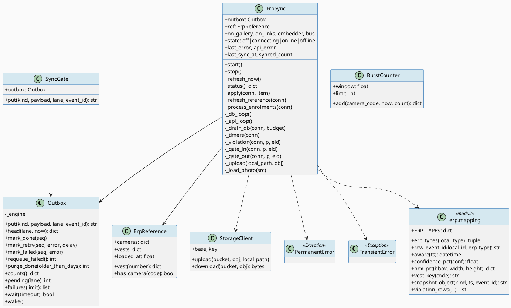
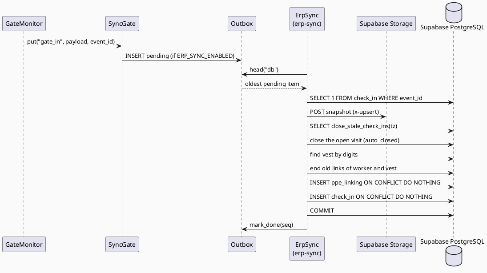
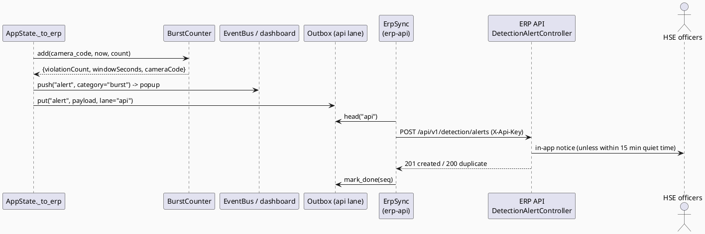
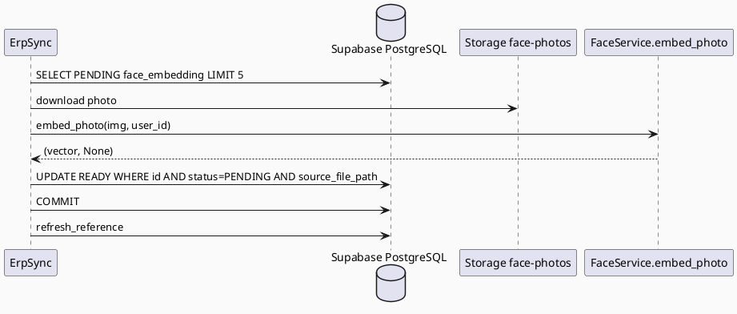
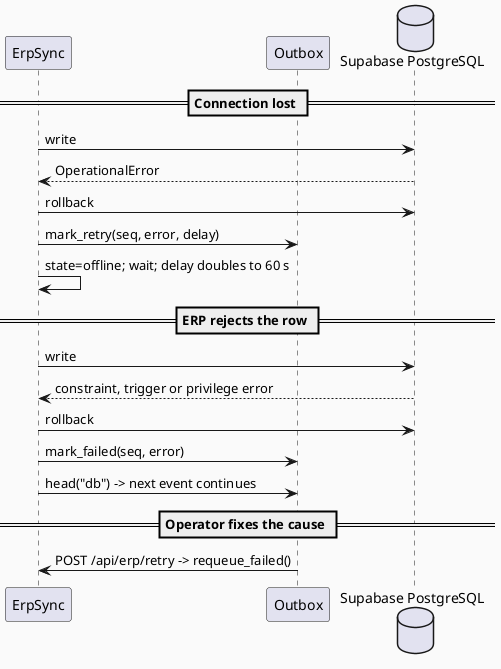
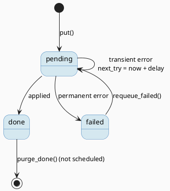
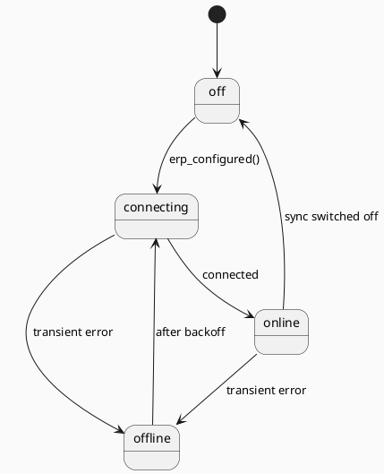

# ENGINEERING DOCUMENTATION STANDARD (EDS) v2.0
# Quy chuẩn Tài liệu Kỹ thuật và Đặc tả Hiện thực hóa

| Field | Value |
|-------|-------|
| **Document ID** | `STEELSIGHT-DET-SYN-IMP-001` |
| **Version** | `1.1` |
| **Date** | `2026-11-09` |
| **Status** | `Draft` |
| **Document Owner** | `Nguyen Vu An` |
| **Author** | `Claude Code (Opus 5.5) — reverse-engineered from the code (baseline 57283ce plus package refactor)` |
| **Reviewed by** | `[ ] Pending — Tech Lead` |
| **DPO Sign-off** | `[ ] Pending` *(**required**: biometric data)* |
| **Approved by** | `[ ] Pending — Principal Architect` |
| **Last Review** | `2026-11-17` |
| **Based on EDS** | `v2.0` |

---

## CHANGELOG

> **Policy 4.4 — Immutable History:** Không bao giờ xóa thông tin cũ. Mọi thay đổi phải ghi vào bảng này.

| Ngày | Người thực hiện | Nội dung thay đổi |
|------|-----------------|-------------------|
| 2026-11-09 | Claude Code (Opus 5.5) — documentation | Tạo tài liệu lần đầu, from the code as built after the package refactor |
| 2026-11-09 | Claude Code (Opus 5.5) — documentation | v1.1: rebuilt from the source code. Added class diagrams and missing diagrams, Gherkin scenarios, separate NFR tables, module-specific deployment, verification and error sections |
| 2026-11-17 | Claude Code (Opus 5.5) — documentation | Reference data before the queue and camera-gated violations (ADR-119), `Outbox.clear`, the `vest_fix` event and `_vest_fix` handler (ADR-120), gallery copy after each sync (ADR-117) |

---

## MỤC LỤC

1. [Tổng quan Module](#1-tổng-quan-module)
2. [Ma trận Truy vết (Traceability Matrix)](#2-ma-trận-truy-vết-traceability-matrix)
3. [Architecture Decision Records (ADR)](#3-architecture-decision-records-adr) ⭐ *Mới*
4. [Non-Functional Requirements & SLA](#4-non-functional-requirements--sla) ⭐ *Mới*
5. [Static Modeling (Mô hình Tĩnh)](#5-static-modeling-mô-hình-tĩnh)
6. [Dynamic Modeling (Mô hình Động)](#6-dynamic-modeling-mô-hình-động)
7. [Domain Event Catalog](#7-domain-event-catalog) ⭐ *Mới*
8. [Interface Specification (Đặc tả Giao diện)](#8-interface-specification-đặc-tả-giao-diện)
9. [API Specification](#9-api-specification)
10. [Bảng mã lỗi (Error Codes)](#10-bảng-mã-lỗi-error-codes)
11. [Quy trình Triển khai (Step-by-Step)](#11-quy-trình-triển-khai-step-by-step)
12. [Rollback & Incident Runbook](#12-rollback--incident-runbook) ⭐ *Mới*
13. [Kịch bản Kiểm thử Chi tiết](#13-kịch-bản-kiểm-thử-chi-tiết)
14. [Phương pháp Xác minh](#14-phương-pháp-xác-minh)
15. [Mẫu thử thực tế (API Verification Samples)](#15-mẫu-thử-thực-tế-api-verification-samples)
16. [Bảng tổng hợp phân quyền (Authorization Matrix)](#16-bảng-tổng-hợp-phân-quyền-authorization-matrix)
17. [AI Prompt Constraints (CASE 2.0)](#17-ai-prompt-constraints-case-20) ⭐⭐ *CASE 2.0 Core*

> **Adaptations to this stack:** this is a Python desktop application, so §5.2 describes SQLite, files or in-memory data rather than Prisma, §8 uses Python signatures, and deployment is a site install. Everything here was written from the source code.

---

## 1. Tổng quan Module

> Delivers local events to the ERP in order and safely, and brings back cameras, vests, faces and links.

| Field | Value |
|-------|-------|
| **Module Name** | `SYN — ERP Sync` |
| **Bounded Context** | `Outbox, mapping to ERP rows, Supabase writes and enrolment` |
| **Code** | `steelsight/erp/*` |
| **Tables** | `outbox` (SQLite); writes ERP `violation`, `check_in`, `ppe_linking`, `face_embedding` |
| **Data Classification** | `Sensitive-PII` |
| **Compliance Scope** | Luật 91/2025/QH15, NĐ 356/2025 — biometric vectors and worker records cross to a processor; DPO review required |
| **Upstream Dependencies** | IDG, SAF, Supabase PostgreSQL and Storage, ERP REST API |
| **Downstream Consumers** | IDG (gallery, links), WEB (status) |

---

## 2. Ma trận Truy vết (Traceability Matrix)

| Requirement ID | Loại (BR/ADR/US) | Mô tả yêu cầu | Thành phần Code | Compliance Target | ADR liên quan |
|---|---|---|---|---|---|
| BR-SYN-001 | Business Rule | Events within a lane leave in order | `Outbox.head` | — | — |
| BR-SYN-002 | Business Rule | Transient failures retry with backoff up to 60 s | `ErpSync`, `is_transient_db_error` | — | — |
| BR-SYN-003 | Business Rule | Permanent failures are set aside and can be re-queued | `Outbox.mark_failed`, `requeue_failed` | — | — |
| BR-SYN-004 | Business Rule | Every ERP row has a stable `event_id` | `erp/mapping.py` | — | — |
| BR-SYN-005 | Business Rule | Replaying an event changes nothing | `ErpSync` handlers | — | — |
| BR-SYN-006 | Business Rule | Writes stay within the `steelsight_detection` grants | `erp/sync.py` | — | — |
| BR-SYN-007 | Business Rule | Links are reseeded from the ERP only when the `db` lane is empty | `ErpSync.refresh_reference` | — | — |
| BR-SYN-008 | Business Rule | One camera reaching 5 ERP rows in 10 minutes raises one dashboard popup and one ERP alert | `BurstCounter` | — | — |
| FR-8.9 | Requirement | Write every violation to the ERP | `Outbox`, `ErpSync` | — | — |
| FR-7.7 | Requirement | Burst alerts to HSE | `BurstCounter`, `post_alert` | — | — |
| INT-2 | Requirement | Limited role through psycopg | `erp/sync.py` | — | — |
| INT-3 | Requirement | Never alter ERP tables | `erp/sync.py` | — | — |
| INT-7 | Requirement | Process the enrolment queue | `ErpSync.process_enrolments` | — | — |
| INT-8 | Requirement | Outbox, safe resend | `Outbox` | — | — |
| INT-11 | Requirement | `close_stale_check_ins` on a timer and before check-in | `ErpSync` | — | — |
| ADR-108 | Decision | ERP writes go through a local SQLite outbox with ordered lanes | see ADR | — | [ADR-108](../02_design/adr/ADR-108_sqlite-outbox-with-ordered-lanes.md) |
| ADR-109 | Decision | Detection creates stable event IDs for every ERP write | see ADR | — | [ADR-109](../02_design/adr/ADR-109_stable-event-ids-from-the-producer.md) |
| ADR-110 | Decision | Detection connects as a limited role and writes only granted columns | see ADR | — | [ADR-110](../02_design/adr/ADR-110_least-privilege-column-grants-for-detection.md) |
| BR-SYN-009 | Business Rule | Reference data loads before queued events | `ErpSync._db_loop` | — | ADR-119 |
| BR-SYN-010 | Business Rule | Violations only from cameras with a known ERP code | `AppState._erp_camera_code` | — | ADR-119 |
| BR-SYN-011 | Business Rule | Clear rejected events or pending violations, never pending attendance | `Outbox.clear` | — | ADR-119 |
| BR-SYN-012 | Business Rule | Gallery copied to disk after each sync | `GalleryCache.save` | Luật 91/2025 — biometric | ADR-117 |
| ADR-117 | Decision | Offline copy of the face gallery | see ADR | — | [ADR-117](../02_design/adr/ADR-117_offline-face-gallery-cache.md) |
| ADR-119 | Decision | Reference data first; violations only from known cameras | see ADR | — | [ADR-119](../02_design/adr/ADR-119_reference-first-and-camera-gated-violations.md) |
| ADR-120 | Decision | Manual vest number correction | see ADR | — | [ADR-120](../02_design/adr/ADR-120_manual-vest-number-correction.md) |

---

## 3. Architecture Decision Records (ADR)

### ADR-108 — ERP writes go through a local SQLite outbox with ordered lanes

| Field | Value |
|-------|-------|
| **Status** | `Accepted` |
| **Deciders** | `Nguyen Vu An — Developer; Claude Code (Opus 5.5) — AI pair programmer` |
| **Date** | `2026-11-09` |
| **Supersedes** | `—` |

> Full text: [ADR-108](../02_design/adr/ADR-108_sqlite-outbox-with-ordered-lanes.md). **Decision:** *We chose option C.* Lanes are `db` (Supabase) and `api` (ERP REST). The head of a lane blocks later events until it is done or failed. Transient errors back off, doubling to 60 s. Permanent errors mark the event failed so later events continue, and an operator can re-queue it.

### ADR-109 — Detection creates stable event IDs for every ERP write

| Field | Value |
|-------|-------|
| **Status** | `Accepted` |
| **Deciders** | `Nguyen Vu An — Developer; Claude Code (Opus 5.5) — AI pair programmer` |
| **Date** | `2026-11-09` |
| **Supersedes** | `—` |

> Full text: [ADR-109](../02_design/adr/ADR-109_stable-event-ids-from-the-producer.md). **Decision:** *We chose option B.* `gate_in` also carries a separate `link_event_id` for its `ppe_linking` row.

### ADR-110 — Detection connects as a limited role and writes only granted columns

| Field | Value |
|-------|-------|
| **Status** | `Accepted` |
| **Deciders** | `Nguyen Vu An — Developer; Claude Code (Opus 5.5) — AI pair programmer` |
| **Date** | `2026-11-09` |
| **Supersedes** | `—` |

> Full text: [ADR-110](../02_design/adr/ADR-110_least-privilege-column-grants-for-detection.md). **Decision:** *We chose option B.* The role reads only `id`, `employee_code`, `face_file_path`, `is_active` and `deleted_at` from `app_user`. ERP secrets come only from `.env` or environment variables.

---

## 4. Non-Functional Requirements & SLA

> No SLA has been agreed for this module. "Target" values describe what the code does today, not a contractual commitment.

### 4.1. Performance & Availability

| Category | Requirement | Target SLA | Measurement Method | Compliance Basis |
|----------|-------------|------------|---------------------|------------------|
| Batch | Events per drain pass | 100 | `_drain_db(budget=100)` | — |
| Retry (db) | Backoff | 1 s doubling to `SYNC_RETRY_MAX_SECONDS` = 60 s | Code review | BR-SYN-002 |
| Retry (api) | Backoff | 2 s doubling to 60 s | Code review | BR-SYN-002 |
| Refresh | Reference data | Every 300 s | `_timers` | — |
| Close stale | `close_stale_check_ins` | Every 600 s and before each `gate_in` | `_timers`, `_gate_in` | INT-11 |
| Enrolment | Poll, batch | Every 30 s, 5 rows | `process_enrolments` | INT-7 |
| ERP cold start | Alert timeout | 90 s | `post_alert` | — |
| Burst | Default threshold | 5 ERP rows per camera in 600 s; then quiet for 600 s | `BurstCounter` | BR-SYN-008 |

### 4.2. Data Integrity & Retention

| Category | Requirement | Target | Verification Method | Compliance Basis |
|----------|-------------|--------|---------------------|------------------|
| Durability | No event lost while offline | 0 | `tests/test_sync.py`, `tests/test_outbox.py` | NFR-10 |
| Order | Per-lane order | Strict | `Outbox.head` | BR-SYN-001 |
| Idempotency | Replay inserts nothing | Exists check + `ON CONFLICT` | SYN-TC-015 | ADR-005, ADR-109 |
| Clock skew | ERP checks stay true | `GREATEST(at, start + 1 s / 1 min)` | SQL review | ERP `check_in` CHECK |
| Atomicity | One event, one transaction | `ErpSync.apply` commits | SYN-TC-017 | ADR-108 |
| Retention gap | Done outbox rows are kept | `purge_done` exists, unscheduled | SYN-TC-026 (new) | L4 |

### 4.3. Security

| Category | Requirement | Target | Verification Method | Compliance Basis |
|----------|-------------|--------|---------------------|------------------|
| Least privilege | Connect as `steelsight_detection` | Column grants only | `tests/erp_integration_check.py` (not re-run in this pass) | ADR-110 |
| Secrets | From `.env` or environment | Never API-settable | `/api/settings` allow list | BR-DPL-002 |
| In transit | Pooler with `sslmode=require`, HTTPS | Set in the URL | Configuration | Luật 91/2025/QH15 |
| Service key | `SUPABASE_SERVICE_KEY` on the site machine | **High-value secret** | Review | L6 |

### 4.4. Scalability & Capacity Planning

> One worker thread per lane. Throughput is bounded by round trips to Supabase through the session pooler, and has not been measured.

---

## 5. Static Modeling (Mô hình Tĩnh)

### 5.1. Class Diagram (PlantUML)



### 5.2. Data Structure

**Local:** `outbox` (`STEELSIGHT-DET-DPL-IMP-001` §5.2).

**ERP tables used** (owned by the ERP's Flyway migrations; all access goes through the `steelsight_detection` grants):

| Table / function | Access | Statement constant |
|------------------|--------|--------------------|
| `violation` | SELECT by `event_id`, INSERT | `SQL_EXISTS`, `SQL_VIOLATION` |
| `check_in` | SELECT, INSERT, UPDATE `check_out_at`, `auto_closed` | `SQL_INSERT_CHECK_IN`, `SQL_CHECK_OUT`, `SQL_CLOSE_OPEN_VISIT` |
| `ppe_linking` | SELECT, INSERT, UPDATE `unlinked_at` | `SQL_INSERT_LINK`, `SQL_LINK_BY_EVENT`, `SQL_END_LINKS`, `SQL_UNLINK`, `SQL_REF_LINKS` |
| `ppe_vest` | SELECT | `SQL_VEST_ID`, `SQL_REF_VESTS` |
| `camera` | SELECT | `SQL_REF_CAMERAS`; sub-selects in inserts |
| `shift` | SELECT | Sub-select in `SQL_INSERT_CHECK_IN` |
| `face_embedding` | SELECT, UPDATE status and vector | `SQL_REF_GALLERY`, `SQL_PENDING_FACES`, `SQL_FACE_READY`, `SQL_FACE_FAILED` |
| `app_user` | SELECT `id`, `employee_code`, `is_active`, `deleted_at` | Joins |
| `close_stale_check_ins(text)` | EXECUTE | `SQL_CLOSE_STALE` |

**Type mapping**

| Local | ERP rows |
|-------|----------|
| `missing_helmet` | `NO_HARD_HAT` |
| `missing_vest`, `intruder` | `NO_VEST` |
| `missing_both` | `NO_HARD_HAT` and `NO_VEST`, sharing one photo |

**Burst alert:** `AppState._to_erp` counts every violation per camera, even with ERP sync off. At the threshold it pushes an `alert` event with category `burst`, shown as a dashboard popup, and queues one `alert` on the `api` lane. A `missing_both` counts as 2, because it becomes two ERP rows. The ERP adds its own 15-minute quiet time per camera before notifying HSE officers again.

**Storage:** bucket `detection-snapshots` holds `violations/<day>/<id>.jpg` and `check-ins/<day>/<event>.jpg`; enrolment photos are read from `face-photos`.

---

## 6. Dynamic Modeling (Mô hình Động)

### 6.1. Sequence Diagram — Happy Path (PlantUML)







### 6.2. Sequence Diagram — Error Path (PlantUML)



### 6.3. State Machine





> **⚠️ Invariant bất biến:**
> - Within a lane, a later event never overtakes an earlier pending one.
> - An `event_id` is created once and kept through every retry.
> - ERP-side links are loaded into `LinkBook` only when the `db` lane is empty, because otherwise the ERP is behind the site.
> - `check_out_at > check_in_at` and `unlinked_at > linked_at` hold even with clock skew, through `GREATEST`.

---

## 7. Domain Event Catalog

### 7.1. Events Published (Phát ra)

| Event Name | Trigger | Publisher | Subscriber(s) | Payload Schema | Async? |
|---|---|---|---|---|---|
| `alert` (api lane) | Burst limit reached | `AppState._to_erp` | ERP REST API | `eventId, violationCount, windowSeconds, detectedAt, cameraCode` | Yes |

### 7.2. Events Consumed (Tiêu thụ)

| Event Name | Source | Handler | Action thực hiện |
|---|---|---|---|
| `violation` | SAF via `AppState._to_erp` | `ErpSync.apply` | Inserts ERP rows |
| `gate_in` / `gate_out` | IDG | `ErpSync.apply` | Check-in, link and check-out in one transaction |

### 7.3. Payload Schema

```python
# Outbox "violation" (one per ERP row; event_id = row_event_id(local_id, erp_type))
{"camera_code": str, "violation_type": "NO_HARD_HAT|NO_VEST", "detected_at": iso_with_zone, "confidence": float,
 "box_x": float, "box_y": float, "box_w": float, "box_h": float, "snapshot_path": str,
 "local_snapshot": path, "user_id": int or None, "link_id": int or None, "link_event_id": uuid or None, "local_id": str}

# Outbox "alert" (lane "api"). eventId is added when sent, from the outbox event_id.
{"violationCount": int, "windowSeconds": int, "cameraCode": str or None, "detectedAt": iso_with_zone}
```
`gate_in` and `gate_out` are in `STEELSIGHT-DET-IDG-IMP-001` §7.3.

---

## 8. Interface Specification (Đặc tả Giao diện)

### 8.1. Service Interface

```python
# steelsight/erp/outbox.py  @version 1.0
class Outbox:
    def __init__(self, engine=None): ...
    def put(self, kind: str, payload: dict, lane: str = "db", event_id=None) -> str: ...  # ValueError for a bad lane
    def head(self, lane: str, now=None) -> dict | None: ...  # None if empty or the head is waiting
    def mark_done(self, seq: int) -> None: ...
    def mark_retry(self, seq: int, error: str, delay: float) -> None: ...
    def mark_failed(self, seq: int, error: str) -> None: ...
    def requeue_failed(self) -> int: ...
    def purge_done(self, older_than_days: int = 7) -> int: ...
    def counts(self) -> dict: ...
    def pending(self, lane: str) -> int: ...
    def failures(self, limit: int = 20) -> list[dict]: ...

class SyncGate:
    def put(self, kind, payload, lane="db", event_id=None) -> str | None: ...  # None while sync is off

# steelsight/erp/sync.py
class ErpSync:
    def __init__(self, outbox, reference, *, on_gallery=None, on_links=None, embedder=None, bus=None): ...
    def start(self) -> None: ...
    def stop(self) -> None: ...
    def refresh_now(self) -> None: ...
    def status(self) -> dict: ...
    def apply(self, conn, item: dict) -> None: ...  # one transaction; PermanentError for an unknown kind or camera

# steelsight/erp/mapping.py: pure functions, no I/O
def erp_types(local_type: str) -> tuple[str, ...]: ...  # ValueError if unmapped
def row_event_id(local_id: str, erp_type: str) -> str: ...  # uuid5, stable
def vest_key(code) -> str: ...
def violation_rows(*, local_id, local_type, ts, confidence, bbox, frame_size, camera_code,
                   local_snapshot, user_id=None, link_id=None, link_event_id=None) -> list[tuple[str, dict]]: ...
class BurstCounter:
    def add(self, camera_code: str, now: float, count: int = 1) -> dict | None: ...
```

### 8.2. Repository Interface

Not applicable: this module has no repository layer. Local tables are SQLAlchemy `Table` objects in `core/db.py`.

---

## 9. API Specification

### 9.1. Endpoints Table (outgoing: this module is the client)

| Method | Path | Auth | Purpose | Idempotent? |
|--------|------|------|---------|-------------|
| `POST` | `{ERP}/api/v1/detection/alerts` | `X-Api-Key` | Burst alert | Yes, by `eventId` |
| `POST` | `{SUPABASE}/storage/v1/object/{bucket}/{object}` | Bearer service key, `x-upsert: true` | Upload photo | Yes |
| `GET` | `{SUPABASE}/storage/v1/object/{bucket}/{object}` | Bearer service key | Download photo | Yes |

### 9.2. Request / Response Schemas

```json
{ "eventId": "uuid", "violationCount": 5, "windowSeconds": 60,
  "cameraCode": "CAM-B2", "detectedAt": "2026-11-09T09:30:00+07:00" }
```

| ERP answer | Treated as |
|------------|------------|
| 200, 201 | Done |
| 401, 403 | Transient (keeps the alert until the key is fixed) |
| 408, 425, 429, 5xx, network | Transient |
| Other 4xx | Permanent |

---

## 10. Bảng mã lỗi (Error Codes)

| Code | HTTP / source | Class | Message | Trigger Condition |
|------|---------------|-------|---------|-------------------|
| `SYN-001` | psycopg `OperationalError`, `InterfaceError` | Transient | driver text | Connection problem |
| `SYN-002` | Storage / ERP 408, 425, 429, 5xx, network | Transient | `HTTP <n> ...` / `mạng: ...` | Service unavailable |
| `SYN-003` | ERP API 401, 403 | Transient | `ERP API từ chối key` | Wrong API key |
| `SYN-004` | Other psycopg errors | Permanent | `<Type>: ...` | Constraint, trigger, privilege |
| `SYN-005` | Handler | Permanent | `mã camera '<x>' không có trong bảng camera` | Unknown camera |
| `SYN-006` | Handler | Permanent | `loại sự kiện không hỗ trợ: <kind>` | Unknown kind |
| `SYN-007` | Enrolment | FAILED row | `Không tải được ảnh: ...` / `Không tìm thấy khuôn mặt` | Photo missing or no face |

> `SYN-00x` labels are for traceability; `last_error` holds the plain message.

---

## 11. Quy trình Triển khai (Step-by-Step)

### 11.1. Prerequisites

- [ ] Related ADRs reviewed (§3)
- [ ] DPO sign-off — **required**
- [ ] `.venv` created by `setup.bat`

### 11.2. Pre-Migration Checklist

- [ ] Back up `data/` before upgrading (`violations.db`, `users.db`, `settings.json`, `cameras.json`)
- [ ] Local SQLite changes go through `core/db.py` `migrate`; ERP schema changes belong to the ERP's Flyway migrations

### 11.3. Implementation Steps

#### Chặng 1 — Prerequisites

- ERP migrations applied; buckets `detection-snapshots` and `face-photos` exist.
- `camera.camera_code` values match each camera's code here.

#### Chặng 2 — Configure

```dotenv
STEELSIGHT_DB_URL=postgresql://steelsight_detection.<ref>:<password>@<pooler>:5432/postgres?sslmode=require
SUPABASE_URL=https://<ref>.supabase.co
SUPABASE_SERVICE_KEY=<service key>
# STEELSIGHT_ERP_URL is optional; the default is https://steelsight-erp.onrender.com
STEELSIGHT_DETECTION_API_KEY=<same value as the ERP>
```

Then switch on **Đồng bộ ERP** in Settings.

#### Chặng 3 — Verification

```bash
curl -s http://127.0.0.1:8765/api/erp/status   # state=online, outbox.pending_db falls to 0, failures empty
```

> ⚠️ `gate_in` opens ERP visits. Never point a test machine at production data.

### 11.4. Deployment Checklist

- [ ] `pytest -q tests` passes
- [ ] The module's checks in §14 give the expected output

---

## 12. Rollback & Incident Runbook

### 12.1. Điều kiện kích hoạt Rollback

| Điều kiện | Ngưỡng | Người quyết định |
|-----------|--------|------------------|
| `pending_db` keeps growing while online | 10 minutes | Developer |
| Many failed events | Any repeated cause | Developer |
| Duplicates seen in the ERP | Any | Tech Lead + DPO |

### 12.2. Rollback Procedure

```powershell
git checkout <previous-commit>   # restore the code; data/ is not tracked
run.bat
```

### 12.3. Notification Protocol

| Thời điểm | Người nhận | Kênh | Template |
|---|---|---|---|
| When found | Developer | Direct message | Module, symptom, time |
| If personal data is exposed | DPO (no named DPO yet) | Email | Luật 91/2025/QH15 incident duties |

### 12.4. Post-Incident Review (PIR)

Timeline, root cause, impact, remediation and prevention, within 48 hours.

---

## 13. Kịch bản Kiểm thử Chi tiết

Test data classification: `SYNTHETIC`. Full specification: `04_testing/STEELSIGHT-DET-SYN-TDD-001_Test-Spec.md`.

### 13.1. Unit Tests

#### TC-UNIT-001 — Outbox order

```gherkin
Feature: Outbox lanes
  Background:
    Given test data classification: SYNTHETIC
    And an Outbox on a temporary SQLite file

  Scenario: A retry holds the lane
    Given gate_in and gate_out are queued in order
    When gate_in is retried with a delay of 30 s
    Then head("db") returns nothing before 30 s
    And gate_in is returned after 30 s with attempts 1

  Scenario: A failed event steps aside
    Given two violations are queued
    When the first is marked failed
    Then head("db") returns the second
    And requeue_failed returns 1
```

**Hàm được test:** `Outbox.head()` · **Invariant:** no overtaking inside a lane.

### 13.2. Integration Tests

#### TC-INT-001 — Handler order

```gherkin
  Scenario: gate_in runs its statements in order
    Given test data classification: SYNTHETIC
    And a scripted fake connection
    When apply receives gate_in for worker 7 with vest 12
    Then statements run as exists, close stale, close open visit, find vest, end links, insert link, find link, insert check-in
    And the connection commits once
```

**External dependencies:** PostgreSQL (real check only) · **Mock strategy:** `FakeConn` in pytest; `tests/erp_integration_check.py` runs the same handlers against the real schema as `steelsight_detection`.

### 13.3. E2E / Security Tests

#### TC-SEC-001 — Role limits

```gherkin
  Scenario: The detection role reads no worker names
    Given test data classification: SYNTHETIC
    And a connection as steelsight_detection
    When a query selects app_user.full_name
    Then the database refuses it
```

### 13.4. Case Summary

| TC ID | Test | Description | Severity | Status |
|---|---|---|---|---|
| SYN-TC-001 | `test_erp_mapping.py::test_types_map_to_erp_enum` | Types map to the ERP enum | HIGH | 🟢V |
| SYN-TC-002 | `test_erp_mapping.py::test_confidence_is_percent_and_clamped` | Confidence 0–100 | MEDIUM | 🟢V |
| SYN-TC-003 | `test_erp_mapping.py::test_box_is_percent_of_frame_and_clamped` | Box as percent | MEDIUM | 🟢V |
| SYN-TC-004 | `test_erp_mapping.py::test_vest_key_matches_by_digits` | Vest key by digits | HIGH | 🟢V |
| SYN-TC-005 | `test_erp_mapping.py::test_aware_adds_zone_only_to_naive_times` | Time zone handling | MEDIUM | 🟢V |
| SYN-TC-006 | `test_erp_mapping.py::test_missing_both_becomes_two_rows_with_stable_ids_and_one_photo` | Two rows with stable IDs | CRITICAL | 🟢V |
| SYN-TC-007 | `test_erp_mapping.py::test_violation_row_contents` | Row contents | HIGH | 🟢V |
| SYN-TC-008 | `test_erp_mapping.py::test_burst_counter_alerts_once_per_window` | One alert per window | MEDIUM | 🟢V |
| SYN-TC-009 | `test_erp_mapping.py::test_burst_counter_counts_both_rows` | Both rows count | MEDIUM | 🟢V |
| SYN-TC-010 | `test_outbox.py::test_events_come_out_in_order_per_lane` | Order per lane | CRITICAL | 🟢V |
| SYN-TC-011 | `test_outbox.py::test_retry_keeps_the_head_until_its_time` | Retry holds the head | HIGH | 🟢V |
| SYN-TC-012 | `test_outbox.py::test_failed_events_step_aside_and_can_be_requeued` | Failed events step aside | HIGH | 🟢V |
| SYN-TC-013 | `test_outbox.py::test_event_id_is_kept` | Event ID preserved | CRITICAL | 🟢V |
| SYN-TC-014 | `test_outbox.py::test_sync_gate_drops_events_while_sync_is_off` | Gate off drops events | MEDIUM | 🟢V |
| SYN-TC-015 | `test_sync.py::test_violation_insert_and_retry_is_a_no_op` | Replay is a no-op | CRITICAL | 🟢V |
| SYN-TC-016 | `test_sync.py::test_unknown_camera_is_a_permanent_error` | Unknown camera is permanent | HIGH | 🟢V |
| SYN-TC-017 | `test_sync.py::test_gate_in_closes_old_visit_moves_the_link_then_checks_in` | Closes old visit, moves link, checks in | CRITICAL | 🟢V |
| SYN-TC-018 | `test_sync.py::test_gate_in_with_unknown_vest_checks_in_without_a_link` | Unknown vest still checks in | HIGH | 🟢V |
| SYN-TC-019 | `test_sync.py::test_gate_out_checks_out_and_unlinks` | Checks out and unlinks | CRITICAL | 🟢V |
| SYN-TC-020 | `test_sync.py::test_drain_marks_rejected_rows_failed_and_keeps_going` | Rejected rows do not block | HIGH | 🟢V |
| SYN-TC-021 | `test_sync.py::test_drain_keeps_the_event_when_the_network_drops` | Network drop keeps the event | CRITICAL | 🟢V |
| SYN-TC-022 | `test_sync.py::test_reference_refresh_loads_gallery_and_links_only_when_outbox_is_empty` | Links seeded only when empty | HIGH | 🟢V |
| SYN-TC-023 | A process restart resumes pending events in order | *(new)* | HIGH | 🔴 |
| SYN-TC-024 | Backoff doubles and stops at 60 s | *(new)* | MEDIUM | 🔴 |
| SYN-TC-025 | An enrolment replaced meanwhile is not overwritten | *(new)* | HIGH | 🔴 |
| SYN-TC-026 | Done rows are purged on a schedule (not implemented) | *(new)* | LOW | 🔴 |

---

## 14. Phương pháp Xác minh

### 14.1. Database Inspection

```sql
-- Local
SELECT status, lane, count(*) FROM outbox GROUP BY status, lane;
SELECT kind, last_error FROM outbox WHERE status = 'failed' ORDER BY seq DESC LIMIT 20;
-- ERP, never run write statements against production
SELECT count(*), count(DISTINCT event_id) FROM check_in WHERE event_id IS NOT NULL;
```

### 14.2. Log / Audit Verification

```bash
curl -s http://127.0.0.1:8765/api/erp/status
```

### 14.3. Tool-based Verification

```bash
# WSL: see the header of the script for the environment it needs
python tests/erp_integration_check.py /tmp/erp-it   # against a throwaway Postgres, never production
```

---

## 15. Mẫu thử thực tế (API Verification Samples)

> Since ADR-115 every local request needs the launch cookie. Take the `steelsight_launch` value from the running window (browser DevTools → Application → Cookies) and add `-H "Cookie: steelsight_launch=<value>"` to the `curl` commands below.

### 15.1. Happy Path

```bash
curl -s -X POST http://127.0.0.1:8765/api/erp/retry     # {"ok":true,"requeued":n}
curl -s -X POST http://127.0.0.1:8765/api/erp/refresh   # {"ok":true}
```

### 15.2. Error Paths

```bash
curl -s http://127.0.0.1:8765/api/erp/status            # state "offline", error text, and failures listed
```

---

## 16. Bảng tổng hợp phân quyền (Authorization Matrix)

| Actor | Identity | Allowed |
|-------|----------|---------|
| This app to PostgreSQL | `steelsight_detection` | Granted columns only |
| This app to Storage | Service key | Both buckets |
| This app to ERP API | `X-Api-Key` | `POST /api/v1/detection/alerts` |

---

## 17. AI Prompt Constraints (CASE 2.0)

### 17.1 Constraint Summary Table

| # | Constraint | Source (ADR/BR) | Last Verified |
|---|---|---|---|
| C1 | `Queue ERP work with `SyncGate.put`; never write from engine or gate code` | `ADR-108` | `2026-11-09` |
| C2 | `Check new SQL against the ERP's column GRANTs` | `ADR-110` | `2026-11-09` |
| C3 | `Never regenerate `event_id` on retry` | `ADR-109` | `2026-11-09` |
| C4 | `Each event is one transaction committed by `ErpSync.apply`` | `ADR-108` | `2026-11-09` |
| C5 | `Do NOT create or alter ERP tables` | `INT-3` | `2026-11-09` |

### 17.2 Constraint Injection Block (Copy-Paste vào AI Prompt)

```
[CONSTRAINT BLOCK — Module: ERP Sync]
Theo TDS STEELSIGHT-DET-SYN-IMP-001 và các ADR liên quan:

1. Queue ERP work with `SyncGate.put`; never write from engine or gate code
2. Check new SQL against the ERP's column GRANTs
3. Never regenerate `event_id` on retry
4. Each event is one transaction committed by `ErpSync.apply`
5. Do NOT create or alter ERP tables

[CONTEXT BLOCK]
- Bounded Context: Outbox, mapping to ERP rows, Supabase writes and enrolment
- Data Classification: Sensitive-PII
- Existing interfaces: §8
- Auth matrix: §16

[TASK BLOCK]
Implement {feature/method} thỏa mãn constraints trên.
Output phải tuân thủ §8 Interface Specification.
Tests phải cover §13 Test Scenarios.
```

### 17.3 Constraint Quality Checklist

- [x] Mỗi constraint traceable về ADR hoặc BR cụ thể
- [x] Không có constraint generic
- [x] Mỗi constraint có `Last Verified` date ≤ 2 sprints
- [x] Constraint block có ≥ 3 constraints cụ thể
- [x] Constraint block reference §8 Interface
- [x] Constraint block reference §16 Auth Matrix

### 17.4 Anti-Pattern Detection

| AP-ID | Anti-Pattern | Dấu hiệu | Hành động |
|-------|-------------|-----------|----------|
| AP-AI-001 | Unconstrained Gen | Code không match bất kỳ constraint nào | Reject — inject lại constraints |
| AP-AI-003 | Implicit Decision | Code assume architecture không có trong §3 ADR | Reject — viết ADR trước |
| AP-AI-005 | Hallucinated Contract | Code import service/type không có trong §8 | Reject — verify contract existence |

---

## PHỤ LỤC

### A. Glossary (Thuật ngữ)

| Thuật ngữ | Định nghĩa |
|-----------|------------|
| Lane | An independent ordered queue in the outbox |
| Transient / permanent | Worth retrying / not worth retrying |
| Session pooler | Supabase's PostgreSQL connection endpoint |
| PII | Personally Identifiable Information |
| DPO | Data Protection Officer |
| Red Gate | Check that tests fail against a stub before implementation |

### B. Tài liệu tham chiếu

| Document | Path |
|----------|------|
| Module map | `02_design/DETECTION-MODULE-MAP.md` |
| Source | `steelsight/erp/*` |
| Requirements | `docs/REQUIREMENTS_SPECIFICATION.md` |

---

*EDS v2.1 — Tích hợp CASE 2.0 AI Prompt Constraints (§17).*
