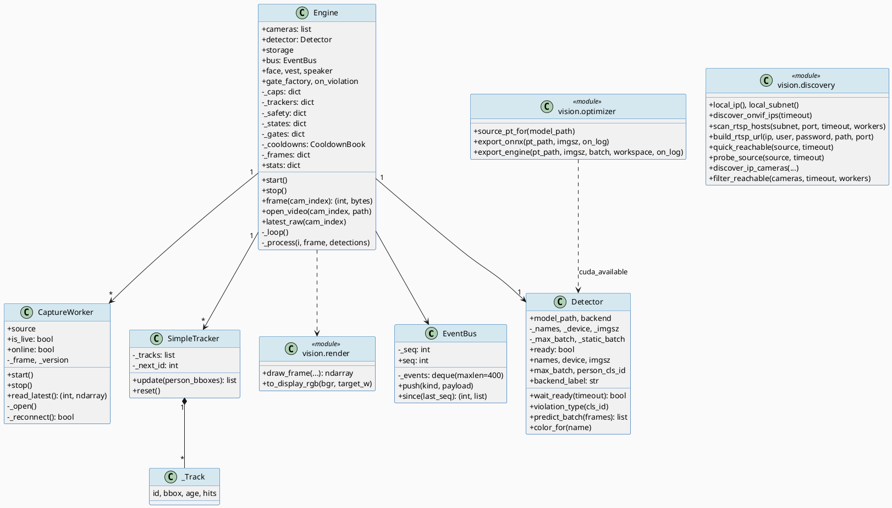
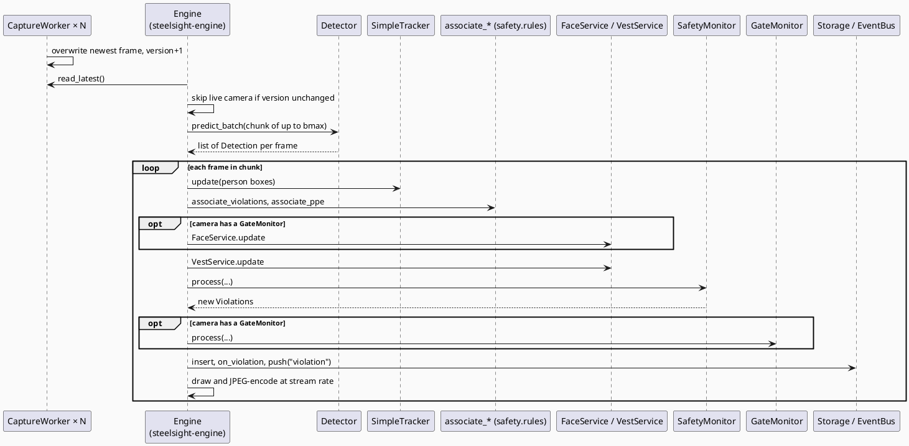
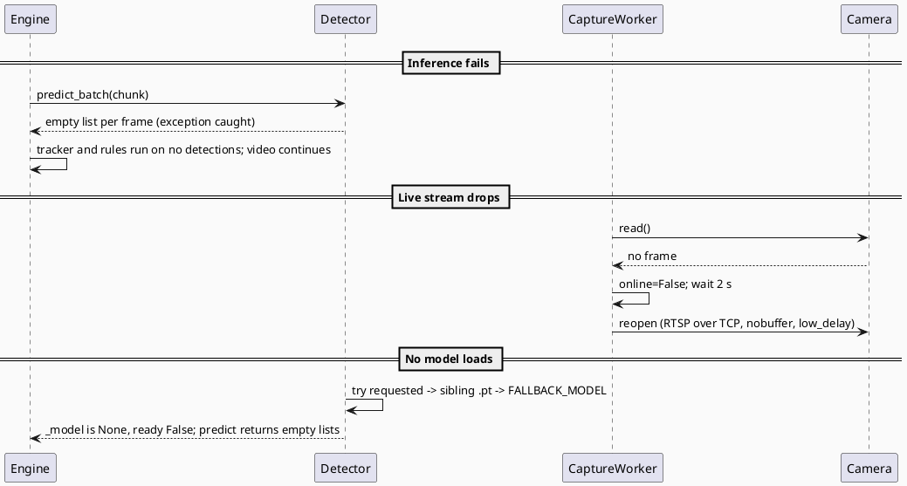
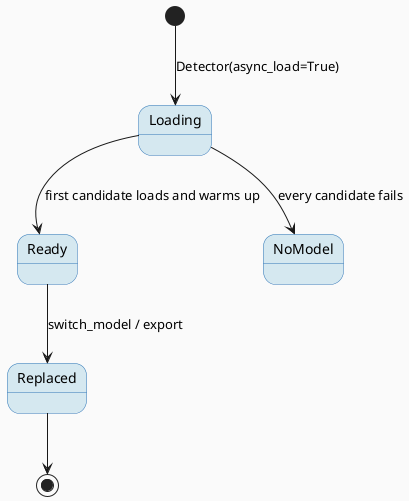
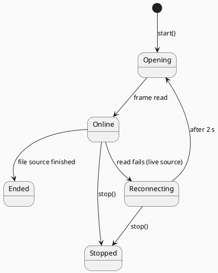

# ENGINEERING DOCUMENTATION STANDARD (EDS) v2.0
# Quy chuẩn Tài liệu Kỹ thuật và Đặc tả Hiện thực hóa

| Field | Value |
|-------|-------|
| **Document ID** | `STEELSIGHT-DET-VIS-IMP-001` |
| **Version** | `1.1` |
| **Date** | `2026-11-09` |
| **Status** | `Draft` |
| **Document Owner** | `Nguyen Vu An` |
| **Author** | `Claude Code (Opus 5.5) — reverse-engineered from the code (baseline 57283ce plus package refactor)` |
| **Reviewed by** | `[ ] Pending — Tech Lead` |
| **DPO Sign-off** | `[ ] Pending` |
| **Approved by** | `[ ] Pending — Principal Architect` |
| **Last Review** | `2026-11-09` |
| **Based on EDS** | `v2.0` |

---

## CHANGELOG

> **Policy 4.4 — Immutable History:** Không bao giờ xóa thông tin cũ. Mọi thay đổi phải ghi vào bảng này.

| Ngày | Người thực hiện | Nội dung thay đổi |
|------|-----------------|-------------------|
| 2026-11-09 | Claude Code (Opus 5.5) — documentation | Tạo tài liệu lần đầu, from the code as built after the package refactor |
| 2026-11-09 | Claude Code (Opus 5.5) — documentation | v1.1: rebuilt from the source code. Added class diagrams and missing diagrams, Gherkin scenarios, separate NFR tables, module-specific deployment, verification and error sections |

---

## MỤC LỤC

1. [Tổng quan Module](#1-tổng-quan-module)
2. [Ma trận Truy vết (Traceability Matrix)](#2-ma-trận-truy-vết-traceability-matrix)
3. [Architecture Decision Records (ADR)](#3-architecture-decision-records-adr) ⭐ *Mới*
4. [Non-Functional Requirements & SLA](#4-non-functional-requirements--sla) ⭐ *Mới*
5. [Static Modeling (Mô hình Tĩnh)](#5-static-modeling-mô-hình-tĩnh)
6. [Dynamic Modeling (Mô hình Động)](#6-dynamic-modeling-mô-hình-động)
7. [Domain Event Catalog](#7-domain-event-catalog) ⭐ *Mới*
8. [Interface Specification (Đặc tả Giao diện)](#8-interface-specification-đặc-tả-giao-diện)
9. [API Specification](#9-api-specification)
10. [Bảng mã lỗi (Error Codes)](#10-bảng-mã-lỗi-error-codes)
11. [Quy trình Triển khai (Step-by-Step)](#11-quy-trình-triển-khai-step-by-step)
12. [Rollback & Incident Runbook](#12-rollback--incident-runbook) ⭐ *Mới*
13. [Kịch bản Kiểm thử Chi tiết](#13-kịch-bản-kiểm-thử-chi-tiết)
14. [Phương pháp Xác minh](#14-phương-pháp-xác-minh)
15. [Mẫu thử thực tế (API Verification Samples)](#15-mẫu-thử-thực-tế-api-verification-samples)
16. [Bảng tổng hợp phân quyền (Authorization Matrix)](#16-bảng-tổng-hợp-phân-quyền-authorization-matrix)
17. [AI Prompt Constraints (CASE 2.0)](#17-ai-prompt-constraints-case-20) ⭐⭐ *CASE 2.0 Core*

> **Adaptations to this stack:** this is a Python desktop application, so §5.2 describes SQLite, files or in-memory data rather than Prisma, §8 uses Python signatures, and deployment is a site install. Everything here was written from the source code.

---

## 1. Tổng quan Module

> Reads cameras, runs one batched detector, tracks people and hands each frame to the rules.

| Field | Value |
|-------|-------|
| **Module Name** | `VIS — Vision & Engine` |
| **Bounded Context** | `Camera input, YOLO inference, tracking and the realtime loop` |
| **Code** | `steelsight/engine.py`, `steelsight/vision/*` |
| **Tables** | *(none)* |
| **Data Classification** | `PII` |
| **Compliance Scope** | Luật 91/2025/QH15 — video of identifiable workers; frames are held in memory |
| **Upstream Dependencies** | Cameras, ultralytics, ONNX Runtime, TensorRT |
| **Downstream Consumers** | SAF, IDG, WEB |

---

## 2. Ma trận Truy vết (Traceability Matrix)

| Requirement ID | Loại (BR/ADR/US) | Mô tả yêu cầu | Thành phần Code | Compliance Target | ADR liên quan |
|---|---|---|---|---|---|
| BR-VIS-001 | Business Rule | Only the newest frame of each camera is processed | `vision/capture.py`, `engine.py` | — | — |
| BR-VIS-002 | Business Rule | Inference batches at most `min(BATCH_MAX, detector.max_batch)` frames | `engine.py` | — | — |
| BR-VIS-003 | Business Rule | Model load falls back to the same-name `.pt`, then `FALLBACK_MODEL` | `vision/detector.py` | — | — |
| BR-VIS-004 | Business Rule | Tracks match by greedy IoU ≥ 0.3 and are dropped after 30 unmatched frames | `vision/tracker.py` | — | — |
| BR-VIS-005 | Business Rule | Live streams reconnect every 2 s with no retry limit | `vision/capture.py` | — | — |
| FR-1.1 | Requirement | Accept webcams, streams and files | `CaptureWorker` | — | — |
| FR-1.2 | Requirement | Newest frame only | `CaptureWorker.read_latest` | — | — |
| FR-1.3 | Requirement | Reconnect dropped streams | `CaptureWorker` | — | — |
| FR-2.3 | Requirement | One model, one batch | `Engine` | — | — |
| FR-2.5 | Requirement | Fallback model | `Detector` | — | — |
| FR-3.1 | Requirement | Stable ID within a camera | `SimpleTracker` | — | — |
| ADR-103 | Decision | One detector, one batched realtime loop, latest frame only | see ADR | — | [ADR-103](../02_design/adr/ADR-103_one-batched-realtime-loop-on-latest-frames.md) |
| ADR-104 | Decision | Face and OCR models run off the detection loop | see ADR | — | [ADR-104](../02_design/adr/ADR-104_identity-models-off-the-detection-loop.md) |

---

## 3. Architecture Decision Records (ADR)

### ADR-103 — One detector, one batched realtime loop, latest frame only

| Field | Value |
|-------|-------|
| **Status** | `Accepted` |
| **Deciders** | `Nguyen Vu An — Developer; Claude Code (Opus 5.5) — AI pair programmer` |
| **Date** | `2026-11-09` |
| **Supersedes** | `—` |

> Full text: [ADR-103](../02_design/adr/ADR-103_one-batched-realtime-loop-on-latest-frames.md). **Decision:** *We chose option B.* Capture threads overwrite a one-slot buffer. The engine processes a camera only when its frame version has changed, in chunks of up to `BATCH_MAX` (4).

### ADR-104 — Face and OCR models run off the detection loop

| Field | Value |
|-------|-------|
| **Status** | `Accepted` |
| **Deciders** | `Nguyen Vu An — Developer; Claude Code (Opus 5.5) — AI pair programmer` |
| **Date** | `2026-11-09` |
| **Supersedes** | `—` |

> Full text: [ADR-104](../02_design/adr/ADR-104_identity-models-off-the-detection-loop.md). **Decision:** *We chose option B.* Face queue size 16; OCR queue size 8. A full queue skips the crop for that frame. Two matching votes confirm an identity.

---

## 4. Non-Functional Requirements & SLA

> No SLA has been agreed for this module. "Target" values describe what the code does today, not a contractual commitment.

### 4.1. Performance & Availability

| Category | Requirement | Target SLA | Measurement Method | Compliance Basis |
|----------|-------------|------------|---------------------|------------------|
| Pacing | Inference loop rate cap | `ENGINE_TARGET_FPS` = 20 | `Engine._loop` | NFR-13 (no benchmark recorded) |
| Stream | JPEG encode rate per camera | `STREAM_FPS_CAP` = 15, width ≤ 800, quality 80 | `Engine._process` | — |
| Batch | Frames per forward pass | `min(BATCH_MAX=4, detector.max_batch)` | `Engine._loop` | BR-VIS-002 |
| Resilience | A model or per-camera error keeps video running | Try/except around predict and `_process` | Code review | NFR-1 |
| Reconnect | Live source retry | Every 2 s, unlimited | `CaptureWorker._reconnect` | BR-VIS-005 |
| Telemetry | FPS window | Measured every 10 processed frames | `Engine._process` | — |

### 4.2. Data Integrity & Retention

| Category | Requirement | Target | Verification Method | Compliance Basis |
|----------|-------------|--------|---------------------|------------------|
| Video | Frames held only in memory | One slot per camera, plus one JPEG | Code review | Luật 91/2025/QH15 |
| Tracking | IDs are per camera and reset on restart | No cross-camera or cross-restart ID | `SimpleTracker` | FR-3.2, FR-3.3 not met |

### 4.3. Security

| Category | Requirement | Target | Verification Method | Compliance Basis |
|----------|-------------|--------|---------------------|------------------|
| Camera credentials | RTSP passwords URL-encoded when built | `build_rtsp_url` quotes user and password | Code review | NFR-8 |
| Probes | ONVIF and port-554 scans stay on the local /24 | Local subnet only | `local_subnet` | Network policy |

### 4.4. Scalability & Capacity Planning

> One detector shared by all cameras, up to 4 frames per batch. More cameras divide the same GPU time. TensorRT engines are tied to the GPU and TensorRT version that built them.

---

## 5. Static Modeling (Mô hình Tĩnh)

### 5.1. Class Diagram (PlantUML)



### 5.2. Data Structure

No tables. In-memory structures:

```python
Engine._frames: dict[int, tuple[int, bytes]]   # camera -> (version, JPEG)
Engine._stats:  dict[int, dict]                # camera -> {online, fps, persons, violations}
CaptureWorker._frame / _version                # newest ndarray and its counter, under a lock
```

`stats[i]["violations"]` counts people with a negative box in the current frame, not stored violations.

**Backend selection (`Detector._configure_backend`):**

| Backend | Device | imgsz | Batch |
|---------|--------|-------|-------|
| `.engine` | `cuda:0`, FP16 from build | Dynamic: `min(max(64, DETECT_IMGSZ), meta*2)`; static: metadata | Dynamic: `min(BATCH_MAX, meta batch)`; static: exact, padded |
| `.onnx` | CUDA if ONNX Runtime and torch both have it; else CPU, DirectML when available | Input height if fixed, else `DETECT_IMGSZ` | Input batch if fixed, else `BATCH_MAX` |
| `.pt` | `resolve_device()` | `DETECT_IMGSZ` | `BATCH_MAX`; FP16 on CUDA when enabled |

---

## 6. Dynamic Modeling (Mô hình Động)

### 6.1. Sequence Diagram — Happy Path (PlantUML)



### 6.2. Sequence Diagram — Error Path (PlantUML)



### 6.3. State Machine





> **⚠️ Invariant bất biến:**
> - One slot per camera: there is never a frame queue.
> - A frame is processed once; live cameras are skipped until `version` changes.
> - For a static-batch backend, results for padded frames are dropped.

---

## 7. Domain Event Catalog

### 7.1. Events Published (Phát ra)

| Event Name | Trigger | Publisher | Subscriber(s) | Payload Schema | Async? |
|---|---|---|---|---|---|
| `system`, `export`, `alert` | Model and engine state | `AppState`, `Engine` | Dashboard, Notifier, Reporter | `{message, ...}` | Polled |

### 7.2. Events Consumed (Tiêu thụ)

*This module consumes no events.*

### 7.3. Payload Schema

```python
# EventBus entries: {"kind": <kind>, **payload}
{"kind": "system", "message": str}
{"kind": "export", "message": str, "done": bool, "ok": bool}
{"kind": "violation", **Violation.to_event()}   # see SAF
```

---

## 8. Interface Specification (Đặc tả Giao diện)

### 8.1. Service Interface

```python
# steelsight/engine.py  @version 1.0
class EventBus:
    def __init__(self, maxlen: int = 400): ...
    def push(self, kind: str, payload: dict) -> None: ...
    def since(self, last_seq: int) -> tuple[int, list[dict]]: ...

class Engine:
    def __init__(self, cameras, detector, storage, bus, face=None, vest=None, speaker=None,
                 gate_factory=None, on_violation=None): ...
    def start(self) -> None: ...
    def stop(self) -> None: ...
    def frame(self, cam_index: int) -> tuple[int, bytes | None]: ...     # (-1, None) before the first frame
    @property
    def stats(self) -> dict[int, dict]: ...
    def open_video(self, cam_index: int, path: str) -> None: ...          # not exposed by any route yet
    def latest_raw(self, cam_index: int): ...                             # a copy, or None

# steelsight/vision/detector.py
class Detector:
    def __init__(self, model_path=None, async_load=False, on_ready=None): ...
    def predict_batch(self, frames: list) -> list[list[Detection]]: ...   # never raises for inference errors

# steelsight/vision/tracker.py
class SimpleTracker:
    def update(self, person_bboxes: list) -> list[tuple[BBox, int]]: ...  # same order as the input
```

### 8.2. Repository Interface

Not applicable: this module has no repository layer. Local tables are SQLAlchemy `Table` objects in `core/db.py`.

---

## 9. API Specification

### 9.1. Endpoints Table

*This module has no HTTP endpoints of its own. See `STEELSIGHT-DET-WEB-IMP-001` §9.*

### 9.2. Request / Response Schemas

*Not applicable.*

---

## 10. Bảng mã lỗi (Error Codes)

| Code | Where | Message / effect | Trigger Condition |
|------|-------|------------------|-------------------|
| *(printed)* | `Detector._load` | `Lỗi load <path>` | One candidate model fails |
| *(printed)* | `Engine._loop` | `predict_batch lỗi -> stream frame thô` | Inference raises |
| *(printed)* | `Engine._process` | `process cam <i> lỗi` | Any per-camera step raises |
| *(event)* | `optimizer` | `Xuất ONNX thất bại`, `Build engine thất bại` | Export fails |

> This module has no coded errors.

---

## 11. Quy trình Triển khai (Step-by-Step)

### 11.1. Prerequisites

- [ ] Related ADRs reviewed (§3)
- [ ] DPO sign-off if personal data handling changes
- [ ] `.venv` created by `setup.bat`

### 11.2. Pre-Migration Checklist

- [ ] Back up `data/` before upgrading (`violations.db`, `users.db`, `settings.json`, `cameras.json`)
- [ ] Local SQLite changes go through `core/db.py` `migrate`; ERP schema changes belong to the ERP's Flyway migrations

### 11.3. Implementation Steps

#### Chặng 1 — Place model files

```powershell
# models/best.pt (required for export), models/yolo26n.pt (fallback)
.venv\Scripts\python.exe scripts\build_engine.py   # builds best.engine on this GPU; exits 0 without CUDA
```

#### Chặng 2 — Verification

```powershell
.venv\Scripts\python.exe run.py
# Expected in the header: backend label such as "TensorRT · GPU · FP16", each camera online
```

> ⚠️ Never copy a `.engine` from another machine. It fails to load and falls back to the `.pt`.

### 11.4. Deployment Checklist

- [ ] `pytest -q tests` passes
- [ ] The module's checks in §14 give the expected output

---

## 12. Rollback & Incident Runbook

### 12.1. Điều kiện kích hoạt Rollback

| Điều kiện | Ngưỡng | Người quyết định |
|-----------|--------|------------------|
| FPS collapses after a model change | Visibly below normal | Site administrator |
| Falls back to `yolo26n.pt` unexpectedly | Any | Developer |

### 12.2. Rollback Procedure

```powershell
git checkout <previous-commit>   # restore the code; data/ is not tracked
run.bat
```

### 12.3. Notification Protocol

| Thời điểm | Người nhận | Kênh | Template |
|---|---|---|---|
| When found | Developer | Direct message | Module, symptom, time |
| If personal data is exposed | DPO (no named DPO yet) | Email | Luật 91/2025/QH15 incident duties |

### 12.4. Post-Incident Review (PIR)

Timeline, root cause, impact, remediation and prevention, within 48 hours.

---

## 13. Kịch bản Kiểm thử Chi tiết

Test data classification: `SYNTHETIC`. Full specification: `04_testing/STEELSIGHT-DET-VIS-TDD-001_Test-Spec.md`.

### 13.1. Unit Tests

#### TC-UNIT-001 — Tracker keeps identity

```gherkin
Feature: IoU tracking
  Background:
    Given test data classification: SYNTHETIC

  Scenario: Overlapping boxes keep the same id
    Given a track at box A
    When update receives a box overlapping A with IoU 0.5
    Then the returned id is the same

  Scenario: A box below the threshold starts a new track
    When update receives a box with IoU below 0.3
    Then a new id is returned

  Scenario: Old tracks are dropped
    Given a track unmatched for TRACK_MAX_AGE + 1 frames
    Then a box at that position gets a new id
```

**Hàm được test:** `SimpleTracker.update()` · **Invariant:** output order matches input order.

### 13.2. Integration Tests

#### TC-INT-001 — Engine wiring

```gherkin
  Scenario: Face recognition runs only on the gate camera
    Given test data classification: SYNTHETIC
    And one gate camera and one zone camera with fake services
    When a person walks across the gate line and a NoHelmet box appears on the zone camera
    Then FaceService.update was called only for the gate camera
    And a gate_in event is queued
    And the zone violation has camera_code CAM-B2 and identity_source vest
```

**External dependencies:** none · **Mock strategy:** `FakeDetector`, `FakeFace`, `FakeVest`, `FakeStorage`, `FakeOutbox`.

### 13.3. E2E / Security Tests

#### TC-E2E-001 — Stream

```gherkin
  Scenario: A browser receives frames
    Given test data classification: SYNTHETIC
    And the app is running with a test video
    When GET /stream/0 is opened
    Then the response is multipart/x-mixed-replace with boundary steelsight-frame
```

### 13.4. Case Summary

| TC ID | Test | Description | Severity | Status |
|---|---|---|---|---|
| VIS-TC-001 | `test_engine_flow.py::test_gate_camera_checks_in_and_zone_camera_reports_a_named_violation` | Gate and zone cameras run through one engine flow | HIGH | 🟢V |
| VIS-TC-002 | A slower reader sees the newest frame, not a backlog | *(new)* | HIGH | 🔴 |
| VIS-TC-003 | An unmatched track is dropped after `TRACK_MAX_AGE` frames | *(new)* | MEDIUM | 🔴 |
| VIS-TC-004 | Overlap below 0.3 starts a new track | *(new)* | MEDIUM | 🔴 |
| VIS-TC-005 | A detector exception yields empty detections and the loop continues | *(new)* | HIGH | 🔴 |
| VIS-TC-006 | `.engine` without CUDA loads the same-name `.pt` | *(new)* | MEDIUM | 🔴 |

---

## 14. Phương pháp Xác minh

### 14.1. Database Inspection

*No tables.*

### 14.2. Log / Audit Verification

```powershell
.venv\Scripts\python.exe run.py | findstr "[Detector] [Engine]"
# Expected: "[Detector] backend=... device=... imgsz=... max_batch=... classes=[...]"
```

### 14.3. Tool-based Verification

```powershell
.venv\Scripts\python.exe -m pytest -q tests/test_engine_flow.py
```

---

## 15. Mẫu thử thực tế (API Verification Samples)

> Since ADR-115 every local request needs the launch cookie. Take the `steelsight_launch` value from the running window (browser DevTools → Application → Cookies) and add `-H "Cookie: steelsight_launch=<value>"` to the `curl` commands below.

### 15.1. Happy Path

```bash
curl -s http://127.0.0.1:8765/api/state    # model.backend, model.ready, model.imgsz
curl -i http://127.0.0.1:8765/stream/0     # multipart/x-mixed-replace; boundary=steelsight-frame
```

### 15.2. Error Paths

```bash
curl -i http://127.0.0.1:8765/api/cameras/0/frame   # 404 {"ok":false,"error":"Chưa có hình từ camera này."} when no frame exists
```

---

## 16. Bảng tổng hợp phân quyền (Authorization Matrix)

*No endpoints of its own. `/stream/{cam_index}` is listed in `STEELSIGHT-DET-WEB-IMP-001` §16.*

---

## 17. AI Prompt Constraints (CASE 2.0)

### 17.1 Constraint Summary Table

| # | Constraint | Source (ADR/BR) | Last Verified |
|---|---|---|---|
| C1 | `The engine thread MUST NOT block on I/O, identity models or the ERP` | `ADR-103` | `2026-11-09` |
| C2 | `Capture workers keep only the newest frame` | `BR-VIS-001` | `2026-11-09` |
| C3 | `Catch failures per camera step so video keeps streaming` | `NFR-1` | `2026-11-09` |
| C4 | `Publish UI events through `EventBus`` | `ADR-112` | `2026-11-09` |
| C5 | `Face and OCR calls only queue work` | `ADR-104` | `2026-11-09` |

### 17.2 Constraint Injection Block (Copy-Paste vào AI Prompt)

```
[CONSTRAINT BLOCK — Module: Vision & Engine]
Theo TDS STEELSIGHT-DET-VIS-IMP-001 và các ADR liên quan:

1. The engine thread MUST NOT block on I/O, identity models or the ERP
2. Capture workers keep only the newest frame
3. Catch failures per camera step so video keeps streaming
4. Publish UI events through `EventBus`
5. Face and OCR calls only queue work

[CONTEXT BLOCK]
- Bounded Context: Camera input, YOLO inference, tracking and the realtime loop
- Data Classification: PII
- Existing interfaces: §8
- Auth matrix: §16

[TASK BLOCK]
Implement {feature/method} thỏa mãn constraints trên.
Output phải tuân thủ §8 Interface Specification.
Tests phải cover §13 Test Scenarios.
```

### 17.3 Constraint Quality Checklist

- [x] Mỗi constraint traceable về ADR hoặc BR cụ thể
- [x] Không có constraint generic
- [x] Mỗi constraint có `Last Verified` date ≤ 2 sprints
- [x] Constraint block có ≥ 3 constraints cụ thể
- [x] Constraint block reference §8 Interface
- [x] Constraint block reference §16 Auth Matrix

### 17.4 Anti-Pattern Detection

| AP-ID | Anti-Pattern | Dấu hiệu | Hành động |
|-------|-------------|-----------|----------|
| AP-AI-001 | Unconstrained Gen | Code không match bất kỳ constraint nào | Reject — inject lại constraints |
| AP-AI-003 | Implicit Decision | Code assume architecture không có trong §3 ADR | Reject — viết ADR trước |
| AP-AI-005 | Hallucinated Contract | Code import service/type không có trong §8 | Reject — verify contract existence |

---

## PHỤ LỤC

### A. Glossary (Thuật ngữ)

| Thuật ngữ | Định nghĩa |
|-----------|------------|
| Latest-frame | Only the newest camera frame is kept |
| Static batch | An exported model locked to one batch size, padded by the detector |
| Foot point | Bottom-centre of a person box, used by the gate |
| PII | Personally Identifiable Information |
| DPO | Data Protection Officer |
| Red Gate | Check that tests fail against a stub before implementation |

### B. Tài liệu tham chiếu

| Document | Path |
|----------|------|
| Module map | `02_design/DETECTION-MODULE-MAP.md` |
| Source | `steelsight/engine.py`, `steelsight/vision/*` |
| Requirements | `docs/REQUIREMENTS_SPECIFICATION.md` |

---

*EDS v2.1 — Tích hợp CASE 2.0 AI Prompt Constraints (§17).*
