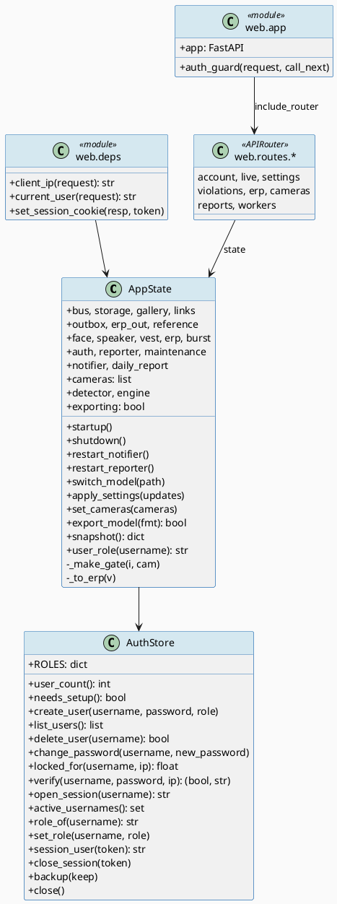
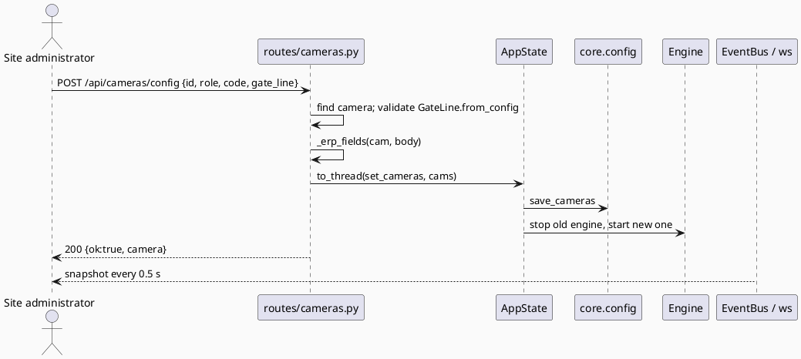
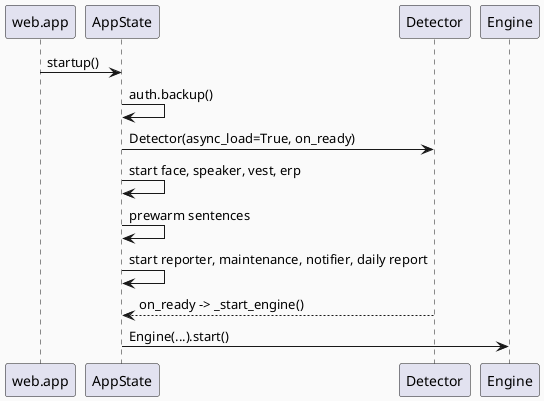
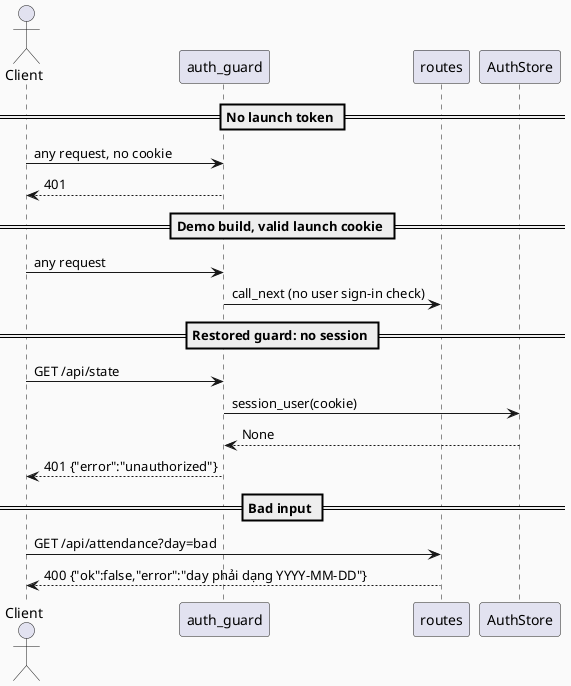
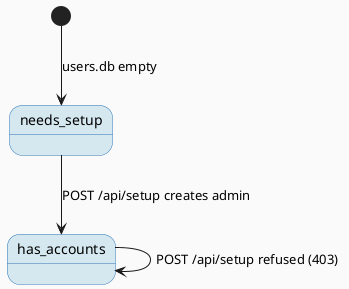

# ENGINEERING DOCUMENTATION STANDARD (EDS) v2.0
# Quy chuẩn Tài liệu Kỹ thuật và Đặc tả Hiện thực hóa

| Field | Value |
|-------|-------|
| **Document ID** | `STEELSIGHT-DET-WEB-IMP-001` |
| **Version** | `1.1` |
| **Date** | `2026-11-09` |
| **Status** | `Draft` |
| **Document Owner** | `Nguyen Vu An` |
| **Author** | `Claude Code (Opus 5.5) — reverse-engineered from the code (baseline 57283ce plus package refactor)` |
| **Reviewed by** | `[ ] Pending — Tech Lead` |
| **DPO Sign-off** | `[ ] Pending` |
| **Approved by** | `[ ] Pending — Principal Architect` |
| **Last Review** | `2026-11-17` |
| **Based on EDS** | `v2.0` |

---

## CHANGELOG

> **Policy 4.4 — Immutable History:** Không bao giờ xóa thông tin cũ. Mọi thay đổi phải ghi vào bảng này.

| Ngày | Người thực hiện | Nội dung thay đổi |
|------|-----------------|-------------------|
| 2026-11-09 | Claude Code (Opus 5.5) — documentation | Tạo tài liệu lần đầu, from the code as built after the package refactor |
| 2026-11-09 | Claude Code (Opus 5.5) — documentation | v1.1: rebuilt from the source code. Added class diagrams and missing diagrams, Gherkin scenarios, separate NFR tables, module-specific deployment, verification and error sections |
| 2026-11-17 | Claude Code (Opus 5.5) — documentation | Preview stills (ADR-121, `GET /stream/{i}/still`), `POST /api/erp/clear`, `POST /api/vest/fix`, vest correction on the worker cards and gate screen, clear buttons in Settings, scanner re-scan setting in seconds, stable camera IDs (crc32 instead of `hash()`) |

---

## MỤC LỤC

1. [Tổng quan Module](#1-tổng-quan-module)
2. [Ma trận Truy vết (Traceability Matrix)](#2-ma-trận-truy-vết-traceability-matrix)
3. [Architecture Decision Records (ADR)](#3-architecture-decision-records-adr) ⭐ *Mới*
4. [Non-Functional Requirements & SLA](#4-non-functional-requirements--sla) ⭐ *Mới*
5. [Static Modeling (Mô hình Tĩnh)](#5-static-modeling-mô-hình-tĩnh)
6. [Dynamic Modeling (Mô hình Động)](#6-dynamic-modeling-mô-hình-động)
7. [Domain Event Catalog](#7-domain-event-catalog) ⭐ *Mới*
8. [Interface Specification (Đặc tả Giao diện)](#8-interface-specification-đặc-tả-giao-diện)
9. [API Specification](#9-api-specification)
10. [Bảng mã lỗi (Error Codes)](#10-bảng-mã-lỗi-error-codes)
11. [Quy trình Triển khai (Step-by-Step)](#11-quy-trình-triển-khai-step-by-step)
12. [Rollback & Incident Runbook](#12-rollback--incident-runbook) ⭐ *Mới*
13. [Kịch bản Kiểm thử Chi tiết](#13-kịch-bản-kiểm-thử-chi-tiết)
14. [Phương pháp Xác minh](#14-phương-pháp-xác-minh)
15. [Mẫu thử thực tế (API Verification Samples)](#15-mẫu-thử-thực-tế-api-verification-samples)
16. [Bảng tổng hợp phân quyền (Authorization Matrix)](#16-bảng-tổng-hợp-phân-quyền-authorization-matrix)
17. [AI Prompt Constraints (CASE 2.0)](#17-ai-prompt-constraints-case-20) ⭐⭐ *CASE 2.0 Core*

> **Adaptations to this stack:** this is a Python desktop application, so §5.2 describes SQLite, files or in-memory data rather than Prisma, §8 uses Python signatures, and deployment is a site install. Everything here was written from the source code.

---

## 1. Tổng quan Module

> Serves the dashboard and API, owns application state, and holds the sign-in code that the demo bypasses.

| Field | Value |
|-------|-------|
| **Module Name** | `WEB — Web & Access` |
| **Bounded Context** | `Dashboard API, application state and sign-in` |
| **Code** | `steelsight/web/*` |
| **Tables** | `users.db` (accounts) |
| **Data Classification** | `Confidential` |
| **Compliance Scope** | Luật 91/2025/QH15 — **demo build has no access control; not for customer delivery** |
| **Upstream Dependencies** | All modules |
| **Downstream Consumers** | Browser dashboard, pywebview |

---

## 2. Ma trận Truy vết (Traceability Matrix)

| Requirement ID | Loại (BR/ADR/US) | Mô tả yêu cầu | Thành phần Code | Compliance Target | ADR liên quan |
|---|---|---|---|---|---|
| BR-WEB-001 | Business Rule | UI events are polled from `EventBus`, not pushed across threads | `web/routes/live.py` | — | — |
| BR-WEB-002 | Business Rule | Demo build: all requests skip sign-in checks | `web/app.py` `auth_guard` | — | — |
| BR-WEB-003 | Business Rule | Passwords are PBKDF2-HMAC-SHA256 with 200,000 iterations | `web/auth.py` | — | — |
| BR-WEB-004 | Business Rule | Repeated failed sign-ins lock out with doubling delay | `AuthStore.locked_for` | — | — |
| BR-WEB-005 | Business Rule | The first admin can be created only while no account exists | `web/routes/account.py` `api_setup` | — | — |
| BR-WEB-006 | Business Rule | Empty secret fields do not erase saved secrets | `web/routes/settings.py` | — | — |
| BR-WEB-007 | Business Rule | Every local HTTP and WebSocket request needs the launch token | `web/access.py`, `auth_guard`, `routes/live.py` | — | — |
| FR-1.4 | Requirement | Manage cameras from the UI | `routes/cameras.py` | — | — |
| FR-2.6 | Requirement | Switch model while running | `routes/settings.py` | — | — |
| FR-6.6 | Requirement | Gate log | `routes/workers.py` | — | — |
| FR-7.4 | Requirement | Immediate dashboard updates | `routes/live.py` | — | — |
| FR-9.1 | Requirement | Require sign-in (disabled) | `auth_guard` | — | — |
| FR-9.2 | Requirement | Slow password hashes | `AuthStore` | — | — |
| FR-9.3 | Requirement | Lockout (unused) | `AuthStore.locked_for` | — | — |
| ADR-101 | Decision | Group the Python code into packages by purpose and split the web layer into route files | see ADR | — | [ADR-101](../02_design/adr/ADR-101_packages-by-purpose-and-routed-web-layer.md) |
| ADR-112 | Decision | The web layer polls thread-safe state | see ADR | — | [ADR-112](../02_design/adr/ADR-112_polling-bridge-between-threads-and-asyncio.md) |
| ADR-114 | Decision | The demo build bypasses sign-in checks | see ADR | — | [ADR-114](../02_design/adr/ADR-114_demo-build-bypasses-login.md) |
| ADR-115 | Decision | Every local request must carry a per-launch token | see ADR | — | [ADR-115](../02_design/adr/ADR-115_launch-token-for-the-local-server.md) |
| BR-WEB-008 | Business Rule | Previews fetch one frame at a time | `routes/live.py stream_still`, `app.js startPreview` | — | ADR-121 |
| ADR-121 | Decision | Previews fetch still frames | see ADR | — | [ADR-121](../02_design/adr/ADR-121_previews-poll-still-frames.md) |

---

## 3. Architecture Decision Records (ADR)

### ADR-101 — Group the Python code into packages by purpose and split the web layer into route files

| Field | Value |
|-------|-------|
| **Status** | `Accepted` |
| **Deciders** | `Nguyen Vu An — Developer; Claude Code (Opus 5.5) — AI pair programmer` |
| **Date** | `2026-11-09` |
| **Supersedes** | `—` |

> Full text: [ADR-101](../02_design/adr/ADR-101_packages-by-purpose-and-routed-web-layer.md). **Decision:** *We chose option B.* Packages are `core`, `vision`, `safety`, `people`, `gate`, `erp`, `records` and `web`; `engine.py` stays at the top because it joins them. `build_engine.py` moved to `scripts/`.

### ADR-112 — The web layer polls thread-safe state

| Field | Value |
|-------|-------|
| **Status** | `Accepted` |
| **Deciders** | `Nguyen Vu An — Developer; Claude Code (Opus 5.5) — AI pair programmer` |
| **Date** | `2026-11-09` |
| **Supersedes** | `—` |

> Full text: [ADR-112](../02_design/adr/ADR-112_polling-bridge-between-threads-and-asyncio.md). **Decision:** *We chose option B.* `EventBus` is a `deque(maxlen=400)` of `(seq, event)`, and each reader keeps its own `seq`.

### ADR-114 — The demo build bypasses sign-in checks

| Field | Value |
|-------|-------|
| **Status** | `Accepted` |
| **Deciders** | `Nguyen Vu An — Developer; Claude Code (Opus 5.5) — AI pair programmer` |
| **Date** | `2026-11-09` |
| **Supersedes** | `—` |

> Full text: [ADR-114](../02_design/adr/ADR-114_demo-build-bypasses-login.md). **Decision:** *We chose option B, for the demo build only.*

### ADR-115 — Every local request must carry a per-launch token

| Field | Value |
|-------|-------|
| **Status** | `Accepted` |
| **Deciders** | `Nguyen Vu An — Developer; Claude Code (Opus 5.5) — AI pair programmer` |
| **Date** | `2026-11-09` |
| **Supersedes** | `—` |

> Full text: [ADR-115](../02_design/adr/ADR-115_launch-token-for-the-local-server.md). **Decision:** *We chose option C.* `desktop.py` and `run.py` open `/?launch=<token>`. `auth_guard` swaps the token for a cookie and redirects to `/`. Every HTTP request and the `/ws` handshake must then present it.

---

## 4. Non-Functional Requirements & SLA

> No SLA has been agreed for this module. "Target" values describe what the code does today, not a contractual commitment.

### 4.1. Performance & Availability

| Category | Requirement | Target SLA | Measurement Method | Compliance Basis |
|----------|-------------|------------|---------------------|------------------|
| Stream | MJPEG poll | `1 / (STREAM_FPS_CAP + 5)` s; about 20 per second | `routes/live.py` | ADR-112 |
| Events | WebSocket tick | 0.5 s | `routes/live.py` | FR-7.4 |
| Non-blocking | Slow operations run in a thread | `asyncio.to_thread` | Code review | ADR-112 |
| Lifecycle | Services start and stop with the app | `AppState.startup` / `shutdown` | Code review | NFR-1 |

### 4.2. Data Integrity & Retention

| Category | Requirement | Target | Verification Method | Compliance Basis |
|----------|-------------|--------|---------------------|------------------|
| Accounts | `users.db` backed up on start | 7 most recent daily copies | `AuthStore.backup` | — |
| Sessions | In memory, 12 h | Lost on restart | `AuthStore` | — |

### 4.3. Security

| Category | Requirement | Target | Verification Method | Compliance Basis |
|----------|-------------|--------|---------------------|------------------|
| **Access control** | Sign-in on every page and API | **Disabled in this build** | `auth_guard` demo return | FR-9.1, ADR-114 |
| Local access | Launch token on all HTTP and WebSocket requests | Per-launch, HttpOnly, SameSite=Strict | WEB-TC-008, ASGI check 2026-11-09 | ADR-115 |
| Passwords | PBKDF2-HMAC-SHA256, 200,000 rounds, 16-byte salt, constant-time compare | As built | Code review | FR-9.2 |
| Sessions | 256-bit token, HttpOnly, SameSite=Lax | As built (no `Secure`: loopback) | Code review | — |
| Lockout | After 5 failures: 5 s doubling to 900 s, per user + IP | Unused while bypassed | WEB-TC-006 (new) | FR-9.3 |
| Binding | Loopback by default | `HOST=127.0.0.1`; `.exe` uses a random loopback port | `core/config.py`, `desktop.py` | ADR-102 |
| Secrets | `/api/cameras` returns RTSP URLs with passwords | **Fails** | WEB-TC-007 (new) | NFR-7 |
| Input | `/api/report/run` validates `day` | Fixed 2026-11-09 | REC-TC-007 | CWE-22 |

### 4.4. Scalability & Capacity Planning

> One operator or a few dashboards on the loopback port. Each WebSocket sends a full snapshot every 0.5 s.

---

## 5. Static Modeling (Mô hình Tĩnh)

### 5.1. Class Diagram (PlantUML)



### 5.2. Data Structure

```sql
-- DATA_DIR/users.db (web/auth.py), separate from violations.db
CREATE TABLE users (
  username TEXT PRIMARY KEY, salt BLOB NOT NULL, pw_hash BLOB NOT NULL,
  iterations INTEGER NOT NULL, role TEXT NOT NULL DEFAULT 'user', created_at TEXT NOT NULL);
```

**Other files:** `backups/users-<YYYYMMDD>.db`.

**Roles:** `AuthStore.ROLES` defines `admin`, `operator` and `viewer`, but no route checks a role today.

---

## 6. Dynamic Modeling (Mô hình Động)

### 6.1. Sequence Diagram — Happy Path (PlantUML)





### 6.2. Sequence Diagram — Error Path (PlantUML)



### 6.3. State Machine



> **⚠️ Invariant bất biến:**
> - `/api/setup` creates an admin only while no account exists, so it cannot be used to take over an existing install.
> - Empty secret fields in `/api/settings` never erase saved secrets.
> - Routes hold validation and dispatch only; state changes happen in `AppState` or the services.

---

## 7. Domain Event Catalog

### 7.1. Events Published (Phát ra)

*This module publishes no events.*

### 7.2. Events Consumed (Tiêu thụ)

| Event Name | Source | Handler | Action thực hiện |
|---|---|---|---|
| All kinds | `EventBus` | `/ws` | Sent to the browser every 0.5 s |

### 7.3. Payload Schema

```python
# WebSocket /ws, every 0.5 s
{"stats": {cam: {"online", "fps", "persons", "violations"}}, "events": [ ... ], "snapshot": AppState.snapshot()}
```

---

## 8. Interface Specification (Đặc tả Giao diện)

### 8.1. Service Interface

```python
# steelsight/web/state.py  @version 1.0: the single instance is `state`
class AppState:
    def startup(self) -> None: ...
    def shutdown(self) -> None: ...
    def switch_model(self, path: str) -> None: ...
    def apply_settings(self, updates: dict) -> None: ...
    def set_cameras(self, cameras: list) -> None: ...
    def export_model(self, fmt: str) -> bool: ...     # False if busy or no .pt source
    def snapshot(self) -> dict: ...

# steelsight/web/auth.py
class AuthStore:
    def verify(self, username, password, ip="?") -> tuple[bool, str]: ...
    def open_session(self, username: str) -> str: ...
    def session_user(self, token) -> str | None: ...
    def close_session(self, token) -> None: ...
    def create_user(self, username, password, role="user") -> tuple[bool, str]: ...
    def locked_for(self, username, ip) -> float: ...
```

### 8.2. Repository Interface

Not applicable: this module has no repository layer. Local tables are SQLAlchemy `Table` objects in `core/db.py`.

---

## 9. API Specification

### 9.1. Endpoints Table

| Method | Path | Purpose | Auth Level (demo) | Required Roles | Rate Limit | Idempotent? |
|---|---|---|---|---|---|---|
| `GET` | `/` | Page | None (ADR-114) | — | None | Yes |
| `GET` | `/login` | Page | None (ADR-114) | — | None | Yes |
| `GET` | `/api/auth-status` | JSON | None (ADR-114) | — | None | Yes |
| `POST` | `/api/setup` | Create first admin (only while no account exists) | None (ADR-114) | — | None | No |
| `POST` | `/api/login` | Session | None (ADR-114) | — | None | No |
| `POST` | `/api/logout` | Session | None (ADR-114) | — | None | Yes |
| `GET` | `/logout` | Redirect | None (ADR-114) | — | None | Yes |
| `GET` | `/stream/{cam_index}` | MJPEG | None (ADR-114) | — | None | Yes |
| `WS` | `/ws` | stats, events, snapshot | None (ADR-114) | — | None | — |
| `GET` | `/api/state` | JSON | None (ADR-114) | — | None | Yes |
| `POST` | `/api/model` | Switch model | None (ADR-114) | — | None | Yes |
| `POST` | `/api/settings` | Save settings | None (ADR-114) | — | None | Yes |
| `POST` | `/api/export` | Export model | None (ADR-114) | — | None | No |
| `GET` | `/api/violations` | List | None (ADR-114) | — | None | Yes |
| `DELETE` | `/api/violations` | Clear all | None (ADR-114) | — | None | Yes |
| `GET` | `/api/vest` | Links | None (ADR-114) | — | None | Yes |
| `GET` | `/api/erp/status` | Status | None (ADR-114) | — | None | Yes |
| `POST` | `/api/erp/retry` | Re-queue | None (ADR-114) | — | None | No |
| `POST` | `/api/erp/refresh` | Reload | None (ADR-114) | — | None | Yes |
| `POST` | `/api/scan` | Find cameras | None (ADR-114) | — | None | Yes |
| `GET` | `/api/cameras` | List | None (ADR-114) | — | None | Yes |
| `POST` | `/api/cameras/config` | Role, code, line | None (ADR-114) | — | None | Yes |
| `GET` | `/api/cameras/{cam_index}/frame` | JPEG | None (ADR-114) | — | None | Yes |
| `POST` | `/api/cameras` | Set, add, remove | None (ADR-114) | — | None | No |
| `POST` | `/api/cameras/test` | Probe | None (ADR-114) | — | None | Yes |
| `POST` | `/api/notify/test` | Telegram | None (ADR-114) | — | None | No |
| `POST` | `/api/report/run` | Build report | None (ADR-114) | — | None | No |
| `GET` | `/api/reports` | List | None (ADR-114) | — | None | Yes |
| `GET` | `/api/reports/download` | File | None (ADR-114) | — | None | Yes |
| `GET` | `/api/faceid/status` | Status | None (ADR-114) | — | None | Yes |
| `GET` | `/api/workers` | List | None (ADR-114) | — | None | Yes |
| `POST` | `/api/workers/capture-camera` | Base64 frame | None (ADR-114) | — | None | Yes |
| `GET` | `/api/attendance` | Gate log | None (ADR-114) | — | None | Yes |

Also mounted: `/static`, `/evidence`, `/attendance-img`. Error bodies are `{"ok": false, "error": "..."}`.

### 9.2. Request / Response Schemas

#### `POST /api/cameras/config` — Set role, ERP code or gate line

```json
{ "id": "CAM-1", "role": "gate", "code": "CAM-GATE",
  "gate_line": { "a": [0.5, 0.0], "b": [0.5, 1.0], "inside": [0.8, 0.5] } }
```

**200:** `{"ok": true, "camera": {"name", "id", "source", "role", "code", "gate_line", "erp_known"}}` · **400:** invalid line · **404:** unknown camera

#### `POST /api/cameras` — Manage cameras

Priority order: `{"set": [...]}`, `{"remove": "<id or source>"}`, `{"add": [...]}`. Each item is `{"kind": "webcam", "index": 0}`, `{"kind": "ip", "ip", "user", "password", "path", "port"}`, or `{"url": "rtsp://..."}`; `role`, `code` and `gate_line` are optional. **200:** `{"ok": true, "count": n, "cameras": [...]}`

#### `POST /api/settings`

Only keys in the route's `allowed` set are saved. A blank `telegram_bot_token` or `smtp_password` is ignored. **200:** `{"ok": true, "settings": {...}}`

#### `GET /api/attendance?day=YYYY-MM-DD`

**200:** `{"day", "events": [...], "entries", "exits", "active_links"}` · **400:** `{"ok": false, "error": "day phải dạng YYYY-MM-DD"}`

#### `POST /api/report/run`

`{"day": "YYYY-MM-DD"}`, default yesterday. **200:** `{"ok", "message", "file"}` · **400:** not a real date.


---

## 10. Bảng mã lỗi (Error Codes)

| Code | HTTP Status | Trigger Condition | Body |
|---|---|---|---|
| `WEB-001` | 400 | Bad input | `ok:false` with a Vietnamese `error` |
| `WEB-002` | 401 | Wrong sign-in, or (when auth is restored) no session | `error` |
| `WEB-003` | 403 | `/api/setup` called after an account exists | `error` |
| `WEB-004` | 404 | Unknown model, camera or report | `error` |

> The API has no coded errors yet. `WEB-00x` here names each class for traceability only; the JSON response does not include the code.

---

## 11. Quy trình Triển khai (Step-by-Step)

### 11.1. Prerequisites

- [ ] Related ADRs reviewed (§3)
- [ ] DPO sign-off if personal data handling changes
- [ ] `.venv` created by `setup.bat`

### 11.2. Pre-Migration Checklist

- [ ] Back up `data/` before upgrading (`violations.db`, `users.db`, `settings.json`, `cameras.json`)
- [ ] Local SQLite changes go through `core/db.py` `migrate`; ERP schema changes belong to the ERP's Flyway migrations

### 11.3. Implementation Steps

#### Chặng 1 — Start

```powershell
run.bat                                 # desktop window on a random loopback port
.venv\Scripts\python.exe run.py         # browser, http://127.0.0.1:8765
```

#### Chặng 2 — Before any customer delivery

1. Remove the early return in `auth_guard`.
2. Restore the session check in `ws` (`web/routes/live.py`).
3. Stop returning RTSP passwords from `/api/cameras`.

#### Chặng 3 — Verification

```bash
curl -i -H "Cookie: steelsight_launch=<value>" http://127.0.0.1:8765/api/state   # demo: 200; with auth restored: 401
```

> ⚠️ The demo build is for a controlled, loopback-only machine ([ADR-114](../02_design/adr/ADR-114_demo-build-bypasses-login.md)).

### 11.4. Deployment Checklist

- [ ] `pytest -q tests` passes
- [ ] The module's checks in §14 give the expected output

---

## 12. Rollback & Incident Runbook

### 12.1. Điều kiện kích hoạt Rollback

| Điều kiện | Ngưỡng | Người quyết định |
|-----------|--------|------------------|
| API errors after upgrade | Any endpoint | Developer |
| Port reachable outside the machine | Any | Site administrator + DPO |

### 12.2. Rollback Procedure

```powershell
git checkout <previous-commit>   # restore the code; data/ is not tracked
run.bat
```

### 12.3. Notification Protocol

| Thời điểm | Người nhận | Kênh | Template |
|---|---|---|---|
| When found | Developer | Direct message | Module, symptom, time |
| If personal data is exposed | DPO (no named DPO yet) | Email | Luật 91/2025/QH15 incident duties |

### 12.4. Post-Incident Review (PIR)

Timeline, root cause, impact, remediation and prevention, within 48 hours.

---

## 13. Kịch bản Kiểm thử Chi tiết

Test data classification: `SYNTHETIC`. Full specification: `04_testing/STEELSIGHT-DET-WEB-TDD-001_Test-Spec.md`.

### 13.1. Unit Tests

*No scenario at this level yet; see the case summary.*

### 13.2. Integration Tests

*No scenario at this level yet; see the case summary.*

### 13.3. E2E / Security Tests

#### TC-E2E-001 — Endpoints

```gherkin
Feature: Dashboard API
  Background:
    Given test data classification: SYNTHETIC
    And the app is loaded without starting the engine

  Scenario: Validation errors
    When GET /api/attendance?day=bad
    Then the response status is 400
    When POST /api/export with format "bad"
    Then the response status is 400

  Scenario: Not found
    When POST /api/cameras/config with an unknown id
    Then the response status is 404
```

**Mock strategy:** direct ASGI calls.

#### TC-SEC-001 — Restored access control

```gherkin
  Scenario: No session
    Given auth_guard is restored
    When GET /api/state with no cookie
    Then the response status is 401

  Scenario: Setup cannot replace an admin
    Given an admin account exists
    When POST /api/setup with the same username and a new password
    Then the response status is 403
    And the existing password still works
```

#### TC-SEC-002 — Secrets

```gherkin
  Scenario: Camera passwords
    Given a camera whose source contains a password
    When GET /api/cameras
    Then the response does not contain the password
```

**Hàm được test:** `auth_guard`, `api_setup`, `_public_camera`.

### 13.4. Case Summary

| TC ID | Test | Description | Severity | Status |
|---|---|---|---|---|
| WEB-TC-001 | Each listed endpoint answers with its documented status | *(new)* | HIGH | 🔴 |
| WEB-TC-002 | With auth restored, an API call with no session returns 401 | *(new)* | CRITICAL | 🔴 |
| WEB-TC-003 | With auth restored, `/ws` refuses a connection with no session | *(new)* | CRITICAL | 🔴 |
| WEB-TC-004 | `/api/setup` refuses once an account exists | *(new)* | CRITICAL | 🔴 |
| WEB-TC-005 | A blank `smtp_password` does not erase the saved one | *(new)* | HIGH | 🔴 |
| WEB-TC-006 | Lockout delays double after 5 failed sign-ins | *(new)* | HIGH | 🔴 |
| WEB-TC-007 | `/api/cameras` does not return RTSP passwords (currently fails) | *(new)* | HIGH | 🔴 |
| WEB-TC-008 | A launch token validates only when exact | `test_missing_or_wrong_tokens_are_refused` | CRITICAL | 🟢V |
| WEB-TC-009 | `/ws` refuses a connection with no launch cookie | *(new)* | CRITICAL | 🔴 |

---

## 14. Phương pháp Xác minh

### 14.1. Database Inspection

```sql
-- users.db
SELECT username, role, iterations, created_at FROM users;   -- never select salt or pw_hash into logs
```

### 14.2. Log / Audit Verification

```bash
curl -s http://127.0.0.1:8765/api/auth-status   # needs_setup, user, role
```

### 14.3. Tool-based Verification

```powershell
netstat -ano | findstr 8765        # expected: 127.0.0.1 only
```

---

## 15. Mẫu thử thực tế (API Verification Samples)

> Since ADR-115 every local request needs the launch cookie. Take the `steelsight_launch` value from the running window (browser DevTools → Application → Cookies) and add `-H "Cookie: steelsight_launch=<value>"` to the `curl` commands below.

### 15.1. Happy Path

```bash
curl -i http://127.0.0.1:8765/api/auth-status     # 200
curl -i http://127.0.0.1:8765/api/cameras         # 200
```

### 15.2. Error Paths

```bash
curl -i http://127.0.0.1:8765/api/cameras                         # 401 with no launch cookie
curl -i "http://127.0.0.1:8765/api/attendance?day=bad"            # 400 {"ok":false,"error":"day phải dạng YYYY-MM-DD"}
curl -i "http://127.0.0.1:8765/api/reports/download?name=x.txt"   # 400
curl -i http://127.0.0.1:8765/api/cameras/0/frame                 # 404 with no engine running
curl -i -X POST http://127.0.0.1:8765/api/export -H "Content-Type: application/json" -d '{"format":"bad"}'   # 400
```

Status codes above were observed through direct ASGI calls on 2026-11-09.

---

## 16. Bảng tổng hợp phân quyền (Authorization Matrix)

| Endpoint | Demo build (launch token required) | Intended, once sign-in is restored |
|---|---|---|
| `GET /` | ✅ | Session; 401 with none |
| `GET /login` | ✅ | Public |
| `GET /api/auth-status` | ✅ | Public |
| `POST /api/setup` | ✅ | Public while no account exists; 403 after |
| `POST /api/login` | ✅ | Public |
| `POST /api/logout` | ✅ | Session; 401 with none |
| `GET /logout` | ✅ | Public |
| `GET /stream/{cam_index}` | ✅ | Session; 401 with none |
| `WS /ws` | ✅ | Session (`/ws` check must be restored too) |
| `GET /api/state` | ✅ | Session; 401 with none |
| `POST /api/model` | ✅ | Session; 401 with none |
| `POST /api/settings` | ✅ | Session; 401 with none |
| `POST /api/export` | ✅ | Session; 401 with none |
| `GET /api/violations` | ✅ | Session; 401 with none |
| `DELETE /api/violations` | ✅ | Session; 401 with none |
| `GET /api/vest` | ✅ | Session; 401 with none |
| `GET /api/erp/status` | ✅ | Session; 401 with none |
| `POST /api/erp/retry` | ✅ | Session; 401 with none |
| `POST /api/erp/refresh` | ✅ | Session; 401 with none |
| `POST /api/scan` | ✅ | Session; 401 with none |
| `GET /api/cameras` | ✅ | Session; 401 with none |
| `POST /api/cameras/config` | ✅ | Session; 401 with none |
| `GET /api/cameras/{cam_index}/frame` | ✅ | Session; 401 with none |
| `POST /api/cameras` | ✅ | Session; 401 with none |
| `POST /api/cameras/test` | ✅ | Session; 401 with none |
| `POST /api/notify/test` | ✅ | Session; 401 with none |
| `POST /api/report/run` | ✅ | Session; 401 with none |
| `GET /api/reports` | ✅ | Session; 401 with none |
| `GET /api/reports/download` | ✅ | Session; 401 with none |
| `GET /api/faceid/status` | ✅ | Session; 401 with none |
| `GET /api/workers` | ✅ | Session; 401 with none |
| `POST /api/workers/capture-camera` | ✅ | Session; 401 with none |
| `GET /api/attendance` | ✅ | Session; 401 with none |

> ⚠️ No role is checked anywhere, in this build or in the restored guard: `admin`, `operator` and `viewer` exist but are unused. See [ADR-114](../02_design/adr/ADR-114_demo-build-bypasses-login.md).

---

## 17. AI Prompt Constraints (CASE 2.0)

### 17.1 Constraint Summary Table

| # | Constraint | Source (ADR/BR) | Last Verified |
|---|---|---|---|
| C1 | `New endpoints go in a feature router under `web/routes/`` | `ADR-101` | `2026-11-09` |
| C2 | `Routes validate and delegate; no business logic` | `ADR-101` | `2026-11-09` |
| C3 | `Run blocking `state` operations with `asyncio.to_thread`` | `ADR-112` | `2026-11-09` |
| C4 | `Do NOT ship the demo bypass to a customer` | `ADR-114` | `2026-11-09` |
| C5 | `Secrets are write-only through the API` | `BR-WEB-006` | `2026-11-09` |

### 17.2 Constraint Injection Block (Copy-Paste vào AI Prompt)

```
[CONSTRAINT BLOCK — Module: Web & Access]
Theo TDS STEELSIGHT-DET-WEB-IMP-001 và các ADR liên quan:

1. New endpoints go in a feature router under `web/routes/`
2. Routes validate and delegate; no business logic
3. Run blocking `state` operations with `asyncio.to_thread`
4. Do NOT ship the demo bypass to a customer
5. Secrets are write-only through the API

[CONTEXT BLOCK]
- Bounded Context: Dashboard API, application state and sign-in
- Data Classification: Confidential
- Existing interfaces: §8
- Auth matrix: §16

[TASK BLOCK]
Implement {feature/method} thỏa mãn constraints trên.
Output phải tuân thủ §8 Interface Specification.
Tests phải cover §13 Test Scenarios.
```

### 17.3 Constraint Quality Checklist

- [x] Mỗi constraint traceable về ADR hoặc BR cụ thể
- [x] Không có constraint generic
- [x] Mỗi constraint có `Last Verified` date ≤ 2 sprints
- [x] Constraint block có ≥ 3 constraints cụ thể
- [x] Constraint block reference §8 Interface
- [x] Constraint block reference §16 Auth Matrix

### 17.4 Anti-Pattern Detection

| AP-ID | Anti-Pattern | Dấu hiệu | Hành động |
|-------|-------------|-----------|----------|
| AP-AI-001 | Unconstrained Gen | Code không match bất kỳ constraint nào | Reject — inject lại constraints |
| AP-AI-003 | Implicit Decision | Code assume architecture không có trong §3 ADR | Reject — viết ADR trước |
| AP-AI-005 | Hallucinated Contract | Code import service/type không có trong §8 | Reject — verify contract existence |

---

## PHỤ LỤC

### A. Glossary (Thuật ngữ)

| Thuật ngữ | Định nghĩa |
|-----------|------------|
| `state` | The single `AppState` instance |
| Launch token | Random secret for one run of the app |
| Public paths | Routes `auth_guard` would leave open once restored |
| PII | Personally Identifiable Information |
| DPO | Data Protection Officer |
| Red Gate | Check that tests fail against a stub before implementation |

### B. Tài liệu tham chiếu

| Document | Path |
|----------|------|
| Module map | `02_design/DETECTION-MODULE-MAP.md` |
| Source | `steelsight/web/*` |
| Requirements | `docs/REQUIREMENTS_SPECIFICATION.md` |

---

*EDS v2.1 — Tích hợp CASE 2.0 AI Prompt Constraints (§17).*
