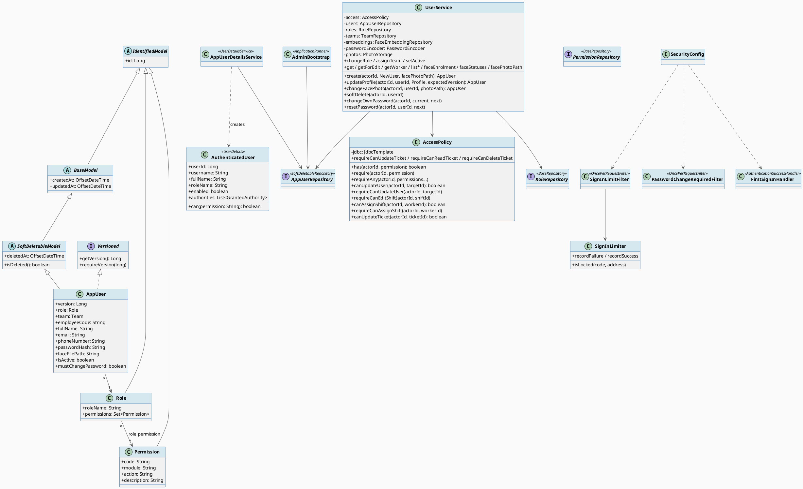
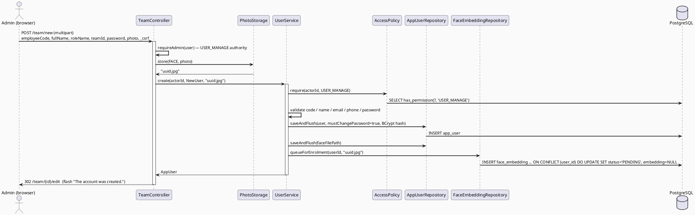
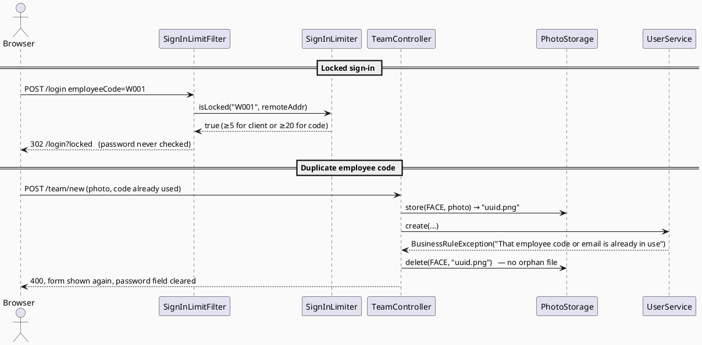
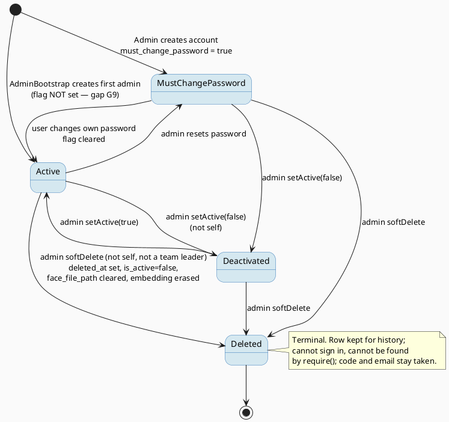

# ENGINEERING DOCUMENTATION STANDARD (EDS) v2.0
# Quy chuẩn Tài liệu Kỹ thuật và Đặc tả Hiện thực hóa

| Field | Value |
|-------|-------|
| **Document ID** | `STEELSIGHT-IAM-IMP-001` |
| **Version** | `1.0` |
| **Date** | `2026-11-06` |
| **Status** | `Draft` |
| **Document Owner** | `Nguyen Vu An` |
| **Author** | `Claude Code (Opus 5.5) — reverse-engineered from commit f005861` |
| **Reviewed by** | `[ ] Pending — Tech Lead` |
| **DPO Sign-off** | `[ ] Pending` *(required: module holds PII and controls access to biometric data)* |
| **Approved by** | `[ ] Pending — Principal Architect` |
| **Last Review** | `2026-11-06` |
| **Based on EDS** | `v2.0` |

---

## CHANGELOG

> **Policy 4.4 — Immutable History:** Không bao giờ xóa thông tin cũ. Mọi thay đổi phải ghi vào bảng này.

| Ngày | Người thực hiện | Nội dung thay đổi |
|------|-----------------|-------------------|
| 2026-11-06 | Claude Code (Opus 5.5) — documentation | Tạo tài liệu lần đầu, from the code as built (V1–V11) |

---

## MỤC LỤC

1. [Tổng quan Module](#1-tổng-quan-module)
2. [Ma trận Truy vết (Traceability Matrix)](#2-ma-trận-truy-vết-traceability-matrix)
3. [Architecture Decision Records (ADR)](#3-architecture-decision-records-adr) ⭐ *Mới*
4. [Non-Functional Requirements & SLA](#4-non-functional-requirements--sla) ⭐ *Mới*
5. [Static Modeling (Mô hình Tĩnh)](#5-static-modeling-mô-hình-tĩnh)
6. [Dynamic Modeling (Mô hình Động)](#6-dynamic-modeling-mô-hình-động)
7. [Domain Event Catalog](#7-domain-event-catalog) ⭐ *Mới*
8. [Interface Specification (Đặc tả Giao diện)](#8-interface-specification-đặc-tả-giao-diện)
9. [API Specification](#9-api-specification)
10. [Bảng mã lỗi (Error Codes)](#10-bảng-mã-lỗi-error-codes)
11. [Quy trình Triển khai (Step-by-Step)](#11-quy-trình-triển-khai-step-by-step)
12. [Rollback & Incident Runbook](#12-rollback--incident-runbook) ⭐ *Mới*
13. [Kịch bản Kiểm thử Chi tiết](#13-kịch-bản-kiểm-thử-chi-tiết)
14. [Phương pháp Xác minh](#14-phương-pháp-xác-minh)
15. [Mẫu thử thực tế (API Verification Samples)](#15-mẫu-thử-thực-tế-api-verification-samples)
16. [Bảng tổng hợp phân quyền (Authorization Matrix)](#16-bảng-tổng-hợp-phân-quyền-authorization-matrix)
17. [AI Prompt Constraints (CASE 2.0)](#17-ai-prompt-constraints-case-20) ⭐⭐ *CASE 2.0 Core*

> **Adaptations to this stack.** The template assumes TypeScript, Prisma and JWT. Steelsight is Java 17 / Spring Boot 4 / JPA / Flyway with session cookies. So §5.2 shows the Flyway SQL that defines the tables, §8 shows Java signatures, and §9 lists HTML form endpoints (session cookie + CSRF), not JSON. These are the real contracts.

---

## 1. Tổng quan Module

> Identity & Access holds user accounts, roles and permissions; signs people in by employee code; and answers, for every other module, "may this user do this to that record?". It is the only module that creates or changes accounts, including the face photo that starts gate enrolment.

| Field | Value |
|-------|-------|
| **Module Name** | `IAM — Identity & Access` |
| **Bounded Context** | `Identity` |
| **Data Classification** | `PII` (name, email, phone, employee code); controls `Sensitive-PII` (face photo path → biometric) |
| **Compliance Scope** | `Luật 91/2025/QH15 (PDPL)`, `NĐ 356/2025/NĐ-CP` — article mapping pending DPO |
| **Upstream Dependencies** | `PLT` (base models, Text validation, exceptions), `SCH` (TeamRepository), `ATT` (FaceEmbeddingRepository), `STO` (PhotoStorage) |
| **Downstream Consumers** | Every module (`AccessPolicy`, `AuthenticatedUser`, `AppUserRepository`) |

**Code location:** `identity/**`, `security/**`, `config/PasswordConfig.java`, `web/AccountController.java`, `web/AuthController.java`, account endpoints of `web/TeamController.java`, forms `NewAccountForm`, `ProfileForm`, `PasswordForm`, templates `login.html`, `account/password.html`, `team/new.html`, `team/edit.html`.

---

## 2. Ma trận Truy vết (Traceability Matrix)

| Requirement ID | Loại (BR/ADR/US) | Mô tả yêu cầu | Thành phần Code | Compliance Target | ADR liên quan |
|----------------|------------------|---------------|-----------------|-------------------|---------------|
| BR-IAM-001 | Business Rule | Sign in by employee code; deleted not found; deactivated refused | `AppUserDetailsService.loadUserByUsername()`, `AuthenticatedUser(enabled)` | PDPL — access control | ADR-008 |
| BR-IAM-002 | Business Rule | Password 8 chars – 72 bytes, BCrypt only | `UserService.checkedPassword()`, `PasswordConfig` | PDPL — security measures | ADR-008 |
| BR-IAM-003 | Business Rule | Admin-chosen password must be changed first | `UserService.create/resetPassword/changeOwnPassword`, `FirstSignInHandler`, `PasswordChangeRequiredFilter` | PDPL — security measures | ADR-009 |
| BR-IAM-004 | Business Rule | 5 per client / 20 per code / 15 min lock | `SignInLimiter`, `SignInLimitFilter` | — | ADR-008 |
| BR-IAM-005 | Business Rule | Only `USER_MANAGE` changes accounts | `UserService.*`, `can_update_user()` (V10), `TeamController.requireAdmin()` | PDPL — access control | ADR-010 |
| BR-IAM-006 | Business Rule | No self role change / deactivate / delete | `UserService.changeRole/setActive/softDelete` | — | ADR-010 |
| BR-IAM-007 | Business Rule | Leader can't be deleted or demoted while leading | `UserService.changeRole/softDelete` | — | ADR-017 |
| BR-IAM-008 | Business Rule | Code, email, name, phone formats | `UserService.create/updateProfile/email()`, `Text` | PDPL — accuracy | ADR-003 |
| BR-IAM-009 | Business Rule | Permission AND scope via SQL | `AccessPolicy`, `has_permission()`, `can_update_user()`, etc. | PDPL — least privilege | ADR-001 |
| BR-IAM-010 | Business Rule | First admin bootstrap | `AdminBootstrap.run()` | — | — |
| BR-IAM-011 | Business Rule | `USER_READ_ALL` sees any worker | `UserService.getWorker()` | PDPL — purpose limitation | ADR-001 |
| BR-ATT-010 | Business Rule | Soft delete erases embedding, photo after commit | `UserService.softDelete()`, `trg_user_erase_embedding` | PDPL — sensitive data erasure | ADR-007 |
| US-ADM-002 | User Story | Admin manages accounts | `TeamController /team/new`, `/team/{id}/*` | — | ADR-010 |
| US-ADM-003 | User Story | Admin uploads face photo | `TeamController.changeFacePhoto()`, `UserService.changeFacePhoto()` | PDPL — biometric | ADR-011 |
| US-ALL-001 | User Story | Sign in, change own password | `SecurityConfig`, `AccountController` | — | ADR-008, ADR-009 |
| ADR-001 | Decision | Rules in SQL functions | `AccessPolicy`, `V1/V3/V10/V11` | — | — |

---

## 3. Architecture Decision Records (ADR)

> Full text in `02_design/adr/`. Not repeated here, so there's one copy of each decision.

| ADR | Status | Decision (one line) | Effect on this module |
|-----|--------|---------------------|------------------------|
| [ADR-001](../02_design/adr/ADR-001_permission-and-scope-in-sql-functions.md) | Accepted | Permission + scope live in SQL functions, called through `AccessPolicy` | IAM owns `AccessPolicy` and `has_permission()` for everyone |
| [ADR-007](../02_design/adr/ADR-007_soft-delete-and-biometric-erasure.md) | Accepted | Soft-delete people; erase biometrics | `UserService.softDelete()` |
| [ADR-008](../02_design/adr/ADR-008_session-sign-in-by-employee-code-with-limiter.md) | Accepted | Session form login, BCrypt, sign-in limiter | `SecurityConfig`, `SignInLimiter` |
| [ADR-009](../02_design/adr/ADR-009_forced-password-change.md) | Accepted | Forced change of admin-chosen passwords | `FirstSignInHandler`, `PasswordChangeRequiredFilter` |
| [ADR-010](../02_design/adr/ADR-010_admin-only-account-management.md) | Accepted (supersedes V1 `USER_UPDATE_TEAM`) | Only admins manage accounts | `can_update_user()` = `USER_MANAGE` |

---

## 4. Non-Functional Requirements & SLA

> **No targets have been measured.** Values marked *proposed* are suggestions for review; values marked *configured* are what the code or hosting actually does.

### 4.1. Performance & Availability

| Category | Requirement | Target SLA | Measurement Method | Compliance Basis |
|----------|-------------|------------|---------------------|------------------|
| Latency | `POST /login` incl. BCrypt (cost 10) | *proposed* `< 500 ms` p95 warm | Request log `…ms` field (`RequestLogFilter`) | — |
| Latency | One `AccessPolicy` check | *proposed* `< 5 ms` | `SQL_LOG_LEVEL=DEBUG` timing | — |
| Availability | Sign-in available | *configured:* Render free tier, sleeps after 15 min idle, ≥ 1 min cold start; **no SLA** | Render dashboard | — |
| Throughput | Concurrent sign-ins | *proposed* `10/s` (one site) | Load test not done | — |

### 4.2. Data Integrity & Retention

| Category | Requirement | Target | Verification Method | Compliance Basis |
|----------|-------------|--------|---------------------|------------------|
| Uniqueness | `employee_code`, `email` unique | 100% | DB `UNIQUE` | PDPL — accuracy |
| Consistency | Lost-update protection on profile edits | 100% | `@Version` + `requireVersion()` | — |
| Retention | Soft-deleted users kept indefinitely | *Not defined* — **DPO to set** | — | PDPL — storage limitation |
| Erasure | Face embedding erased in the delete transaction | 100% | `trg_user_erase_embedding`, `RepositoryIntegrationTest.softDeletingAWorkerErasesTheirEmbedding` | PDPL — sensitive data |

### 4.3. Security

| Category | Requirement | Target | Verification Method | Compliance Basis |
|----------|-------------|--------|---------------------|------------------|
| Password storage | BCrypt hash only | 100% | `password_hash` starts `$2a$`/`$2b$` | PDPL — security measures |
| Encryption in transit | Browser ↔ Render HTTPS (Render-terminated); ERP ↔ Supabase `sslmode=require` | TLS (version set by Render/Supabase) | `openssl s_client` (§14.3) | PDPL — security measures |
| Session cookie | `HttpOnly`, `SameSite=Lax`, `Secure` in prod | configured | §14.3 curl check | — |
| Session ending | A password change ends the user's other sessions; an admin reset ends all of them (in memory, single instance) | configured | `AccountSecurityTest` | PDPL — security measures |
| Brute force | Lock after 5 / 20 failures for 15 min | configured | `DeploymentEndpointsTest` | — |
| CSRF | All page forms | configured (Spring default) | `LoginIntegrationTest.loginWithoutACsrfTokenIsRefused` | — |
| Access control | Role + scope | Least privilege | §16 | PDPL — least privilege |
| Encryption at rest | Supabase-managed disk encryption | Provider default; not verified | — | PDPL |

### 4.4. Scalability & Capacity Planning

> Expected load for one site: tens of accounts, a few hundred sign-ins a day. The design is single-instance: sessions and sign-in counts are in memory (gap G6). Scaling out needs a shared session store (e.g. Spring Session JDBC) and a shared limiter store first.

---

## 5. Static Modeling (Mô hình Tĩnh)

### 5.1. Class Diagram (PlantUML)



### 5.2. Data Structure (Flyway SQL — replaces the template's Prisma schema)

```sql
-- === IAM SCHEMA (V1, as changed by V10) ===
CREATE TABLE role (
  id        bigint GENERATED ALWAYS AS IDENTITY PRIMARY KEY,
  role_name text NOT NULL UNIQUE                 -- WORKER, HSE_OFFICER, MANAGER, ADMIN
);

CREATE TABLE permission (
  id          bigint GENERATED ALWAYS AS IDENTITY PRIMARY KEY,
  code        text NOT NULL UNIQUE,              -- loaded as a Spring authority
  module      text NOT NULL,                     -- TICKET, SHIFT, VIOLATION, USER, CHECKIN, REPORT
  action      text NOT NULL,                     -- READ, CREATE, UPDATE, DELETE, REVIEW, MANAGE
  description text
);

CREATE TABLE role_permission (
  role_id       bigint REFERENCES role(id),
  permission_id bigint REFERENCES permission(id),
  PRIMARY KEY (role_id, permission_id)
);

CREATE TABLE app_user (
  id                   bigint GENERATED ALWAYS AS IDENTITY PRIMARY KEY,
  role_id              bigint NOT NULL REFERENCES role(id),
  team_id              bigint REFERENCES team(id),
  employee_code        text   NOT NULL UNIQUE,   -- sign-in name
  full_name            text   NOT NULL,
  email                text   UNIQUE,
  phone_number         text,
  password_hash        text   NOT NULL,          -- BCrypt; never the password
  face_file_path       text,                     -- stored name in the FACE album (biometric)
  is_active            boolean NOT NULL DEFAULT true,
  version              bigint  NOT NULL DEFAULT 0,
  created_at           timestamptz NOT NULL DEFAULT now(),
  updated_at           timestamptz NOT NULL DEFAULT now(),   -- trg_user_updated
  deleted_at           timestamptz,                          -- soft delete; trg_user_erase_embedding
  must_change_password boolean NOT NULL DEFAULT false        -- V10
);
CREATE INDEX idx_user_team ON app_user(team_id);

-- Scope functions owned by IAM (all LANGUAGE sql STABLE)
-- has_permission(p_user, p_code)   : active, not deleted, role holds code
-- can_update_user(p_user, p_target): has USER_MANAGE and target not deleted   (V10)
-- can_edit_shift, can_assign_shift : see SCH TDS
-- can_read_ticket, can_update_ticket, can_delete_ticket : see TKT TDS
```

> The `steelsight_detection` role can `SELECT (id, employee_code, full_name, face_file_path, is_active, deleted_at)` on `app_user` only (ADR-004).

---

## 6. Dynamic Modeling (Mô hình Động)

### 6.1. Sequence Diagram — Happy Path (PlantUML): admin creates an account with a face photo



### 6.2. Sequence Diagram — Error Path (PlantUML): locked sign-in, and a duplicate code with cleanup



### 6.3. State Machine *(bắt buộc nếu module có trạng thái)*: account



> **⚠️ Invariant bất biến:**
> - A deleted account never becomes active again (no undelete path exists).
> - `has_permission()` returns false for an inactive or deleted user, whatever their role.
> - An account with `deleted_at` set has no `face_embedding` row and no `face_file_path`.
> - An admin can never change their own role, deactivate or delete themselves.

---

## 7. Domain Event Catalog

> **There is no in-process event bus.** The rows below are the Spring Security application events this module listens to, and the database trigger it relies on. Names follow `[Entity][PastTenseVerb]`.

### 7.1. Events Published (Phát ra)

| Event Name | Trigger | Publisher | Subscriber(s) | Payload Schema | Async? |
|------------|---------|-----------|---------------|----------------|--------|
| `AuthenticationSucceeded` (`AuthenticationSuccessEvent`) | Correct password | Spring Security | `SignInLimiter.succeeded`, `SignInLog.succeeded` | `Authentication` (name, `WebAuthenticationDetails.remoteAddress`) | No |
| `AuthenticationFailed` (`AbstractAuthenticationFailureEvent`) | Wrong password, unknown code, disabled user | Spring Security | `SignInLimiter.failed`, `SignInLog.failed` | `Authentication` + exception class | No |
| `UserSoftDeleted` *(DB trigger, not an app event)* | `app_user.deleted_at` NULL → value | PostgreSQL `trg_user_erase_embedding` | `app_user_erase_embedding()` deletes `face_embedding` | row `NEW.id` | No (same transaction) |
| `FacePhotoReplaced` *(after-commit hook)* | `changeFacePhoto` / `softDelete` commits | `UserService.removeFacePhotoAfterCommit` | `PhotoStorage.delete(FACE, old)` | stored name | After commit, same thread |

### 7.2. Events Consumed (Tiêu thụ)

| Event Name | Source | Handler | Action thực hiện |
|------------|--------|---------|------------------|
| `AuthenticationSuccessEvent` | Spring Security | `SignInLimiter.succeeded` | Clears that (code, address) count only |
| `AbstractAuthenticationFailureEvent` | Spring Security | `SignInLimiter.failed` | +1 for (code, address) and for code |
| `ApplicationReadyEvent` (via `ApplicationRunner`) | Spring Boot | `AdminBootstrap.run` | Creates the first admin if none and a password is set |

### 7.3. Payload Schema

```java
// Spring's own types; nothing custom is published.
// SignInLimiter keys (in-memory Caffeine, expireAfterWrite 15 min, max 100 000):
//   "client|" + normalise(code) + "|" + remoteAddress   → Integer failures
//   "code|"   + normalise(code)                         → Integer failures
// normalise(code) = strip().toUpperCase(Locale.ROOT), truncated to 64 chars
```

---

## 8. Interface Specification (Đặc tả Giao diện)

### 8.1. Service Interface

```java
// identity/service/UserService.java — @Service @Transactional
// @version 1.0 (V10 semantics: admin-only account management)

public record NewUser(String employeeCode, String fullName, String email, String phoneNumber,
                      String rawPassword, String roleName, Long teamId) {}
public record Profile(String fullName, String email, String phoneNumber) {}

public class UserService {
  /** USER_MANAGE. Sets mustChangePassword. Queues the face photo when given.
   *  @throws AccessDeniedException without USER_MANAGE
   *  @throws BusinessRuleException code/name/email/phone/password invalid, role missing, code or email taken
   *  @throws NotFoundException role or team not found */
  AppUser create(Long actorId, NewUser details, String facePhotoPath);
  AppUser create(Long actorId, NewUser details);

  /** requireCanUpdateUser. @throws StaleEditException when expectedVersion is old */
  AppUser updateProfile(Long actorId, Long userId, Profile profile, long expectedVersion);

  /** USER_MANAGE; not self; can't leave MANAGER while leading a team. */
  AppUser changeRole(Long actorId, Long userId, String roleName);
  AppUser assignTeam(Long actorId, Long userId, Long teamId);          // USER_MANAGE; null = no team
  AppUser setActive(Long actorId, Long userId, boolean active);        // USER_MANAGE; not self
  AppUser changeFacePhoto(Long actorId, Long userId, String photoPath);// USER_MANAGE; queues enrolment; old file removed after commit
  void    softDelete(Long actorId, Long userId);                      // USER_MANAGE; not self; not a leader
  void    changeOwnPassword(Long actorId, String current, String next);// any signed-in user
  void    resetPassword(Long actorId, Long userId, String next);       // USER_MANAGE; sets mustChangePassword

  // Reads (readOnly)
  AppUser get(Long actorId, Long userId);                // self, or can_update_user, or USER_MANAGE
  AppUser getForEdit(Long actorId, Long userId);         // requireCanUpdateUser
  AppUser getWorker(Long actorId, Long workerId);        // USER_READ_ALL; WORKER role only, else NotFound
  List<Role> listRoles(Long actorId);                    // USER_MANAGE
  List<AppUser> listAll(Long actorId);                   // USER_MANAGE
  Page<AppUser> listManaged(Long actorId, Pageable p);   // USER_MANAGE → all; SHIFT_UPDATE_TEAM → own team
  List<AppUser> listShiftWorkers(Long actorId);          // SHIFT_UPDATE_ALL → active; SHIFT_UPDATE_TEAM → own team active
  List<AppUser> listForViolationReview(Long actorId);    // VIOLATION_REVIEW
  List<AppUser> listForManualCheckIn(Long actorId);      // CHECKIN_EDIT
  boolean canEdit(Long actorId, Long userId);
  boolean canPlanShiftFor(Long actorId, Long workerId);
  Optional<FaceEmbedding> faceEnrolment(Long actorId, Long userId);         // USER_MANAGE
  Map<Long, EmbeddingStatus> faceStatuses(Long actorId, Collection<Long>);  // USER_MANAGE
  String facePhotoPath(Long actorId, Long userId);                          // USER_MANAGE; NotFound if none
}

// identity/service/AccessPolicy.java — @Component; every method runs one SELECT <sql function>
public class AccessPolicy {
  boolean has(Long actorId, String permission);
  void    require(Long actorId, String permission);            // @throws AccessDeniedException
  void    requireAny(Long actorId, String... permissions);
  boolean canUpdateUser(Long actorId, Long targetUserId);
  void    requireCanUpdateUser(Long actorId, Long targetUserId);
  void    requireCanEditShift(Long actorId, Long shiftId);
  boolean canAssignShift(Long actorId, Long workerId);
  void    requireCanAssignShift(Long actorId, Long workerId);
  boolean canUpdateTicket(Long actorId, Long ticketId);
  void    requireCanUpdateTicket(Long actorId, Long ticketId);
  void    requireCanReadTicket(Long actorId, Long ticketId);
  void    requireCanDeleteTicket(Long actorId, Long ticketId);
}
```

### 8.2. Repository Interface

```java
// identity/repository/AppUserRepository.java
// @version 1.0
public interface AppUserRepository extends SoftDeletableRepository<AppUser, Long> {
  Optional<AppUser> findByEmployeeCodeAndDeletedAtIsNull(String employeeCode);
  Optional<AppUser> findByEmailAndDeletedAtIsNull(String email);
  List<AppUser> findAllByTeamIdAndDeletedAtIsNull(Long teamId);
  List<AppUser> findAllByRoleIdAndDeletedAtIsNull(Long roleId);
  Page<AppUser> findAllLiveByName(Pageable page);
  List<AppUser> findAllActiveByName();
  List<AppUser> findActiveByRole(Long roleId);
  List<AppUser> findManagersWithoutATeam();
  List<AppUser> findAllByTeamId(Long teamId);           // includes deleted (used when deleting a team)
  List<AppUser> findTeamMembers(Long managerId);        // excludes the manager and deleted users
  Page<AppUser> findTeamMembers(Long managerId, Pageable page);
  boolean existsByEmployeeCode(String code);
  boolean existsByEmail(String email);
  // inherited: require(id) → NotFoundException when missing OR soft-deleted
  // No hard delete is ever called (ADR-007)
}
public interface RoleRepository extends BaseRepository<Role, Long> { Optional<Role> findByRoleName(String n); }
public interface PermissionRepository extends BaseRepository<Permission, Long> { Optional<Permission> findByCode(String c); }
```

---

## 9. API Specification

### 9.1. Endpoints Table

All page endpoints use the **session cookie** (`JSESSIONID`) and need a **CSRF token** on POST. Rate limit applies to `POST /login` only.

| Method | Path | Auth Level | Required Roles / Permission | Rate Limit | Idempotent? |
|--------|------|------------|------------------------------|------------|-------------|
| `GET` | `/login` | Public | — | — | Yes |
| `POST` | `/login` | Public + CSRF | — (`employeeCode`, `password`) | 5 fails/15 min per (code, address); 20 per code | No |
| `POST` | `/logout` | Session + CSRF | any | — | Yes |
| `GET` | `/account/password` | Session | any | — | Yes |
| `POST` | `/account/password` | Session + CSRF | any (own account) | — | No |
| `GET` | `/team/new` | Session | `USER_MANAGE` | — | Yes |
| `POST` | `/team/new` (multipart, optional `photo`) | Session + CSRF | `USER_MANAGE` | — | No |
| `GET` | `/team/{id}/edit` | Session | `USER_MANAGE` (`can_update_user`) | — | Yes |
| `POST` | `/team/{id}` | Session + CSRF | `USER_MANAGE` | — | No (versioned) |
| `POST` | `/team/{id}/role` | Session + CSRF | `USER_MANAGE`, not self | — | Yes |
| `POST` | `/team/{id}/team` | Session + CSRF | `USER_MANAGE` | — | Yes |
| `POST` | `/team/{id}/deactivate`, `/team/{id}/reactivate` | Session + CSRF | `USER_MANAGE`, not self | — | Yes |
| `POST` | `/team/{id}/password` | Session + CSRF | `USER_MANAGE` | — | No |
| `POST` | `/team/{id}/face` (multipart `photo`) | Session + CSRF | `USER_MANAGE` | — | No |
| `GET` | `/team/{id}/face` | Session | `USER_MANAGE` | — | Yes |
| `POST` | `/team/{id}/delete` (`confirm=true`) | Session + CSRF | `USER_MANAGE`, not self, not a leader | — | No |

### 9.2. Request / Response Schemas

#### `POST /team/new` — Tạo mới

**Request Body** (`multipart/form-data`):
```text
_csrf=<token>
employeeCode=W010            # [A-Za-z0-9._-]{1,50}
fullName=Nguyen Van A        # required, ≤ 200
email=a@example.com          # optional, ≤ 200, x@y
phoneNumber=0900000000       # optional, ≤ 30
roleName=WORKER              # WORKER | HSE_OFFICER | MANAGER | ADMIN
teamId=3                     # optional
password=Start-Pass-2026     # 8 chars .. 72 bytes
photo=<file>                 # optional JPEG/PNG/WebP, ≤ 5 MB
```

**Response — 302 Found (Happy Path):**
```text
Location: /team/{newId}/edit
Flash: success = "The account was created."
DB: app_user(must_change_password = true); face_embedding(status = 'PENDING') when a photo was sent
```

**Response — 400 Bad Request (Validation Error):** the form page (`team/new`) is rendered again with status 400, header `HX-Push-Url: false`, the typed values except the password, and:
```text
error = "An employee code can use letters, numbers, dots, dashes and underscores, up to 50 characters"
```

**Response — 400 (Conflict, shown as a rule):**
```text
error = "That employee code or email is already in use"     # the stored photo is deleted
```

**Response — 403:** error page "Not allowed" (non-admin).

---

## 10. Bảng mã lỗi (Error Codes)

> **Gap G4:** the application returns no error codes; it shows the message (translated by `Display.message()`). The codes below are documentation IDs, so tests and support can refer to a case.

| Code | HTTP Status | Message (EN) | Message (VI) | Trigger Condition |
|------|-------------|--------------|--------------|-------------------|
| `IAM-001` | 400 | An employee code can use letters, numbers, dots, dashes and underscores, up to 50 characters | Mã nhân viên chỉ gồm chữ cái, chữ số, dấu … (`msg.an-employee-code-can-use-…`) | Code fails `[A-Za-z0-9._-]{1,50}` |
| `IAM-002` | 400 | A password needs at least 8 characters | Mật khẩu cần ít nhất 8 ký tự | `< 8` chars |
| `IAM-003` | 400 | That password is too long | Mật khẩu này quá dài | `> 72` UTF-8 bytes |
| `IAM-004` | 400 | That employee code or email is already in use | Mã nhân viên hoặc email này đã được sử dụng | Unique violation on save |
| `IAM-005` | 400 | That email address doesn't look right | Địa chỉ email có vẻ không đúng | Fails `[^@\s]+@[^@\s]+` |
| `IAM-006` | 400 | The current password is wrong | Mật khẩu hiện tại không đúng | `changeOwnPassword` mismatch |
| `IAM-007` | 400 | Choose a password that's different from the current one | Hãy chọn mật khẩu khác với mật khẩu hiện tại | New = current |
| `IAM-008` | 400 | The new passwords don't match | Hai mật khẩu mới không khớp nhau | Confirm ≠ new (controller) |
| `IAM-009` | 400 | You cannot change your own role / deactivate your own account / delete your own account | Bạn không thể tự đổi vai trò của mình / tự vô hiệu hóa tài khoản của mình / tự xóa tài khoản của mình | Self-action |
| `IAM-010` | 400 | Give this user's teams a new manager first | Trước hết hãy chỉ định quản lý mới cho các đội của người này | Delete/demote a team leader |
| `IAM-011` | 400 | Tick the box to confirm the deletion | Hãy đánh dấu vào ô để xác nhận xóa | `confirm` not true |
| `IAM-012` | 400 | Choose a role | Vui lòng chọn vai trò | Blank `roleName` |
| `IAM-013` | 403 | Not allowed — You don't have access to this page. | Không được phép — Bạn không có quyền truy cập trang này. | `AccessDeniedException` |
| `IAM-014` | 404 | Page not found — We couldn't find what you were looking for. | Không tìm thấy trang — Không tìm thấy nội dung bạn cần. | Unknown/deleted user, role or team |
| `IAM-015` | 409 | Someone else changed this — Go back, reload the page and try again. | Người khác đã thay đổi nội dung này — Hãy quay lại, tải lại trang và thử lại. | Stale profile version |
| `IAM-016` | 302 → `/login?locked` | Too many failed sign-ins. Try again in 15 minutes. | Đăng nhập sai quá nhiều lần. Vui lòng thử lại sau 15 phút. | Sign-in limiter |
| `IAM-017` | 302 → `/login?error` | The employee code or password is wrong. | Mã nhân viên hoặc mật khẩu không đúng. | Wrong password, unknown code or disabled account (same answer) |

---

## 11. Quy trình Triển khai (Step-by-Step)

### 11.1. Prerequisites

- [x] ADR-001, 007, 008, 009, 010 Accepted (§3)
- [ ] DPO sign-off (module holds PII and gates biometric data)
- [ ] Blueprint approved by Principal Architect
- [ ] Staging environment — **none exists**; only local Docker DB, Testcontainers and production

### 11.2. Pre-Migration Checklist *(bắt buộc tick trước khi chạy migration)*

- [ ] Backup production DB: `pg_dump "$DB_URL_LIBPQ" -Fc -f backup_$(date +%Y%m%d).dump` (or a Supabase dashboard backup)
- [ ] Migration run on a copy (local Docker `steelsight-db` on port 55433) — no 24 h staging soak exists
- [ ] Forward-fix migration drafted (§12)
- [ ] DPO sign-off if `app_user` columns holding PII change

### 11.3. Implementation Steps

#### Chặng 1 — Database (Flyway, at application start)

```bash
# Flyway runs automatically when the app starts; locally:
cp .env.example .env    # fill DB_URL, DB_USERNAME, DB_PASSWORD, ADMIN_PASSWORD
sh ./mvnw spring-boot:run
# IAM migrations: V1 (roles, permissions, app_user, has_permission, can_update_user),
#                 V3 (scope functions), V10 (admin-only, must_change_password)
```

> ⚠️ **Chú ý:** Never edit an applied migration; Flyway's checksum check will stop startup.

#### Chặng 2 — First admin and secrets

```bash
# Render → Environment
ADMIN_EMPLOYEE_CODE=ADMIN
ADMIN_PASSWORD=<strong, unique>        # used only when no admin exists
SESSION_COOKIE_SECURE is set by the prod profile — do not set it by hand
# After first sign-in, change the admin password from the account menu (gap G9).
```

#### Chặng 3 — Verification sau deploy

```bash
curl -s https://<service>.onrender.com/actuator/health
# Expected: {"status":"UP"}
curl -s -o /dev/null -w '%{http_code} %{redirect_url}\n' https://<service>.onrender.com/
# Expected: 302 https://<service>.onrender.com/login
```

### 11.4. Deployment Checklist

- [ ] Migration ran (log line `Successfully applied … migrations`)
- [ ] `/actuator/health` returns 200 `UP`
- [ ] Sign-in works; session cookie has `Secure; HttpOnly; SameSite=Lax`
- [ ] Five wrong passwords lock the sign-in (`/login?locked`)
- [ ] No `ERROR` request lines in the first 10 minutes of Render logs
- [ ] DPO informed if PII processing changed

---

## 12. Rollback & Incident Runbook

### 12.1. Điều kiện kích hoạt Rollback (Trigger Conditions)

| Điều kiện | Ngưỡng | Người quyết định |
|-----------|--------|------------------|
| Nobody can sign in | Any confirmed case | Developer (on-call) |
| A user can reach another user's data or an admin page | Any case | Developer + DPO |
| 5xx on `/login` or `/team/**` | > 5% for 5 min | Developer |
| Sign-in latency | > 2× baseline | Developer |

### 12.2. Rollback Procedure

```bash
# Bước 1: Schema — Flyway Community has no undo. Write a forward migration V<n+1>__revert_<x>.sql
#          that restores the previous function bodies / columns. Never delete rows from flyway_schema_history.

# Bước 2: Re-deploy the previous image (every image is tagged with its commit SHA)
curl --fail --get "$RENDER_DEPLOY_HOOK" --data-urlencode "imgURL=ghcr.io/owochiii/steelsight_erp:<previous_sha>"
#   or in Render: Manual Deploy → previous deploy → Rollback

# Bước 3: Verify
curl -s https://<service>.onrender.com/actuator/health     # {"status":"UP"}

# Bước 4: Smoke test — sign in as each role; open /team as admin; confirm a worker gets 403 on /team/new
```

### 12.3. Notification Protocol

| Thời điểm | Người nhận | Kênh | Template |
|-----------|------------|------|----------|
| Ngay khi phát hiện | Developer / team | Team chat | "🚨 Steelsight IAM incident: [description], request id [id]" |
| Trong 30 phút | DPO | Email | *(If personal or biometric data may be exposed)* |
| Trong 72 giờ | Competent authority (Bộ Công an — A05) | Official channel | *(If a personal-data breach is confirmed; deadline per Luật 91/2025 — DPO to confirm)* |

### 12.4. Post-Incident Review (PIR)

> Bắt buộc hoàn thành PIR document trong vòng **48 giờ** sau khi incident được resolve.

- **Timeline**, **Root Cause** (5 Whys), **Impact** (accounts affected, PII exposure?), **Remediation**, **Prevention**.

---

## 13. Kịch bản Kiểm thử Chi tiết

> Full test cases, with IDs and current status, are in [`04_testing/STEELSIGHT-IAM-TDD-001_Test-Spec.md`](../04_testing/STEELSIGHT-IAM-TDD-001_Test-Spec.md). All test data is `SYNTHETIC` (seeded in each test class; no production data).

### 13.1. Unit Tests

#### TC-UNIT-001 — Sign-in limiter counts per client and per code

```gherkin
Feature: Sign-in limiter
  Background:
    Given test data classification: SYNTHETIC
    And a new SignInLimiter

  Scenario: Locks a client after five failures
    Given 5 failures for code "W001" from "10.0.0.1"
    When isLocked("W001", "10.0.0.1") is asked
    Then it answers true

  Scenario: Spoofed addresses still hit the per-code limit
    Given 20 failures for "w001 " from 20 different addresses
    When isLocked("W001", "10.9.9.9") is asked
    Then it answers true
    And another code is not locked
```

**Hàm được test:** `SignInLimiter.isLocked()`, `recordFailure()`, `recordSuccess()`
**Invariant kiểm tra:** a success clears only that client's count.

### 13.2. Integration Tests

#### TC-INT-001 — Admin creates an account with a face photo

```gherkin
  Scenario: Account and enrolment queued together
    Given test data classification: SYNTHETIC
    And PostgreSQL (Testcontainers pgvector/pgvector:pg17) migrated by Flyway
    When UserService.create(admin, NewUser(...), "photo.jpg") is called
    Then app_user has must_change_password = true and a BCrypt password_hash
    And face_embedding has one row for the user with status PENDING
```

**External dependencies:** PostgreSQL, PhotoStorage (local)
**Mock strategy:** Testcontainers for the DB; local disk storage in a temp folder.

### 13.3. E2E / Security Tests

#### TC-E2E-001 — Managers and workers can't manage accounts

```gherkin
  Scenario: Worker posts to /team/new
    Given test data classification: SYNTHETIC
    And a signed-in WORKER session with a valid CSRF token
    When POST /team/new is called with a complete form
    Then the response status is 403
    And no app_user row is created and no photo is stored

  Scenario: Login without CSRF
    When POST /login is called without _csrf
    Then the response status is 403

  Scenario: Script in a name
    Given a user named "<script>alert(1)</script>"
    When the home page is rendered for them
    Then the name is HTML-escaped
```

---

## 14. Phương pháp Xác minh

### 14.1. Database Inspection

```sql
-- New account is forced to change its password and is hashed
SELECT id, employee_code, must_change_password, left(password_hash, 4) AS hash_prefix, is_active, deleted_at
FROM app_user WHERE employee_code = 'W010';           -- expect true, '$2a$', true, NULL

-- Soft delete erased biometrics
SELECT u.id, u.deleted_at, u.face_file_path, e.id AS embedding_row
FROM app_user u LEFT JOIN face_embedding e ON e.user_id = u.id
WHERE u.id = :id;                                     -- expect deleted_at set, NULL, NULL

-- Who holds what
SELECT r.role_name, string_agg(p.code, ', ' ORDER BY p.code)
FROM role r JOIN role_permission rp ON rp.role_id = r.id JOIN permission p ON p.id = rp.permission_id
GROUP BY r.role_name;

-- Detection role cannot read password hashes (expect: permission denied)
SET ROLE steelsight_detection; SELECT password_hash FROM app_user LIMIT 1; RESET ROLE;
```

### 14.2. Log / Audit Verification

```bash
# Sign-ins and refusals (Render → Logs, or local stdout)
grep -E 'Signed in:|Sign-in refused|Sign-in locked' app.log | head
# Each request line carries the request id in [brackets]
grep -E '\] POST /team/' app.log | head -5
# No password in logs. Expected: no output
grep -iE 'password=|passwordHash|\$2a\$' app.log
```

### 14.3. Tool-based Verification

```bash
# Session cookie flags in production
curl -s -D - -o /dev/null https://<service>.onrender.com/login | grep -i '^set-cookie'
# Expected: JSESSIONID=…; Path=/; Secure; HttpOnly; SameSite=Lax

# TLS offered by Render
openssl s_client -connect <service>.onrender.com:443 -servername <service>.onrender.com </dev/null 2>/dev/null | grep -E 'Protocol|Cipher'
```

---

## 15. Mẫu thử thực tế (API Verification Samples)

### 15.1. Happy Path

```bash
# Sign in (the CSRF token comes from the login page)
BASE=https://<service>.onrender.com; JAR=$(mktemp)
CSRF=$(curl -s -c $JAR $BASE/login | grep -oP 'name="_csrf" value="\K[^"]+')
curl -s -b $JAR -c $JAR -o /dev/null -w '%{http_code} %{redirect_url}\n' \
  -d "employeeCode=ADMIN&password=$ADMIN_PASSWORD&_csrf=$CSRF" $BASE/login
```

**Expected Response (302):**
```text
302 https://<service>.onrender.com/          # or /account/password when must_change_password is true
```

### 15.2. Error Paths

```bash
# Wrong password → back to the login page with an error
curl -s -b $JAR -o /dev/null -w '%{http_code} %{redirect_url}\n' \
  -d "employeeCode=ADMIN&password=wrong&_csrf=$CSRF" $BASE/login
```

**Expected Response (302):**
```text
302 https://<service>.onrender.com/login?error
```

```bash
# A page with no session → sign-in page
curl -s -o /dev/null -w '%{http_code} %{redirect_url}\n' $BASE/team
```

**Expected Response (302):**
```text
302 https://<service>.onrender.com/login
```

---

## 16. Bảng tổng hợp phân quyền (Authorization Matrix)

| Endpoint | `ANONYMOUS` | `WORKER` | `HSE_OFFICER` | `MANAGER` | `ADMIN` |
|----------|-------------|----------|---------------|-----------|---------|
| `GET/POST /login` | ✅ | ✅ | ✅ | ✅ | ✅ |
| `GET/POST /account/password` | ❌ → login | ✅ Own | ✅ Own | ✅ Own | ✅ Own |
| `GET/POST /team/new` | ❌ → login | ❌ | ❌ | ❌ | ✅ |
| `GET /team/{id}/edit`, `POST /team/{id}` | ❌ → login | ❌ | ❌ | ❌ | ✅ All (not deleted) |
| `POST /team/{id}/role`, `/deactivate`, `/delete` | ❌ → login | ❌ | ❌ | ❌ | ✅ Others only |
| `POST /team/{id}/team`, `/reactivate`, `/password` | ❌ → login | ❌ | ❌ | ❌ | ✅ |
| `GET/POST /team/{id}/face` | ❌ → login | ❌ | ❌ | ❌ | ✅ |

**Chú thích:**
- ✅ = Được phép
- ❌ = Bị từ chối (403), or redirected to `/login` when not signed in
- `Own` = Chỉ được phép với resource của chính mình
- While `must_change_password` is set, every page except `/account/password`, `/logout`, `/login`, `/language`, `/error`, `/actuator/health` and static files redirects to `/account/password`.

---

## 17. AI Prompt Constraints (CASE 2.0)

### 17.1 Constraint Summary Table

| # | Constraint | Source (ADR/BR) | Last Verified |
|---|-----------|-----------------|---------------|
| C1 | Every service method calls `AccessPolicy` first; the actor is `AuthenticatedUser.getUserId()` | `ADR-001`, `BR-IAM-009` | `2026-11-06` |
| C2 | Do NOT re-implement scope rules in Java/JPQL; add a `can_*` SQL function by migration | `ADR-001` | `2026-11-06` |
| C3 | Only `USER_MANAGE` changes accounts; no manager account rights | `ADR-010`, `BR-IAM-005` | `2026-11-06` |
| C4 | Passwords only via `PasswordEncoder`; admin-set passwords set `mustChangePassword = true`; never log or echo passwords | `ADR-008`, `ADR-009`, `BR-IAM-002/003` | `2026-11-06` |
| C5 | Soft delete only; face photo removal after commit; embedding erased by trigger | `ADR-007`, `BR-ATT-010` | `2026-11-06` |
| C6 | Any new sign-in path goes through `SignInLimiter` | `ADR-008`, `BR-IAM-004` | `2026-11-06` |

### 17.2 Constraint Injection Block (Copy-Paste vào AI Prompt)

```
[CONSTRAINT BLOCK — Module: IAM — Identity & Access]
Theo TDS STEELSIGHT-IAM-IMP-001 và các ADR liên quan (ADR-001, 007, 008, 009, 010):

1. Every public method in identity/service/** MUST begin with an AccessPolicy check (require, requireAny,
   requireCanUpdateUser ...) before loading the target. The actor is the Long actorId passed from
   @AuthenticationPrincipal AuthenticatedUser.getUserId(); never from a request parameter.
2. Do NOT implement scope rules in Java or JPQL. A new scope = new SQL function can_<verb>_<noun>(bigint, bigint)
   in a new Flyway migration + a method on AccessPolicy.
3. Only USER_MANAGE (Admin) may create, edit, change role/team/active/password/face photo, or delete accounts.
   Self role change, self deactivation and self deletion throw BusinessRuleException.
4. Hash passwords with the PasswordEncoder bean; validate 8 chars..72 UTF-8 bytes; any password chosen by
   someone else sets mustChangePassword = true. Never log, return or re-render a password.
5. app_user is never hard-deleted. softDelete sets deleted_at, is_active=false, face_file_path=null and
   removes the old photo with TransactionSynchronization.afterCommit.
6. Any new sign-in path calls SignInLimiter.isLocked() before checking the password.

[CONTEXT BLOCK]
- Bounded Context: Identity
- Data Classification: PII; gates Sensitive-PII (biometric face photo)
- Compliance: Luật 91/2025/QH15, NĐ 356/2025 (DPO sign-off pending)
- Existing interfaces: §8.1 UserService, AccessPolicy + §8.2 AppUserRepository
- Error codes: §10 (messages only; no codes returned — gap G4)
- Auth matrix: §16

[TASK BLOCK]
Implement {feature/method} thỏa mãn constraints trên.
Output phải tuân thủ §8 Interface Specification.
Tests phải cover §13 Test Scenarios and the TCs in STEELSIGHT-IAM-TDD-001.
```

### 17.3 Constraint Quality Checklist

- [x] Mỗi constraint traceable về ADR hoặc BR cụ thể
- [x] Không có constraint generic
- [x] Mỗi constraint có `Last Verified` date ≤ 2 sprints
- [x] Constraint block có ≥ 3 constraints cụ thể
- [x] Constraint block reference §8 Interface
- [x] Constraint block reference §16 Auth Matrix

### 17.4 Anti-Pattern Detection (cho AI-Generated Code từ Block này)

| AP-ID | Anti-Pattern | Dấu hiệu | Hành động |
|-------|-------------|-----------|----------|
| AP-AI-001 | Unconstrained Gen | Service method with no `access.` call on its first line | Reject — inject lại constraints |
| AP-AI-003 | Implicit Decision | `@PreAuthorize`, JWT, remember-me, or a manager edit path appears | Reject — viết ADR trước |
| AP-AI-005 | Hallucinated Contract | Calls to `UserService.update()`, `AccessPolicy.check()` or a `USER_UPDATE_TEAM` permission (none exist) | Reject — verify contract existence |

---

## PHỤ LỤC

### A. Glossary (Thuật ngữ)

| Thuật ngữ | Định nghĩa |
|-----------|------------|
| Employee code | The sign-in name, unique per account (`app_user.employee_code`) |
| Permission | One action code (e.g. `USER_MANAGE`) held by a role |
| Scope | Which records a permission applies to (team you lead, category your role handles) |
| Soft delete | Setting `deleted_at` instead of deleting the row |
| Forced password change | `must_change_password` → user kept on `/account/password` until they change it |
| PII | Personally Identifiable Information |
| DPO | Data Protection Officer |
| Constraint Injection | Kỹ thuật inject specification vào AI prompt trước khi generate code |
| Red Gate | Gate xác minh test sensitivity — tests phải FAIL trước khi implement |
| Trust Level | Mức tin cậy của AI-generated artifact (T0–T5) |

### B. Tài liệu tham chiếu

| Document | Link / Path |
|----------|-------------|
| Module map, BR and US catalog | `02_design/MODULE-MAP.md` |
| Database design | `docs/database-design.md` §1.1 |
| User guide | `docs/user-guide.md` §2, §3 |
| Deployment | `docs/deployment.md` |
| Luật Bảo vệ dữ liệu cá nhân 91/2025/QH15 | *(official gazette link — to be added by DPO)* |
| NĐ 356/2025/NĐ-CP | *(official gazette link — to be added by DPO)* |
| Test-Spec | `04_testing/STEELSIGHT-IAM-TDD-001_Test-Spec.md` |

---

*EDS v2.1 — Tích hợp CASE 2.0 AI Prompt Constraints (§17).*
*Sections đánh dấu ⭐ là bổ sung EDS v2.0. Section đánh dấu ⭐⭐ là bổ sung CASE 2.0.*
*Câu hỏi hoặc đề xuất sửa đổi: tạo Issue với label `docs-policy`.*
