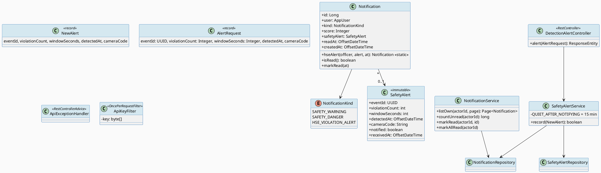
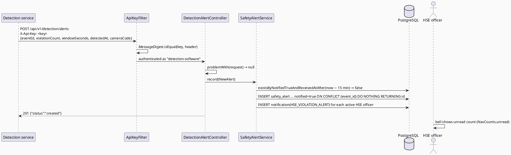
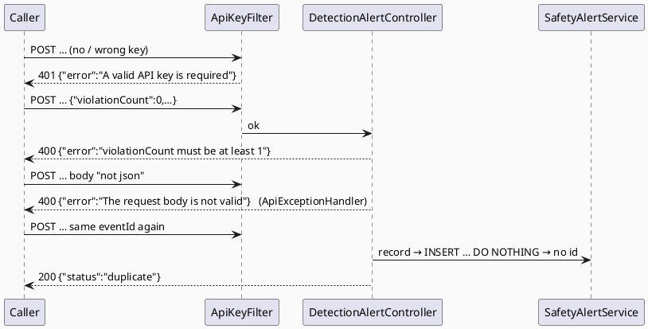
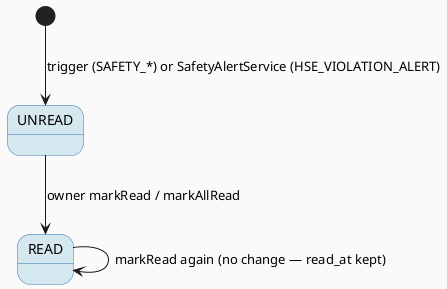

# ENGINEERING DOCUMENTATION STANDARD (EDS) v2.0
# Quy chuẩn Tài liệu Kỹ thuật và Đặc tả Hiện thực hóa

| Field | Value |
|-------|-------|
| **Document ID** | `STEELSIGHT-NTF-IMP-001` |
| **Version** | `1.0` |
| **Date** | `2026-11-06` |
| **Status** | `Draft` |
| **Document Owner** | `Nguyen Vu An` |
| **Author** | `Claude Code (Opus 5.5) — reverse-engineered from commit f005861` |
| **Reviewed by** | `[ ] Pending — Tech Lead` |
| **DPO Sign-off** | `[ ] Pending` *(notifications carry a worker's monthly score)* |
| **Approved by** | `[ ] Pending — Principal Architect` |
| **Last Review** | `2026-11-06` |
| **Based on EDS** | `v2.0` |

---

## CHANGELOG

> **Policy 4.4 — Immutable History:** Không bao giờ xóa thông tin cũ. Mọi thay đổi phải ghi vào bảng này.

| Ngày | Người thực hiện | Nội dung thay đổi |
|------|-----------------|-------------------|
| 2026-11-06 | Claude Code (Opus 5.5) — documentation | Tạo tài liệu lần đầu, from the code as built (V8) |

---

## MỤC LỤC

1. [Tổng quan Module](#1-tổng-quan-module)
2. [Ma trận Truy vết (Traceability Matrix)](#2-ma-trận-truy-vết-traceability-matrix)
3. [Architecture Decision Records (ADR)](#3-architecture-decision-records-adr) ⭐ *Mới*
4. [Non-Functional Requirements & SLA](#4-non-functional-requirements--sla) ⭐ *Mới*
5. [Static Modeling (Mô hình Tĩnh)](#5-static-modeling-mô-hình-tĩnh)
6. [Dynamic Modeling (Mô hình Động)](#6-dynamic-modeling-mô-hình-động)
7. [Domain Event Catalog](#7-domain-event-catalog) ⭐ *Mới*
8. [Interface Specification (Đặc tả Giao diện)](#8-interface-specification-đặc-tả-giao-diện)
9. [API Specification](#9-api-specification)
10. [Bảng mã lỗi (Error Codes)](#10-bảng-mã-lỗi-error-codes)
11. [Quy trình Triển khai (Step-by-Step)](#11-quy-trình-triển-khai-step-by-step)
12. [Rollback & Incident Runbook](#12-rollback--incident-runbook) ⭐ *Mới*
13. [Kịch bản Kiểm thử Chi tiết](#13-kịch-bản-kiểm-thử-chi-tiết)
14. [Phương pháp Xác minh](#14-phương-pháp-xác-minh)
15. [Mẫu thử thực tế (API Verification Samples)](#15-mẫu-thử-thực-tế-api-verification-samples)
16. [Bảng tổng hợp phân quyền (Authorization Matrix)](#16-bảng-tổng-hợp-phân-quyền-authorization-matrix)
17. [AI Prompt Constraints (CASE 2.0)](#17-ai-prompt-constraints-case-20) ⭐⭐ *CASE 2.0 Core*

> **Adaptations to this stack:** §5.2 Flyway SQL, §8 Java. §9 documents the **only JSON API** in the system (`/api/v1/detection/alerts`, `X-Api-Key`) plus the notification pages (session + CSRF).

---

## 1. Tổng quan Module

> Notification & Detection API delivers in-app notices: a worker's warning and danger levels (written by a database trigger) and HSE alerts when the detection service reports a burst of violations through the ERP's one REST endpoint. Users read and mark their own notices; the sidebar bell shows the unread count.

| Field | Value |
|-------|-------|
| **Module Name** | `NTF — Notification & Detection API` |
| **Bounded Context** | `Alerting` |
| **Data Classification** | `PII` (score per worker per month) / `Internal` (alerts: counts, time, camera code) |
| **Compliance Scope** | `Luật 91/2025/QH15` — DPO pending |
| **Upstream Dependencies** | `IAM` (AppUser, Role), `PPE` (`safety_scores()`, violation trigger), detection service (HTTP caller) |
| **Downstream Consumers** | Sidebar (`NavCounts.unread`), `notifications/list.html`, worker dashboard |

**Code location:** `notification/**`, `api/DetectionAlertController.java`, `api/ApiExceptionHandler.java`, `security/ApiKeyFilter.java`, `SecurityConfig.apiFilterChain`, `web/NotificationController.java`, `web/NavCounts.java`; SQL `notify_safety_level()` + `trg_violation_safety_level`.

---

## 2. Ma trận Truy vết (Traceability Matrix)

| Requirement ID | Loại (BR/ADR/US) | Mô tả yêu cầu | Thành phần Code | Compliance Target | ADR liên quan |
|----------------|------------------|---------------|-----------------|-------------------|---------------|
| BR-NTF-001 | Business Rule | One warning/danger notice per level per month | `notify_safety_level()`, `uq_notification_level` | PDPL — transparency | ADR-014 |
| BR-NTF-002 | Business Rule | `X-Api-Key` required; none configured → refuse all | `ApiKeyFilter`, `SecurityConfig.apiFilterChain` | — | ADR-019 |
| BR-NTF-003 | Business Rule | Same `eventId` → 200 duplicate | `SafetyAlertService.record()` | — | ADR-005 |
| BR-NTF-004 | Business Rule | Notify all active HSE unless notified < 15 min ago | `SafetyAlertService.record()/tellHse()` | — | ADR-019 |
| BR-NTF-005 | Business Rule | Own notifications only | `NotificationService` | PDPL — least privilege | ADR-022 |
| BR-NTF-006 | Business Rule | No stored text | `notification` columns | — | ADR-022 |
| US-WRK-005 | User Story | Told at warning/danger | trigger + `notifications/list` | — | ADR-014 |
| US-HSE-006 | User Story | Alerted on bursts | `DetectionAlertController` | — | ADR-019 |
| US-SYS-001 | User Story | Detection reports bursts, retry-safe | `POST /api/v1/detection/alerts` | — | ADR-005, ADR-019 |

---

## 3. Architecture Decision Records (ADR)

| ADR | Status | Decision (one line) | Effect on this module |
|-----|--------|---------------------|------------------------|
| [ADR-005](../02_design/adr/ADR-005_idempotent-detection-writes-by-event-id.md) | Accepted | Idempotency by `event_id` | `safety_alert.event_id` |
| [ADR-014](../02_design/adr/ADR-014_safety-score-computed-in-sql.md) | Accepted | Level notices by trigger | `notify_safety_level()` |
| [ADR-019](../02_design/adr/ADR-019_detection-alert-api-with-shared-key.md) | Accepted | REST + shared key + quiet period | `apiFilterChain`, `SafetyAlertService` |
| [ADR-022](../02_design/adr/ADR-022_notifications-store-no-text.md) | Accepted | No stored text | `notification` table |

---

## 4. Non-Functional Requirements & SLA

### 4.1. Performance & Availability

| Category | Requirement | Target SLA | Measurement Method | Compliance Basis |
|----------|-------------|------------|---------------------|------------------|
| Latency | `POST /api/v1/detection/alerts` warm | *proposed* `< 200 ms` p95 | Request log ms | — |
| Availability | Alert API | *configured:* Render wakes on request (≥ 1 min cold start); detection's outbox retries meanwhile | Detection outbox | — |
| Delivery | Level notice while ERP sleeps | Always (DB trigger) | ADR-014 | — |
| Throttle | HSE alert notices | ≤ 1 notifying alert per 15 min (best effort, gap G5) | `safety_alert.notified` | — |

### 4.2. Data Integrity & Retention

| Category | Requirement | Target | Verification Method | Compliance Basis |
|----------|-------------|--------|---------------------|------------------|
| Idempotency | No duplicate alerts per `eventId` | 100% | `DetectionAlertApiTest.aRetryOfTheSameEventChangesNothing` | — |
| Consistency | Kind ↔ parameters | 100% | `CHECK`s on `notification` | — |
| Retention | Notifications and alerts never deleted | *Not defined — DPO* | — | PDPL — storage limitation |

### 4.3. Security

| Category | Requirement | Target | Verification Method | Compliance Basis |
|----------|-------------|--------|---------------------|------------------|
| API auth | Constant-time key compare; 401 JSON otherwise | configured | `DetectionAlertApiTest.aMissingOrWrongKeyIsRefusedAsJson` | — |
| Fail closed | Empty key → refuse every call | configured | `DetectionApiWithoutKeyTest` | — |
| Isolation | API chain stateless, no session, CSRF off; page chain unaffected | configured | `DetectionAlertApiTest.pagesStillRequireACsrfToken` | — |
| Encryption in transit | HTTPS via Render | Render TLS | §14.3 | PDPL |
| Rate limit | None on the API | **Gap** | — | — |
| `SECURITY DEFINER` | `search_path` pinned | configured | V8 source | — |

### 4.4. Scalability & Capacity Planning

> A few alerts an hour at most. `idx_safety_alert_notified` keeps the quiet-period check cheap; `idx_notification_unread` keeps the bell count cheap on every page.

---

## 5. Static Modeling (Mô hình Tĩnh)

### 5.1. Class Diagram (PlantUML)



### 5.2. Data Structure (Flyway SQL)

```sql
-- === NTF SCHEMA (V8) ===
CREATE TABLE safety_alert (
  id              bigint GENERATED ALWAYS AS IDENTITY PRIMARY KEY,
  event_id        uuid        NOT NULL UNIQUE,
  violation_count integer     NOT NULL CHECK (violation_count > 0),
  window_seconds  integer     NOT NULL CHECK (window_seconds > 0),
  detected_at     timestamptz NOT NULL,
  camera_code     text,                      -- as sent; not a FK so a typo can't lose an alert
  notified        boolean     NOT NULL,
  received_at     timestamptz NOT NULL DEFAULT now()
);
CREATE INDEX idx_safety_alert_notified ON safety_alert(received_at DESC) WHERE notified;

CREATE TABLE notification (
  id              bigint GENERATED ALWAYS AS IDENTITY PRIMARY KEY,
  user_id         bigint NOT NULL REFERENCES app_user(id),
  kind            text   NOT NULL CHECK (kind IN ('SAFETY_WARNING','SAFETY_DANGER','HSE_VIOLATION_ALERT')),
  score           integer,
  period          date,
  safety_alert_id bigint REFERENCES safety_alert(id),
  read_at         timestamptz,
  created_at      timestamptz NOT NULL DEFAULT now(),
  CHECK ((kind = 'HSE_VIOLATION_ALERT') = (safety_alert_id IS NOT NULL)),
  CHECK ((kind = 'HSE_VIOLATION_ALERT') = (period IS NULL)),
  CHECK ((kind = 'HSE_VIOLATION_ALERT') = (score IS NULL))
);
CREATE INDEX idx_notification_user   ON notification(user_id, created_at DESC);
CREATE INDEX idx_notification_unread ON notification(user_id) WHERE read_at IS NULL;
CREATE UNIQUE INDEX uq_notification_level ON notification(user_id, kind, period) WHERE period IS NOT NULL;

-- notify_safety_level() RETURNS trigger  LANGUAGE plpgsql SECURITY DEFINER SET search_path = public, pg_temp
--   skip if NEW.user_id IS NULL or OVERTURNED; read safety_scores(now()) for the worker;
--   if WARNING or DANGER: INSERT notification(user_id, 'SAFETY_'||level, score, first-of-month)
--   ON CONFLICT (user_id, kind, period) WHERE period IS NOT NULL DO NOTHING
-- CREATE TRIGGER trg_violation_safety_level AFTER INSERT OR UPDATE OF user_id, dispute_status ON violation
-- The detection role has no grants on notification or safety_alert.
```

---

## 6. Dynamic Modeling (Mô hình Động)

### 6.1. Sequence Diagram — Happy Path (PlantUML): detection alert reaches HSE



### 6.2. Sequence Diagram — Error Path (PlantUML)



### 6.3. State Machine *(bắt buộc nếu module có trạng thái)*: notification



> **⚠️ Invariant bất biến:**
> - A worker receives each of SAFETY_WARNING and SAFETY_DANGER at most once per month.
> - Only the owner can change `read_at`, and it is set once.
> - A `safety_alert` row is never updated after insert (all columns `updatable = false`).

---

## 7. Domain Event Catalog

### 7.1. Events Published (Phát ra)

| Event Name | Trigger | Publisher | Subscriber(s) | Payload Schema | Async? |
|------------|---------|-----------|---------------|----------------|--------|
| `SafetyLevelReached` | Violation insert/update pushes a worker to WARNING/DANGER | `notify_safety_level()` | Worker's notification list | `notification(kind, score, period)` | No (in the violation's tx) |
| `HseAlerted` | New alert outside the quiet period | `SafetyAlertService.tellHse` | Every active HSE officer | `notification(HSE_VIOLATION_ALERT, safety_alert_id)` | No |

### 7.2. Events Consumed (Tiêu thụ)

| Event Name | Source | Handler | Action thực hiện |
|------------|--------|---------|------------------|
| `ViolationBurstDetected` | Detection service (HTTP) | `DetectionAlertController.alert` → `SafetyAlertService.record` | Store alert; notify HSE unless quiet |
| `ViolationIdentified` / `DisputeDecided` | PPE (DB) | `trg_violation_safety_level` | Recompute level, maybe notify |

### 7.3. Payload Schema

```json
// ViolationBurstDetected — POST /api/v1/detection/alerts   (version 1, no explicit version field)
{
  "eventId": "6f1c2b2e-6a0e-4d3b-9b5e-2b1d9f0e7a11",   // UUID, required, dedup key
  "violationCount": 7,                               // integer ≥ 1, required
  "windowSeconds": 300,                              // integer ≥ 1, required
  "detectedAt": "2026-11-06T09:15:00+07:00",         // ISO 8601 with offset, required
  "cameraCode": "CAM-B2"                             // optional, ≤ 100 chars, not validated against camera
}
```

---

## 8. Interface Specification (Đặc tả Giao diện)

### 8.1. Service Interface

```java
// notification/service/SafetyAlertService.java — @Service @Transactional
// @version 1.0
public record NewAlert(UUID eventId, int violationCount, int windowSeconds, OffsetDateTime detectedAt, String cameraCode) {}
public class SafetyAlertService {
  /** Stores the alert (always, unless the eventId is known) and notifies active HSE officers unless an alert
   *  that notified arrived in the last 15 minutes. @return false when eventId already existed. No permission
   *  check: the caller is authenticated by ApiKeyFilter. */
  boolean record(NewAlert alert);
}

// notification/service/NotificationService.java — @Service @Transactional
public class NotificationService {
  Page<Notification> listOwn(Long actorId, Pageable page);   // own only, newest first
  long countUnread(Long actorId);
  /** @throws AccessDeniedException another user's notification; @throws NotFoundException unknown id */
  void markRead(Long actorId, Long notificationId);
  void markAllRead(Long actorId);
}

// api/DetectionAlertController.java — @RestController @RequestMapping("/api/v1/detection")
public record AlertRequest(UUID eventId, Integer violationCount, Integer windowSeconds,
                           OffsetDateTime detectedAt, String cameraCode) {}
ResponseEntity<Map<String, String>> alert(@RequestBody AlertRequest request);   // POST /alerts
```

### 8.2. Repository Interface

```java
// @version 1.0
public interface NotificationRepository extends BaseRepository<Notification, Long> {
  Page<Notification> findAllByUserIdOrderByCreatedAtDescIdDesc(Long userId, Pageable p);
  long countByUserIdAndReadAtIsNull(Long userId);
  @Modifying int markAllRead(Long userId, OffsetDateTime at);
  // No delete.
}
public interface SafetyAlertRepository extends BaseRepository<SafetyAlert, Long> {
  boolean existsByNotifiedTrueAndReceivedAtAfter(OffsetDateTime since);
  // Inserts go through JdbcTemplate INSERT … ON CONFLICT (event_id) DO NOTHING RETURNING id.
}
```

---

## 9. API Specification

### 9.1. Endpoints Table

| Method | Path | Auth Level | Required Roles | Rate Limit | Idempotent? |
|--------|------|------------|----------------|------------|-------------|
| `POST` | `/api/v1/detection/alerts` | `X-Api-Key` (stateless, no CSRF) | `detection-software` | **None** | Yes (by `eventId`) |
| `GET` | `/notifications?page=n` | Session | any (own) | — | Yes |
| `POST` | `/notifications/{id}/read` | Session + CSRF | owner | — | Yes |
| `POST` | `/notifications/read-all` | Session + CSRF | any (own) | — | Yes |

### 9.2. Request / Response Schemas

#### `POST /api/v1/detection/alerts` — Tạo mới

**Request Body:**
```json
{
  "eventId": "6f1c2b2e-6a0e-4d3b-9b5e-2b1d9f0e7a11",
  "violationCount": 7,
  "windowSeconds": 300,
  "detectedAt": "2026-11-06T09:15:00+07:00",
  "cameraCode": "CAM-B2"
}
```

**Response — 201 Created (Happy Path):**
```json
{ "status": "created" }
```

**Response — 200 OK (retry of a known eventId):**
```json
{ "status": "duplicate" }
```

**Response — 400 Bad Request (Validation Error):**
```json
{ "error": "violationCount must be at least 1" }
```

**Response — 401 Unauthorized:**
```json
{ "error": "A valid API key is required" }
```

**Response — 500:**
```json
{ "error": "Something went wrong" }
```

> The response format is `{"error": "<message>"}`, not the template's `{"error": {"code", "message", "details"}}` (gap G4).

---

## 10. Bảng mã lỗi (Error Codes)

| Code | HTTP Status | Message (EN) | Message (VI) | Trigger Condition |
|------|-------------|--------------|--------------|-------------------|
| `NTF-001` | 401 | A valid API key is required | — *(API, English only)* | Missing/wrong key, or none configured |
| `NTF-002` | 400 | eventId is required | — | `eventId` null |
| `NTF-003` | 400 | violationCount must be at least 1 | — | null or < 1 |
| `NTF-004` | 400 | windowSeconds must be at least 1 | — | null or < 1 |
| `NTF-005` | 400 | detectedAt is required | — | null |
| `NTF-006` | 400 | cameraCode is too long | — | > 100 chars |
| `NTF-007` | 400 | The request body is not valid | — | Unparseable JSON / bad UUID / bad date |
| `NTF-008` | 4xx | The request was rejected | — | Framework rejection (e.g. 405, 415) |
| `NTF-009` | 500 | Something went wrong | — | Unexpected failure (logged with stack trace) |
| `NTF-010` | 403 | Not allowed | Không được phép | `markRead` on someone else's notification |
| `NTF-011` | 404 | Page not found | Không tìm thấy trang | Unknown notification id |

---

## 11. Quy trình Triển khai (Step-by-Step)

### 11.1. Prerequisites

- [x] ADR-019, ADR-022 Accepted
- [ ] DPO sign-off
- [ ] Principal Architect approval
- [ ] Detection service configured with `DETECTION_ERP_URL` and `DETECTION_ERP_API_KEY`

### 11.2. Pre-Migration Checklist *(bắt buộc tick trước khi chạy migration)*

- [ ] Backup production DB
- [ ] A new notification kind updates the `kind` CHECK, `NotificationKind`, both message files and the template
- [ ] A change to `notify_safety_level()` keeps `SECURITY DEFINER SET search_path = public, pg_temp`

### 11.3. Implementation Steps

#### Chặng 1 — Migration

```bash
# V8 creates safety_alert, notification, notify_safety_level() and its trigger
sh ./mvnw spring-boot:run
```

#### Chặng 2 — API key

```bash
openssl rand -hex 32                     # put the same value in both places:
# Render:     STEELSIGHT_DETECTION_API_KEY=<value>
# Detection:  DETECTION_ERP_API_KEY=<value>
```

> ⚠️ **Chú ý:** With the variable empty, every API call is refused (fail closed).

#### Chặng 3 — Verification sau deploy

```bash
curl -s -o /dev/null -w '%{http_code}\n' -X POST https://<service>.onrender.com/api/v1/detection/alerts \
  -H 'Content-Type: application/json' -d '{}'
# Expected: 401
```

### 11.4. Deployment Checklist

- [ ] Wrong key → 401 JSON
- [ ] Synthetic alert → 201; same `eventId` again → 200 duplicate
- [ ] HSE officers see the bell count rise
- [ ] Page forms still require CSRF

---

## 12. Rollback & Incident Runbook

### 12.1. Điều kiện kích hoạt Rollback (Trigger Conditions)

| Điều kiện | Ngưỡng | Người quyết định |
|-----------|--------|------------------|
| API accepts calls without the key | Any | Developer (immediate) |
| HSE flooded with alerts | > 4 notices per hour | Developer |
| Level notices missing or duplicated | Any confirmed case | Developer |
| Key leaked | Any | Developer — rotate now |

### 12.2. Rollback Procedure

```bash
# Key leak: rotate first
NEW=$(openssl rand -hex 32)   # set STEELSIGHT_DETECTION_API_KEY in Render, then DETECTION_ERP_API_KEY on the laptop
# Bước 1: Forward migration for trigger/table fixes
# Bước 2: Re-deploy previous image tag (Render deploy hook)
# Bước 3: Verify 401 without key, 201 with key
# Bước 4: Smoke: synthetic alert, check HSE notifications
```

### 12.3. Notification Protocol

| Thời điểm | Người nhận | Kênh | Template |
|-----------|------------|------|----------|
| Ngay khi phát hiện | Developer + detection operator | Team chat | "🚨 Steelsight NTF incident: [description]" |
| Trong 30 phút | DPO | Email | *(If notifications exposed another user's score)* |
| Trong 72 giờ | Competent authority | Official channel | *(Confirmed breach — DPO decides)* |

### 12.4. Post-Incident Review (PIR)

> PIR within **48 giờ**: Timeline, Root Cause, Impact, Remediation, Prevention.

---

## 13. Kịch bản Kiểm thử Chi tiết

> Full TCs: [`04_testing/STEELSIGHT-NTF-TDD-001_Test-Spec.md`](../04_testing/STEELSIGHT-NTF-TDD-001_Test-Spec.md). Test data `SYNTHETIC`.

### 13.1. Unit Tests

#### TC-UNIT-001 — Request validation

```gherkin
Feature: Alert request validation
  Background:
    Given test data classification: SYNTHETIC

  Scenario: Valid body
    Given eventId, violationCount=3, windowSeconds=60, detectedAt
    When problemWith(request) runs
    Then it returns null

  Scenario: Zero count
    Given violationCount=0
    Then it returns "violationCount must be at least 1"
```

**Hàm được test:** `DetectionAlertController.problemWith()` (private; covered through MockMvc)
**Invariant kiểm tra:** no alert row is written for an invalid body.

### 13.2. Integration Tests

#### TC-INT-001 — Quiet period

```gherkin
  Scenario: Second alert within 15 minutes
    Given test data classification: SYNTHETIC
    And two active HSE officers
    When alert A then alert B (new eventId) arrive 1 minute apart
    Then two safety_alert rows exist, A notified=true, B notified=false
    And each officer has exactly one HSE_VIOLATION_ALERT notification
```

**External dependencies:** PostgreSQL
**Mock strategy:** Testcontainers; MockMvc for the HTTP layer.

### 13.3. E2E / Security Tests

#### TC-E2E-001 — Key required

```gherkin
  Scenario: No key
    Given test data classification: SYNTHETIC
    When POST /api/v1/detection/alerts has no X-Api-Key
    Then the response status is 401 and Content-Type is application/json
    And no safety_alert row is created
```

---

## 14. Phương pháp Xác minh

### 14.1. Database Inspection

```sql
-- Alerts and whether they notified
SELECT id, event_id, violation_count, window_seconds, camera_code, notified, received_at
FROM safety_alert ORDER BY received_at DESC LIMIT 10;

-- Notified alerts closer than 15 minutes apart (G5 race indicator; expect 0)
SELECT a.id, b.id FROM safety_alert a JOIN safety_alert b ON a.id < b.id
WHERE a.notified AND b.notified AND b.received_at - a.received_at < interval '15 minutes';

-- Duplicate level notices (expect 0)
SELECT user_id, kind, period, count(*) FROM notification WHERE period IS NOT NULL GROUP BY 1, 2, 3 HAVING count(*) > 1;
```

### 14.2. Log / Audit Verification

```bash
grep -E 'API call refused' app.log | head          # wrong/missing key attempts
grep -E 'has no active HSE officer to notify' app.log
grep -iE 'x-api-key|STEELSIGHT_DETECTION_API_KEY' app.log   # Expected: no output (key never logged)
```

### 14.3. Tool-based Verification

```bash
openssl s_client -connect <service>.onrender.com:443 -servername <service>.onrender.com </dev/null 2>/dev/null | grep Protocol
```

---

## 15. Mẫu thử thực tế (API Verification Samples)

### 15.1. Happy Path

```bash
curl -s -X POST https://<service>.onrender.com/api/v1/detection/alerts \
  -H "X-Api-Key: $STEELSIGHT_DETECTION_API_KEY" \
  -H "Content-Type: application/json" \
  -d "{\"eventId\":\"$(uuidgen)\",\"violationCount\":7,\"windowSeconds\":300,\"detectedAt\":\"2026-11-06T09:15:00+07:00\",\"cameraCode\":\"CAM-B2\"}"
```

**Expected Response (201):**
```json
{ "status": "created" }
```

### 15.2. Error Paths

```bash
curl -s -X POST https://<service>.onrender.com/api/v1/detection/alerts \
  -H "X-Api-Key: $STEELSIGHT_DETECTION_API_KEY" -H "Content-Type: application/json" \
  -d '{"eventId":"6f1c2b2e-6a0e-4d3b-9b5e-2b1d9f0e7a11","violationCount":0,"windowSeconds":300,"detectedAt":"2026-11-06T09:15:00+07:00"}'
```

**Expected Response (400):**
```json
{ "error": "violationCount must be at least 1" }
```

```bash
curl -s -X POST https://<service>.onrender.com/api/v1/detection/alerts -H "Content-Type: application/json" -d '{}'
```

**Expected Response (401):**
```json
{ "error": "A valid API key is required" }
```

---

## 16. Bảng tổng hợp phân quyền (Authorization Matrix)

| Endpoint | `ANONYMOUS` | `WORKER` | `HSE_OFFICER` | `MANAGER` | `ADMIN` | `detection-software` (API key) |
|----------|-------------|----------|---------------|-----------|---------|--------------------------------|
| `POST /api/v1/detection/alerts` | ❌ 401 | ❌ 401 | ❌ 401 | ❌ 401 | ❌ 401 | ✅ |
| `GET /notifications` | ❌ → login | ✅ Own | ✅ Own | ✅ Own | ✅ Own | — |
| `POST /notifications/{id}/read` | ❌ → login | ✅ Own | ✅ Own | ✅ Own | ✅ Own | — |
| `POST /notifications/read-all` | ❌ → login | ✅ Own | ✅ Own | ✅ Own | ✅ Own | — |

**Chú thích:** a session cookie does not authenticate `/api/**`; only `X-Api-Key` does. Who *receives* notices: SAFETY_* → the worker; HSE_VIOLATION_ALERT → every active `HSE_OFFICER`.

---

## 17. AI Prompt Constraints (CASE 2.0)

### 17.1 Constraint Summary Table

| # | Constraint | Source (ADR/BR) | Last Verified |
|---|-----------|-----------------|---------------|
| C1 | `/api/**` only via `apiFilterChain` with `ApiKeyFilter`; stateless; JSON errors | `ADR-019`, `BR-NTF-002` | `2026-11-06` |
| C2 | Accepted events idempotent by `eventId`: 201 created, 200 duplicate | `ADR-005`, `BR-NTF-003` | `2026-11-06` |
| C3 | Level notices only from `notify_safety_level()`; HSE notices only via `Notification.hseAlert` | `ADR-014`, `BR-NTF-001/004` | `2026-11-06` |
| C4 | Store parameters, never text; new kinds need CHECK + enum + both message files | `ADR-022`, `BR-NTF-006` | `2026-11-06` |
| C5 | Notification reads and marks are own-only | `BR-NTF-005` | `2026-11-06` |

### 17.2 Constraint Injection Block (Copy-Paste vào AI Prompt)

```
[CONSTRAINT BLOCK — Module: NTF — Notification & Detection API]
Theo TDS STEELSIGHT-NTF-IMP-001 và các ADR liên quan (ADR-005, 014, 019, 022):

1. Machine endpoints live in package orochi.steelsight.api under /api/v1/**, covered by
   SecurityConfig.apiFilterChain (ApiKeyFilter, STATELESS, CSRF off). Errors are JSON {"error": "..."} through
   ApiExceptionHandler; never an HTML page or a stack trace. Never log the API key.
2. Every accepted detection event is idempotent: INSERT ... ON CONFLICT (event_id) DO NOTHING RETURNING id;
   201 {"status":"created"} when inserted, 200 {"status":"duplicate"} otherwise.
3. Do not insert SAFETY_WARNING / SAFETY_DANGER from Java; the notify_safety_level() trigger does. HSE alert
   notices are created only with Notification.hseAlert(officer, alert, at) inside SafetyAlertService.
4. Notifications store kind + parameters (score, period, safety_alert_id), never message text. A new kind
   needs the CHECK in a migration, NotificationKind, and keys in messages.properties and messages_vi.properties.
5. NotificationService acts only on the actor's own notifications; markRead refuses others with
   AccessDeniedException.

[CONTEXT BLOCK]
- Bounded Context: Alerting
- Data Classification: PII (scores) / Internal (alerts)
- Compliance: Luật 91/2025/QH15 (DPO pending)
- Existing interfaces: §8.1 SafetyAlertService, NotificationService, DetectionAlertController + §8.2 repositories
- Error codes: §10
- Auth matrix: §16

[TASK BLOCK]
Implement {feature/method} thỏa mãn constraints trên.
Output phải tuân thủ §8 Interface Specification.
Tests phải cover §13 Test Scenarios and STEELSIGHT-NTF-TDD-001.
```

### 17.3 Constraint Quality Checklist

- [x] Mỗi constraint traceable về ADR hoặc BR cụ thể
- [x] Không có constraint generic
- [x] Mỗi constraint có `Last Verified` date ≤ 2 sprints
- [x] Constraint block có ≥ 3 constraints cụ thể
- [x] Constraint block reference §8 Interface
- [x] Constraint block reference §16 Auth Matrix

### 17.4 Anti-Pattern Detection (cho AI-Generated Code từ Block này)

| AP-ID | Anti-Pattern | Dấu hiệu | Hành động |
|-------|-------------|-----------|----------|
| AP-AI-001 | Unconstrained Gen | An `/api/` endpoint outside `orochi.steelsight.api` or a page under `/api/` | Reject |
| AP-AI-003 | Implicit Decision | JWT/OAuth for the API, a message bus, push/email notifications | Reject — ADR first |
| AP-AI-005 | Hallucinated Contract | `NotificationService.send()`, `notification.message` column (don't exist) | Reject |

---

## PHỤ LỤC

### A. Glossary (Thuật ngữ)

| Thuật ngữ | Định nghĩa |
|-----------|------------|
| Safety alert | A detection report that violations are too many in a time window |
| Quiet period | 15 minutes after a notifying alert during which new alerts are stored without notifying |
| Level notice | SAFETY_WARNING / SAFETY_DANGER notification for one worker and month |
| API key | Shared secret in `X-Api-Key`, from `STEELSIGHT_DETECTION_API_KEY` |
| Red Gate | Tests phải FAIL trước khi implement |

### B. Tài liệu tham chiếu

| Document | Link / Path |
|----------|-------------|
| Module map | `02_design/MODULE-MAP.md` |
| Database design | `docs/database-design.md` §1.6 |
| Deployment (API key) | `docs/deployment.md` §3 |
| Test-Spec | `04_testing/STEELSIGHT-NTF-TDD-001_Test-Spec.md` |

---

*EDS v2.1 — Tích hợp CASE 2.0 AI Prompt Constraints (§17).*
*Sections đánh dấu ⭐ là bổ sung EDS v2.0. Section đánh dấu ⭐⭐ là bổ sung CASE 2.0.*
*Câu hỏi hoặc đề xuất sửa đổi: tạo Issue với label `docs-policy`.*
