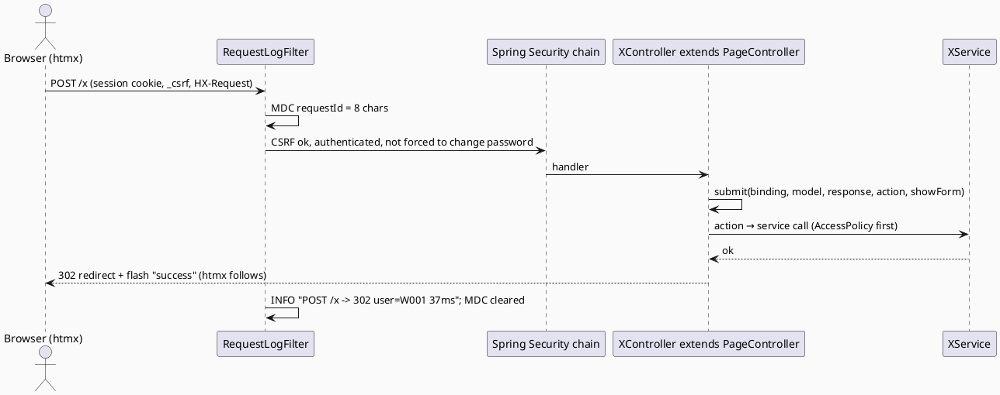
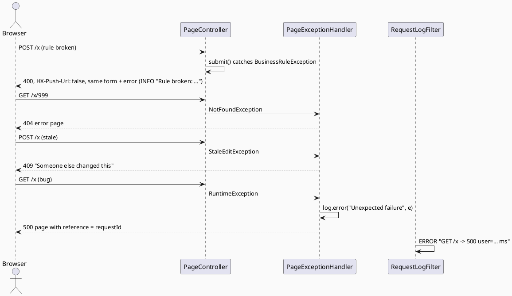

# ENGINEERING DOCUMENTATION STANDARD (EDS) v2.0
# Quy chuẩn Tài liệu Kỹ thuật và Đặc tả Hiện thực hóa

| Field | Value |
|-------|-------|
| **Document ID** | `STEELSIGHT-PLT-IMP-001` |
| **Version** | `1.0` |
| **Date** | `2026-11-06` |
| **Status** | `Draft` |
| **Document Owner** | `Nguyen Vu An` |
| **Author** | `Claude Code (Opus 5.5) — reverse-engineered from commit f005861` |
| **Reviewed by** | `[ ] Pending — Tech Lead` |
| **DPO Sign-off** | `[ ] Pending` *(logging, hosting location, RLS)* |
| **Approved by** | `[ ] Pending — Principal Architect` |
| **Last Review** | `2026-11-06` |
| **Based on EDS** | `v2.0` |

---

## CHANGELOG

> **Policy 4.4 — Immutable History:** Không bao giờ xóa thông tin cũ. Mọi thay đổi phải ghi vào bảng này.

| Ngày | Người thực hiện | Nội dung thay đổi |
|------|-----------------|-------------------|
| 2026-11-06 | Claude Code (Opus 5.5) — documentation | Tạo tài liệu lần đầu, from the code, Dockerfile and CI as built |

---

## MỤC LỤC

1. [Tổng quan Module](#1-tổng-quan-module)
2. [Ma trận Truy vết (Traceability Matrix)](#2-ma-trận-truy-vết-traceability-matrix)
3. [Architecture Decision Records (ADR)](#3-architecture-decision-records-adr) ⭐ *Mới*
4. [Non-Functional Requirements & SLA](#4-non-functional-requirements--sla) ⭐ *Mới*
5. [Static Modeling (Mô hình Tĩnh)](#5-static-modeling-mô-hình-tĩnh)
6. [Dynamic Modeling (Mô hình Động)](#6-dynamic-modeling-mô-hình-động)
7. [Domain Event Catalog](#7-domain-event-catalog) ⭐ *Mới*
8. [Interface Specification (Đặc tả Giao diện)](#8-interface-specification-đặc-tả-giao-diện)
9. [API Specification](#9-api-specification)
10. [Bảng mã lỗi (Error Codes)](#10-bảng-mã-lỗi-error-codes)
11. [Quy trình Triển khai (Step-by-Step)](#11-quy-trình-triển-khai-step-by-step)
12. [Rollback & Incident Runbook](#12-rollback--incident-runbook) ⭐ *Mới*
13. [Kịch bản Kiểm thử Chi tiết](#13-kịch-bản-kiểm-thử-chi-tiết)
14. [Phương pháp Xác minh](#14-phương-pháp-xác-minh)
15. [Mẫu thử thực tế (API Verification Samples)](#15-mẫu-thử-thực-tế-api-verification-samples)
16. [Bảng tổng hợp phân quyền (Authorization Matrix)](#16-bảng-tổng-hợp-phân-quyền-authorization-matrix)
17. [AI Prompt Constraints (CASE 2.0)](#17-ai-prompt-constraints-case-20) ⭐⭐ *CASE 2.0 Core*

> **Adaptations to this stack:** this is the shared kernel. §5.2 shows the base entity mapping and the RLS script; §9 lists the platform endpoints (`/`, `/language`, `/actuator/health`, `/error`). **§11 and §12 here are the general deployment and rollback procedure** that the other TDS documents refer to.

---

## 1. Tổng quan Module

> Platform is what every module stands on: base entity classes (id equality, timestamps, soft delete, versioning), the generic repository lookups, the exception types and how pages show them, form-handling helpers, text validation, site time, bilingual messages, request logging, the dashboard, and the build, image, CI and hosting setup.

| Field | Value |
|-------|-------|
| **Module Name** | `PLT — Platform (shared kernel)` |
| **Bounded Context** | `Cross-cutting` |
| **Data Classification** | `Internal`; logs carry employee codes (`PII`) |
| **Compliance Scope** | `Luật 91/2025/QH15` (logging, hosting/processors, cross-border) — DPO pending |
| **Upstream Dependencies** | Spring Boot 4.0.0, Spring Security 7, Thymeleaf 3.1, htmx 2.0.7, PostgreSQL 17 + pgvector + btree_gist, Flyway, Render, Supabase, GitHub Actions |
| **Downstream Consumers** | All modules |

**Code location:** `SteelsightErpApplication`, `model/**`, `repository/**`, `exception/**`, `validation/Text`, `config/LocaleConfig`, `web/PageController`, `web/PageExceptionHandler`, `web/RequestLogFilter`, `web/HomeController`, `web/LanguageController`, `web/Display`, `web/SiteTime`, `web/Charts`, `web/NavCounts`, `templates/fragments/**`, `templates/home.html`, `templates/error.html`, `messages*.properties`, `static/**`, `db/migration/afterMigrate__enable_rls.sql`, `application*.yaml`, `Dockerfile`, `.github/workflows/ci.yml`, `pom.xml`, `package.json`, `scripts/build-icons.mjs`.

---

## 2. Ma trận Truy vết (Traceability Matrix)

| Requirement ID | Loại (BR/ADR/US) | Mô tả yêu cầu | Thành phần Code | Compliance Target | ADR liên quan |
|----------------|------------------|---------------|-----------------|-------------------|---------------|
| BR-PLT-001 | Business Rule | Flyway only; RLS on all tables | `ddl-auto: validate`, `afterMigrate__enable_rls.sql` | PDPL — security | ADR-003, ADR-004 |
| BR-PLT-002 | Business Rule | One request line + request id; no personal data | `RequestLogFilter`, `PageController.submit()` | PDPL — minimisation | ADR-024 |
| BR-PLT-003 | Business Rule | CSRF on forms; API stateless | `SecurityConfig` | — | ADR-002, ADR-019 |
| BR-PLT-004 | Business Rule | Error pages with right status | `PageExceptionHandler` | — | ADR-024 |
| BR-PLT-005 | Business Rule | UTC storage, site-time display | `hibernate.jdbc.time_zone`, `SiteTime`, `Display` | — | ADR-018 |
| BR-PLT-006 | Business Rule | Same keys in both languages; cookie for a year | `TranslationsTest`, `LocaleConfig`, `LanguageController` | — | ADR-002 |
| BR-PLT-007 | Business Rule | Only `/actuator/health`, public, no details | `management.endpoints.web.exposure.include` | PDPL — security | ADR-023 |
| BR-PLT-008 | Business Rule | Versioned entities; 409 on stale | `Versioned`, `StaleEditException` | — | ADR-006 |
| US-ALL-001 | User Story | Bilingual, light/dark, phone-friendly | templates, `app.css`, `app.js`, `LocaleConfig` | — | ADR-002 |

---

## 3. Architecture Decision Records (ADR)

| ADR | Status | Decision (one line) | Effect on this module |
|-----|--------|---------------------|------------------------|
| [ADR-002](../02_design/adr/ADR-002_server-rendered-monolith.md) | Accepted | Server-rendered monolith | Templates, htmx, `PageController` |
| [ADR-003](../02_design/adr/ADR-003_flyway-owns-schema-db-enforces-integrity.md) | Accepted | Flyway; DB integrity | `validate`, migrations |
| [ADR-004](../02_design/adr/ADR-004_shared-database-with-least-privilege-detection-role.md) | Accepted | RLS on every table | `afterMigrate__enable_rls.sql` |
| [ADR-006](../02_design/adr/ADR-006_optimistic-locking-through-forms.md) | Accepted | Versioned forms | `Versioned`, 409 |
| [ADR-018](../02_design/adr/ADR-018_shift-overlap-exclusion-and-site-time.md) | Accepted | Site time | `SiteTime` |
| [ADR-023](../02_design/adr/ADR-023_hosting-render-and-supabase.md) | Accepted (GitLab move pending) | Render + Supabase | Dockerfile, CI, prod profile |
| [ADR-024](../02_design/adr/ADR-024_request-id-logging-without-personal-data.md) | Accepted | Request-id logging | `RequestLogFilter` |

---

## 4. Non-Functional Requirements & SLA

### 4.1. Performance & Availability

| Category | Requirement | Target SLA | Measurement Method | Compliance Basis |
|----------|-------------|------------|---------------------|------------------|
| Latency | Page response warm | *proposed* `< 500 ms` p95 | `RequestLogFilter` ms field | — |
| Cold start | First request after sleep | *configured:* ≥ 1 min (Render free) | Render | — |
| Availability | Site | **No SLA** on the free tier (sleeps after 15 min idle; Supabase may pause idle projects). Demo fallback: same image on the laptop + `cloudflared` | Render dashboard | — |
| Memory | Container | 512 MB, heap ≤ 70 % (`-XX:MaxRAMPercentage=70`) | Render metrics | — |
| DB pool | Hikari | max 5, min idle 1 (prod) | `application-prod.yaml` | — |

### 4.2. Data Integrity & Retention

| Category | Requirement | Target | Verification Method | Compliance Basis |
|----------|-------------|--------|---------------------|------------------|
| Schema drift | Entities match tables | Startup fails otherwise | `ddl-auto: validate` | — |
| Durability | DB backups | Supabase-managed (free-tier policy); **RPO not defined** | Supabase dashboard | PDPL — integrity |
| Logs | Retention | Render's (short; not controlled) | — | PDPL — storage limitation (DPO) |

### 4.3. Security

| Category | Requirement | Target | Verification Method | Compliance Basis |
|----------|-------------|--------|---------------------|------------------|
| Encryption in transit | Browser → Render | HTTPS (Render certificate) | §14.3 | PDPL |
| Encryption in transit | ERP → Supabase | `sslmode=require` | `DB_URL` | PDPL |
| Public data API | Supabase Data API blocked | RLS on every table | `RepositoryIntegrationTest.everyPublicTableHasRowLevelSecurity` | PDPL |
| Container | Non-root user (uid 1001), JRE only | configured | `Dockerfile` | — |
| Secrets | None in Git; env only | configured | `.env.example`, `.gitignore` | PDPL |
| Open redirect | `/language` uses only the Referer path | configured | `LanguageController.pageBefore()` | — |
| XSS | Thymeleaf escapes by default | configured | `PagesIntegrationTest.pageTextIsEscaped` | — |
| Static analysis / dependency scan | Semgrep, Trivy | **Planned** (GitLab), not in repo | — | — |

### 4.4. Scalability & Capacity Planning

> Single instance by design: in-memory sessions and sign-in counts (gap G6). To scale out: Spring Session JDBC, a shared limiter store, and a larger Supabase pooler or a paid tier.

---

## 5. Static Modeling (Mô hình Tĩnh)

### 5.1. Class Diagram (PlantUML)

```plantuml
@startuml PLT_ClassDiagram
skinparam classAttributeIconSize 0
skinparam backgroundColor #FAFAFA
skinparam ClassBorderColor #2E75B6
skinparam ClassHeaderBackgroundColor #D5E8F0

abstract class IdentifiedModel {
  + id: Long  <<IDENTITY>>
  + equals(o): by id and Hibernate class
  + hashCode(): constant per class
  + toString(): "Class(id=…)"
}
abstract class BaseModel {
  + createdAt
  + updatedAt
  #onCreate() @PrePersist
  #onUpdate() @PreUpdate
}
abstract class SoftDeletableModel {
  + deletedAt
  + isDeleted()
}
interface Versioned {
  + getVersion(): Long
  + requireVersion(long)
}

interface BaseRepository<T, ID> {
  + require(id): T
}
interface SoftDeletableRepository<T, ID> {
  + findByIdAndDeletedAtIsNull
  + findAllByDeletedAtIsNull
  + require(id)
}

class BusinessRuleException <<RuntimeException>>
class NotFoundException <<RuntimeException>>
class StaleEditException <<OptimisticLockingFailureException>>
class Text <<final>> {
  + LONG = 4000
  + SHORT = 200
  + required(field, value, max)
  + optional(field, value, max)
}

abstract class PageController {
  # pageOf(number): Pageable  (size 20)
  # pageOf(rows, number): Page
  # attempt(redirect, target, msg, action): String
  # submit(binding, model, response, action, showForm): String
}
class PageExceptionHandler <<ControllerAdvice>>
class RequestLogFilter <<OncePerRequestFilter>> {
  + REQUEST_ID = "requestId"
}
class SiteTime {
  + toInstant / toLocal / startOf / today / dateOf / mondayOf
}
class Display <<@Component display>> {
  + date / time / dateTime / hours / label / role / category / message / waiting
}
class LocaleConfig {
  + localeResolver(): CookieLocaleResolver("steelsight-language", 365 d)
}
class HomeController
class NavCounts <<@Component navCounts>>

IdentifiedModel <|-- BaseModel
BaseModel <|-- SoftDeletableModel
BaseRepository <|-- SoftDeletableRepository
PageController ..> BusinessRuleException
PageExceptionHandler ..> NotFoundException
PageExceptionHandler ..> StaleEditException
@enduml
```



### 5.2. Data Structure (Flyway SQL / mapping)

```sql
-- Shared function used by every table with updated_at (V1)
CREATE OR REPLACE FUNCTION set_updated_at() RETURNS trigger AS $$
BEGIN NEW.updated_at = now(); RETURN NEW; END; $$ LANGUAGE plpgsql;

-- afterMigrate__enable_rls.sql — runs after EVERY Flyway migrate
DO $$
DECLARE t record;
BEGIN
  FOR t IN SELECT tablename FROM pg_tables WHERE schemaname = 'public' AND NOT rowsecurity LOOP
    EXECUTE format('ALTER TABLE public.%I ENABLE ROW LEVEL SECURITY', t.tablename);
  END LOOP;
END $$;
-- Extensions (V1): btree_gist (shift exclusion), vector (face embeddings)
```

```yaml
# application.yaml (excerpt)
spring.jpa.hibernate.ddl-auto: validate
spring.jpa.properties.hibernate.jdbc.time_zone: UTC
management.endpoints.web.exposure.include: health
logging.pattern.correlation: "[%X{requestId:-}] "
server.forward-headers-strategy: framework
server.servlet.session.cookie: { same-site: lax, secure: ${SESSION_COOKIE_SECURE:false} }
steelsight.time-zone: ${APP_TIME_ZONE:Asia/Ho_Chi_Minh}
```

---

## 6. Dynamic Modeling (Mô hình Động)

### 6.1. Sequence Diagram — Happy Path (PlantUML): a form post through the platform



### 6.2. Sequence Diagram — Error Path (PlantUML)



### 6.3. State Machine *(bắt buộc nếu module có trạng thái)*

> Not applicable — shared kernel. Entity state machines are in each module's TDS.

> **⚠️ Invariant bất biến:**
> - Entities compare by id and class only; `toString()` never walks relations (avoids loops such as `Team.manager ↔ AppUser.team`).
> - `require(id)` on a soft-deletable repository treats a deleted row as not found.
> - Every public table has RLS enabled after any migration.

---

## 7. Domain Event Catalog

### 7.1. Events Published (Phát ra)

| Event Name | Trigger | Publisher | Subscriber(s) | Payload Schema | Async? |
|------------|---------|-----------|---------------|----------------|--------|
| `RequestCompleted` *(log line)* | Each non-static request | `RequestLogFilter` | Render logs | method, path, status, user, ms, requestId | No |

### 7.2. Events Consumed (Tiêu thụ)

| Event Name | Source | Handler | Action thực hiện |
|------------|--------|---------|------------------|
| `afterMigrate` (Flyway callback) | Flyway | `afterMigrate__enable_rls.sql` | Enables RLS on any table without it |

### 7.3. Payload Schema

```text
[<requestId>] <METHOD> <path> -> <status> user=<employeeCode|anonymous|detection-software> <ms>ms
```

---

## 8. Interface Specification (Đặc tả Giao diện)

### 8.1. Service Interface

```java
// @version 1.0 — shared kernel contracts
public interface Versioned { Long getVersion(); default void requireVersion(long v); }   // throws StaleEditException

public final class Text {
  public static final int LONG = 4000, SHORT = 200;
  /** "<field> is required" when blank; trims; "<field> can be at most <n> characters". */
  public static String required(String field, String value, int maxLength);
  /** Blank → null (never an empty string on a unique column). */
  public static String optional(String field, String value, int maxLength);
}

abstract class PageController {
  protected Pageable pageOf(int number);                         // max(number, 0), size 20
  protected <T> Page<T> pageOf(List<T> rows, int number);        // in-memory paging
  /** Buttons: run, flash success or the rule's message, redirect to target. */
  protected String attempt(RedirectAttributes r, String target, String successMessage, Runnable action);
  /** Forms: action's view, or 400 + the same form + error; logs field names only. */
  protected String submit(BindingResult b, Model m, HttpServletResponse res, Supplier<String> action, Supplier<String> showForm);
}

@Component public class SiteTime {
  OffsetDateTime toInstant(LocalDateTime local);  LocalDateTime toLocal(OffsetDateTime instant);
  OffsetDateTime startOf(LocalDate date);         LocalDate today();
  LocalDate dateOf(OffsetDateTime instant);       LocalDate mondayOf(LocalDate date);
}

@Component("display") public class Display {   // used in templates as ${@display.x(...)}
  String date(..); String time(..); String dateTime(..); String hours(BigDecimal);
  String label(Enum<?>); String role(String); String category(String);
  /** English rule message → msg.<slug> key in the reader's language, numbers as arguments; falls back to English. */
  String message(String english);
  String waiting(OffsetDateTime since);
}
```

### 8.2. Repository Interface

```java
// @version 1.0
@NoRepositoryBean
public interface BaseRepository<T extends IdentifiedModel, ID> extends JpaRepository<T, ID> {
  default T require(ID id);   // NotFoundException("Record", id) → 404
}
@NoRepositoryBean
public interface SoftDeletableRepository<T extends SoftDeletableModel, ID> extends BaseRepository<T, ID> {
  Optional<T> findByIdAndDeletedAtIsNull(ID id);
  List<T> findAllByDeletedAtIsNull();
  @Override default T require(ID id);   // deleted = not found
}
```

---

## 9. API Specification

### 9.1. Endpoints Table

| Method | Path | Auth Level | Required Roles | Rate Limit | Idempotent? |
|--------|------|------------|----------------|------------|-------------|
| `GET` | `/` (dashboard; blocks per permission) | Session | any | — | Yes |
| `POST` | `/language` (`lang=vi\|en`) | Public + CSRF | — | — | Yes |
| `GET` | `/actuator/health` | Public | — | — | Yes |
| `GET` | `/actuator/**` (others) | — | not exposed → 404/403 | — | — |
| `GET` | `/error` | Public | — | — | Yes |
| `GET` | `/css/**`, `/js/**`, `/img/**` | Public | — | — | Yes |

### 9.2. Request / Response Schemas

#### `GET /actuator/health`

**Response — 200 OK:**
```json
{ "status": "UP" }
```

#### `POST /language`

**Request:** `lang=vi&_csrf=<token>`, `Referer: https://<host>/shifts?week=2026-11-10`
**Response — 302:** `Location: /shifts` (path of the Referer only; anything else → `/`), `Set-Cookie: steelsight-language=vi; Max-Age=31536000; SameSite=Lax`.

---

## 10. Bảng mã lỗi (Error Codes)

> The platform's error pages. Module-specific messages are in each module's §10. **No codes are emitted** (gap G4).

| Code | HTTP Status | Message (EN) | Message (VI) | Trigger Condition |
|------|-------------|--------------|--------------|-------------------|
| `PLT-001` | 400 | One of the values isn't valid. Check the form and try again. | Có giá trị không hợp lệ. Hãy kiểm tra biểu mẫu và thử lại. | Form binding error |
| `PLT-002` | 400 | That didn't work — *(the rule's message)* | Không thực hiện được — *(translated)* | `BusinessRuleException` outside `submit`/`attempt` |
| `PLT-003` | 403 | Not allowed — You don't have access to this page. | Không được phép — Bạn không có quyền truy cập trang này. | `AccessDeniedException`, missing CSRF |
| `PLT-004` | 404 | Page not found — We couldn't find what you were looking for. | Không tìm thấy trang — Không tìm thấy nội dung bạn cần. | `NotFoundException`, bad id type, unknown path |
| `PLT-005` | 409 | Someone else changed this — Go back, reload the page and try again. | Người khác đã thay đổi nội dung này — Hãy quay lại, tải lại trang và thử lại. | `OptimisticLockingFailureException` |
| `PLT-006` | 413 | Photo too large — Go back and choose a photo under 5 MB. | Ảnh quá lớn — Hãy quay lại và chọn ảnh dưới 5 MB. | Upload limit |
| `PLT-007` | 4xx | That didn't work — Go back and try again. | Không thực hiện được — Hãy quay lại và thử lại. | Framework `ErrorResponse` (405, 415 …) |
| `PLT-008` | 500 | Something went wrong — This is a problem on our side. *(+ reference)* | Đã xảy ra lỗi — Đây là lỗi từ phía hệ thống. | Any other exception; logged with stack trace |

---

## 11. Quy trình Triển khai (Step-by-Step)

> **This is the general procedure** referenced by every module's §11.

### 11.1. Prerequisites

- [ ] Module ADRs Accepted (`02_design/MODULE-MAP.md` §5)
- [ ] DPO sign-off for modules with PII (all except STO-only config changes)
- [ ] `sh ./mvnw verify` green (needs Docker for Testcontainers)
- [ ] Staging: **none**; local Docker DB `steelsight-db` on port 55433 serves as the pre-production copy

### 11.2. Pre-Migration Checklist *(bắt buộc tick trước khi chạy migration)*

- [ ] Backup production DB (Supabase dashboard backup, or `pg_dump -Fc` over the session pooler)
- [ ] New migration tested on the local copy and in `mvn verify`
- [ ] New migration is a **new** `V<n>__…sql` file; no applied file edited
- [ ] Forward-fix migration drafted (§12)
- [ ] DPO sign-off if PII storage changes

### 11.3. Implementation Steps

#### Chặng 1 — Build and test

```bash
export JAVA_HOME=/usr/lib/jvm/java-17-openjdk-amd64   # if not already set
sh ./mvnw -B verify                                    # unit + Testcontainers integration tests
```

> ⚠️ **Chú ý:** Testcontainers needs a running Docker; without it, only the database-free tests run.

#### Chặng 2 — Image and deploy (GitHub Actions, until the GitLab move)

```bash
git push origin master
# CI: test → build ghcr.io/owochiii/steelsight_erp:<sha> (+ latest) → Render deploy hook with imgURL=<image>:<sha>
# Flyway migrates on the new container's startup; Render switches traffic after /actuator/health is UP.
```

#### Chặng 3 — Verification sau deploy

```bash
curl -s https://<service>.onrender.com/actuator/health
# Expected: {"status":"UP"}
```

### 11.4. Deployment Checklist

- [ ] Migration ran (log `Successfully applied N migrations` or `Schema … is up to date`)
- [ ] Health endpoint 200
- [ ] No `ERROR` request lines in the first 10 minutes
- [ ] Session cookie `Secure`; sign-in works; a photo still opens after restart
- [ ] DPO informed if PII processing changed

---

## 12. Rollback & Incident Runbook

> **General procedure**, referenced by every module's §12.

### 12.1. Điều kiện kích hoạt Rollback (Trigger Conditions)

| Điều kiện | Ngưỡng | Người quyết định |
|-----------|--------|------------------|
| Error rate | > 5% 5xx for 5 min | Developer (on-call) |
| Latency | p99 > 2× baseline | Developer |
| Data inconsistency | Any case | Developer + Tech Lead + DPO |
| App won't start (Flyway or validate failure) | Any | Developer |

### 12.2. Rollback Procedure

```bash
# Bước 1: Schema — no Flyway undo. Add V<n+1>__revert_<what>.sql restoring the previous state.
#          Never delete rows from flyway_schema_history on production.

# Bước 2: Re-deploy the previous image (every image is tagged by commit SHA)
curl --fail --get "$RENDER_DEPLOY_HOOK" --data-urlencode "imgURL=ghcr.io/owochiii/steelsight_erp:<previous_sha>"
#   or Render dashboard → Deploys → previous → Rollback
#   Note: an older image + a newer schema fails ddl-auto=validate if columns were removed/renamed;
#   additive migrations are safe to roll back over.

# Bước 3: Verify
curl -s https://<service>.onrender.com/actuator/health

# Bước 4: Smoke test — sign in as each role; open dashboard, /shifts, /tickets/queue, /violations/review
```

### 12.3. Notification Protocol

| Thời điểm | Người nhận | Kênh | Template |
|-----------|------------|------|----------|
| Ngay khi phát hiện | Developer / team | Team chat | "🚨 Steelsight incident: [description], reference [requestId]" |
| Trong 30 phút | DPO | Email | *(If personal data may be affected)* |
| Trong 72 giờ | Competent authority (Bộ Công an) | Official channel | *(Confirmed personal-data breach — deadline and form per Luật 91/2025 / NĐ 356/2025, DPO to confirm)* |

### 12.4. Post-Incident Review (PIR)

> Bắt buộc hoàn thành PIR document trong vòng **48 giờ** sau khi incident được resolve.

- **Timeline:** from Render logs (request ids)
- **Root Cause:** 5 Whys
- **Impact:** users affected, downtime, PII exposure?
- **Remediation:** steps taken
- **Prevention:** action items (test, ADR, constraint)

---

## 13. Kịch bản Kiểm thử Chi tiết

> Full TCs: [`04_testing/STEELSIGHT-PLT-TDD-001_Test-Spec.md`](../04_testing/STEELSIGHT-PLT-TDD-001_Test-Spec.md). Test data `SYNTHETIC`. All integration tests share one `pgvector/pgvector:pg17` Testcontainer (`TestDatabase`).

### 13.1. Unit Tests

#### TC-UNIT-001 — Translations complete

```gherkin
Feature: Bilingual messages
  Background:
    Given test data classification: SYNTHETIC

  Scenario: Same keys in both files
    When messages.properties and messages_vi.properties are compared
    Then the key sets are equal

  Scenario: Every code message is translated
    Given every BusinessRuleException / flash message written in the code
    Then each has a msg.<slug> key in messages_vi.properties
```

**Hàm được test:** `TranslationsTest`
**Invariant kiểm tra:** no page shows a missing-key marker.

### 13.2. Integration Tests

#### TC-INT-001 — RLS everywhere

```gherkin
  Scenario: Every public table has RLS
    Given test data classification: SYNTHETIC
    And Flyway migrated a fresh database
    When pg_tables is read for schema public
    Then rowsecurity is true for every table
```

**External dependencies:** PostgreSQL
**Mock strategy:** Testcontainers.

### 13.3. E2E / Security Tests

#### TC-E2E-001 — Unexpected failure is logged with a reference

```gherkin
  Scenario: A bug in a page
    Given test data classification: SYNTHETIC
    When a request fails with an unexpected exception
    Then the response is 500 with the request id as reference
    And the log has the stack trace and the same request id
    And no password or form value is in the log
```

---

## 14. Phương pháp Xác minh

### 14.1. Database Inspection

```sql
-- RLS on every table (expect 0 rows)
SELECT tablename FROM pg_tables WHERE schemaname = 'public' AND NOT rowsecurity;
-- Migration history
SELECT installed_rank, version, description, success FROM flyway_schema_history ORDER BY installed_rank;
-- No policy for Supabase's public roles (expect only steelsight_detection)
SELECT DISTINCT unnest(roles) FROM pg_policies WHERE schemaname = 'public';
```

### 14.2. Log / Audit Verification

```bash
grep -E '\] (GET|POST) .* -> 5[0-9]{2} ' app.log | head        # server errors with request id
grep -E 'Unexpected failure' -A 5 app.log | head
grep -iE 'password=|currentPassword|newPassword' app.log         # Expected: no output
```

### 14.3. Tool-based Verification

```bash
openssl s_client -connect <service>.onrender.com:443 -servername <service>.onrender.com </dev/null 2>/dev/null | grep -E 'Protocol|Cipher'
curl -s -o /dev/null -w '%{http_code}\n' https://<service>.onrender.com/actuator/env     # Expected: not 200
docker run --rm ghcr.io/owochiii/steelsight_erp:<sha> id                                # uid=1001(steelsight)
```

---

## 15. Mẫu thử thực tế (API Verification Samples)

### 15.1. Happy Path

```bash
curl -s https://<service>.onrender.com/actuator/health
```

**Expected Response (200):**
```json
{ "status": "UP" }
```

### 15.2. Error Paths

```bash
curl -s -o /dev/null -w '%{http_code}\n' https://<service>.onrender.com/actuator/metrics
```

**Expected Response:** not 200 (endpoint not exposed).

```bash
# Open redirect attempt through the language switch
curl -s -b $JAR -o /dev/null -w '%{redirect_url}\n' -H 'Referer: https://evil.example/phish' -d "lang=vi&_csrf=$CSRF" $BASE/language
```

**Expected:** redirect to `https://<service>.onrender.com/phish` (path only on the same host), never to `evil.example`.

---

## 16. Bảng tổng hợp phân quyền (Authorization Matrix)

| Endpoint | `ANONYMOUS` | `WORKER` | `HSE_OFFICER` | `MANAGER` | `ADMIN` |
|----------|-------------|----------|---------------|-----------|---------|
| `GET /actuator/health` | ✅ | ✅ | ✅ | ✅ | ✅ |
| `GET /actuator/**` (other) | ❌ | ❌ | ❌ | ❌ | ❌ |
| `POST /language` | ✅ | ✅ | ✅ | ✅ | ✅ |
| `GET /` dashboard | ❌ → login | ✅ (own week, tickets, violations, score) | ✅ (+ queue, safety charts, disputes, on site) | ✅ (+ today's roster, on site) | ✅ (all blocks) |
| Static `/css`, `/js`, `/img` | ✅ | ✅ | ✅ | ✅ | ✅ |

**Chú thích:** dashboard blocks are shown by `AuthenticatedUser.can(...)`, and each block's data is still fetched through a service that checks permission.

---

## 17. AI Prompt Constraints (CASE 2.0)

### 17.1 Constraint Summary Table

| # | Constraint | Source (ADR/BR) | Last Verified |
|---|-----------|-----------------|---------------|
| C1 | Entities extend `IdentifiedModel`/`BaseModel`/`SoftDeletableModel`; never override equals/hashCode/toString with fields | `PLT` invariants | `2026-11-06` |
| C2 | Rule failures throw `BusinessRuleException` with an English sentence that has a `msg.*` VI key | `BR-PLT-004/006` | `2026-11-06` |
| C3 | Forms via `PageController.submit`, buttons via `attempt`; no try/catch for 403/404/409 in controllers | `ADR-002`, `BR-PLT-004` | `2026-11-06` |
| C4 | Times via `SiteTime`/`Display`; storage UTC | `ADR-018`, `BR-PLT-005` | `2026-11-06` |
| C5 | Logs: SLF4J, path only, no personal values; request id via MDC | `ADR-024`, `BR-PLT-002` | `2026-11-06` |
| C6 | Config by env vars; nothing secret in Git; only health exposed | `ADR-023`, `BR-PLT-007` | `2026-11-06` |

### 17.2 Constraint Injection Block (Copy-Paste vào AI Prompt)

```
[CONSTRAINT BLOCK — Module: PLT — Platform]
Theo TDS STEELSIGHT-PLT-IMP-001 và các ADR liên quan (ADR-002, 003, 004, 006, 018, 023, 024):

1. New entities extend IdentifiedModel (or BaseModel / SoftDeletableModel) and implement Versioned when edited
   through a form. Do not add Lombok @Data/@EqualsAndHashCode/@ToString on entities.
2. Lookups by id use repository.require(id) (404 on missing or soft-deleted). Rule violations throw
   BusinessRuleException("<English sentence>"), and a matching msg.<slug> key is added to
   messages_vi.properties (and any new label to both message files).
3. Controllers extend PageController; forms use submit(...), buttons use attempt(...). Let
   PageExceptionHandler handle AccessDenied (403), NotFound (404), OptimisticLock (409), upload size (413), bugs (500).
4. Convert and format times only with SiteTime and Display (site zone APP_TIME_ZONE); the DB stores UTC.
5. Log with SLF4J; never log passwords, form values, query strings, photo bytes or keys; sanitise \r\n\t
   in typed values. Do not add actuator endpoints, System.out, or secrets in application*.yaml.

[CONTEXT BLOCK]
- Bounded Context: Cross-cutting
- Data Classification: Internal (+ employee codes in logs)
- Compliance: Luật 91/2025/QH15 (DPO pending)
- Existing interfaces: §8.1 Versioned, Text, PageController, SiteTime, Display + §8.2 BaseRepository
- Error codes: §10
- Auth matrix: §16

[TASK BLOCK]
Implement {feature/method} thỏa mãn constraints trên.
Output phải tuân thủ §8 Interface Specification.
Tests phải cover §13 Test Scenarios and STEELSIGHT-PLT-TDD-001.
```

### 17.3 Constraint Quality Checklist

- [x] Mỗi constraint traceable về ADR hoặc BR cụ thể
- [x] Không có constraint generic
- [x] Mỗi constraint có `Last Verified` date ≤ 2 sprints
- [x] Constraint block có ≥ 3 constraints cụ thể
- [x] Constraint block reference §8 Interface
- [x] Constraint block reference §16 Auth Matrix

### 17.4 Anti-Pattern Detection (cho AI-Generated Code từ Block này)

| AP-ID | Anti-Pattern | Dấu hiệu | Hành động |
|-------|-------------|-----------|----------|
| AP-AI-001 | Unconstrained Gen | Hard-coded English in a template, `ZoneId.systemDefault()` | Reject |
| AP-AI-003 | Implicit Decision | `ddl-auto: update`, new actuator endpoints, a second logging framework, Redis/session store | Reject — ADR first |
| AP-AI-005 | Hallucinated Contract | `BaseService`, `ApiResponse<T>`, `ErrorCode` enum (none exist) | Reject |

---

## PHỤ LỤC

### A. Glossary (Thuật ngữ)

| Thuật ngữ | Định nghĩa |
|-----------|------------|
| Shared kernel | Code every module uses (base entities, errors, helpers) |
| Request id | 8-character id in MDC on every log line of one request |
| Site time | `APP_TIME_ZONE`, default `Asia/Ho_Chi_Minh` |
| RLS | PostgreSQL Row Level Security; here it blocks Supabase's public Data API |
| Prod profile | `application-prod.yaml`, switched on by the Dockerfile |
| Red Gate | Tests phải FAIL trước khi implement |

### B. Tài liệu tham chiếu

| Document | Link / Path |
|----------|-------------|
| Module map | `02_design/MODULE-MAP.md` |
| Tech stack | `docs/tech-stack.md` |
| Deployment | `docs/deployment.md` |
| AI usage log | `chatlog/ai-log.md` |
| Test-Spec | `04_testing/STEELSIGHT-PLT-TDD-001_Test-Spec.md` |

---

*EDS v2.1 — Tích hợp CASE 2.0 AI Prompt Constraints (§17).*
*Sections đánh dấu ⭐ là bổ sung EDS v2.0. Section đánh dấu ⭐⭐ là bổ sung CASE 2.0.*
*Câu hỏi hoặc đề xuất sửa đổi: tạo Issue với label `docs-policy`.*
