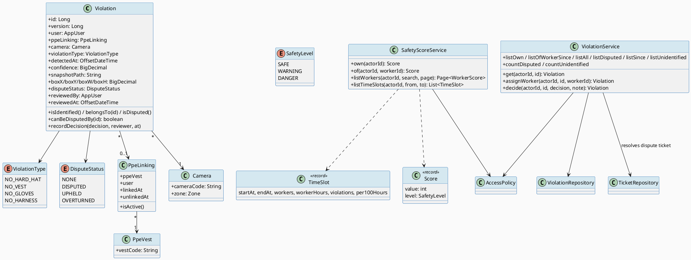
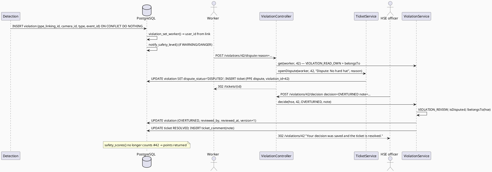
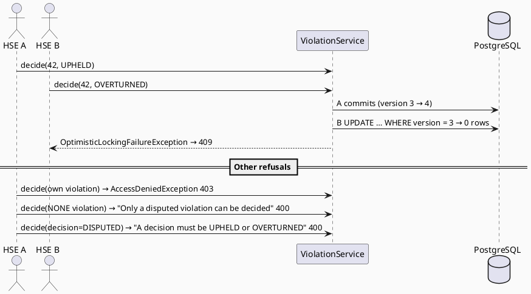
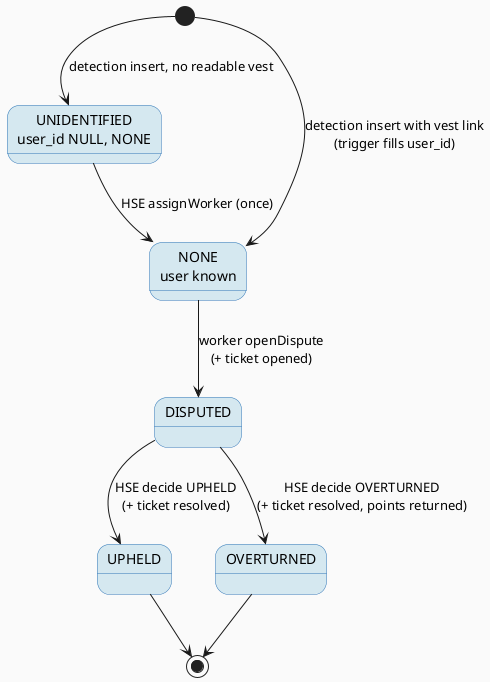

# ENGINEERING DOCUMENTATION STANDARD (EDS) v2.0
# Quy chuẩn Tài liệu Kỹ thuật và Đặc tả Hiện thực hóa

| Field | Value |
|-------|-------|
| **Document ID** | `STEELSIGHT-PPE-IMP-001` |
| **Version** | `1.0` |
| **Date** | `2026-11-06` |
| **Status** | `Draft` |
| **Document Owner** | `Nguyen Vu An` |
| **Author** | `Claude Code (Opus 5.5) — reverse-engineered from commit f005861` |
| **Reviewed by** | `[ ] Pending — Tech Lead` |
| **DPO Sign-off** | `[ ] Pending` *(camera snapshots of identifiable workers; scores affect pay)* |
| **Approved by** | `[ ] Pending — Principal Architect` |
| **Last Review** | `2026-11-06` |
| **Based on EDS** | `v2.0` |

---

## CHANGELOG

> **Policy 4.4 — Immutable History:** Không bao giờ xóa thông tin cũ. Mọi thay đổi phải ghi vào bảng này.

| Ngày | Người thực hiện | Nội dung thay đổi |
|------|-----------------|-------------------|
| 2026-11-06 | Claude Code (Opus 5.5) — documentation | Tạo tài liệu lần đầu, from the code as built (V1, V2, V8) |

---

## MỤC LỤC

1. [Tổng quan Module](#1-tổng-quan-module)
2. [Ma trận Truy vết (Traceability Matrix)](#2-ma-trận-truy-vết-traceability-matrix)
3. [Architecture Decision Records (ADR)](#3-architecture-decision-records-adr) ⭐ *Mới*
4. [Non-Functional Requirements & SLA](#4-non-functional-requirements--sla) ⭐ *Mới*
5. [Static Modeling (Mô hình Tĩnh)](#5-static-modeling-mô-hình-tĩnh)
6. [Dynamic Modeling (Mô hình Động)](#6-dynamic-modeling-mô-hình-động)
7. [Domain Event Catalog](#7-domain-event-catalog) ⭐ *Mới*
8. [Interface Specification (Đặc tả Giao diện)](#8-interface-specification-đặc-tả-giao-diện)
9. [API Specification](#9-api-specification)
10. [Bảng mã lỗi (Error Codes)](#10-bảng-mã-lỗi-error-codes)
11. [Quy trình Triển khai (Step-by-Step)](#11-quy-trình-triển-khai-step-by-step)
12. [Rollback & Incident Runbook](#12-rollback--incident-runbook) ⭐ *Mới*
13. [Kịch bản Kiểm thử Chi tiết](#13-kịch-bản-kiểm-thử-chi-tiết)
14. [Phương pháp Xác minh](#14-phương-pháp-xác-minh)
15. [Mẫu thử thực tế (API Verification Samples)](#15-mẫu-thử-thực-tế-api-verification-samples)
16. [Bảng tổng hợp phân quyền (Authorization Matrix)](#16-bảng-tổng-hợp-phân-quyền-authorization-matrix)
17. [AI Prompt Constraints (CASE 2.0)](#17-ai-prompt-constraints-case-20) ⭐⭐ *CASE 2.0 Core*

> **Adaptations to this stack:** §5.2 Flyway SQL, §8 Java, §9 session + CSRF form endpoints. Violations are **inserted only by the detection service** (YOLO26 + EasyOCR) as `steelsight_detection`; the ERP reviews them.

---

## 1. Tổng quan Module

> PPE & Safety shows the PPE violations cameras detect, lets workers see and dispute their own, lets HSE name unidentified workers and decide disputes, and computes each worker's monthly safety score and the safety of each shift time slot. It also owns the worker directory with scores (`/workers`).

| Field | Value |
|-------|-------|
| **Module Name** | `PPE — PPE & Safety` |
| **Bounded Context** | `Safety monitoring` |
| **Data Classification** | `PII` (violations tied to a worker, camera snapshots, scores) |
| **Compliance Scope** | `Luật 91/2025/QH15` — accuracy, right to object; DPO pending |
| **Upstream Dependencies** | `IAM` (AccessPolicy, AppUser), `SCH` (Zone, Shift for time slots), `TKT` (dispute ticket), `PLT` |
| **Downstream Consumers** | `NTF` (score-level trigger), `RPT` (violations and scores), dashboard charts, `TKT` (dispute) |

**Code location:** `ppe/**`, `web/ViolationController.java`, `web/WorkerController.java`, `web/SafetyController.java`, `web/Charts.java`, templates `violations/*`, `workers/*`, `safety/shifts.html`, `fragments/safety.html`; SQL `violation_set_worker()`, `safety_scores()`, `safety_time_slots()`, `safety_policy`.

---

## 2. Ma trận Truy vết (Traceability Matrix)

| Requirement ID | Loại (BR/ADR/US) | Mô tả yêu cầu | Thành phần Code | Compliance Target | ADR liên quan |
|----------------|------------------|---------------|-----------------|-------------------|---------------|
| BR-PPE-001 | Business Rule | Vest link fills/validates the worker | `violation_set_worker()` | PDPL — accuracy | ADR-003 |
| BR-PPE-002 | Business Rule | Unidentified can't be disputed; HSE names once | `CHECK (dispute_status='NONE' OR user_id IS NOT NULL)`, `ViolationService.assignWorker()` | PDPL — accuracy | ADR-003 |
| BR-PPE-003 | Business Rule | Only own worker disputes, once | `TicketService.openDispute()`, `Violation.canBeDisputedBy()` | PDPL — right to object | ADR-015 |
| BR-PPE-004 | Business Rule | Decide UPHELD/OVERTURNED; not own; ticket resolved together; one winner | `ViolationService.decide()`, `@Version` | PDPL — accountability | ADR-015, ADR-006 |
| BR-PPE-005 | Business Rule | Score formula | `safety_scores()`, `safety_policy` | PDPL — accuracy (pay) | ADR-014 |
| BR-PPE-006 | Business Rule | Levels SAFE/WARNING/DANGER | `safety_scores()` | — | ADR-014 |
| BR-PPE-007 | Business Rule | Own vs all visibility | `ViolationService.get/listOwn/listAll` | PDPL — least privilege | ADR-001 |
| BR-PPE-008 | Business Rule | Time slots per 100 worker-hours | `safety_time_slots()`, `SafetyScoreService.listTimeSlots()` | — | ADR-014 |
| BR-IAM-011 | Business Rule | `USER_READ_ALL` sees any worker | `WorkerController`, `SafetyScoreService.listWorkers/of` | PDPL — purpose limitation | ADR-001 |
| US-WRK-002/003 | User Story | See and dispute own violations | `ViolationController.list/detail/dispute` | — | ADR-015 |
| US-HSE-001/002 | User Story | Decide disputes; name workers | `ViolationController.decide/assignWorker`, `/violations/review` | — | ADR-015 |
| US-HSE-005 | User Story | Time-slot safety | `SafetyController` | — | ADR-014 |
| US-MGR-004 | User Story | Worker directory | `WorkerController` | — | — |

---

## 3. Architecture Decision Records (ADR)

| ADR | Status | Decision (one line) | Effect on this module |
|-----|--------|---------------------|------------------------|
| [ADR-003](../02_design/adr/ADR-003_flyway-owns-schema-db-enforces-integrity.md) | Accepted | DB enforces integrity | `violation_set_worker()`, dispute CHECKs |
| [ADR-004](../02_design/adr/ADR-004_shared-database-with-least-privilege-detection-role.md) | Accepted | Detection inserts violations as a limited role | Column INSERT grants; no dispute updates |
| [ADR-005](../02_design/adr/ADR-005_idempotent-detection-writes-by-event-id.md) | Accepted | `event_id` idempotency | `uq_violation_event`, `uq_ppe_linking_event` |
| [ADR-014](../02_design/adr/ADR-014_safety-score-computed-in-sql.md) | Accepted | Score in SQL, never stored | `safety_scores()`, `SafetyScoreService` |
| [ADR-015](../02_design/adr/ADR-015_dispute-decision-and-ticket-in-one-transaction.md) | Accepted | Decision + ticket in one transaction | `ViolationService.decide()` |

---

## 4. Non-Functional Requirements & SLA

### 4.1. Performance & Availability

| Category | Requirement | Target SLA | Measurement Method | Compliance Basis |
|----------|-------------|------------|---------------------|------------------|
| Latency | `GET /workers` (computes every worker's score) | *proposed* `< 800 ms` p95 for ≤ 500 workers | Request log ms | — |
| Latency | Dashboard safety block (14-day trend) | *proposed* `< 800 ms` | Request log ms | — |
| Ingest | Violation recorded while ERP sleeps | Always (direct DB insert) | ADR-004 | — |

### 4.2. Data Integrity & Retention

| Category | Requirement | Target | Verification Method | Compliance Basis |
|----------|-------------|--------|---------------------|------------------|
| Correctness | Score = formula of rows | 100% | `SafetyScoreTest` (12) | PDPL — accuracy |
| Consistency | Decision ⇔ ticket resolved | 100% | `ServiceAtomicityTest` | — |
| Idempotency | Retried detection event | No duplicate | `uq_violation_event` | — |
| Retention | Violations and snapshots | *Not defined — DPO* | — | PDPL — storage limitation |

### 4.3. Security

| Category | Requirement | Target | Verification Method | Compliance Basis |
|----------|-------------|--------|---------------------|------------------|
| Access control | Workers see own only; HSE/Admin all; managers via worker page only | Least privilege | §16, `PagesIntegrationTest.someoneElsesViolationIsForbidden` | PDPL |
| Separation of duties | Reviewer can't decide own violation | 100% | `HsePagesIntegrationTest.anOfficerCanSeeButNotDecideTheirOwnViolation` | — |
| Detection limits | Detection can't change dispute fields | configured | `schema_checks.sql` | PDPL — least privilege |
| SQL injection | `listWorkers` search binds and escapes LIKE wildcards | 100% | `WorkerAccessPagesTest.searchTreatsWildcardsAsPlainText` | — |

### 4.4. Scalability & Capacity Planning

> 1 gate + 3 zone cameras. The 30-minute repeat block bounds counted hits; raw rows can be many. `idx_violation_user_time`, `idx_violation_unidentified` and `idx_violation_link_time` index the reads. `safety_scores()` scans the month's violations for all workers per call.

---

## 5. Static Modeling (Mô hình Tĩnh)

### 5.1. Class Diagram (PlantUML)



### 5.2. Data Structure (Flyway SQL)

```sql
-- === PPE SCHEMA (V1, V2, V8) ===
CREATE TABLE ppe_vest (id bigint GENERATED ALWAYS AS IDENTITY PRIMARY KEY, vest_code text NOT NULL UNIQUE);

CREATE TABLE ppe_linking (                       -- who wore which vest, and when
  id          bigint GENERATED ALWAYS AS IDENTITY PRIMARY KEY,
  ppe_vest_id bigint NOT NULL REFERENCES ppe_vest(id),
  user_id     bigint NOT NULL REFERENCES app_user(id),
  linked_at   timestamptz NOT NULL DEFAULT now(),
  unlinked_at timestamptz,                       -- NULL = still active
  event_id    uuid CONSTRAINT uq_ppe_linking_event UNIQUE,   -- V2
  CHECK (unlinked_at IS NULL OR unlinked_at > linked_at)
);
CREATE UNIQUE INDEX uq_link_active_vest ON ppe_linking(ppe_vest_id) WHERE unlinked_at IS NULL;
CREATE UNIQUE INDEX uq_link_active_user ON ppe_linking(user_id)     WHERE unlinked_at IS NULL;

CREATE TABLE camera (id bigint GENERATED ALWAYS AS IDENTITY PRIMARY KEY,
                     camera_code text NOT NULL UNIQUE, zone_id bigint NOT NULL REFERENCES zone(id));

CREATE TABLE violation (
  id             bigint GENERATED ALWAYS AS IDENTITY PRIMARY KEY,
  user_id        bigint REFERENCES app_user(id),      -- NULL = not identified yet
  ppe_linking_id bigint REFERENCES ppe_linking(id),   -- vest read by OCR
  camera_id      bigint NOT NULL REFERENCES camera(id),
  violation_type text   NOT NULL,                     -- NO_HARD_HAT, NO_VEST, NO_GLOVES, NO_HARNESS
  detected_at    timestamptz NOT NULL,
  confidence     numeric(5,2) CHECK (confidence BETWEEN 0 AND 100),
  snapshot_path  text   NOT NULL,
  box_x numeric(5,2), box_y numeric(5,2), box_w numeric(5,2), box_h numeric(5,2),   -- % of image
  dispute_status text NOT NULL DEFAULT 'NONE' CHECK (dispute_status IN ('NONE','DISPUTED','UPHELD','OVERTURNED')),
  reviewed_by    bigint REFERENCES app_user(id),
  reviewed_at    timestamptz,
  version        bigint NOT NULL DEFAULT 0,
  created_at     timestamptz NOT NULL DEFAULT now(),
  updated_at     timestamptz NOT NULL DEFAULT now(),
  event_id       uuid CONSTRAINT uq_violation_event UNIQUE,                         -- V2
  CHECK (dispute_status NOT IN ('UPHELD','OVERTURNED') OR (reviewed_by IS NOT NULL AND reviewed_at IS NOT NULL)),
  CHECK (dispute_status = 'NONE' OR user_id IS NOT NULL)
);
CREATE INDEX idx_violation_link_time    ON violation(ppe_linking_id, detected_at DESC);
CREATE INDEX idx_violation_user_time    ON violation(user_id, detected_at DESC);
CREATE INDEX idx_violation_unidentified ON violation(detected_at DESC) WHERE user_id IS NULL;
-- trg_violation_worker  BEFORE INSERT OR UPDATE → violation_set_worker(): fill user_id from the link, refuse a mismatch
-- trg_violation_safety_level AFTER INSERT OR UPDATE OF user_id, dispute_status → notify_safety_level() (see NTF TDS)

CREATE TABLE safety_policy (                                                        -- V8, one row
  id                   boolean  PRIMARY KEY DEFAULT true CHECK (id),
  points_per_violation integer  NOT NULL DEFAULT 10 CHECK (points_per_violation > 0),
  warning_at           integer  NOT NULL DEFAULT 70,
  danger_at            integer  NOT NULL DEFAULT 40,
  repeat_limit         interval NOT NULL DEFAULT interval '30 minutes',
  time_zone            text     NOT NULL DEFAULT 'Asia/Ho_Chi_Minh',
  CHECK (0 <= danger_at AND danger_at < warning_at AND warning_at < 100)
);
-- safety_scores(p_at timestamptz DEFAULT now()) RETURNS TABLE(user_id, score, level)   STABLE
-- safety_time_slots(p_from, p_to) RETURNS TABLE(start_at, end_at, workers, worker_hours, violations, per_100_hours)
-- Detection: SELECT violation; INSERT (user_id, ppe_linking_id, camera_id, violation_type, detected_at, confidence,
--            snapshot_path, box_x, box_y, box_w, box_h, event_id); SELECT, INSERT, UPDATE(unlinked_at) on ppe_linking.
```

---

## 6. Dynamic Modeling (Mô hình Động)

### 6.1. Sequence Diagram — Happy Path (PlantUML): detection → dispute → decision



### 6.2. Sequence Diagram — Error Path (PlantUML)



### 6.3. State Machine *(bắt buộc nếu module có trạng thái)*: violation dispute



> **⚠️ Invariant bất biến:**
> - A violation can only be disputed once; UPHELD and OVERTURNED are final.
> - DISPUTED / UPHELD / OVERTURNED require a known worker; UPHELD / OVERTURNED require reviewer and time.
> - A violation's `user_id` always equals its vest link's worker when a link is set.
> - OVERTURNED never costs points; DISPUTED does until decided.

---

## 7. Domain Event Catalog

### 7.1. Events Published (Phát ra)

| Event Name | Trigger | Publisher | Subscriber(s) | Payload Schema | Async? |
|------------|---------|-----------|---------------|----------------|--------|
| `ViolationIdentified` *(DB trigger)* | `user_id` set on insert or by HSE | `trg_violation_safety_level` | `notify_safety_level()` (NTF) | row | No (same tx) |
| `DisputeDecided` *(DB trigger)* | `dispute_status` changes | `trg_violation_safety_level` | `notify_safety_level()` | row | No |
| `DisputeDecided` *(in-process call)* | `ViolationService.decide` | `ViolationService` | `Ticket.resolveBy` + `TicketComment` (TKT) | decision, reviewer, note | No (same tx) |

### 7.2. Events Consumed (Tiêu thụ)

| Event Name | Source | Handler | Action thực hiện |
|------------|--------|---------|------------------|
| `ViolationDetected` | Detection outbox (`event_id`) | DB insert + `violation_set_worker()` | New violation, worker filled from vest link |
| `VestLinked` / `VestUnlinked` | Detection outbox | DB insert/update `ppe_linking` | Who wears which vest |
| `DisputeOpened` | TKT (`TicketService.openDispute`) | sets `DISPUTED` | Starts review |

### 7.3. Payload Schema

```text
ViolationDetected (row written by detection)
  event_id       uuid      -- dedup key
  camera_id      bigint
  violation_type text      -- NO_HARD_HAT | NO_VEST | NO_GLOVES | NO_HARNESS
  detected_at    timestamptz
  confidence     numeric?  -- 0..100
  snapshot_path  text
  box_x, box_y, box_w, box_h numeric?   -- % of image
  ppe_linking_id bigint?   -- when OCR read a vest
  user_id        bigint?   -- normally left NULL; the trigger fills it from the link
```

---

## 8. Interface Specification (Đặc tả Giao diện)

### 8.1. Service Interface

```java
// ppe/service/ViolationService.java — @Service @Transactional
// @version 1.0
public class ViolationService {
  /** VIOLATION_READ_ALL, or VIOLATION_READ_OWN and belongsTo(actor). @throws AccessDeniedException */
  Violation get(Long actorId, Long violationId);
  List<Violation> listOwn(Long actorId);                              // VIOLATION_READ_OWN
  Page<Violation> listOwn(Long actorId, Pageable page);
  List<Violation> listOfWorkerSince(Long actorId, Long workerId, OffsetDateTime from); // USER_READ_ALL
  Page<Violation> listAll(Long actorId, Pageable page);               // VIOLATION_READ_ALL
  Page<Violation> listDisputed(Long actorId, Pageable page);          // oldest first
  List<Violation> listSince(Long actorId, OffsetDateTime from);       // with camera + zone fetched
  Page<Violation> listUnidentified(Long actorId, Pageable page);
  long countDisputed(Long actorId);
  long countUnidentified(Long actorId);
  /** VIOLATION_REVIEW. @throws BusinessRuleException "Choose a worker" | "This violation already has a worker" */
  Violation assignWorker(Long actorId, Long violationId, Long workerId);
  /** VIOLATION_REVIEW; DISPUTED only; not own; resolves the dispute ticket in the same transaction.
   *  @throws BusinessRuleException "A decision must be UPHELD or OVERTURNED" | "Only a disputed violation can be decided"
   *  @throws AccessDeniedException own violation
   *  @throws OptimisticLockingFailureException concurrent decision */
  Violation decide(Long actorId, Long violationId, DisputeStatus decision, String note);
}

// ppe/service/SafetyScoreService.java — @Service @Transactional(readOnly = true)
public record Score(int value, SafetyLevel level) {}
public record WorkerScore(AppUser worker, Score score) {}
public record TimeSlot(OffsetDateTime startAt, OffsetDateTime endAt, int workers, BigDecimal workerHours,
                       int violations, BigDecimal per100Hours) {}
public class SafetyScoreService {
  Score own(Long actorId);                                    // VIOLATION_READ_OWN; null if not a WORKER
  Score of(Long actorId, Long workerId);                      // USER_READ_ALL
  Page<WorkerScore> listWorkers(Long actorId, String search, Pageable page);   // USER_READ_ALL; lowest first
  List<TimeSlot> listTimeSlots(Long actorId, OffsetDateTime from, OffsetDateTime to); // VIOLATION_READ_ALL
}
```

### 8.2. Repository Interface

```java
// @version 1.0
public interface ViolationRepository extends BaseRepository<Violation, Long> {
  List<Violation> findAllByUserIdOrderByDetectedAtDesc(Long userId);
  Page<Violation> findAllByUserIdOrderByDetectedAtDescIdDesc(Long userId, Pageable p);
  List<Violation> findAllByUserIdAndDetectedAtGreaterThanEqualOrderByDetectedAtDescIdDesc(Long userId, OffsetDateTime from);
  Page<Violation> findAllByUserIsNullOrderByDetectedAtDescIdDesc(Pageable p);
  Page<Violation> findAllByDisputeStatusOrderByDetectedAtAscIdAsc(DisputeStatus s, Pageable p);
  Page<Violation> findAllByOrderByDetectedAtDescIdDesc(Pageable p);
  List<Violation> findDetectedSince(OffsetDateTime from);    // JOIN FETCH camera, zone
  long countByDisputeStatus(DisputeStatus s);
  long countByUserIsNull();
  // The ERP never inserts violations; detection does.
}
public interface PpeLinkingRepository extends BaseRepository<PpeLinking, Long> { /* findBy…UnlinkedAtIsNull */ }
public interface PpeVestRepository extends BaseRepository<PpeVest, Long> { Optional<PpeVest> findByVestCode(String c); }
public interface CameraRepository extends BaseRepository<Camera, Long> { Optional<Camera> findByCameraCode(String c); }
```

---

## 9. API Specification

### 9.1. Endpoints Table

| Method | Path | Auth Level | Required Roles / Permission | Rate Limit | Idempotent? |
|--------|------|------------|------------------------------|------------|-------------|
| `GET` | `/violations?page=n` | Session | `VIOLATION_READ_OWN` | — | Yes |
| `GET` | `/violations/review?view=DISPUTED\|UNIDENTIFIED\|ALL&page=n` | Session | `VIOLATION_READ_ALL` | — | Yes |
| `GET` | `/violations/{id}` | Session | `VIOLATION_READ_ALL`, or own + `VIOLATION_READ_OWN` | — | Yes |
| `POST` | `/violations/{id}/dispute` (`reason`) | Session + CSRF | own violation + `TICKET_CREATE` | — | No (second → rule) |
| `POST` | `/violations/{id}/decision` (`decision`, `note`) | Session + CSRF | `VIOLATION_REVIEW`, not own | — | No |
| `POST` | `/violations/{id}/worker` (`workerId`) | Session + CSRF | `VIOLATION_REVIEW` | — | No |
| `GET` | `/workers?q=&page=n` | Session | `USER_READ_ALL` | — | Yes |
| `GET` | `/workers/{id}` | Session | `USER_READ_ALL`; WORKER-role target | — | Yes |
| `GET` | `/safety/shifts?week=YYYY-MM-DD` | Session | `VIOLATION_READ_ALL` | — | Yes |

### 9.2. Request / Response Schemas

#### `POST /violations/{id}/decision` — Quyết định

**Request Body** (form):
```text
_csrf=<token>
decision=OVERTURNED          # UPHELD | OVERTURNED
note=Worker wore a hard hat; the model misread a cap    # optional, ≤ 4000; becomes a ticket comment
```

**Response — 302 (Happy Path):** `Location: /violations/{id}`, flash "Your decision was saved and the ticket is resolved.". DB: `violation.dispute_status='OVERTURNED'`, `reviewed_by`, `reviewed_at`; `ticket.status='RESOLVED'`.

**Response — 302 with flash error (Rule):** `Location: /violations/{id}`, flash `error = "Only a disputed violation can be decided"` (buttons use `attempt()`, which redirects rather than returning 400).

**Response — 403:** own violation, or no `VIOLATION_REVIEW`.

**Response — 409:** another officer decided first.

---

## 10. Bảng mã lỗi (Error Codes)

| Code | HTTP Status | Message (EN) | Message (VI) | Trigger Condition |
|------|-------------|--------------|--------------|-------------------|
| `PPE-001` | 302 + flash | A decision must be UPHELD or OVERTURNED | Quyết định phải là giữ nguyên hoặc hủy bỏ | Other / missing decision |
| `PPE-002` | 302 + flash | Only a disputed violation can be decided | Chỉ có thể quyết định vi phạm đang bị khiếu nại | Not DISPUTED |
| `PPE-003` | 403 | You cannot decide a dispute about your own violation | *(shown as generic 403: Không được phép)* | `belongsTo(actor)` |
| `PPE-004` | 302 + flash | Choose a worker | Vui lòng chọn công nhân | `workerId` null |
| `PPE-005` | 302 + flash | This violation already has a worker | Vi phạm này đã có công nhân | Already identified |
| `PPE-006` | 302 + flash | This violation has already been disputed | Vi phạm này đã bị khiếu nại | Second dispute |
| `PPE-007` | 302 + flash | This violation already has a dispute ticket | Vi phạm này đã có phiếu khiếu nại | `uq_ticket_violation` |
| `PPE-008` | 302 + flash | A description is required | Vui lòng nhập mô tả | Empty dispute reason |
| `PPE-009` | 403 | This is someone else's violation / You can only dispute your own violation | *(generic 403)* | Not own |
| `PPE-010` | 404 | Page not found | Không tìm thấy trang | Unknown violation; worker page for a non-WORKER |
| `PPE-011` | 409 | Someone else changed this | Người khác đã thay đổi nội dung này | Concurrent decision |
| `PPE-DB-01` | — (SQL error to detection) | `violation user % does not match vest link user %` | — | `violation_set_worker()` |

---

## 11. Quy trình Triển khai (Step-by-Step)

### 11.1. Prerequisites

- [x] ADR-014, ADR-015 Accepted
- [ ] DPO sign-off (snapshots, scores affecting pay)
- [ ] Principal Architect approval
- [ ] `safety_policy` values confirmed by HSE management (10 points, 70/40, 30 min)

### 11.2. Pre-Migration Checklist *(bắt buộc tick trước khi chạy migration)*

- [ ] Backup production DB
- [ ] A change to `safety_scores()` is checked against `SafetyScoreTest`
- [ ] A change to `safety_policy` defaults is announced to workers (it changes scores immediately for the month)
- [ ] `SECURITY DEFINER` functions keep `SET search_path = public, pg_temp`

### 11.3. Implementation Steps

#### Chặng 1 — Migrations

```bash
# V1 (vest, linking, camera, violation, trigger), V2 (event_id), V8 (safety_policy, safety_scores, safety_time_slots)
sh ./mvnw spring-boot:run
```

#### Chặng 2 — Policy tuning (if HSE asks)

```sql
UPDATE safety_policy SET points_per_violation = 10, warning_at = 70, danger_at = 40, repeat_limit = interval '30 minutes';
-- Scores change at once for the whole current month. Notices already sent are not withdrawn.
```

#### Chặng 3 — Verification sau deploy

```sql
SELECT * FROM safety_scores(now()) ORDER BY score LIMIT 5;
SELECT * FROM safety_time_slots(date_trunc('week', now()), date_trunc('week', now()) + interval '7 days');
```

### 11.4. Deployment Checklist

- [ ] Migrations ran; health 200
- [ ] A worker sees only their own violations; HSE review list loads
- [ ] A test dispute → decision resolves its ticket
- [ ] DPO informed if score rules changed

---

## 12. Rollback & Incident Runbook

### 12.1. Điều kiện kích hoạt Rollback (Trigger Conditions)

| Điều kiện | Ngưỡng | Người quyết định |
|-----------|--------|------------------|
| Scores wrong (pay impact) | Any confirmed case | Developer + HSE lead |
| A decision without its ticket resolved, or vice versa | Any case | Developer |
| Worker sees another worker's violation | Any case | Developer + DPO |
| Detection inserts refused | > 1% of events | Developer + detection operator |

### 12.2. Rollback Procedure

```bash
# Bước 1: Forward migration restoring the previous safety_scores()/trigger bodies
# Bước 2: Re-deploy the previous image tag (Render deploy hook)
# Bước 3: Verify: SELECT * FROM safety_scores(now()) matches a hand count for one worker
# Bước 4: Smoke: dispute + decide on synthetic data in a local copy
```

### 12.3. Notification Protocol

| Thời điểm | Người nhận | Kênh | Template |
|-----------|------------|------|----------|
| Ngay khi phát hiện | Developer, HSE lead | Team chat | "🚨 Steelsight PPE incident: [description]" |
| Trong 30 phút | DPO | Email | *(If violations or snapshots were exposed, or pay data wrong)* |
| Trong 72 giờ | Competent authority | Official channel | *(Confirmed personal-data breach — DPO decides)* |

### 12.4. Post-Incident Review (PIR)

> PIR within **48 giờ**: Timeline, Root Cause, Impact (workers whose score was wrong), Remediation, Prevention.

---

## 13. Kịch bản Kiểm thử Chi tiết

> Full TCs: [`04_testing/STEELSIGHT-PPE-TDD-001_Test-Spec.md`](../04_testing/STEELSIGHT-PPE-TDD-001_Test-Spec.md). Test data `SYNTHETIC`.

### 13.1. Unit Tests

#### TC-UNIT-001 — Repeats in one half hour count once

```gherkin
Feature: Safety score (SQL function, tested through Testcontainers)
  Background:
    Given test data classification: SYNTHETIC
    And safety_policy defaults (10 points, 70/40, 30 minutes)

  Scenario: Same type twice in one block
    Given two NO_HARD_HAT violations at 09:01 and 09:20 for worker W
    When safety_scores(now()) is read
    Then W's score is 90

  Scenario: Overturned refunds
    Given one violation for W that is then OVERTURNED
    Then W's score is 100
```

**Hàm được test:** `safety_scores()`
**Invariant kiểm tra:** `score = max(0, 100 − 10 × distinct(type, 30-min bin))`.

### 13.2. Integration Tests

#### TC-INT-001 — Decision and ticket move together

```gherkin
  Scenario: Failed decision rolls back both
    Given test data classification: SYNTHETIC
    And a DISPUTED violation with its ticket
    When ViolationService.decide fails after recording the decision
    Then the violation is still DISPUTED and the ticket still unresolved
```

**External dependencies:** PostgreSQL
**Mock strategy:** Testcontainers; failure injected in the test.

### 13.3. E2E / Security Tests

#### TC-E2E-001 — Another worker's violation

```gherkin
  Scenario: Worker opens someone else's violation
    Given test data classification: SYNTHETIC
    And worker A signed in
    When GET /violations/{id of B's violation}
    Then the response status is 403
```

---

## 14. Phương pháp Xác minh

### 14.1. Database Inspection

```sql
-- Decided violations whose ticket is not resolved (expect 0)
SELECT v.id FROM violation v JOIN ticket t ON t.violation_id = v.id AND t.deleted_at IS NULL
WHERE v.dispute_status IN ('UPHELD','OVERTURNED') AND t.status <> 'RESOLVED';

-- Violations whose worker disagrees with their vest link (expect 0)
SELECT v.id FROM violation v JOIN ppe_linking l ON l.id = v.ppe_linking_id WHERE v.user_id <> l.user_id;

-- One worker's score, by hand
SELECT count(DISTINCT (violation_type, date_bin('30 minutes', detected_at, timestamptz 'epoch')))
FROM violation WHERE user_id = :id AND dispute_status <> 'OVERTURNED'
  AND detected_at >= date_trunc('month', now() AT TIME ZONE 'Asia/Ho_Chi_Minh') AT TIME ZONE 'Asia/Ho_Chi_Minh';
```

### 14.2. Log / Audit Verification

```bash
grep -E '\] POST /violations/[0-9]+/(decision|dispute|worker)' app.log | head
grep -E 'Access denied: You cannot decide a dispute about your own violation' app.log
```

### 14.3. Tool-based Verification

```bash
psql "$DETECTION_DB" -c "UPDATE violation SET dispute_status='OVERTURNED' WHERE id=-1;"   # expect permission denied
```

---

## 15. Mẫu thử thực tế (API Verification Samples)

### 15.1. Happy Path

```bash
CSRF=$(curl -s -b $HSE_JAR $BASE/violations/42 | grep -oP 'name="_csrf" value="\K[^"]+' | head -1)
curl -s -b $HSE_JAR -o /dev/null -w '%{http_code} %{redirect_url}\n' \
  -d "decision=OVERTURNED&note=Misread%20cap&_csrf=$CSRF" $BASE/violations/42/decision
```

**Expected Response (302):** `302 …/violations/42`

### 15.2. Error Paths

```bash
# A worker tries to decide
curl -s -b $WORKER_JAR -o /dev/null -w '%{http_code}\n' -d "decision=OVERTURNED&_csrf=$WCSRF" $BASE/violations/42/decision
```

**Expected Response (403).**

```bash
# Workers can't reach the review list
curl -s -b $WORKER_JAR -o /dev/null -w '%{http_code}\n' $BASE/violations/review
```

**Expected Response (403).**

---

## 16. Bảng tổng hợp phân quyền (Authorization Matrix)

| Endpoint | `WORKER` | `HSE_OFFICER` | `MANAGER` | `ADMIN` | `steelsight_detection` |
|----------|----------|---------------|-----------|---------|------------------------|
| `GET /violations` | ✅ Own | ❌ | ❌ | ✅ Own | — |
| `GET /violations/review` | ❌ | ✅ All | ❌ | ✅ All | — |
| `GET /violations/{id}` | ✅ Own | ✅ All | ❌ | ✅ All | — |
| `POST /violations/{id}/dispute` | ✅ Own, once | ✅ Own, once | ❌ | ✅ Own, once | — |
| `POST /violations/{id}/decision` | ❌ | ✅ Not own | ❌ | ✅ Not own | — |
| `POST /violations/{id}/worker` | ❌ | ✅ | ❌ | ✅ | — |
| `GET /workers`, `/workers/{id}` | ❌ | ✅ All | ✅ All | ✅ All | — |
| `GET /safety/shifts` | ❌ | ✅ | ❌ | ✅ | — |
| `INSERT violation`, `ppe_linking` | — | — | — | — | ✅ (detection columns only) |

**Chú thích:** ✅ = Được phép · ❌ = 403 · `Own` = the violation's `user_id` is the actor. Dispute for HSE/Admin works only if a camera caught them (they hold `TICKET_CREATE`; `get()` passes through `VIOLATION_READ_ALL`).

---

## 17. AI Prompt Constraints (CASE 2.0)

### 17.1 Constraint Summary Table

| # | Constraint | Source (ADR/BR) | Last Verified |
|---|-----------|-----------------|---------------|
| C1 | Score only via `safety_scores()`; rules only in `safety_policy` | `ADR-014`, `BR-PPE-005/006` | `2026-11-06` |
| C2 | Decide only via `ViolationService.decide`, which resolves the ticket in the same transaction | `ADR-015`, `BR-PPE-004` | `2026-11-06` |
| C3 | Dispute only via `TicketService.openDispute` | `ADR-015`, `BR-PPE-003` | `2026-11-06` |
| C4 | The ERP never inserts violations; the vest-link trigger owns `user_id` consistency | `ADR-004`, `BR-PPE-001` | `2026-11-06` |
| C5 | Reads go through `ViolationService.get/list*` with VIOLATION_READ_OWN/ALL checks | `ADR-001`, `BR-PPE-007` | `2026-11-06` |

### 17.2 Constraint Injection Block (Copy-Paste vào AI Prompt)

```
[CONSTRAINT BLOCK — Module: PPE — PPE & Safety]
Theo TDS STEELSIGHT-PPE-IMP-001 và các ADR liên quan (ADR-003, 004, 005, 014, 015):

1. Read scores only with SafetyScoreService (SELECT ... FROM safety_scores(?)). Do not store a score or compute
   it in Java. Points, thresholds, repeat window and time zone come from the safety_policy row.
2. Change dispute_status only through TicketService.openDispute (NONE → DISPUTED, own violation, once) and
   ViolationService.decide (DISPUTED → UPHELD|OVERTURNED, VIOLATION_REVIEW, never own, resolves the ticket in
   the same @Transactional method).
3. Do not insert violations from the ERP. HSE may only set user_id on an unidentified violation, once
   (ViolationService.assignWorker).
4. Every read calls access.require(...VIOLATION_READ_OWN|VIOLATION_READ_ALL|USER_READ_ALL) and own-only reads
   check violation.belongsTo(actorId).
5. LIKE searches must escape \ % _ and bind parameters (see SafetyScoreService.listWorkers).

[CONTEXT BLOCK]
- Bounded Context: Safety monitoring
- Data Classification: PII
- Compliance: Luật 91/2025/QH15 (accuracy, right to object) — DPO pending
- Existing interfaces: §8.1 ViolationService, SafetyScoreService + §8.2 repositories
- Error codes: §10
- Auth matrix: §16

[TASK BLOCK]
Implement {feature/method} thỏa mãn constraints trên.
Output phải tuân thủ §8 Interface Specification.
Tests phải cover §13 Test Scenarios and STEELSIGHT-PPE-TDD-001.
```

### 17.3 Constraint Quality Checklist

- [x] Mỗi constraint traceable về ADR hoặc BR cụ thể
- [x] Không có constraint generic
- [x] Mỗi constraint có `Last Verified` date ≤ 2 sprints
- [x] Constraint block có ≥ 3 constraints cụ thể
- [x] Constraint block reference §8 Interface
- [x] Constraint block reference §16 Auth Matrix

### 17.4 Anti-Pattern Detection (cho AI-Generated Code từ Block này)

| AP-ID | Anti-Pattern | Dấu hiệu | Hành động |
|-------|-------------|-----------|----------|
| AP-AI-001 | Unconstrained Gen | `violation.setDisputeStatus(...)` outside `openDispute`/`decide` | Reject |
| AP-AI-003 | Implicit Decision | A `score` column, a Java score formula, or an async ticket update | Reject — ADR first |
| AP-AI-005 | Hallucinated Contract | `ViolationService.create()`, `SafetyScoreService.recalculate()` (don't exist) | Reject |

---

## PHỤ LỤC

### A. Glossary (Thuật ngữ)

| Thuật ngữ | Định nghĩa |
|-----------|------------|
| Vest link | `ppe_linking` row: who wears which vest, from when to when |
| Unidentified | A violation with no `user_id` |
| Hit | A distinct (violation type, 30-minute block) counted against a worker |
| Time slot | All shifts with the same start and end |
| UPHELD / OVERTURNED | HSE keeps / rejects the detection |
| Red Gate | Tests phải FAIL trước khi implement |

### B. Tài liệu tham chiếu

| Document | Link / Path |
|----------|-------------|
| Module map | `02_design/MODULE-MAP.md` |
| Database design | `docs/database-design.md` §1.4, §1.6 |
| User guide | `docs/user-guide.md` §5.1, §5.3, §5.5, §6.3 |
| Test-Spec | `04_testing/STEELSIGHT-PPE-TDD-001_Test-Spec.md` |

---

*EDS v2.1 — Tích hợp CASE 2.0 AI Prompt Constraints (§17).*
*Sections đánh dấu ⭐ là bổ sung EDS v2.0. Section đánh dấu ⭐⭐ là bổ sung CASE 2.0.*
*Câu hỏi hoặc đề xuất sửa đổi: tạo Issue với label `docs-policy`.*
