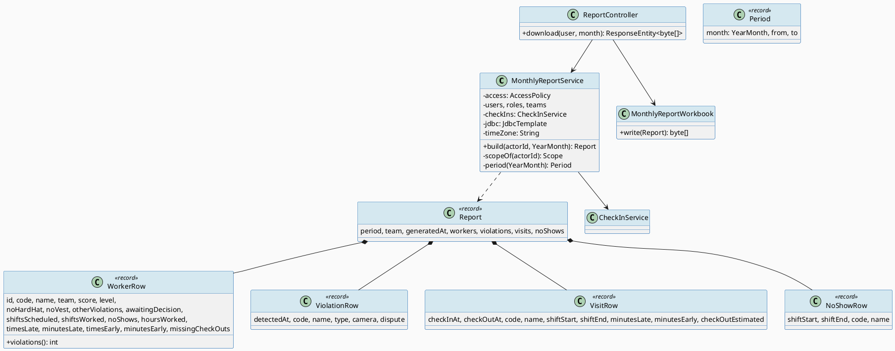
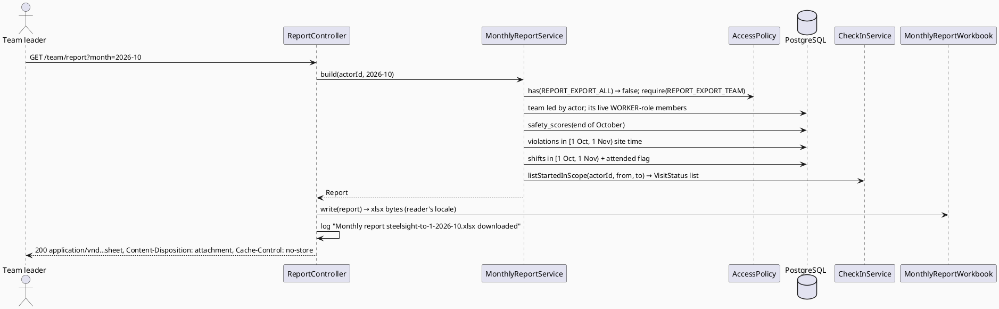
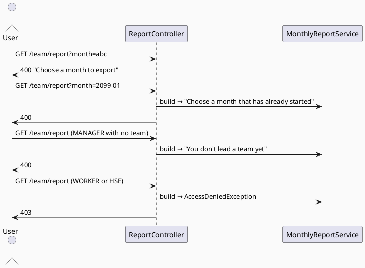

# ENGINEERING DOCUMENTATION STANDARD (EDS) v2.0
# Quy chuẩn Tài liệu Kỹ thuật và Đặc tả Hiện thực hóa

| Field | Value |
|-------|-------|
| **Document ID** | `STEELSIGHT-RPT-IMP-001` |
| **Version** | `1.0` |
| **Date** | `2026-11-06` |
| **Status** | `Draft` |
| **Document Owner** | `Nguyen Vu An` |
| **Author** | `Claude Code (Opus 5.5) — reverse-engineered from commit f005861` |
| **Reviewed by** | `[ ] Pending — Tech Lead` |
| **DPO Sign-off** | `[ ] Pending` *(the export is pay-relevant personal data leaving the system)* |
| **Approved by** | `[ ] Pending — Principal Architect` |
| **Last Review** | `2026-11-06` |
| **Based on EDS** | `v2.0` |

---

## CHANGELOG

> **Policy 4.4 — Immutable History:** Không bao giờ xóa thông tin cũ. Mọi thay đổi phải ghi vào bảng này.

| Ngày | Người thực hiện | Nội dung thay đổi |
|------|-----------------|-------------------|
| 2026-11-06 | Claude Code (Opus 5.5) — documentation | Tạo tài liệu lần đầu, from the code as built (commit 94a2c3c, V11 permissions) |

---

## MỤC LỤC

1. [Tổng quan Module](#1-tổng-quan-module)
2. [Ma trận Truy vết (Traceability Matrix)](#2-ma-trận-truy-vết-traceability-matrix)
3. [Architecture Decision Records (ADR)](#3-architecture-decision-records-adr) ⭐ *Mới*
4. [Non-Functional Requirements & SLA](#4-non-functional-requirements--sla) ⭐ *Mới*
5. [Static Modeling (Mô hình Tĩnh)](#5-static-modeling-mô-hình-tĩnh)
6. [Dynamic Modeling (Mô hình Động)](#6-dynamic-modeling-mô-hình-động)
7. [Domain Event Catalog](#7-domain-event-catalog) ⭐ *Mới*
8. [Interface Specification (Đặc tả Giao diện)](#8-interface-specification-đặc-tả-giao-diện)
9. [API Specification](#9-api-specification)
10. [Bảng mã lỗi (Error Codes)](#10-bảng-mã-lỗi-error-codes)
11. [Quy trình Triển khai (Step-by-Step)](#11-quy-trình-triển-khai-step-by-step)
12. [Rollback & Incident Runbook](#12-rollback--incident-runbook) ⭐ *Mới*
13. [Kịch bản Kiểm thử Chi tiết](#13-kịch-bản-kiểm-thử-chi-tiết)
14. [Phương pháp Xác minh](#14-phương-pháp-xác-minh)
15. [Mẫu thử thực tế (API Verification Samples)](#15-mẫu-thử-thực-tế-api-verification-samples)
16. [Bảng tổng hợp phân quyền (Authorization Matrix)](#16-bảng-tổng-hợp-phân-quyền-authorization-matrix)
17. [AI Prompt Constraints (CASE 2.0)](#17-ai-prompt-constraints-case-20) ⭐⭐ *CASE 2.0 Core*

> **Adaptations to this stack:** read-only module; §5.2 lists the SQL it runs, §8 is Java, §9 is one session-protected download.

---

## 1. Tổng quan Module

> Reporting builds the month's figures that accounting needs for pay and bonuses: each worker's safety score, violations, shifts worked, no-shows, hours, late and early minutes and missing check-outs. A team leader exports their own team; an admin exports every worker. The output is an `.xlsx` file with four sheets, in the downloader's language.

| Field | Value |
|-------|-------|
| **Module Name** | `RPT — Reporting` |
| **Bounded Context** | `Payroll input` |
| **Data Classification** | `PII` (names, codes, attendance, violations, scores) |
| **Compliance Scope** | `Luật 91/2025/QH15` — export of personal data to accounting; DPO pending |
| **Upstream Dependencies** | `IAM` (AccessPolicy, users, roles), `SCH` (teams, shifts), `ATT` (`CheckInService.listStartedInScope`, `AttendanceRules`), `PPE` (`safety_scores()`, violations) |
| **Downstream Consumers** | Accounting (outside the system) |

**Code location:** `reporting/service/MonthlyReportService.java`, `web/MonthlyReportWorkbook.java`, `web/ReportController.java`, export button in `templates/team/list.html`.

---

## 2. Ma trận Truy vết (Traceability Matrix)

| Requirement ID | Loại (BR/ADR/US) | Mô tả yêu cầu | Thành phần Code | Compliance Target | ADR liên quan |
|----------------|------------------|---------------|-----------------|-------------------|---------------|
| BR-RPT-001 | Business Rule | Leader → own team's WORKERs; admin → all WORKERs | `MonthlyReportService.scopeOf()` | PDPL — least privilege | ADR-017, ADR-021 |
| BR-RPT-002 | Business Rule | Started month; default last month; running month to now | `period()`, `ReportController.monthOf()` | — | ADR-021 |
| BR-RPT-003 | Business Rule | Exclude OVERTURNED; DISPUTED counted + awaiting | `build()` violation query | PDPL — accuracy | ADR-014 |
| BR-RPT-004 | Business Rule | Worked = linked or overlapping visit; no-show if ended without | `build()` shift query | PDPL — accuracy | ADR-012 |
| BR-RPT-005 | Business Rule | Hours = sum of closed visits | `row()` | — | — |
| BR-RPT-006 | Business Rule | No-store, ASCII name, localised, logged | `ReportController`, `MonthlyReportWorkbook` | PDPL — security | ADR-021, ADR-024 |
| US-MGR-005 | User Story | Leader exports team month | `GET /team/report` | — | ADR-021 |
| US-ADM-005 | User Story | Admin exports all | `GET /team/report` | — | ADR-021 |

---

## 3. Architecture Decision Records (ADR)

| ADR | Status | Decision (one line) | Effect on this module |
|-----|--------|---------------------|------------------------|
| [ADR-012](../02_design/adr/ADR-012_attendance-tags-computed-on-read.md) | Accepted | Tags computed on read | Report reuses `AttendanceRules` |
| [ADR-014](../02_design/adr/ADR-014_safety-score-computed-in-sql.md) | Accepted | Score from SQL | `safety_scores(end of period)` |
| [ADR-017](../02_design/adr/ADR-017_one-leader-per-team.md) | Accepted | One team per leader | Unambiguous scope |
| [ADR-021](../02_design/adr/ADR-021_monthly-report-as-streamed-xlsx.md) | Accepted | Streamed XLSX, localised | `MonthlyReportWorkbook` |

---

## 4. Non-Functional Requirements & SLA

### 4.1. Performance & Availability

| Category | Requirement | Target SLA | Measurement Method | Compliance Basis |
|----------|-------------|------------|---------------------|------------------|
| Latency | Build + write one month, ≤ 500 workers | *proposed* `< 5 s` | Request log ms | — |
| Memory | Stay within the 512 MB container | streaming writer (fastexcel) | Render metrics | — |

### 4.2. Data Integrity & Retention

| Category | Requirement | Target | Verification Method | Compliance Basis |
|----------|-------------|--------|---------------------|------------------|
| Correctness | Figures match source rows | 100% | `TeamsTicketsAndReportTest.aLeaderExportsTheirTeamsMonthWithTheRightFigures` (reads the file back) | PDPL — accuracy |
| Snapshot | What was sent to accounting | **Not kept** — recomputed on each download | — | — |
| Retention | Downloaded files | Outside the system — **DPO guidance needed** | — | PDPL |

### 4.3. Security

| Category | Requirement | Target | Verification Method | Compliance Basis |
|----------|-------------|--------|---------------------|------------------|
| Access control | Leader (team) or admin (all) only | Least privilege | `theReportIsOnlyForLeadersAndAdmins` | PDPL |
| Caching | `Cache-Control: no-store` | 100% | §14.3 | PDPL |
| Audit | Download logged with request id and user | 100% | `Monthly report … downloaded` log line | PDPL — accountability |
| Header injection | ASCII slug file name | 100% | `ReportController.slug()` | — |

### 4.4. Scalability & Capacity Planning

> One site, one report per team per month. All rows are built in memory before writing; fine for hundreds of workers.

---

## 5. Static Modeling (Mô hình Tĩnh)

### 5.1. Class Diagram (PlantUML)



### 5.2. Data Structure (SQL it runs — no tables of its own)

```sql
-- 1. Scores at the end of the period (the function counts the calendar month p_at falls in)
SELECT user_id, score, level FROM safety_scores(:period_to - interval '1 microsecond');

-- 2. Identified violations in the period
SELECT v.user_id, v.detected_at, v.violation_type, c.camera_code, v.dispute_status
FROM violation v JOIN camera c ON c.id = v.camera_id
WHERE v.user_id IS NOT NULL AND v.detected_at >= :from AND v.detected_at < :to
ORDER BY v.detected_at, v.id;

-- 3. Non-cancelled shifts starting in the period, and whether a visit is linked to or overlaps each one
SELECT s.user_id, s.start_at, s.end_at,
       EXISTS (SELECT 1 FROM check_in c
               WHERE c.user_id = s.user_id
                 AND (c.shift_id = s.id
                      OR (c.check_in_at < s.end_at AND COALESCE(c.check_out_at, now()) > s.start_at))) AS attended
FROM shift s
WHERE s.status <> 'CANCELLED' AND s.start_at >= :from AND s.start_at < :to
ORDER BY s.start_at, s.id;

-- 4. Visits started in the period, through CheckInService.listStartedInScope (JPA) + AttendanceRules
```

Workbook sheets (labels from message keys, in the downloader's language): **Summary** (one `WorkerRow` per worker), **Violations**, **Attendance** (visits), **No-shows**.

---

## 6. Dynamic Modeling (Mô hình Động)

### 6.1. Sequence Diagram — Happy Path (PlantUML)



### 6.2. Sequence Diagram — Error Path (PlantUML)



### 6.3. State Machine *(bắt buộc nếu module có trạng thái)*

> Not applicable — the module is stateless and read-only.

> **⚠️ Invariant bất biến:**
> - The report never writes to the database.
> - A leader's report contains only WORKER-role, non-deleted members of the team they lead.
> - OVERTURNED violations never appear in the counts.

---

## 7. Domain Event Catalog

### 7.1. Events Published (Phát ra)

| Event Name | Trigger | Publisher | Subscriber(s) | Payload Schema | Async? |
|------------|---------|-----------|---------------|----------------|--------|
| `MonthlyReportDownloaded` *(log line only)* | Successful download | `ReportController` | Log (Render) | file name, request id, user | No |

### 7.2. Events Consumed (Tiêu thụ)

| Event Name | Source | Handler | Action thực hiện |
|------------|--------|---------|------------------|
| *(none)* | — | — | — |

### 7.3. Payload Schema

```text
# Message text as logged (INFO); the request id comes from logging.pattern.correlation "[%X{requestId:-}] "
ReportController:      Monthly report steelsight-<team-slug>-<YYYY-MM>.xlsx downloaded
MonthlyReportService:  Monthly report for <YYYY-MM> built by user <id> (<n> workers)
```

---

## 8. Interface Specification (Đặc tả Giao diện)

### 8.1. Service Interface

```java
// reporting/service/MonthlyReportService.java — @Service @Transactional(readOnly = true)
// @version 1.0
public class MonthlyReportService {
  /** REPORT_EXPORT_ALL → every WORKER; else REPORT_EXPORT_TEAM → the team the actor leads.
   *  @throws AccessDeniedException neither permission
   *  @throws BusinessRuleException "You don't lead a team yet" | "Choose a month that has already started" */
  Report build(Long actorId, YearMonth month);
}

// web/MonthlyReportWorkbook.java — @Component
public class MonthlyReportWorkbook {
  /** Four sheets; labels in LocaleContextHolder's locale; dates as site-local Excel dates. */
  byte[] write(MonthlyReportService.Report report) throws IOException;
}
```

### 8.2. Repository Interface

```java
// No repository of its own. Reads through:
//   AppUserRepository.findAllByRoleIdAndDeletedAtIsNull, findAllByTeamIdAndDeletedAtIsNull
//   TeamRepository.findAllByManagerId, RoleRepository.findByRoleName
//   CheckInService.listStartedInScope
//   JdbcTemplate (queries in §5.2)
```

---

## 9. API Specification

### 9.1. Endpoints Table

| Method | Path | Auth Level | Required Roles | Rate Limit | Idempotent? |
|--------|------|------------|----------------|------------|-------------|
| `GET` | `/team/report?month=YYYY-MM` | Session | `REPORT_EXPORT_ALL` or `REPORT_EXPORT_TEAM` (+ leads a team) | — | Yes |

### 9.2. Request / Response Schemas

#### `GET /team/report?month=2026-10`

**Response — 200 OK (Happy Path):**
```text
Content-Type: application/vnd.openxmlformats-officedocument.spreadsheetml.sheet
Content-Disposition: attachment; filename="steelsight-to-1-2026-10.xlsx"     # "Tổ 1" → "to-1"; admin → "all-workers"
Cache-Control: no-store
<xlsx bytes: Summary, Violations, Attendance, No-shows>
```

**Response — 400 (Validation Error):** error page, `message = "Choose a month to export"` (unparseable) or `"Choose a month that has already started"`.

**Response — 403:** error page "Not allowed".

---

## 10. Bảng mã lỗi (Error Codes)

| Code | HTTP Status | Message (EN) | Message (VI) | Trigger Condition |
|------|-------------|--------------|--------------|-------------------|
| `RPT-001` | 400 | Choose a month to export | Hãy chọn tháng cần xuất | `month` not `YYYY-MM` |
| `RPT-002` | 400 | Choose a month that has already started | Hãy chọn một tháng đã bắt đầu | Future month |
| `RPT-003` | 400 | You don't lead a team yet | Bạn chưa làm tổ trưởng của tổ nào | Leader without a team |
| `RPT-004` | 403 | Not allowed | Không được phép | No export permission |

---

## 11. Quy trình Triển khai (Step-by-Step)

### 11.1. Prerequisites

- [x] ADR-021 Accepted
- [ ] **DPO sign-off** on exporting pay data to accounting, and on what accounting does with the file
- [ ] Accounting confirms the column set

### 11.2. Pre-Migration Checklist *(bắt buộc tick trước khi chạy migration)*

- [ ] Permissions `REPORT_EXPORT_TEAM` / `REPORT_EXPORT_ALL` exist (V11)
- [ ] `APP_TIME_ZONE` equals `safety_policy.time_zone`, or month boundaries and scores disagree

### 11.3. Implementation Steps

#### Chặng 1 — Permissions

```bash
# V11 adds REPORT_EXPORT_TEAM (MANAGER, ADMIN) and REPORT_EXPORT_ALL (ADMIN)
sh ./mvnw spring-boot:run
```

#### Chặng 2 — Verification sau deploy

```bash
curl -s -b $LEADER_JAR -o report.xlsx -w '%{http_code} %{content_type}\n' "$BASE/team/report?month=2026-10"
# Expected: 200 application/vnd.openxmlformats-officedocument.spreadsheetml.sheet
```

### 11.4. Deployment Checklist

- [ ] Leader downloads own team; admin downloads all
- [ ] Worker/HSE get 403
- [ ] Vietnamese reader gets Vietnamese sheet labels
- [ ] Log shows the download line

---

## 12. Rollback & Incident Runbook

### 12.1. Điều kiện kích hoạt Rollback (Trigger Conditions)

| Điều kiện | Ngưỡng | Người quyết định |
|-----------|--------|------------------|
| Wrong figures sent to accounting | Any confirmed case | Developer + Tech Lead (notify accounting) |
| Report contains another team's workers | Any case | Developer + DPO |
| Out-of-memory on download | Any | Developer |

### 12.2. Rollback Procedure

```bash
# Bước 1: Re-deploy the previous image tag (Render deploy hook) — no schema involved
# Bước 2: Tell accounting which month/team files to discard; re-export after the fix
# Bước 3: Verify by re-reading the file (fastexcel-reader in the test) or opening it
```

### 12.3. Notification Protocol

| Thời điểm | Người nhận | Kênh | Template |
|-----------|------------|------|----------|
| Ngay khi phát hiện | Developer, accounting contact | Team chat / email | "🚨 Steelsight report incident: [month, team, issue]" |
| Trong 30 phút | DPO | Email | *(If a file reached someone outside its scope)* |
| Trong 72 giờ | Competent authority | Official channel | *(Confirmed breach — DPO decides)* |

### 12.4. Post-Incident Review (PIR)

> PIR within **48 giờ**: Timeline, Root Cause, Impact (pay affected?), Remediation, Prevention.

---

## 13. Kịch bản Kiểm thử Chi tiết

> Full TCs: [`04_testing/STEELSIGHT-RPT-TDD-001_Test-Spec.md`](../04_testing/STEELSIGHT-RPT-TDD-001_Test-Spec.md). Test data `SYNTHETIC`.

### 13.1. Unit Tests

#### TC-UNIT-001 — File name slug

```gherkin
Feature: Report file name
  Background:
    Given test data classification: SYNTHETIC

  Scenario: Vietnamese team name
    Given team name "Tổ 1"
    When the file name is built for 2026-10
    Then it is "steelsight-to-1-2026-10.xlsx"
```

**Hàm được test:** `ReportController.slug()` (private; covered through MockMvc)
**Invariant kiểm tra:** the file name is plain ASCII.

### 13.2. Integration Tests

#### TC-INT-001 — Leader's month figures

```gherkin
  Scenario: Right figures for one team
    Given test data classification: SYNTHETIC
    And a team with workers, shifts, visits and violations in October (one OVERTURNED, one DISPUTED)
    When the leader downloads /team/report?month=2026-10
    Then the Summary sheet counts exclude the OVERTURNED violation
    And awaitingDecision = 1
    And a shift with no overlapping visit is a no-show
```

**External dependencies:** PostgreSQL
**Mock strategy:** Testcontainers; file read back with fastexcel-reader.

### 13.3. E2E / Security Tests

#### TC-E2E-001 — Only leaders and admins

```gherkin
  Scenario: Worker requests the report
    Given test data classification: SYNTHETIC
    When a WORKER GETs /team/report
    Then the response status is 403
```

---

## 14. Phương pháp Xác minh

### 14.1. Database Inspection

```sql
-- Cross-check one worker's month by hand
SELECT count(*) FILTER (WHERE dispute_status <> 'OVERTURNED') AS counted,
       count(*) FILTER (WHERE dispute_status = 'DISPUTED')    AS awaiting
FROM violation WHERE user_id = :id
  AND detected_at >= '2026-10-01 00:00+07' AND detected_at < '2026-11-01 00:00+07';
```

### 14.2. Log / Audit Verification

```bash
grep -E 'Monthly report .* downloaded' app.log        # who took a copy (request id → user on the request line)
```

### 14.3. Tool-based Verification

```bash
curl -s -D - -o /dev/null -b $LEADER_JAR "$BASE/team/report?month=2026-10" | grep -iE '^(cache-control|content-disposition)'
# Expected: Cache-Control: no-store ; Content-Disposition: attachment; filename="steelsight-…-2026-10.xlsx"
```

---

## 15. Mẫu thử thực tế (API Verification Samples)

### 15.1. Happy Path

```bash
curl -s -b $ADMIN_JAR -o all.xlsx -w '%{http_code}\n' "$BASE/team/report?month=2026-10"
```

**Expected Response (200):** file `steelsight-all-workers-2026-10.xlsx`.

### 15.2. Error Paths

```bash
curl -s -b $ADMIN_JAR -o /dev/null -w '%{http_code}\n' "$BASE/team/report?month=2099-01"
```

**Expected Response (400):** "Choose a month that has already started".

```bash
curl -s -b $WORKER_JAR -o /dev/null -w '%{http_code}\n' "$BASE/team/report"
```

**Expected Response (403).**

---

## 16. Bảng tổng hợp phân quyền (Authorization Matrix)

| Endpoint | `WORKER` | `HSE_OFFICER` | `MANAGER` | `ADMIN` |
|----------|----------|---------------|-----------|---------|
| `GET /team/report` | ❌ | ❌ | ✅ Own team (must lead one) | ✅ All workers |

**Chú thích:** Admin holds both permissions; `REPORT_EXPORT_ALL` is checked first, so an admin always gets every worker.

---

## 17. AI Prompt Constraints (CASE 2.0)

### 17.1 Constraint Summary Table

| # | Constraint | Source (ADR/BR) | Last Verified |
|---|-----------|-----------------|---------------|
| C1 | Scope decided only in `MonthlyReportService.scopeOf` (ALL first, then TEAM) | `ADR-021`, `BR-RPT-001` | `2026-11-06` |
| C2 | Reuse `safety_scores()` and `AttendanceRules`; no duplicated rules | `ADR-014`, `ADR-012` | `2026-11-06` |
| C3 | Read-only: no writes, no stored snapshots without an ADR | `ADR-021` | `2026-11-06` |
| C4 | `no-store`, attachment, ASCII file name, download logged | `BR-RPT-006` | `2026-11-06` |
| C5 | Labels from message keys in both languages | `BR-PLT-006` | `2026-11-06` |

### 17.2 Constraint Injection Block (Copy-Paste vào AI Prompt)

```
[CONSTRAINT BLOCK — Module: RPT — Reporting]
Theo TDS STEELSIGHT-RPT-IMP-001 và các ADR liên quan (ADR-012, 014, 017, 021):

1. MonthlyReportService.build(actorId, month) decides scope: REPORT_EXPORT_ALL → every live WORKER-role user;
   otherwise require REPORT_EXPORT_TEAM and use the one team the actor leads.
2. Scores come from safety_scores(end of period); attendance tags from CheckInService.listStartedInScope +
   AttendanceRules. Do not re-implement either rule in report code.
3. The module is read-only (@Transactional(readOnly = true)); do not persist report snapshots without an ADR.
4. The controller returns the file with Cache-Control: no-store, Content-Disposition attachment, an ASCII slug
   name, and logs the download (file name only, no figures).
5. Every sheet label is a message key present in messages.properties and messages_vi.properties.

[CONTEXT BLOCK]
- Bounded Context: Payroll input
- Data Classification: PII
- Compliance: Luật 91/2025/QH15 (DPO pending)
- Existing interfaces: §8.1 MonthlyReportService, MonthlyReportWorkbook
- Error codes: §10
- Auth matrix: §16

[TASK BLOCK]
Implement {feature/method} thỏa mãn constraints trên.
Output phải tuân thủ §8 Interface Specification.
Tests phải cover §13 Test Scenarios and STEELSIGHT-RPT-TDD-001.
```

### 17.3 Constraint Quality Checklist

- [x] Mỗi constraint traceable về ADR hoặc BR cụ thể
- [x] Không có constraint generic
- [x] Mỗi constraint có `Last Verified` date ≤ 2 sprints
- [x] Constraint block có ≥ 3 constraints cụ thể
- [x] Constraint block reference §8 Interface
- [x] Constraint block reference §16 Auth Matrix

### 17.4 Anti-Pattern Detection (cho AI-Generated Code từ Block này)

| AP-ID | Anti-Pattern | Dấu hiệu | Hành động |
|-------|-------------|-----------|----------|
| AP-AI-001 | Unconstrained Gen | Report query without `scopeOf()` | Reject |
| AP-AI-003 | Implicit Decision | Apache POI, CSV, emailing the file, a team picker | Reject — ADR first |
| AP-AI-005 | Hallucinated Contract | `ReportRepository`, `MonthlyReportService.save()` (don't exist) | Reject |

---

## PHỤ LỤC

### A. Glossary (Thuật ngữ)

| Thuật ngữ | Định nghĩa |
|-----------|------------|
| Period | `[1st of month 00:00 site time, next 1st)` or `[1st, now)` for the running month |
| Attended | A non-cancelled shift with a linked or overlapping visit |
| No-show | A shift that has ended without an attended visit |
| Awaiting decision | A DISPUTED violation, counted until HSE decides |
| Red Gate | Tests phải FAIL trước khi implement |

### B. Tài liệu tham chiếu

| Document | Link / Path |
|----------|-------------|
| Module map | `02_design/MODULE-MAP.md` |
| User guide | `docs/user-guide.md` §4.6 |
| Test-Spec | `04_testing/STEELSIGHT-RPT-TDD-001_Test-Spec.md` |

---

*EDS v2.1 — Tích hợp CASE 2.0 AI Prompt Constraints (§17).*
*Sections đánh dấu ⭐ là bổ sung EDS v2.0. Section đánh dấu ⭐⭐ là bổ sung CASE 2.0.*
*Câu hỏi hoặc đề xuất sửa đổi: tạo Issue với label `docs-policy`.*
