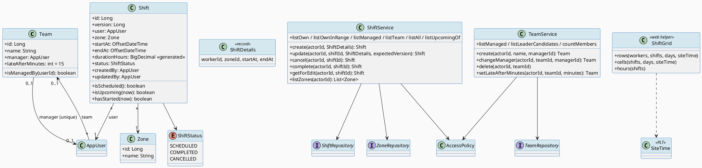
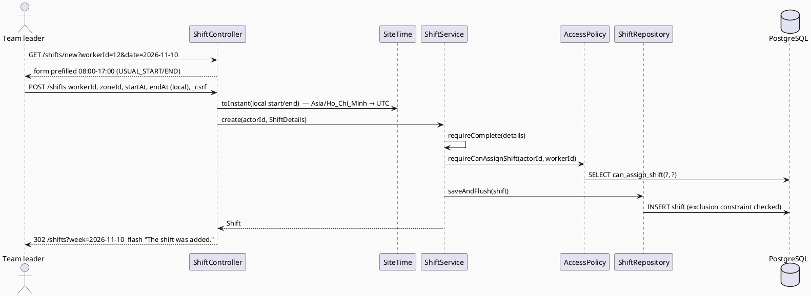
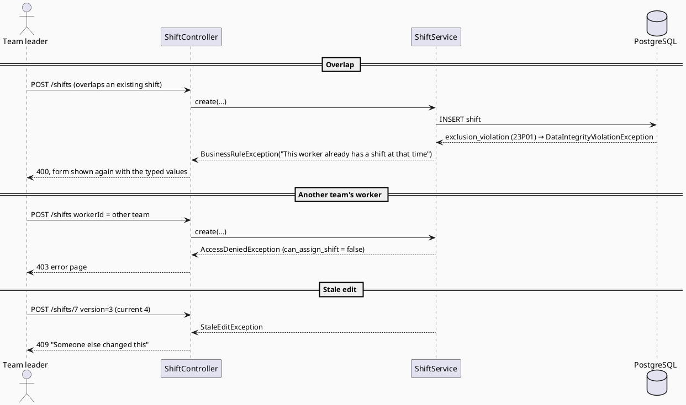
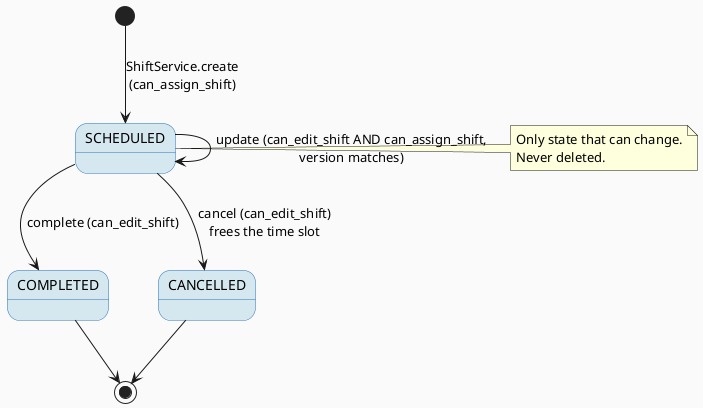

# ENGINEERING DOCUMENTATION STANDARD (EDS) v2.0
# Quy chuẩn Tài liệu Kỹ thuật và Đặc tả Hiện thực hóa

| Field | Value |
|-------|-------|
| **Document ID** | `STEELSIGHT-SCH-IMP-001` |
| **Version** | `1.0` |
| **Date** | `2026-11-06` |
| **Status** | `Draft` |
| **Document Owner** | `Nguyen Vu An` |
| **Author** | `Claude Code (Opus 5.5) — reverse-engineered from commit f005861` |
| **Reviewed by** | `[ ] Pending — Tech Lead` |
| **DPO Sign-off** | `[ ] Pending` *(working-time records are personal data)* |
| **Approved by** | `[ ] Pending — Principal Architect` |
| **Last Review** | `2026-11-06` |
| **Based on EDS** | `v2.0` |

---

## CHANGELOG

> **Policy 4.4 — Immutable History:** Không bao giờ xóa thông tin cũ. Mọi thay đổi phải ghi vào bảng này.

| Ngày | Người thực hiện | Nội dung thay đổi |
|------|-----------------|-------------------|
| 2026-11-06 | Claude Code (Opus 5.5) — documentation | Tạo tài liệu lần đầu, from the code as built (V1, V3, V6, V11) |

---

## MỤC LỤC

1. [Tổng quan Module](#1-tổng-quan-module)
2. [Ma trận Truy vết (Traceability Matrix)](#2-ma-trận-truy-vết-traceability-matrix)
3. [Architecture Decision Records (ADR)](#3-architecture-decision-records-adr) ⭐ *Mới*
4. [Non-Functional Requirements & SLA](#4-non-functional-requirements--sla) ⭐ *Mới*
5. [Static Modeling (Mô hình Tĩnh)](#5-static-modeling-mô-hình-tĩnh)
6. [Dynamic Modeling (Mô hình Động)](#6-dynamic-modeling-mô-hình-động)
7. [Domain Event Catalog](#7-domain-event-catalog) ⭐ *Mới*
8. [Interface Specification (Đặc tả Giao diện)](#8-interface-specification-đặc-tả-giao-diện)
9. [API Specification](#9-api-specification)
10. [Bảng mã lỗi (Error Codes)](#10-bảng-mã-lỗi-error-codes)
11. [Quy trình Triển khai (Step-by-Step)](#11-quy-trình-triển-khai-step-by-step)
12. [Rollback & Incident Runbook](#12-rollback--incident-runbook) ⭐ *Mới*
13. [Kịch bản Kiểm thử Chi tiết](#13-kịch-bản-kiểm-thử-chi-tiết)
14. [Phương pháp Xác minh](#14-phương-pháp-xác-minh)
15. [Mẫu thử thực tế (API Verification Samples)](#15-mẫu-thử-thực-tế-api-verification-samples)
16. [Bảng tổng hợp phân quyền (Authorization Matrix)](#16-bảng-tổng-hợp-phân-quyền-authorization-matrix)
17. [AI Prompt Constraints (CASE 2.0)](#17-ai-prompt-constraints-case-20) ⭐⭐ *CASE 2.0 Core*

> **Adaptations to this stack:** §5.2 is Flyway SQL (not Prisma), §8 is Java, §9 lists session + CSRF form endpoints. See `STEELSIGHT-IAM-IMP-001` for the shared conventions.

---

## 1. Tổng quan Module

> Scheduling holds teams (each with one leader), site zones, and shifts: which worker is in which zone and when. Team leaders plan their own team's week on a grid; admins plan anyone. Workers see their own timetable.

| Field | Value |
|-------|-------|
| **Module Name** | `SCH — Scheduling` |
| **Bounded Context** | `Workforce planning` |
| **Data Classification** | `Internal` (zones) / `PII` (who works when) |
| **Compliance Scope** | `Luật 91/2025/QH15` (working-time data) — DPO pending |
| **Upstream Dependencies** | `IAM` (AccessPolicy, AppUserRepository), `PLT` (SiteTime, Versioned, Text) |
| **Downstream Consumers** | `ATT` (shift on a visit, team grace period), `RPT` (shifts per month), `PPE` (time slots), `IAM` (team on a user), dashboard |

**Code location:** `scheduling/**`, `web/ShiftController.java`, `web/TimetableController.java`, `web/ShiftGrid.java`, `web/ShiftForm.java`, team endpoints of `web/TeamController.java`, templates `shifts/week.html`, `shifts/form.html`, `timetable.html`, `team/list.html`.

---

## 2. Ma trận Truy vết (Traceability Matrix)

| Requirement ID | Loại (BR/ADR/US) | Mô tả yêu cầu | Thành phần Code | Compliance Target | ADR liên quan |
|----------------|------------------|---------------|-----------------|-------------------|---------------|
| BR-SCH-001 | Business Rule | No overlapping non-cancelled shifts per worker | `shift` `EXCLUDE USING gist … WHERE (status <> 'CANCELLED')`, `ShiftService.save()` | PDPL — accuracy | ADR-018 |
| BR-SCH-002 | Business Rule | Worker, zone, start, end required; end > start | `ShiftService.requireComplete()/apply()`, `CHECK (end_at > start_at)` | — | ADR-003 |
| BR-SCH-003 | Business Rule | Manager → own team's active workers; admin → anyone active | `can_assign_shift()` (V3), `can_edit_shift()` (V1) | PDPL — least privilege | ADR-001 |
| BR-SCH-004 | Business Rule | Only SCHEDULED changes; stale form fails | `ShiftService.scheduled()`, `Shift.requireVersion()` | — | ADR-006 |
| BR-SCH-005 | Business Rule | Shift on the local day it starts; Monday weeks; `[from, to)` | `SiteTime`, `ShiftGrid`, `ShiftRepository.*StartAtGreaterThanEqual…LessThan` | — | ADR-018 |
| BR-SCH-006 | Business Rule | One leader per team, MANAGER role, one team per leader | `TeamService.freeLeader()/manager()`, `uq_team_manager` | — | ADR-017 |
| BR-SCH-007 | Business Rule | Delete only an empty team | `TeamService.delete()` | — | ADR-017 |
| BR-SCH-008 | Business Rule | Late rule 0–240, leader or admin | `TeamService.setLateAfterMinutes()`, `CHECK` (V6) | — | ADR-012 |
| US-MGR-001 | User Story | Plan the team's week | `ShiftController` | — | — |
| US-MGR-002 | User Story | Set the late rule | `TeamController.setLateAfter()` | — | ADR-012 |
| US-WRK-001 | User Story | See own timetable | `TimetableController`, `HomeController.addMyWeek()` | — | — |
| US-ADM-001 | User Story | Set up teams | `TeamController /teams/**` | — | ADR-017 |

---

## 3. Architecture Decision Records (ADR)

| ADR | Status | Decision (one line) | Effect on this module |
|-----|--------|---------------------|------------------------|
| [ADR-001](../02_design/adr/ADR-001_permission-and-scope-in-sql-functions.md) | Accepted | Scope in SQL | `can_assign_shift`, `can_edit_shift` |
| [ADR-006](../02_design/adr/ADR-006_optimistic-locking-through-forms.md) | Accepted | Version through forms | `ShiftForm.version` |
| [ADR-017](../02_design/adr/ADR-017_one-leader-per-team.md) | Accepted | One leader ↔ one team | `TeamService`, `uq_team_manager` |
| [ADR-018](../02_design/adr/ADR-018_shift-overlap-exclusion-and-site-time.md) | Accepted | Exclusion constraint; site-local days | `shift` table, `SiteTime`, `ShiftGrid` |

---

## 4. Non-Functional Requirements & SLA

### 4.1. Performance & Availability

| Category | Requirement | Target SLA | Measurement Method | Compliance Basis |
|----------|-------------|------------|---------------------|------------------|
| Latency | `GET /shifts` week grid, 20 rows per page | *proposed* `< 800 ms` p95 warm | Request log ms | — |
| Latency | Save a shift | *proposed* `< 300 ms` p95 | Request log ms | — |
| Availability | Planning pages | *configured:* Render free, sleeps; **no SLA** | Render | — |

### 4.2. Data Integrity & Retention

| Category | Requirement | Target | Verification Method | Compliance Basis |
|----------|-------------|--------|---------------------|------------------|
| Integrity | No overlapping live shifts, even under races | 100% | Exclusion constraint; `ServiceIntegrationTest` | PDPL — accuracy |
| Consistency | Lost-update protection | 100% | `@Version` | — |
| Retention | Shifts never deleted (cancel only) | *Retention period not defined — DPO* | — | PDPL — storage limitation |

### 4.3. Security

| Category | Requirement | Target | Verification Method | Compliance Basis |
|----------|-------------|--------|---------------------|------------------|
| Access control | Plan only own team | Least privilege | §16, `ManagerPagesIntegrationTest.aShiftCannotBeGivenToAnotherTeam` | PDPL |
| CSRF | All forms | configured | `PagesIntegrationTest.formsWithoutACsrfTokenAreRefused` | — |

### 4.4. Scalability & Capacity Planning

> One site, a handful of teams, a few hundred shifts a month. The grid loads one week (`[monday, monday+7)`) and pages rows 20 at a time in memory (`PageController.pageOf(rows, page)`).

---

## 5. Static Modeling (Mô hình Tĩnh)

### 5.1. Class Diagram (PlantUML)



### 5.2. Data Structure (Flyway SQL)

```sql
-- === SCH SCHEMA (V1, V6, V11) ===
CREATE TABLE zone (
  id   bigint GENERATED ALWAYS AS IDENTITY PRIMARY KEY,
  name text NOT NULL UNIQUE                          -- Zone A, Zone B …
);

CREATE TABLE team (
  id                 bigint GENERATED ALWAYS AS IDENTITY PRIMARY KEY,
  name               text NOT NULL UNIQUE,
  manager_id         bigint REFERENCES app_user(id), -- the team leader
  late_after_minutes integer NOT NULL DEFAULT 15 CHECK (late_after_minutes BETWEEN 0 AND 240)   -- V6
);
CREATE UNIQUE INDEX uq_team_manager ON team(manager_id) WHERE manager_id IS NOT NULL;            -- V11

CREATE TABLE shift (
  id             bigint GENERATED ALWAYS AS IDENTITY PRIMARY KEY,
  user_id        bigint NOT NULL REFERENCES app_user(id),
  zone_id        bigint NOT NULL REFERENCES zone(id),
  start_at       timestamptz NOT NULL,
  end_at         timestamptz NOT NULL,
  duration_hours numeric GENERATED ALWAYS AS (extract(epoch FROM (end_at - start_at)) / 3600.0) STORED,
  status         text NOT NULL DEFAULT 'SCHEDULED' CHECK (status IN ('SCHEDULED','COMPLETED','CANCELLED')),
  created_by     bigint NOT NULL REFERENCES app_user(id),
  updated_by     bigint REFERENCES app_user(id),
  version        bigint NOT NULL DEFAULT 0,
  created_at     timestamptz NOT NULL DEFAULT now(),
  updated_at     timestamptz NOT NULL DEFAULT now(),          -- trg_shift_updated
  CHECK (end_at > start_at),
  EXCLUDE USING gist (user_id WITH =, tstzrange(start_at, end_at) WITH &&) WHERE (status <> 'CANCELLED')
);
CREATE INDEX idx_shift_user_start ON shift(user_id, start_at);

-- can_edit_shift(p_user, p_shift):    SHIFT_UPDATE_ALL and shift exists
--                                     OR SHIFT_UPDATE_TEAM and shift's worker is on a team p_user leads
-- can_assign_shift(p_user, p_worker): worker active and not deleted AND
--                                     (SHIFT_UPDATE_ALL OR SHIFT_UPDATE_TEAM on a team p_user leads)   (V3)
-- Detection role: SELECT on zone and shift.
```

> `duration_hours` is generated by the database and read by JPA through `@Generated` (never written by Java).

---

## 6. Dynamic Modeling (Mô hình Động)

### 6.1. Sequence Diagram — Happy Path (PlantUML): a leader adds a shift from an empty grid cell



### 6.2. Sequence Diagram — Error Path (PlantUML)



### 6.3. State Machine *(bắt buộc nếu module có trạng thái)*: shift



> **⚠️ Invariant bất biến:**
> - COMPLETED and CANCELLED are final: `ShiftService.scheduled()` refuses any change ("Only a scheduled shift can be changed").
> - For one worker, no two non-cancelled shifts overlap in time.
> - A team has at most one leader and a manager leads at most one team.

---

## 7. Domain Event Catalog

> No events are published or consumed. Other modules read shifts directly (ATT, RPT, PPE `safety_time_slots()`); the detection service reads `shift` through its `SELECT` grant.

### 7.1. Events Published (Phát ra)

| Event Name | Trigger | Publisher | Subscriber(s) | Payload Schema | Async? |
|------------|---------|-----------|---------------|----------------|--------|
| *(none)* | — | — | — | — | — |

### 7.2. Events Consumed (Tiêu thụ)

| Event Name | Source | Handler | Action thực hiện |
|------------|--------|---------|------------------|
| *(none)* | — | — | — |

### 7.3. Payload Schema

```java
// Not applicable — no events.
```

---

## 8. Interface Specification (Đặc tả Giao diện)

### 8.1. Service Interface

```java
// scheduling/service/ShiftService.java — @Service @Transactional
// @version 1.0
public record ShiftDetails(Long workerId, Long zoneId, OffsetDateTime startAt, OffsetDateTime endAt) {}

public class ShiftService {
  /** @throws BusinessRuleException "Choose a worker" | "Choose a zone" | "Enter when the shift starts and ends"
   *          | "A shift must end after it starts" | "This worker already has a shift at that time"
   *  @throws AccessDeniedException can_assign_shift false */
  Shift create(Long actorId, ShiftDetails details);
  /** can_edit_shift + can_assign_shift; SCHEDULED only; @throws StaleEditException */
  Shift update(Long actorId, Long shiftId, ShiftDetails details, long expectedVersion);
  Shift cancel(Long actorId, Long shiftId);              // can_edit_shift; SCHEDULED only
  Shift complete(Long actorId, Long shiftId);            // can_edit_shift; SCHEDULED only
  List<Shift> listOwn(Long actorId);                     // SHIFT_READ_OWN
  List<Shift> listOwnInRange(Long actorId, OffsetDateTime from, OffsetDateTime to);   // [from, to)
  List<Shift> listManaged(Long actorId, OffsetDateTime from, OffsetDateTime to);      // ALL or own team, [from, to)
  List<Shift> listTeam(Long actorId, OffsetDateTime from, OffsetDateTime to);         // SHIFT_READ_TEAM, BETWEEN
  List<Shift> listAll(Long actorId, OffsetDateTime from, OffsetDateTime to);          // SHIFT_READ_ALL, BETWEEN
  List<Shift> listUpcomingOf(Long actorId, Long workerId, OffsetDateTime now);        // USER_READ_ALL
  Shift getForEdit(Long actorId, Long shiftId);          // can_edit_shift
  List<Zone> listZones(Long actorId);                    // SHIFT_UPDATE_TEAM or SHIFT_UPDATE_ALL
}

// scheduling/service/TeamService.java — @Service @Transactional
public class TeamService {
  Team create(Long actorId, String name, Long managerId);        // USER_MANAGE; free MANAGER leader; unique name
  Team changeManager(Long actorId, Long teamId, Long managerId); // USER_MANAGE
  void delete(Long actorId, Long teamId);                        // USER_MANAGE; no live members
  Team setLateAfterMinutes(Long actorId, Long teamId, Integer m);// USER_MANAGE, or SHIFT_UPDATE_TEAM + leads it; 0..240
  List<Team> listManaged(Long actorId);                          // USER_MANAGE → all; else own
  List<AppUser> listLeaderCandidates(Long actorId);              // USER_MANAGE
  Map<Long, Long> countMembers(Long actorId);                    // USER_MANAGE
}
```

### 8.2. Repository Interface

```java
// @version 1.0
public interface ShiftRepository extends BaseRepository<Shift, Long> {
  List<Shift> findAllByUserIdOrderByStartAtAsc(Long userId);
  List<Shift> findUpcoming(Long userId, OffsetDateTime now);   // SCHEDULED, endAt > now
  List<Shift> findAllByUserIdAndStartAtGreaterThanEqualAndStartAtLessThanOrderByStartAtAsc(Long u, OffsetDateTime f, OffsetDateTime t);
  List<Shift> findAllByStartAtGreaterThanEqualAndStartAtLessThanOrderByStartAtAsc(OffsetDateTime f, OffsetDateTime t);
  List<Shift> findTeamShiftsStartingIn(Long managerId, OffsetDateTime f, OffsetDateTime t);
  List<Shift> findAllByStartAtBetween(OffsetDateTime f, OffsetDateTime t);            // inclusive (legacy)
  List<Shift> findAllByTeamManagerIdAndDateRange(Long managerId, OffsetDateTime f, OffsetDateTime t); // inclusive (legacy)
  // No delete: shifts are cancelled, never removed.
}
public interface TeamRepository extends BaseRepository<Team, Long> {
  Optional<Team> findByName(String name);
  List<Team> findAllByManagerId(Long managerId);   // at most one after V11
  List<Object[]> countMembers();                   // [teamId, live member count]
}
public interface ZoneRepository extends BaseRepository<Zone, Long> {
  Optional<Zone> findByName(String name);
  List<Zone> findAllByOrderByNameAsc();
}
```

---

## 9. API Specification

### 9.1. Endpoints Table

| Method | Path | Auth Level | Required Roles / Permission | Rate Limit | Idempotent? |
|--------|------|------------|------------------------------|------------|-------------|
| `GET` | `/timetable?week=YYYY-MM-DD` | Session | `SHIFT_READ_OWN` | — | Yes |
| `GET` | `/shifts?week=YYYY-MM-DD&page=n` | Session | `SHIFT_READ_TEAM` or `SHIFT_READ_ALL` | — | Yes |
| `GET` | `/shifts/new?workerId=&date=` | Session | `SHIFT_UPDATE_TEAM` or `SHIFT_UPDATE_ALL` | — | Yes |
| `POST` | `/shifts` | Session + CSRF | `can_assign_shift` | — | No |
| `GET` | `/shifts/{id}/edit` | Session | `can_edit_shift` | — | Yes |
| `POST` | `/shifts/{id}` | Session + CSRF | `can_edit_shift` + `can_assign_shift` | — | No (versioned) |
| `POST` | `/shifts/{id}/cancel` | Session + CSRF | `can_edit_shift` | — | No (second call → 400 rule) |
| `POST` | `/shifts/{id}/complete` | Session + CSRF | `can_edit_shift` | — | No |
| `GET` | `/team?page=n` | Session | `USER_MANAGE` or `SHIFT_UPDATE_TEAM` | — | Yes |
| `POST` | `/teams` (`name`, `managerId`) | Session + CSRF | `USER_MANAGE` | — | No |
| `POST` | `/teams/{id}/leader` (`managerId`) | Session + CSRF | `USER_MANAGE` | — | Yes |
| `POST` | `/teams/{id}/delete` | Session + CSRF | `USER_MANAGE` | — | No |
| `POST` | `/teams/{id}/late-after` (`minutes`) | Session + CSRF | `USER_MANAGE`, or the team's leader | — | Yes |

### 9.2. Request / Response Schemas

#### `POST /shifts` — Tạo mới

**Request Body** (`application/x-www-form-urlencoded`):
```text
_csrf=<token>
workerId=12
zoneId=2
startAt=2026-11-10T08:00      # site-local, ISO without zone
endAt=2026-11-10T17:00
```

**Response — 302 (Happy Path):**
```text
Location: /shifts?week=2026-11-10
Flash: success = "The shift was added."
DB: shift(status='SCHEDULED', duration_hours=9, start_at='2026-11-10 01:00:00+00')
```

**Response — 400 (Validation Error):** `shifts/form` re-rendered, `HX-Push-Url: false`, `error = "A shift must end after it starts"`.

**Response — 400 (Conflict, shown as a rule):** `error = "This worker already has a shift at that time"`.

**Response — 403:** worker on another team.

---

## 10. Bảng mã lỗi (Error Codes)

> Documentation IDs only (gap G4).

| Code | HTTP Status | Message (EN) | Message (VI) | Trigger Condition |
|------|-------------|--------------|--------------|-------------------|
| `SCH-001` | 400 | Choose a worker | Vui lòng chọn công nhân | `workerId` null |
| `SCH-002` | 400 | Choose a zone | Vui lòng chọn khu vực | `zoneId` null |
| `SCH-003` | 400 | Enter when the shift starts and ends | Vui lòng nhập thời gian bắt đầu và kết thúc ca | start or end null |
| `SCH-004` | 400 | A shift must end after it starts | Ca phải kết thúc sau khi bắt đầu | end ≤ start |
| `SCH-005` | 400 | This worker already has a shift at that time | Công nhân này đã có ca vào thời gian đó | Exclusion constraint |
| `SCH-006` | 400 | Only a scheduled shift can be changed | Chỉ có thể thay đổi ca đã lên lịch | Edit/cancel/complete a final shift |
| `SCH-007` | 400 | A team with that name already exists | Đã có đội trùng tên này | Unique name |
| `SCH-008` | 400 | Choose a leader for the team | Vui lòng chọn tổ trưởng cho tổ | `managerId` null |
| `SCH-009` | 400 | This manager already leads another team | Quản lý này đã làm tổ trưởng của một tổ khác | Leader busy |
| `SCH-010` | 400 | A team's manager must have the MANAGER role | Người quản lý đội phải có vai trò Quản lý | Leader not MANAGER |
| `SCH-011` | 400 | Move this team's people to another team first | Hãy chuyển người trong tổ này sang tổ khác trước | Delete non-empty team |
| `SCH-012` | 400 | Enter between 0 and 240 minutes | Nhập giá trị từ 0 đến 240 | Late rule out of range |
| `SCH-013` | 400 | A team name is required | Vui lòng nhập tên tổ | Blank name |
| `SCH-014` | 403 | Not allowed | Không được phép | Scope check false; "This is another manager's team" |
| `SCH-015` | 404 | Page not found | Không tìm thấy trang | Unknown shift/team/zone; malformed `week` |
| `SCH-016` | 409 | Someone else changed this | Người khác đã thay đổi nội dung này | Stale version |

---

## 11. Quy trình Triển khai (Step-by-Step)

### 11.1. Prerequisites

- [x] ADR-017, ADR-018 Accepted
- [ ] DPO sign-off
- [ ] Principal Architect approval
- [ ] Staging — none; use local Docker DB (`steelsight-db`, port 55433)

### 11.2. Pre-Migration Checklist *(bắt buộc tick trước khi chạy migration)*

- [ ] Backup production DB (Supabase backup or `pg_dump -Fc`)
- [ ] For V11-style changes: query `SELECT manager_id FROM team WHERE manager_id IS NOT NULL GROUP BY 1 HAVING count(*) > 1;` returns nothing, or V11 aborts by design
- [ ] Forward-fix migration drafted (§12)

### 11.3. Implementation Steps

#### Chặng 1 — Migrations

```bash
# Applied automatically by Flyway at startup: V1 (zone, team, shift, exclusion), V3 (can_assign_shift),
# V6 (late_after_minutes), V11 (uq_team_manager)
sh ./mvnw spring-boot:run
```

> ⚠️ **Chú ý:** `btree_gist` must be available (it is on Supabase and the `pgvector/pgvector:pg17` image).

#### Chặng 2 — Configuration

```bash
APP_TIME_ZONE=Asia/Ho_Chi_Minh    # must equal safety_policy.time_zone
```

#### Chặng 3 — Verification sau deploy

```bash
curl -s https://<service>.onrender.com/actuator/health     # {"status":"UP"}
# As a leader: open /shifts, add one shift, try an overlapping one → message, not 500.
```

### 11.4. Deployment Checklist

- [ ] Migration ran
- [ ] Health 200
- [ ] Overlap shows the rule message, not a 500
- [ ] Grid days match local dates (shift at 23:30 local stays on its start day)

---

## 12. Rollback & Incident Runbook

### 12.1. Điều kiện kích hoạt Rollback (Trigger Conditions)

| Điều kiện | Ngưỡng | Người quyết định |
|-----------|--------|------------------|
| Leaders can plan another team's workers | Any case | Developer + DPO |
| Shifts appear on the wrong day | Any confirmed case | Developer |
| 5xx on `/shifts/**` | > 5% for 5 min | Developer |

### 12.2. Rollback Procedure

```bash
# Bước 1: Forward migration to restore previous function or constraint (no Flyway undo)
# Bước 2: Re-deploy previous image tag
curl --fail --get "$RENDER_DEPLOY_HOOK" --data-urlencode "imgURL=ghcr.io/owochiii/steelsight_erp:<previous_sha>"
# Bước 3: Verify /actuator/health
# Bước 4: Smoke — leader opens /shifts; a worker gets 403 on /shifts
```

### 12.3. Notification Protocol

| Thời điểm | Người nhận | Kênh | Template |
|-----------|------------|------|----------|
| Ngay khi phát hiện | Developer / team | Team chat | "🚨 Steelsight SCH incident: [description]" |
| Trong 30 phút | DPO | Email | *(If one team's data was exposed to another)* |
| Trong 72 giờ | Competent authority | Official channel | *(Only for a confirmed personal-data breach — DPO decides)* |

### 12.4. Post-Incident Review (PIR)

> PIR within **48 giờ**: Timeline, Root Cause, Impact, Remediation, Prevention.

---

## 13. Kịch bản Kiểm thử Chi tiết

> Full TCs: [`04_testing/STEELSIGHT-SCH-TDD-001_Test-Spec.md`](../04_testing/STEELSIGHT-SCH-TDD-001_Test-Spec.md). Test data `SYNTHETIC`.

### 13.1. Unit Tests

#### TC-UNIT-001 — A shift belongs to the day it starts

```gherkin
Feature: Week grid
  Background:
    Given test data classification: SYNTHETIC
    And site time zone Asia/Ho_Chi_Minh

  Scenario: Overnight shift
    Given a shift from Tue 22:00 to Wed 06:00 local
    When ShiftGrid.rows is built for that week
    Then the shift is in Tuesday's cell only

  Scenario: Midnight start
    Given a shift starting Mon 00:00 local of next week
    When this week's grid is built with [monday, monday+7)
    Then the shift is not in this week
```

**Hàm được test:** `ShiftGrid.rows()`, `ShiftService.listManaged()`
**Invariant kiểm tra:** each shift appears in exactly one cell.

### 13.2. Integration Tests

#### TC-INT-001 — Overlap refused, cancel frees the time

```gherkin
  Scenario: Overlap and cancel
    Given test data classification: SYNTHETIC
    And a SCHEDULED shift 08:00–17:00 for worker W
    When a second shift 12:00–20:00 is created for W
    Then BusinessRuleException "This worker already has a shift at that time"
    When the first shift is cancelled and the second is created again
    Then it is saved
```

**External dependencies:** PostgreSQL with `btree_gist`
**Mock strategy:** Testcontainers.

### 13.3. E2E / Security Tests

#### TC-E2E-001 — Another team's worker

```gherkin
  Scenario: Leader posts a shift for another team's worker
    Given test data classification: SYNTHETIC
    And leader L1 signed in with CSRF
    When POST /shifts with workerId of team 2
    Then the response status is 403 and no shift row exists
```

---

## 14. Phương pháp Xác minh

### 14.1. Database Inspection

```sql
-- Overlaps that should not exist (expect 0 rows)
SELECT a.id, b.id FROM shift a JOIN shift b
  ON a.user_id = b.user_id AND a.id < b.id
 AND a.status <> 'CANCELLED' AND b.status <> 'CANCELLED'
 AND tstzrange(a.start_at, a.end_at) && tstzrange(b.start_at, b.end_at);

-- Leaders leading more than one team (expect 0 rows)
SELECT manager_id, count(*) FROM team WHERE manager_id IS NOT NULL GROUP BY 1 HAVING count(*) > 1;

-- Who changed a shift
SELECT id, status, version, created_by, updated_by, updated_at FROM shift WHERE id = :id;
```

### 14.2. Log / Audit Verification

```bash
grep -E '\] POST /shifts' app.log | head      # one line per save, with user and status
grep -E 'Rule broken: This worker already has a shift' app.log | head
```

### 14.3. Tool-based Verification

```bash
# Scope function directly
psql "$DB" -c "SELECT can_assign_shift(:leader_id, :other_team_worker_id);"   # expect f
```

---

## 15. Mẫu thử thực tế (API Verification Samples)

### 15.1. Happy Path

```bash
# Signed-in leader session in $JAR, CSRF from the form page
CSRF=$(curl -s -b $JAR "$BASE/shifts/new?workerId=12&date=2026-11-10" | grep -oP 'name="_csrf" value="\K[^"]+')
curl -s -b $JAR -o /dev/null -w '%{http_code} %{redirect_url}\n' \
  -d "workerId=12&zoneId=2&startAt=2026-11-10T08:00&endAt=2026-11-10T17:00&_csrf=$CSRF" $BASE/shifts
```

**Expected Response (302):**
```text
302 https://<service>.onrender.com/shifts?week=2026-11-10
```

### 15.2. Error Paths

```bash
# End before start
curl -s -b $JAR -o /dev/null -w '%{http_code}\n' \
  -d "workerId=12&zoneId=2&startAt=2026-11-10T17:00&endAt=2026-11-10T08:00&_csrf=$CSRF" $BASE/shifts
```

**Expected Response (400):** the form with "A shift must end after it starts".

```bash
# No CSRF token
curl -s -b $JAR -o /dev/null -w '%{http_code}\n' -d "workerId=12" $BASE/shifts
```

**Expected Response (403).**

---

## 16. Bảng tổng hợp phân quyền (Authorization Matrix)

| Endpoint | `WORKER` | `HSE_OFFICER` | `MANAGER` | `ADMIN` |
|----------|----------|---------------|-----------|---------|
| `GET /timetable` | ✅ Own | ✅ Own | ✅ Own | ✅ Own |
| `GET /shifts` | ❌ | ❌ | ✅ Own team | ✅ All |
| `GET /shifts/new`, `POST /shifts` | ❌ | ❌ | ✅ Own team, active workers | ✅ Any active worker |
| `GET /shifts/{id}/edit`, `POST /shifts/{id}`, `/cancel`, `/complete` | ❌ | ❌ | ✅ Own team | ✅ All |
| `GET /team` | ❌ | ❌ | ✅ Own team (read only) | ✅ All |
| `POST /teams`, `/teams/{id}/leader`, `/teams/{id}/delete` | ❌ | ❌ | ❌ | ✅ |
| `POST /teams/{id}/late-after` | ❌ | ❌ | ✅ The team they lead | ✅ All |

**Chú thích:** ✅ = Được phép · ❌ = 403 · `Own team` = workers on the team the manager leads (not the manager).

---

## 17. AI Prompt Constraints (CASE 2.0)

### 17.1 Constraint Summary Table

| # | Constraint | Source (ADR/BR) | Last Verified |
|---|-----------|-----------------|---------------|
| C1 | Overlap is guarded by the exclusion constraint; translate the DB error, don't pre-check in Java as the guard | `ADR-018`, `BR-SCH-001` | `2026-11-06` |
| C2 | Shift writes go through `can_assign_shift` / `can_edit_shift` via `AccessPolicy` | `ADR-001`, `BR-SCH-003` | `2026-11-06` |
| C3 | Only SCHEDULED shifts change; never delete a shift | `BR-SCH-004` | `2026-11-06` |
| C4 | Local ↔ instant only through `SiteTime`; `[from, to)` ranges; a shift belongs to its start day | `ADR-018`, `BR-SCH-005` | `2026-11-06` |
| C5 | One leader per team with role MANAGER; leader changes only via `TeamService` | `ADR-017`, `BR-SCH-006` | `2026-11-06` |

### 17.2 Constraint Injection Block (Copy-Paste vào AI Prompt)

```
[CONSTRAINT BLOCK — Module: SCH — Scheduling]
Theo TDS STEELSIGHT-SCH-IMP-001 và các ADR liên quan (ADR-001, 006, 017, 018):

1. Create/update shifts only via ShiftService; it must call access.requireCanAssignShift(actorId, workerId)
   (and requireCanEditShift for existing shifts) before touching the repository.
2. Do NOT add a Java overlap query as the guard. Catch DataIntegrityViolationException from saveAndFlush and
   throw BusinessRuleException("This worker already has a shift at that time").
3. Only SCHEDULED shifts may change (ShiftService.scheduled()); COMPLETED/CANCELLED are final; no delete.
4. Convert form LocalDateTime with SiteTime.toInstant; query weeks as [SiteTime.startOf(monday),
   SiteTime.startOf(monday+7)) with ...StartAtGreaterThanEqual...StartAtLessThan methods.
5. Team leader = AppUser with role MANAGER who leads no other team; assign via TeamService.create/changeManager;
   USER_MANAGE required, except setLateAfterMinutes which the team's own leader may call (0..240).

[CONTEXT BLOCK]
- Bounded Context: Workforce planning
- Data Classification: PII (working time)
- Compliance: Luật 91/2025/QH15 (DPO pending)
- Existing interfaces: §8.1 ShiftService, TeamService + §8.2 repositories
- Error codes: §10
- Auth matrix: §16

[TASK BLOCK]
Implement {feature/method} thỏa mãn constraints trên.
Output phải tuân thủ §8 Interface Specification.
Tests phải cover §13 Test Scenarios and STEELSIGHT-SCH-TDD-001.
```

### 17.3 Constraint Quality Checklist

- [x] Mỗi constraint traceable về ADR hoặc BR cụ thể
- [x] Không có constraint generic
- [x] Mỗi constraint có `Last Verified` date ≤ 2 sprints
- [x] Constraint block có ≥ 3 constraints cụ thể
- [x] Constraint block reference §8 Interface
- [x] Constraint block reference §16 Auth Matrix

### 17.4 Anti-Pattern Detection (cho AI-Generated Code từ Block này)

| AP-ID | Anti-Pattern | Dấu hiệu | Hành động |
|-------|-------------|-----------|----------|
| AP-AI-001 | Unconstrained Gen | `shifts.save` without a preceding `requireCanAssignShift` | Reject |
| AP-AI-003 | Implicit Decision | `ZoneId.systemDefault()`, `LocalDate.now()` without `SiteTime`, or a `DELETE FROM shift` | Reject — ADR first |
| AP-AI-005 | Hallucinated Contract | `ShiftService.delete()`, `TeamService.addMember()` (don't exist) | Reject |

---

## PHỤ LỤC

### A. Glossary (Thuật ngữ)

| Thuật ngữ | Định nghĩa |
|-----------|------------|
| Team leader | The MANAGER-role user in `team.manager_id` |
| Late rule | `team.late_after_minutes`, the grace period for late check-ins |
| Site time | `Asia/Ho_Chi_Minh` (`APP_TIME_ZONE`); the zone pages use |
| Exclusion constraint | A PostgreSQL constraint that refuses rows whose ranges overlap |
| Constraint Injection | Kỹ thuật inject specification vào AI prompt trước khi generate code |
| Red Gate | Tests phải FAIL trước khi implement |

### B. Tài liệu tham chiếu

| Document | Link / Path |
|----------|-------------|
| Module map | `02_design/MODULE-MAP.md` |
| Database design | `docs/database-design.md` §1.2–1.3 |
| User guide | `docs/user-guide.md` §3.1, §4.1–4.3 |
| Test-Spec | `04_testing/STEELSIGHT-SCH-TDD-001_Test-Spec.md` |

---

*EDS v2.1 — Tích hợp CASE 2.0 AI Prompt Constraints (§17).*
*Sections đánh dấu ⭐ là bổ sung EDS v2.0. Section đánh dấu ⭐⭐ là bổ sung CASE 2.0.*
*Câu hỏi hoặc đề xuất sửa đổi: tạo Issue với label `docs-policy`.*
