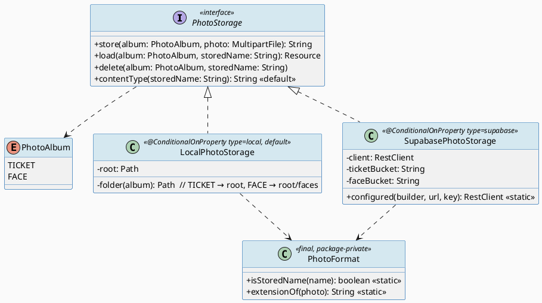
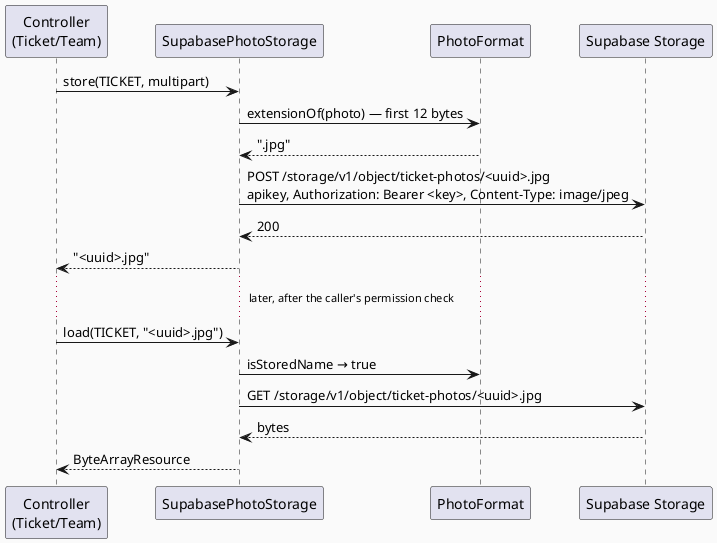
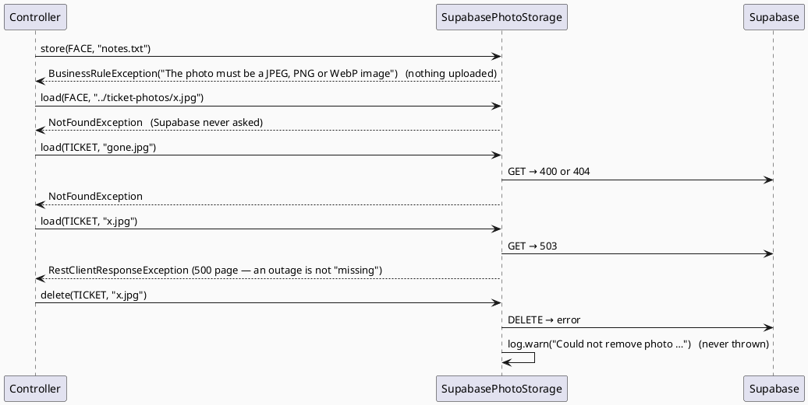

# ENGINEERING DOCUMENTATION STANDARD (EDS) v2.0
# Quy chuẩn Tài liệu Kỹ thuật và Đặc tả Hiện thực hóa

| Field | Value |
|-------|-------|
| **Document ID** | `STEELSIGHT-STO-IMP-001` |
| **Version** | `1.0` |
| **Date** | `2026-11-06` |
| **Status** | `Draft` |
| **Document Owner** | `Nguyen Vu An` |
| **Author** | `Claude Code (Opus 5.5) — reverse-engineered from commit f005861` |
| **Reviewed by** | `[ ] Pending — Tech Lead` |
| **DPO Sign-off** | `[ ] Pending` *(**required**: stores face photos — biometric — with a third-party processor)* |
| **Approved by** | `[ ] Pending — Principal Architect` |
| **Last Review** | `2026-11-06` |
| **Based on EDS** | `v2.0` |

---

## CHANGELOG

> **Policy 4.4 — Immutable History:** Không bao giờ xóa thông tin cũ. Mọi thay đổi phải ghi vào bảng này.

| Ngày | Người thực hiện | Nội dung thay đổi |
|------|-----------------|-------------------|
| 2026-11-06 | Claude Code (Opus 5.5) — documentation | Tạo tài liệu lần đầu, from the code as built (commit d4f978f onward) |

---

## MỤC LỤC

1. [Tổng quan Module](#1-tổng-quan-module)
2. [Ma trận Truy vết (Traceability Matrix)](#2-ma-trận-truy-vết-traceability-matrix)
3. [Architecture Decision Records (ADR)](#3-architecture-decision-records-adr) ⭐ *Mới*
4. [Non-Functional Requirements & SLA](#4-non-functional-requirements--sla) ⭐ *Mới*
5. [Static Modeling (Mô hình Tĩnh)](#5-static-modeling-mô-hình-tĩnh)
6. [Dynamic Modeling (Mô hình Động)](#6-dynamic-modeling-mô-hình-động)
7. [Domain Event Catalog](#7-domain-event-catalog) ⭐ *Mới*
8. [Interface Specification (Đặc tả Giao diện)](#8-interface-specification-đặc-tả-giao-diện)
9. [API Specification](#9-api-specification)
10. [Bảng mã lỗi (Error Codes)](#10-bảng-mã-lỗi-error-codes)
11. [Quy trình Triển khai (Step-by-Step)](#11-quy-trình-triển-khai-step-by-step)
12. [Rollback & Incident Runbook](#12-rollback--incident-runbook) ⭐ *Mới*
13. [Kịch bản Kiểm thử Chi tiết](#13-kịch-bản-kiểm-thử-chi-tiết)
14. [Phương pháp Xác minh](#14-phương-pháp-xác-minh)
15. [Mẫu thử thực tế (API Verification Samples)](#15-mẫu-thử-thực-tế-api-verification-samples)
16. [Bảng tổng hợp phân quyền (Authorization Matrix)](#16-bảng-tổng-hợp-phân-quyền-authorization-matrix)
17. [AI Prompt Constraints (CASE 2.0)](#17-ai-prompt-constraints-case-20) ⭐⭐ *CASE 2.0 Core*

> **Adaptations to this stack:** this module has no tables; §5.2 shows its configuration and the Supabase objects it uses. It has no endpoints of its own; §9 lists the Supabase Storage REST calls it makes and the ERP endpoints that serve its files.

---

## 1. Tổng quan Module

> Photo Storage keeps uploaded photos (ticket photos and face enrolment photos) outside the database, on local disk in development and in private Supabase Storage buckets in production. It decides a photo's type from its bytes, gives each a random name, and keeps faces and tickets apart. It doesn't know who is asking; callers check permissions first.

| Field | Value |
|-------|-------|
| **Module Name** | `STO — Photo Storage` |
| **Bounded Context** | `File storage` (infrastructure) |
| **Data Classification** | `Sensitive-PII` (FACE album) / `PII` (TICKET album, may show people) |
| **Compliance Scope** | `Luật 91/2025/QH15` (biometric; processor Supabase), `NĐ 356/2025` — DPO pending |
| **Upstream Dependencies** | Supabase Storage REST API (prod), local filesystem (dev/test), `PLT` (exceptions) |
| **Downstream Consumers** | `IAM` (`TeamController` face photos, `UserService` cleanup), `TKT` (`TicketController` photos); detection service reads `face-photos` with its own key |

**Code location:** `storage/PhotoStorage.java`, `LocalPhotoStorage.java`, `SupabasePhotoStorage.java`, `PhotoFormat.java`, `PhotoAlbum.java`; config `steelsight.storage.*` in `application.yaml` / `application-prod.yaml`.

---

## 2. Ma trận Truy vết (Traceability Matrix)

| Requirement ID | Loại (BR/ADR/US) | Mô tả yêu cầu | Thành phần Code | Compliance Target | ADR liên quan |
|----------------|------------------|---------------|-----------------|-------------------|---------------|
| BR-STO-001 | Business Rule | JPEG/PNG/WebP by magic bytes, ≤ 5 MB | `PhotoFormat.extensionOf()`, `spring.servlet.multipart.*` | PDPL — security | ADR-020 |
| BR-STO-002 | Business Rule | Random UUID names; only valid names loaded | `PhotoFormat.isStoredName()`, `LocalPhotoStorage.resolve()` | PDPL — security | ADR-020 |
| BR-STO-003 | Business Rule | Separate face and ticket albums; same bucket refused | `PhotoAlbum`, `SupabasePhotoStorage` ctor | PDPL — sensitive data | ADR-020 |
| BR-STO-004 | Business Rule | Served only through ERP after permission checks, `no-store` | `TicketController.photo()`, `TeamController.facePhoto()` | PDPL — access control | ADR-020 |
| BR-STO-005 | Business Rule | Delete on failed save; delete failures logged, not thrown | Controllers, `SupabasePhotoStorage.delete()` | — | ADR-020 |
| BR-STO-006 | Business Rule | `prod` needs Supabase URL + key | `application-prod.yaml`, `configured()` | — | ADR-023 |
| BR-ATT-010 | Business Rule | Old face photo removed only after commit | `UserService.removeFacePhotoAfterCommit()` | PDPL — erasure | ADR-007 |
| US-WRK-004 | User Story | Safety concern photo | TICKET album | — | — |
| US-ADM-003 | User Story | Face photo upload | FACE album | PDPL — biometric | ADR-011 |

---

## 3. Architecture Decision Records (ADR)

| ADR | Status | Decision (one line) | Effect on this module |
|-----|--------|---------------------|------------------------|
| [ADR-007](../02_design/adr/ADR-007_soft-delete-and-biometric-erasure.md) | Accepted | Erase biometrics after commit | Callers delete face photos after commit |
| [ADR-020](../02_design/adr/ADR-020_photo-storage-abstraction-private-buckets.md) | Accepted | One interface, private separate buckets | Whole module |
| [ADR-023](../02_design/adr/ADR-023_hosting-render-and-supabase.md) | Accepted | Render disk is ephemeral; Supabase in prod | `storage.type: supabase` in prod |

---

## 4. Non-Functional Requirements & SLA

### 4.1. Performance & Availability

| Category | Requirement | Target SLA | Measurement Method | Compliance Basis |
|----------|-------------|------------|---------------------|------------------|
| Timeouts | Supabase connect / read | *configured* 5 s / 30 s | `SupabasePhotoStorage.timeouts()` | — |
| Size | Upload | *configured* ≤ 5 MB file, ≤ 6 MB request | `application.yaml` | — |
| Availability | Photos | Supabase Storage availability (free tier); no fallback | — | — |

### 4.2. Data Integrity & Retention

| Category | Requirement | Target | Verification Method | Compliance Basis |
|----------|-------------|--------|---------------------|------------------|
| Durability | Photos survive restarts | Supabase in prod | `docs/deployment.md` §6 check | — |
| Orphans | Failed saves leave no file | Best effort (delete may fail and is only logged) | `Could not remove photo` log | — |
| Retention | Face photo | Until replaced or the account is deleted | `UserService` | PDPL — storage limitation |
| Retention | Ticket photo | Indefinite — **DPO** | — | PDPL |

### 4.3. Security

| Category | Requirement | Target | Verification Method | Compliance Basis |
|----------|-------------|--------|---------------------|------------------|
| Privacy | Buckets private; server key only on the server | configured | Supabase dashboard; `SupabasePhotoStorageTest` | PDPL — security |
| Type spoofing | Content type from bytes, not from browser | 100% | `uploadingNothingOrAFakeImageIsRefused`, `aFileThatIsNotAnImageIsRefused` | — |
| Path traversal | Names never hold a folder or `..` | 100% | `LocalPhotoStorageTest.oneAlbumCannotReadAnothersPhotos` | — |
| Isolation | One album can't read the other | 100% | same | PDPL — sensitive data |
| Encryption in transit | HTTPS to Supabase | TLS | §14.3 | PDPL |
| Encryption at rest | Supabase-managed | Provider default; not verified | — | PDPL |

### 4.4. Scalability & Capacity Planning

> Tens of photos a week. Each load buffers the whole file in memory (`ByteArrayResource`), bounded by the 5 MB limit. Supabase free tier storage quota applies.

---

## 5. Static Modeling (Mô hình Tĩnh)

### 5.1. Class Diagram (PlantUML)



### 5.2. Data Structure (configuration and external objects — no tables)

```yaml
# application.yaml
spring.servlet.multipart: { max-file-size: 5MB, max-request-size: 6MB }
steelsight.storage:
  type: ${STORAGE_TYPE:local}                     # local | supabase
  dir: ${STORAGE_DIR:./uploads}                   # local: tickets at top level, faces in faces/
  supabase-url: ${SUPABASE_URL:}
  supabase-key: ${SUPABASE_SERVICE_KEY:}          # server key; sent as apikey and Bearer
  supabase-bucket: ${SUPABASE_STORAGE_BUCKET:ticket-photos}
  supabase-face-bucket: ${SUPABASE_FACE_BUCKET:face-photos}
# application-prod.yaml
steelsight.storage.type: supabase
```

```text
Supabase Storage (both PRIVATE):
  ticket-photos/<uuid>.<jpg|png|webp>      ← ticket.photo_path
  face-photos/<uuid>.<jpg|png|webp>        ← app_user.face_file_path, face_embedding.source_file_path
Stored name pattern: [A-Za-z0-9][A-Za-z0-9._-]{0,99}, no "..", generated as UUID + extension
```

---

## 6. Dynamic Modeling (Mô hình Động)

### 6.1. Sequence Diagram — Happy Path (PlantUML)



### 6.2. Sequence Diagram — Error Path (PlantUML)



### 6.3. State Machine *(bắt buộc nếu module có trạng thái)*

> Not applicable — objects are written, read and deleted; there are no states. The face photo lifecycle (replace, delete after commit) is in the IAM and ATT TDS.

> **⚠️ Invariant bất biến:**
> - A face photo is never written to, or read from, the ticket album, and vice versa.
> - No stored name contains a folder separator or `..`.
> - A failed cleanup never hides the original error or undoes a saved change.

---

## 7. Domain Event Catalog

### 7.1. Events Published (Phát ra)

| Event Name | Trigger | Publisher | Subscriber(s) | Payload Schema | Async? |
|------------|---------|-----------|---------------|----------------|--------|
| *(none)* | — | — | — | — | — |

### 7.2. Events Consumed (Tiêu thụ)

| Event Name | Source | Handler | Action thực hiện |
|------------|--------|---------|------------------|
| `FacePhotoReplaced` / `UserSoftDeleted` (after commit) | IAM `UserService` | `PhotoStorage.delete(FACE, old)` | Removes the old face photo |

### 7.3. Payload Schema

```java
// Not applicable — direct method calls only.
```

---

## 8. Interface Specification (Đặc tả Giao diện)

### 8.1. Service Interface

```java
// storage/PhotoStorage.java
// @version 1.0
/** Where photos are kept. Callers check permissions first, because this layer has no idea who is asking. */
public interface PhotoStorage {
  /** @return the stored name, or null when no photo was chosen (null or empty file).
   *  @throws BusinessRuleException not JPEG/PNG/WebP
   *  @throws UncheckedIOException / RestClientException on storage failure */
  String store(PhotoAlbum album, MultipartFile photo);
  /** @throws NotFoundException invalid name or missing object (Supabase 400/404) */
  Resource load(PhotoAlbum album, String storedName);
  /** No-op for invalid names; never throws for a missing object; Supabase failures are logged. */
  void delete(PhotoAlbum album, String storedName);
  default String contentType(String storedName);   // .png → image/png, .webp → image/webp, else image/jpeg
}
public enum PhotoAlbum { TICKET, FACE }
```

### 8.2. Repository Interface

```java
// Not applicable — no database access. Two implementations of PhotoStorage are selected by
// @ConditionalOnProperty(name = "steelsight.storage.type"): "local" (default) or "supabase".
```

---

## 9. API Specification

### 9.1. Endpoints Table

**Outbound calls (Supabase Storage REST, base `SUPABASE_URL`):**

| Method | Path | Auth Level | Required Roles | Rate Limit | Idempotent? |
|--------|------|------------|----------------|------------|-------------|
| `POST` | `/storage/v1/object/{bucket}/{name}` | `apikey` + `Authorization: Bearer <server key>` | server key | Supabase limits | No (new name each time) |
| `GET` | `/storage/v1/object/{bucket}/{name}` | same | server key | Supabase limits | Yes |
| `DELETE` | `/storage/v1/object/{bucket}/{name}` | same | server key | Supabase limits | Yes |

**ERP endpoints that serve stored photos (owned by IAM and TKT):**

| Method | Path | Auth Level | Required Roles | Rate Limit | Idempotent? |
|--------|------|------------|----------------|------------|-------------|
| `GET` | `/tickets/{id}/photo` | Session | `can_read_ticket` | — | Yes |
| `GET` | `/team/{id}/face` | Session | `USER_MANAGE` | — | Yes |

### 9.2. Request / Response Schemas

#### `POST /storage/v1/object/face-photos/<uuid>.png`

**Request:** headers `apikey: <key>`, `Authorization: Bearer <key>`, `Content-Type: image/png`; body = photo bytes.
**Response — 200:** stored. Any non-2xx → `RestClientResponseException` → the caller's form shows a 500 page (the photo is reported, not silently lost).

#### `GET /team/{id}/face` (ERP)

**Response — 200:** image bytes, `Content-Type: image/png`, `Cache-Control: no-store`. **403** for non-admins. **404** when the user has no face photo or the object is gone.

---

## 10. Bảng mã lỗi (Error Codes)

| Code | HTTP Status | Message (EN) | Message (VI) | Trigger Condition |
|------|-------------|--------------|--------------|-------------------|
| `STO-001` | 400 | The photo must be a JPEG, PNG or WebP image | Ảnh phải ở định dạng JPEG, PNG hoặc WebP | Magic bytes don't match |
| `STO-002` | 413 | Photo too large — Go back and choose a photo under 5 MB. | Ảnh quá lớn — Hãy quay lại và chọn ảnh dưới 5 MB. | `MaxUploadSizeExceededException` |
| `STO-003` | 400 | Choose a photo to upload | Vui lòng chọn ảnh để tải lên | Empty face upload (`TeamController`) |
| `STO-004` | 404 | Page not found | Không tìm thấy trang | Invalid stored name; object missing |
| `STO-005` | 500 | Something went wrong — This is a problem on our side. | Đã xảy ra lỗi — Đây là lỗi từ phía hệ thống. | Supabase outage, upload failure |
| `STO-CFG-1` | — (startup fails) | Supabase storage needs SUPABASE_URL and SUPABASE_SERVICE_KEY | — | `type=supabase` without settings |
| `STO-CFG-2` | — (startup fails) | Face photos need their own bucket, apart from ticket photos | — | Both bucket names equal |

---

## 11. Quy trình Triển khai (Step-by-Step)

### 11.1. Prerequisites

- [x] ADR-020 Accepted
- [ ] **DPO sign-off** on Supabase as processor of face photos (region, contract)
- [ ] Two **private** buckets created: `ticket-photos`, `face-photos`

### 11.2. Pre-Migration Checklist *(bắt buộc tick trước khi chạy migration)*

- [ ] No schema change in this module
- [ ] Bucket names in Render match the detection service's `DETECTION_FACE_BUCKET` (it stores only the file name)
- [ ] Server key stored only in Render env (never committed)

### 11.3. Implementation Steps

#### Chặng 1 — Buckets

```text
Supabase → Storage → New bucket → "ticket-photos" (Public: OFF)
Supabase → Storage → New bucket → "face-photos"   (Public: OFF)
```

#### Chặng 2 — Environment

```bash
SUPABASE_URL=https://<ref>.supabase.co
SUPABASE_SERVICE_KEY=<server key>       # if the new secret-key format is refused, try service_role
# SUPABASE_STORAGE_BUCKET / SUPABASE_FACE_BUCKET only if the names differ
```

> ⚠️ **Chú ý:** the `prod` profile (set by the Dockerfile) won't start without URL and key.

#### Chặng 3 — Verification sau deploy

```bash
# Upload a ticket photo, restart the Render service, open /tickets/{id}/photo → still 200.
```

### 11.4. Deployment Checklist

- [ ] App started with `type=supabase` (no startup failure)
- [ ] Ticket photo survives a restart
- [ ] Face photo opens only for an admin
- [ ] Bucket "Public" is off for both

---

## 12. Rollback & Incident Runbook

### 12.1. Điều kiện kích hoạt Rollback (Trigger Conditions)

| Điều kiện | Ngưỡng | Người quyết định |
|-----------|--------|------------------|
| A bucket found public | Any | Developer (immediately make private) + DPO |
| Server key leaked | Any | Developer — rotate in Supabase and Render |
| Uploads failing | > 10% for 10 min | Developer |

### 12.2. Rollback Procedure

```bash
# Bước 1: Key leak → Supabase → Settings → API → rotate; update SUPABASE_SERVICE_KEY in Render; redeploy
# Bước 2: Code issue → re-deploy previous image tag (Render deploy hook)
# Bước 3: Verify an upload and a load
# Bước 4: List orphans to clean: objects in buckets not referenced by ticket.photo_path / app_user.face_file_path
```

### 12.3. Notification Protocol

| Thời điểm | Người nhận | Kênh | Template |
|-----------|------------|------|----------|
| Ngay khi phát hiện | Developer | Team chat | "🚨 Steelsight STO incident: [description]" |
| Trong 30 phút | DPO | Email | *(Mandatory if face photos may have been exposed)* |
| Trong 72 giờ | Competent authority | Official channel | *(Confirmed breach of sensitive data — DPO decides)* |

### 12.4. Post-Incident Review (PIR)

> PIR within **48 giờ**: Timeline, Root Cause, Impact (which photos, whose), Remediation, Prevention.

---

## 13. Kịch bản Kiểm thử Chi tiết

> Full TCs: [`04_testing/STEELSIGHT-STO-TDD-001_Test-Spec.md`](../04_testing/STEELSIGHT-STO-TDD-001_Test-Spec.md). Test data `SYNTHETIC` (generated image bytes).

### 13.1. Unit Tests

#### TC-UNIT-001 — Type from bytes, not from the name

```gherkin
Feature: Photo format
  Background:
    Given test data classification: SYNTHETIC

  Scenario: PNG bytes named .jpg
    Given a file "a.jpg" whose bytes start with 89 50 4E 47
    When store(TICKET, file) runs
    Then the stored name ends with ".png"

  Scenario: Text named .png
    Given a file "a.png" containing "hello"
    When store(TICKET, file) runs
    Then BusinessRuleException "The photo must be a JPEG, PNG or WebP image"
    And nothing is uploaded
```

**Hàm được test:** `PhotoFormat.extensionOf()` via `store()`
**Invariant kiểm tra:** an unrecognised file never reaches storage.

### 13.2. Integration Tests

#### TC-INT-001 — Supabase client contract

```gherkin
  Scenario: Upload uses a random name and the server key
    Given test data classification: SYNTHETIC
    And MockRestServiceServer bound to the same RestClient configuration as production
    When store(FACE, png) runs
    Then one POST goes to /storage/v1/object/face-photos/<uuid>.png
    And it carries apikey and Authorization: Bearer headers
```

**External dependencies:** Supabase (mocked)
**Mock strategy:** `MockRestServiceServer` with `SupabasePhotoStorage.configured()`.

### 13.3. E2E / Security Tests

#### TC-E2E-001 — Album isolation

```gherkin
  Scenario: Read a face photo through the ticket album
    Given test data classification: SYNTHETIC
    And a stored face photo "f.png"
    When load(TICKET, "f.png") or load(TICKET, "faces/f.png") is called
    Then NotFoundException
```

---

## 14. Phương pháp Xác minh

### 14.1. Database Inspection

```sql
-- Stored names referenced by the database (compare with bucket listings to find orphans)
SELECT photo_path FROM ticket WHERE photo_path IS NOT NULL;
SELECT face_file_path FROM app_user WHERE face_file_path IS NOT NULL;
-- Any name that isn't a generated one (expect 0)
SELECT id, photo_path FROM ticket WHERE photo_path !~ '^[A-Za-z0-9][A-Za-z0-9._-]{0,99}$' OR photo_path LIKE '%..%';
```

### 14.2. Log / Audit Verification

```bash
grep -E 'Could not remove (old face )?photo' app.log      # cleanup failures to sweep
grep -iE 'SUPABASE_SERVICE_KEY|Bearer ' app.log           # Expected: no output
```

### 14.3. Tool-based Verification

```bash
# A bucket must not be public: this anonymous request must fail
curl -s -o /dev/null -w '%{http_code}\n' "https://<ref>.supabase.co/storage/v1/object/public/face-photos/<name>"
# Expected: 400 or 404, never 200
```

---

## 15. Mẫu thử thực tế (API Verification Samples)

### 15.1. Happy Path

```bash
curl -s -b $ADMIN_JAR -o face.png -w '%{http_code} %{content_type}\n' $BASE/team/12/face
```

**Expected Response (200):** `200 image/png` (or the stored type), header `Cache-Control: no-store`.

### 15.2. Error Paths

```bash
curl -s -b $MANAGER_JAR -o /dev/null -w '%{http_code}\n' $BASE/team/12/face
```

**Expected Response (403).**

```bash
head -c 7000000 /dev/urandom > big.jpg
curl -s -b $JAR -o /dev/null -w '%{http_code}\n' -F categoryId=2 -F subject=x -F description=y -F photo=@big.jpg -F _csrf=$CSRF $BASE/tickets
```

**Expected Response (413):** "Photo too large".

---

## 16. Bảng tổng hợp phân quyền (Authorization Matrix)

| Operation | `WORKER` | `HSE_OFFICER` | `MANAGER` | `ADMIN` | ERP server key | Detection key |
|-----------|----------|---------------|-----------|---------|----------------|---------------|
| Upload ticket photo (via `POST /tickets`) | ✅ | ✅ | ✅ | ✅ | ✅ | — |
| Read ticket photo (`/tickets/{id}/photo`) | ✅ Own ticket | ✅ Own + HSE categories | ✅ Own ticket | ✅ All | ✅ | — |
| Upload / read face photo (`/team/{id}/face`) | ❌ | ❌ | ❌ | ✅ | ✅ | ✅ read (enrolment) |
| Direct bucket access from a browser | ❌ | ❌ | ❌ | ❌ | — | — |

**Chú thích:** Storage itself checks nothing; every row above is enforced by the calling controller/service.

---

## 17. AI Prompt Constraints (CASE 2.0)

### 17.1 Constraint Summary Table

| # | Constraint | Source (ADR/BR) | Last Verified |
|---|-----------|-----------------|---------------|
| C1 | Photos only through `PhotoStorage` with the right `PhotoAlbum` | `ADR-020`, `BR-STO-003` | `2026-11-06` |
| C2 | Check the owning record's permission before `store`/`load` | `ADR-020`, `BR-STO-004` | `2026-11-06` |
| C3 | Type from bytes; random names; never a path from input | `BR-STO-001/002` | `2026-11-06` |
| C4 | Delete the stored file if the save fails; face deletions after commit | `ADR-007`, `BR-STO-005` | `2026-11-06` |
| C5 | Serve with `no-store`; never expose bucket URLs or the key | `ADR-020` | `2026-11-06` |

### 17.2 Constraint Injection Block (Copy-Paste vào AI Prompt)

```
[CONSTRAINT BLOCK — Module: STO — Photo Storage]
Theo TDS STEELSIGHT-STO-IMP-001 và các ADR liên quan (ADR-007, 020, 023):

1. Read and write photos only through the PhotoStorage bean with PhotoAlbum.TICKET or PhotoAlbum.FACE.
   Never use java.nio.file or call Supabase directly from other code.
2. PhotoStorage checks no permissions. The caller MUST check (tickets.get / USER_MANAGE) before store() or load().
3. Never trust the uploaded name or content type; PhotoFormat.extensionOf decides; stored names are
   UUID + extension and must pass PhotoFormat.isStoredName before any load/delete.
4. If the database save fails after store(), call delete() with the stored name and rethrow. Old face photos
   are deleted with TransactionSynchronization.afterCommit. delete() never throws over the original error.
5. Serve images with Cache-Control: no-store and PhotoStorage.contentType(name). Never return a bucket URL,
   signed URL or the server key to the browser.

[CONTEXT BLOCK]
- Bounded Context: File storage
- Data Classification: Sensitive-PII (FACE) / PII (TICKET)
- Compliance: Luật 91/2025/QH15, NĐ 356/2025 (DPO sign-off mandatory)
- Existing interfaces: §8.1 PhotoStorage
- Error codes: §10
- Auth matrix: §16

[TASK BLOCK]
Implement {feature/method} thỏa mãn constraints trên.
Output phải tuân thủ §8 Interface Specification.
Tests phải cover §13 Test Scenarios and STEELSIGHT-STO-TDD-001.
```

### 17.3 Constraint Quality Checklist

- [x] Mỗi constraint traceable về ADR hoặc BR cụ thể
- [x] Không có constraint generic
- [x] Mỗi constraint có `Last Verified` date ≤ 2 sprints
- [x] Constraint block có ≥ 3 constraints cụ thể
- [x] Constraint block reference §8 Interface
- [x] Constraint block reference §16 Auth Matrix

### 17.4 Anti-Pattern Detection (cho AI-Generated Code từ Block này)

| AP-ID | Anti-Pattern | Dấu hiệu | Hành động |
|-------|-------------|-----------|----------|
| AP-AI-001 | Unconstrained Gen | `photos.load` before a permission check | Reject |
| AP-AI-003 | Implicit Decision | Public buckets, signed URLs to the browser, storing bytes in PostgreSQL | Reject — ADR first |
| AP-AI-005 | Hallucinated Contract | `PhotoStorage.url()`, `PhotoAlbum.SNAPSHOT` (don't exist) | Reject |

---

## PHỤ LỤC

### A. Glossary (Thuật ngữ)

| Thuật ngữ | Định nghĩa |
|-----------|------------|
| Album | `PhotoAlbum`: TICKET or FACE; a folder locally, a bucket on Supabase |
| Stored name | The generated `<uuid>.<ext>` kept in the database |
| Magic bytes | The first bytes of a file that identify its format |
| Server key | Supabase key that bypasses Storage policies; server-side only |
| Red Gate | Tests phải FAIL trước khi implement |

### B. Tài liệu tham chiếu

| Document | Link / Path |
|----------|-------------|
| Module map | `02_design/MODULE-MAP.md` |
| Deployment | `docs/deployment.md` §1, §3 |
| Test-Spec | `04_testing/STEELSIGHT-STO-TDD-001_Test-Spec.md` |

---

*EDS v2.1 — Tích hợp CASE 2.0 AI Prompt Constraints (§17).*
*Sections đánh dấu ⭐ là bổ sung EDS v2.0. Section đánh dấu ⭐⭐ là bổ sung CASE 2.0.*
*Câu hỏi hoặc đề xuất sửa đổi: tạo Issue với label `docs-policy`.*
