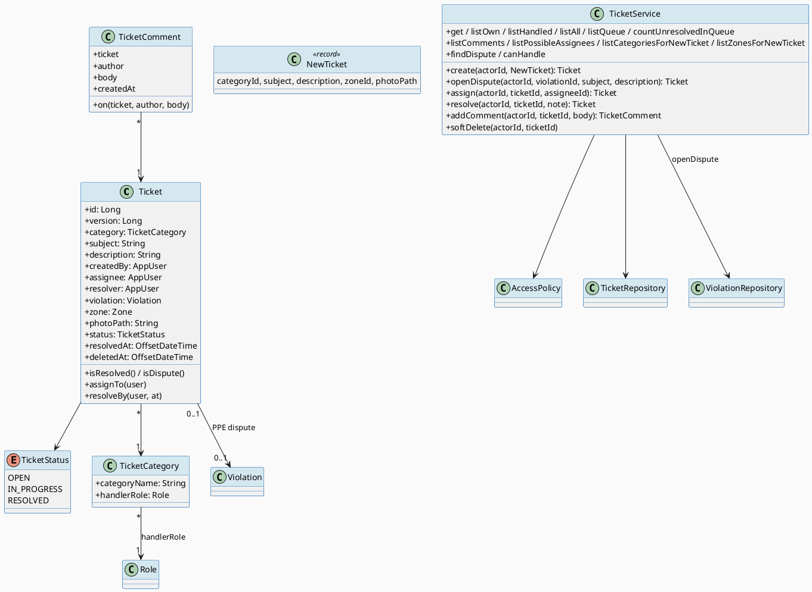
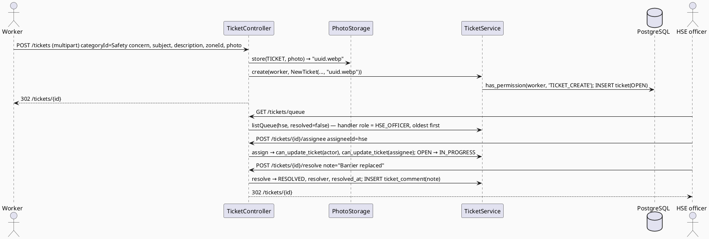
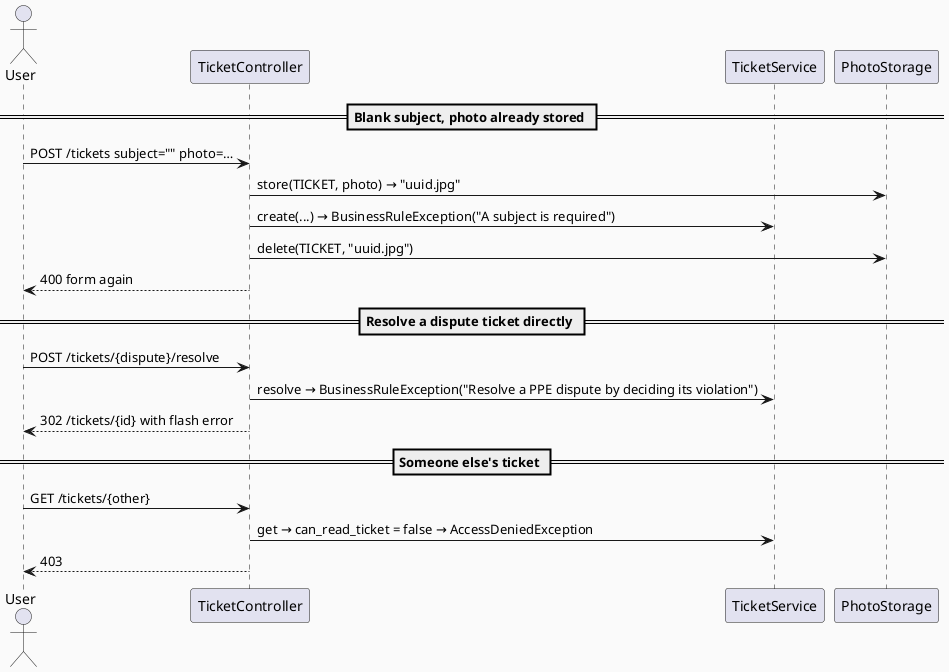
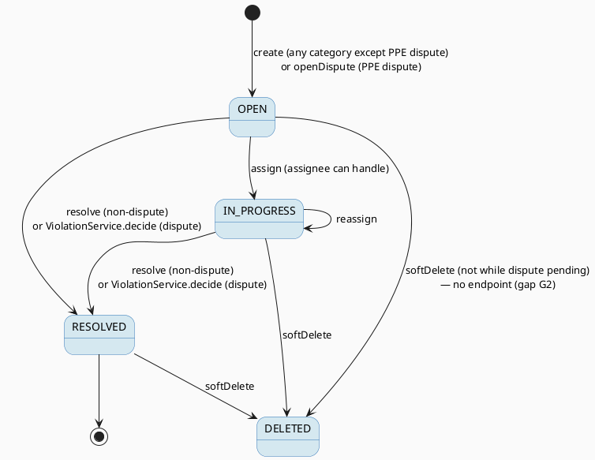

# ENGINEERING DOCUMENTATION STANDARD (EDS) v2.0
# Quy chuẩn Tài liệu Kỹ thuật và Đặc tả Hiện thực hóa

| Field | Value |
|-------|-------|
| **Document ID** | `STEELSIGHT-TKT-IMP-001` |
| **Version** | `1.0` |
| **Date** | `2026-11-06` |
| **Status** | `Draft` |
| **Document Owner** | `Nguyen Vu An` |
| **Author** | `Claude Code (Opus 5.5) — reverse-engineered from commit f005861` |
| **Reviewed by** | `[ ] Pending — Tech Lead` |
| **DPO Sign-off** | `[ ] Pending` *(free text and photos may contain personal data, e.g. leave reasons)* |
| **Approved by** | `[ ] Pending — Principal Architect` |
| **Last Review** | `2026-11-06` |
| **Based on EDS** | `v2.0` |

---

## CHANGELOG

> **Policy 4.4 — Immutable History:** Không bao giờ xóa thông tin cũ. Mọi thay đổi phải ghi vào bảng này.

| Ngày | Người thực hiện | Nội dung thay đổi |
|------|-----------------|-------------------|
| 2026-11-06 | Claude Code (Opus 5.5) — documentation | Tạo tài liệu lần đầu, from the code as built (V1, V3, V4, V11) |

---

## MỤC LỤC

1. [Tổng quan Module](#1-tổng-quan-module)
2. [Ma trận Truy vết (Traceability Matrix)](#2-ma-trận-truy-vết-traceability-matrix)
3. [Architecture Decision Records (ADR)](#3-architecture-decision-records-adr) ⭐ *Mới*
4. [Non-Functional Requirements & SLA](#4-non-functional-requirements--sla) ⭐ *Mới*
5. [Static Modeling (Mô hình Tĩnh)](#5-static-modeling-mô-hình-tĩnh)
6. [Dynamic Modeling (Mô hình Động)](#6-dynamic-modeling-mô-hình-động)
7. [Domain Event Catalog](#7-domain-event-catalog) ⭐ *Mới*
8. [Interface Specification (Đặc tả Giao diện)](#8-interface-specification-đặc-tả-giao-diện)
9. [API Specification](#9-api-specification)
10. [Bảng mã lỗi (Error Codes)](#10-bảng-mã-lỗi-error-codes)
11. [Quy trình Triển khai (Step-by-Step)](#11-quy-trình-triển-khai-step-by-step)
12. [Rollback & Incident Runbook](#12-rollback--incident-runbook) ⭐ *Mới*
13. [Kịch bản Kiểm thử Chi tiết](#13-kịch-bản-kiểm-thử-chi-tiết)
14. [Phương pháp Xác minh](#14-phương-pháp-xác-minh)
15. [Mẫu thử thực tế (API Verification Samples)](#15-mẫu-thử-thực-tế-api-verification-samples)
16. [Bảng tổng hợp phân quyền (Authorization Matrix)](#16-bảng-tổng-hợp-phân-quyền-authorization-matrix)
17. [AI Prompt Constraints (CASE 2.0)](#17-ai-prompt-constraints-case-20) ⭐⭐ *CASE 2.0 Core*

> **Adaptations to this stack:** §5.2 Flyway SQL, §8 Java, §9 session + CSRF form endpoints.

---

## 1. Tổng quan Module

> Ticketing lets anyone open a request or report (leave, equipment, shift issue, account problem, safety concern with zone and photo), routes it by category to the role that handles it (HSE or Admin), and carries the conversation until it's resolved. PPE disputes are tickets too, but open from a violation and close only through its decision.

| Field | Value |
|-------|-------|
| **Module Name** | `TKT — Ticketing` |
| **Bounded Context** | `Requests and reports` |
| **Data Classification** | `PII` (free text, photos, author) |
| **Compliance Scope** | `Luật 91/2025/QH15` — DPO pending |
| **Upstream Dependencies** | `IAM` (AccessPolicy, AppUser, Role), `PPE` (Violation), `SCH` (Zone), `STO` (photo), `PLT` |
| **Downstream Consumers** | `PPE` (`ViolationService.decide` resolves the dispute ticket), dashboard and sidebar counts (`NavCounts.queue`) |

**Code location:** `ticketing/**`, `web/TicketController.java`, `web/TicketForm.java`, templates `tickets/*`.

---

## 2. Ma trận Truy vết (Traceability Matrix)

| Requirement ID | Loại (BR/ADR/US) | Mô tả yêu cầu | Thành phần Code | Compliance Target | ADR liên quan |
|----------------|------------------|---------------|-----------------|-------------------|---------------|
| BR-TKT-001 | Business Rule | Category → handler role | `ticket_category.handler_role_id`, `TicketService.listQueue()` | — | ADR-016 |
| BR-TKT-002 | Business Rule | No ordinary PPE dispute; subject/description rules | `TicketService.create()/newTicket()` | — | ADR-015 |
| BR-TKT-003 | Business Rule | Creator, handler role, `TICKET_READ_ALL` read | `can_read_ticket()` (V11) | PDPL — least privilege | ADR-001, ADR-016 |
| BR-TKT-004 | Business Rule | Assignee must be able to handle; OPEN → IN_PROGRESS | `TicketService.assign()`, `Ticket.assignTo()` | — | ADR-016 |
| BR-TKT-005 | Business Rule | Resolve non-dispute, unresolved; note as comment | `TicketService.resolve()`, `CHECK`s | — | ADR-015 |
| BR-TKT-006 | Business Rule | Comments by creator/handler; none after resolved | `TicketService.addComment()` | — | — |
| BR-TKT-007 | Business Rule | One live dispute ticket per violation; no delete while pending | `uq_ticket_violation`, `TicketService.softDelete()` | — | ADR-015 |
| BR-TKT-008 | Business Rule | Zone + photo; photo via read check | `TicketService.create()`, `TicketController.photo()` | PDPL | ADR-020 |
| US-WRK-004 | User Story | Open a ticket | `TicketController.create()` | — | — |
| US-HSE-003 | User Story | Work safety tickets | `TicketController.queue()/assign()/resolve()` | — | ADR-016 |
| US-ADM-004 | User Story | Work admin tickets, view all | `TicketController.queue(all=true)` | — | ADR-016 |

---

## 3. Architecture Decision Records (ADR)

| ADR | Status | Decision (one line) | Effect on this module |
|-----|--------|---------------------|------------------------|
| [ADR-001](../02_design/adr/ADR-001_permission-and-scope-in-sql-functions.md) | Accepted | Scope in SQL | `can_read/update/delete_ticket` |
| [ADR-007](../02_design/adr/ADR-007_soft-delete-and-biometric-erasure.md) | Accepted | Soft delete | `ticket.deleted_at` |
| [ADR-015](../02_design/adr/ADR-015_dispute-decision-and-ticket-in-one-transaction.md) | Accepted | Dispute + ticket together | `openDispute`; `resolve` refuses disputes |
| [ADR-016](../02_design/adr/ADR-016_ticket-routing-by-category-handler-role.md) | Accepted (supersedes V9 team tickets) | Route by category to HSE or Admin | Queues, permission functions |
| [ADR-020](../02_design/adr/ADR-020_photo-storage-abstraction-private-buckets.md) | Accepted | Private photo storage | `TICKET` album |

---

## 4. Non-Functional Requirements & SLA

### 4.1. Performance & Availability

| Category | Requirement | Target SLA | Measurement Method | Compliance Basis |
|----------|-------------|------------|---------------------|------------------|
| Latency | `GET /tickets/queue` (20 per page) | *proposed* `< 500 ms` p95 | Request log ms | — |
| Latency | `POST /tickets` with a 5 MB photo to Supabase | *proposed* `< 3 s` p95 | Request log ms | — |
| Latency | Ticket detail with assignee list | *configured:* one `can_update_ticket` call per candidate | — | — |

### 4.2. Data Integrity & Retention

| Category | Requirement | Target | Verification Method | Compliance Basis |
|----------|-------------|--------|---------------------|------------------|
| Consistency | RESOLVED ⇔ resolver and time | 100% | `CHECK`s; `RepositoryIntegrationTest.ticketCannotHalfResolve` | — |
| Uniqueness | One live dispute per violation | 100% | `uq_ticket_violation` | — |
| Retention | Tickets and comments kept; soft delete only | *Retention not defined — DPO* | — | PDPL — storage limitation |

### 4.3. Security

| Category | Requirement | Target | Verification Method | Compliance Basis |
|----------|-------------|--------|---------------------|------------------|
| Access control | Only creator, handler role, Admin read | Least privilege | `ServiceIntegrationTest.ticketsStayPrivateToTheirCreatorAndHandlers` | PDPL |
| Photo privacy | Served only after `can_read_ticket`, `no-store` | 100% | `PagesIntegrationTest.aSafetyConcernKeepsItsZoneAndPhotoAndThePhotoStaysPrivate` | PDPL |
| XSS | Ticket text escaped | 100% | `PagesIntegrationTest.pageTextIsEscaped` | — |
| Tampering | Unknown category id → rule error, not 500 | 100% | `PagesIntegrationTest.aTamperedCategoryIsRefusedWithoutAServerError` | — |

### 4.4. Scalability & Capacity Planning

> Tens of tickets a week. Queue reads are indexed by `idx_ticket_category(category_id, status)` and `idx_ticket_creator(created_by, created_at DESC)`.

---

## 5. Static Modeling (Mô hình Tĩnh)

### 5.1. Class Diagram (PlantUML)



### 5.2. Data Structure (Flyway SQL)

```sql
-- === TKT SCHEMA (V1, V4, V11) ===
CREATE TABLE ticket_category (
  id              bigint GENERATED ALWAYS AS IDENTITY PRIMARY KEY,
  category_name   text   NOT NULL UNIQUE,
  handler_role_id bigint NOT NULL REFERENCES role(id)        -- the scope rule lives here
);
-- Seeds after V11: PPE dispute, Safety concern → HSE_OFFICER;
--                  Shift or timetable issue, Equipment request, Leave request, Account or access → ADMIN

CREATE TABLE ticket (
  id           bigint GENERATED ALWAYS AS IDENTITY PRIMARY KEY,
  category_id  bigint NOT NULL REFERENCES ticket_category(id),
  subject      text   NOT NULL,
  description  text   NOT NULL,
  created_by   bigint NOT NULL REFERENCES app_user(id),
  assignee_id  bigint REFERENCES app_user(id),
  resolver_id  bigint REFERENCES app_user(id),
  violation_id bigint REFERENCES violation(id),             -- PPE dispute only
  status       text NOT NULL DEFAULT 'OPEN' CHECK (status IN ('OPEN','IN_PROGRESS','RESOLVED')),
  resolved_at  timestamptz,
  version      bigint NOT NULL DEFAULT 0,
  created_at   timestamptz NOT NULL DEFAULT now(),
  updated_at   timestamptz NOT NULL DEFAULT now(),
  deleted_at   timestamptz,                                  -- soft delete
  zone_id      bigint REFERENCES zone(id),                   -- V4
  photo_path   text,                                         -- V4, stored name in TICKET album
  CHECK ((status = 'RESOLVED') = (resolver_id IS NOT NULL)),
  CHECK ((status = 'RESOLVED') = (resolved_at IS NOT NULL))
);
CREATE INDEX idx_ticket_creator  ON ticket(created_by, created_at DESC);
CREATE INDEX idx_ticket_category ON ticket(category_id, status);
CREATE UNIQUE INDEX uq_ticket_violation ON ticket(violation_id) WHERE violation_id IS NOT NULL AND deleted_at IS NULL;

CREATE TABLE ticket_comment (
  id         bigint GENERATED ALWAYS AS IDENTITY PRIMARY KEY,
  ticket_id  bigint NOT NULL REFERENCES ticket(id) ON DELETE CASCADE,
  author_id  bigint NOT NULL REFERENCES app_user(id),
  body       text   NOT NULL,
  created_at timestamptz NOT NULL DEFAULT now()
);

-- can_read_ticket(u, t)   : live ticket AND (TICKET_READ_ALL OR (TICKET_READ_OWN AND creator) OR (TICKET_READ_HANDLED AND role = handler))
-- can_update_ticket(u, t) : live ticket AND (TICKET_UPDATE_ALL OR (TICKET_UPDATE_HANDLED AND role = handler))
-- can_delete_ticket(u, t) : live ticket AND (TICKET_DELETE_ALL OR (TICKET_DELETE_HANDLED AND role = handler))
-- The detection role has no access to ticket tables.
```

---

## 6. Dynamic Modeling (Mô hình Động)

### 6.1. Sequence Diagram — Happy Path (PlantUML): safety concern with a photo, handled by HSE



### 6.2. Sequence Diagram — Error Path (PlantUML)



### 6.3. State Machine *(bắt buộc nếu module có trạng thái)*



> **⚠️ Invariant bất biến:**
> - RESOLVED is final: no assign, resolve or comment afterwards ("This ticket is already resolved").
> - `status = RESOLVED` exactly when `resolver_id` and `resolved_at` are set.
> - A dispute ticket is resolved only together with its violation's decision.

---

## 7. Domain Event Catalog

### 7.1. Events Published (Phát ra)

| Event Name | Trigger | Publisher | Subscriber(s) | Payload Schema | Async? |
|------------|---------|-----------|---------------|----------------|--------|
| `DisputeOpened` *(in-process call)* | `openDispute` | `TicketService` | `Violation.disputeStatus = DISPUTED` (PPE) | violationId | No (same tx) |

### 7.2. Events Consumed (Tiêu thụ)

| Event Name | Source | Handler | Action thực hiện |
|------------|--------|---------|------------------|
| `DisputeDecided` | PPE (`ViolationService.decide`) | `Ticket.resolveBy` + `TicketComment.on` | Resolves the dispute ticket with the reviewer's note |

### 7.3. Payload Schema

```java
// In-process only; no serialised events.
// DisputeDecided ≈ (violationId, DisputeStatus decision, AppUser reviewer, OffsetDateTime at, String note)
```

---

## 8. Interface Specification (Đặc tả Giao diện)

### 8.1. Service Interface

```java
// ticketing/service/TicketService.java — @Service @Transactional
// @version 1.0
public record NewTicket(Long categoryId, String subject, String description, Long zoneId, String photoPath) {}

public class TicketService {
  static final String PPE_DISPUTE_CATEGORY = "PPE dispute";

  /** TICKET_CREATE. @throws BusinessRuleException "Choose a category" | "Open a PPE dispute from the violation itself"
   *          | "A subject is required" | "A description is required" | length limits
   *  @throws NotFoundException unknown category or zone */
  Ticket create(Long actorId, NewTicket details);
  Ticket create(Long actorId, Long categoryId, String subject, String description);
  /** TICKET_CREATE; own violation; NONE only; marks DISPUTED in the same tx.
   *  @throws AccessDeniedException not own | @throws BusinessRuleException already disputed / already has a ticket */
  Ticket openDispute(Long actorId, Long violationId, String subject, String description);
  /** can_update_ticket for actor AND assignee; unresolved. */
  Ticket assign(Long actorId, Long ticketId, Long assigneeId);
  /** can_update_ticket; unresolved; not a dispute; note → comment. */
  Ticket resolve(Long actorId, Long ticketId, String note);
  /** can_read_ticket; unresolved; creator or can_update_ticket; body required ≤ 4000. */
  TicketComment addComment(Long actorId, Long ticketId, String body);
  /** can_delete_ticket; refuses a pending dispute. No endpoint calls this yet (gap G2). */
  void softDelete(Long actorId, Long ticketId);

  Ticket get(Long actorId, Long ticketId);                                // can_read_ticket
  Page<Ticket> listOwn(Long actorId, Pageable page);                      // TICKET_READ_OWN
  List<Ticket> listHandled(Long actorId);                                 // TICKET_READ_HANDLED
  List<Ticket> listAll(Long actorId);                                     // TICKET_READ_ALL
  Page<Ticket> listQueue(Long actorId, boolean resolved, boolean everyCategory, Pageable page);
  long countUnresolvedInQueue(Long actorId);
  List<TicketComment> listComments(Long actorId, Long ticketId);          // can_read_ticket
  List<AppUser> listPossibleAssignees(Long actorId, Long ticketId);       // active in handler role AND can_update_ticket
  List<TicketCategory> listCategoriesForNewTicket(Long actorId);          // all except PPE dispute
  List<Zone> listZonesForNewTicket(Long actorId);
  Optional<Ticket> findDispute(Long actorId, Long violationId);           // can_read_ticket when present
  boolean canHandle(Long actorId, Long ticketId);
}
```

### 8.2. Repository Interface

```java
// @version 1.0
public interface TicketRepository extends SoftDeletableRepository<Ticket, Long> {
  List<Ticket> findAllByCreatedByIdAndDeletedAtIsNullOrderByCreatedAtDesc(Long userId);
  Page<Ticket> findAllByCreatedByIdAndDeletedAtIsNullOrderByCreatedAtDescIdDesc(Long userId, Pageable p);
  Optional<Ticket> findByViolationIdAndDeletedAtIsNull(Long violationId);
  Page<Ticket> findAllByStatusInAndDeletedAtIsNull(Collection<TicketStatus> s, Pageable p);
  Page<Ticket> findAllByCategoryHandlerRoleIdAndStatusInAndDeletedAtIsNull(Long roleId, Collection<TicketStatus> s, Pageable p);
  long countByCategoryHandlerRoleIdAndStatusInAndDeletedAtIsNull(Long roleId, Collection<TicketStatus> s);
  List<Ticket> findAllByHandlerRoleId(Long roleId);
  // No hard delete.
}
public interface TicketCategoryRepository extends BaseRepository<TicketCategory, Long> {
  Optional<TicketCategory> findByCategoryName(String name);
  List<TicketCategory> findAllByHandlerRoleId(Long roleId);
}
public interface TicketCommentRepository extends BaseRepository<TicketComment, Long> {
  List<TicketComment> findAllByTicketIdOrderByCreatedAtAsc(Long ticketId);   // append-only in practice
}
```

---

## 9. API Specification

### 9.1. Endpoints Table

| Method | Path | Auth Level | Required Roles / Permission | Rate Limit | Idempotent? |
|--------|------|------------|------------------------------|------------|-------------|
| `GET` | `/tickets?page=n` | Session | `TICKET_READ_OWN` | — | Yes |
| `GET` | `/tickets/queue?resolved=&all=&page=n` | Session | `TICKET_READ_HANDLED` or `TICKET_READ_ALL` (`all` needs `TICKET_READ_ALL`) | — | Yes |
| `GET` | `/tickets/new` | Session | `TICKET_CREATE` | — | Yes |
| `POST` | `/tickets` (multipart, optional `photo`) | Session + CSRF | `TICKET_CREATE` | — | No |
| `GET` | `/tickets/{id}` | Session | `can_read_ticket` | — | Yes |
| `POST` | `/tickets/{id}/comments` (`body`) | Session + CSRF | creator or `can_update_ticket` | — | No |
| `POST` | `/tickets/{id}/assignee` (`assigneeId`) | Session + CSRF | `can_update_ticket` | — | Yes |
| `POST` | `/tickets/{id}/resolve` (`note`) | Session + CSRF | `can_update_ticket`; not a dispute | — | No |
| `GET` | `/tickets/{id}/photo` | Session | `can_read_ticket` | — | Yes |

### 9.2. Request / Response Schemas

#### `POST /tickets` — Tạo mới

**Request Body** (`multipart/form-data`):
```text
_csrf=<token>
categoryId=2                     # any category except "PPE dispute"
subject=Broken guard rail        # required, ≤ 200
description=Level 3, east side   # required, ≤ 4000
zoneId=1                         # optional
photo=<file>                     # optional JPEG/PNG/WebP ≤ 5 MB
```

**Response — 302 (Happy Path):** `Location: /tickets/{id}`, flash "Your ticket was sent.". DB: `ticket(status='OPEN', photo_path='<uuid>.jpg')`.

**Response — 400 (Validation Error):** `tickets/new` again, `error = "A subject is required"`; the stored photo is deleted.

**Response — 400 (Rule):** `error = "Open a PPE dispute from the violation itself"`.

#### `GET /tickets/{id}/photo`

**Response — 200:** image bytes, `Content-Type` from the stored name, `Cache-Control: no-store`. **403** without `can_read_ticket`; **404** when the ticket has no photo.

---

## 10. Bảng mã lỗi (Error Codes)

| Code | HTTP Status | Message (EN) | Message (VI) | Trigger Condition |
|------|-------------|--------------|--------------|-------------------|
| `TKT-001` | 400 | Choose a category | Vui lòng chọn danh mục | `categoryId` null |
| `TKT-002` | 400 | Open a PPE dispute from the violation itself | Hãy mở khiếu nại PPE từ chính vi phạm đó | PPE dispute category chosen |
| `TKT-003` | 400 | A subject is required | Vui lòng nhập tiêu đề | Blank subject |
| `TKT-004` | 400 | A description is required | Vui lòng nhập mô tả | Blank description |
| `TKT-005` | 400 | A subject can be at most 200 characters | Tiêu đề chỉ được tối đa 200 ký tự | Too long |
| `TKT-006` | 400 | A description can be at most 4000 characters | Mô tả chỉ được tối đa 4000 ký tự | Too long |
| `TKT-007` | 302 + flash | That user cannot handle this ticket | Người này không thể xử lý phiếu này | Assignee lacks `can_update_ticket` |
| `TKT-008` | 302 + flash | This ticket is already resolved | Phiếu này đã được xử lý | Act on RESOLVED |
| `TKT-009` | 302 + flash | Resolve a PPE dispute by deciding its violation | Hãy xử lý khiếu nại PPE bằng cách quyết định vi phạm của nó | Resolve a dispute ticket |
| `TKT-010` | 302 + flash | A comment is required | Vui lòng nhập bình luận | Blank comment |
| `TKT-011` | 400 | Decide the dispute before deleting its ticket | Hãy quyết định khiếu nại trước khi xóa phiếu của nó | `softDelete` on a pending dispute (no endpoint) |
| `TKT-012` | 400 | The photo must be a JPEG, PNG or WebP image | Ảnh phải ở định dạng JPEG, PNG hoặc WebP | Not an image |
| `TKT-013` | 403 | Not allowed | Không được phép | `can_read/update_ticket` false |
| `TKT-014` | 404 | Page not found | Không tìm thấy trang | Unknown/deleted ticket, category, zone; no photo |
| `TKT-015` | 413 | Photo too large — Go back and choose a photo under 5 MB. | Ảnh quá lớn — Hãy quay lại và chọn ảnh dưới 5 MB. | Multipart limit |

---

## 11. Quy trình Triển khai (Step-by-Step)

### 11.1. Prerequisites

- [x] ADR-015, ADR-016 Accepted
- [ ] DPO sign-off
- [ ] Principal Architect approval
- [ ] Supabase bucket `ticket-photos` exists and is **private**

### 11.2. Pre-Migration Checklist *(bắt buộc tick trước khi chạy migration)*

- [ ] Backup production DB
- [ ] New categories added by migration `INSERT INTO ticket_category`; `PPE dispute` name unchanged
- [ ] A routing change re-checks open tickets' assignees (V11 un-assigned managers)

### 11.3. Implementation Steps

#### Chặng 1 — Migrations

```bash
# V1 (ticket tables, can_update_ticket), V3 (can_read_ticket, can_delete_ticket), V4 (zone, photo), V11 (routing)
sh ./mvnw spring-boot:run
```

#### Chặng 2 — Storage

```bash
SUPABASE_URL=https://<ref>.supabase.co
SUPABASE_SERVICE_KEY=<server key>
SUPABASE_STORAGE_BUCKET=ticket-photos
```

#### Chặng 3 — Verification sau deploy

```bash
# Open a Safety concern with a photo as a worker; restart the service; the photo still opens for HSE.
```

### 11.4. Deployment Checklist

- [ ] Health 200
- [ ] Safety concern reaches HSE's queue; leave request reaches Admin's
- [ ] Photo still loads after a restart (Supabase, not local disk)
- [ ] A worker gets 403 on another worker's ticket

---

## 12. Rollback & Incident Runbook

### 12.1. Điều kiện kích hoạt Rollback (Trigger Conditions)

| Điều kiện | Ngưỡng | Người quyết định |
|-----------|--------|------------------|
| Tickets visible to the wrong people | Any case | Developer + DPO |
| Tickets routed to nobody | Any category with no active handler | Developer |
| Photo upload failures | > 10% for 10 min | Developer |

### 12.2. Rollback Procedure

```bash
# Bước 1: Forward migration restoring previous can_*_ticket bodies / category handlers
# Bước 2: Re-deploy previous image tag (Render deploy hook)
# Bước 3: Verify health
# Bước 4: Smoke: worker opens ticket; HSE/Admin sees it in the right queue; another worker gets 403
```

### 12.3. Notification Protocol

| Thời điểm | Người nhận | Kênh | Template |
|-----------|------------|------|----------|
| Ngay khi phát hiện | Developer / team | Team chat | "🚨 Steelsight TKT incident: [description]" |
| Trong 30 phút | DPO | Email | *(If ticket text or photos were exposed)* |
| Trong 72 giờ | Competent authority | Official channel | *(Confirmed breach — DPO decides)* |

### 12.4. Post-Incident Review (PIR)

> PIR within **48 giờ**: Timeline, Root Cause, Impact, Remediation, Prevention.

---

## 13. Kịch bản Kiểm thử Chi tiết

> Full TCs: [`04_testing/STEELSIGHT-TKT-TDD-001_Test-Spec.md`](../04_testing/STEELSIGHT-TKT-TDD-001_Test-Spec.md). Test data `SYNTHETIC`.

### 13.1. Unit Tests

#### TC-UNIT-001 — Assigning moves OPEN to IN_PROGRESS

```gherkin
Feature: Ticket entity
  Background:
    Given test data classification: SYNTHETIC

  Scenario: First assignment
    Given an OPEN ticket
    When assignTo(hse) is called
    Then status is IN_PROGRESS and assignee is hse

  Scenario: Reassignment keeps IN_PROGRESS
    Given an IN_PROGRESS ticket
    When assignTo(other) is called
    Then status stays IN_PROGRESS
```

**Hàm được test:** `Ticket.assignTo()`, `Ticket.resolveBy()`
**Invariant kiểm tra:** resolveBy sets status, resolver and time together.

### 13.2. Integration Tests

#### TC-INT-001 — Routing by category

```gherkin
  Scenario: Safety to HSE, leave to Admin
    Given test data classification: SYNTHETIC
    When a worker opens a Safety concern and a Leave request
    Then HSE's queue has only the Safety concern
    And Admin's queue has only the Leave request
    And a team leader's queue request is refused (403)
```

**External dependencies:** PostgreSQL
**Mock strategy:** Testcontainers.

### 13.3. E2E / Security Tests

#### TC-E2E-001 — Photo stays private

```gherkin
  Scenario: Another worker requests the photo
    Given test data classification: SYNTHETIC
    And worker A's ticket with a photo
    When worker B GETs /tickets/{id}/photo
    Then the response status is 403
    When HSE GETs it
    Then 200 with Cache-Control: no-store
```

---

## 14. Phương pháp Xác minh

### 14.1. Database Inspection

```sql
-- Half-resolved tickets (expect 0; CHECKs prevent it)
SELECT id FROM ticket WHERE (status = 'RESOLVED') <> (resolver_id IS NOT NULL AND resolved_at IS NOT NULL);

-- Live dispute tickets per violation (expect max 1)
SELECT violation_id, count(*) FROM ticket WHERE violation_id IS NOT NULL AND deleted_at IS NULL GROUP BY 1 HAVING count(*) > 1;

-- Queue sizes by handler role
SELECT r.role_name, t.status, count(*) FROM ticket t JOIN ticket_category c ON c.id = t.category_id
JOIN role r ON r.id = c.handler_role_id WHERE t.deleted_at IS NULL GROUP BY 1, 2;
```

### 14.2. Log / Audit Verification

```bash
grep -E '\] POST /tickets' app.log | head
grep -E 'Could not remove photo' app.log      # orphaned uploads to clean up
```

### 14.3. Tool-based Verification

```bash
curl -s -D - -o /dev/null -b $HSE_JAR $BASE/tickets/12/photo | grep -iE '^(content-type|cache-control)'
# Expected: Content-Type: image/jpeg ; Cache-Control: no-store
```

---

## 15. Mẫu thử thực tế (API Verification Samples)

### 15.1. Happy Path

```bash
CSRF=$(curl -s -b $JAR $BASE/tickets/new | grep -oP 'name="_csrf" value="\K[^"]+')
curl -s -b $JAR -o /dev/null -w '%{http_code} %{redirect_url}\n' \
  -F categoryId=2 -F subject='Broken guard rail' -F description='Level 3, east side' -F zoneId=1 \
  -F photo=@rail.jpg -F _csrf=$CSRF $BASE/tickets
```

**Expected Response (302):** `302 …/tickets/{id}`

### 15.2. Error Paths

```bash
# Not an image
curl -s -b $JAR -o /dev/null -w '%{http_code}\n' -F categoryId=2 -F subject=x -F description=y \
  -F photo=@notes.txt -F _csrf=$CSRF $BASE/tickets
```

**Expected Response (400):** form with "The photo must be a JPEG, PNG or WebP image".

```bash
# Someone else's ticket
curl -s -b $OTHER_JAR -o /dev/null -w '%{http_code}\n' $BASE/tickets/12
```

**Expected Response (403).**

---

## 16. Bảng tổng hợp phân quyền (Authorization Matrix)

| Endpoint | `WORKER` | `HSE_OFFICER` | `MANAGER` | `ADMIN` |
|----------|----------|---------------|-----------|---------|
| `GET /tickets`, `GET/POST /tickets/new`, `POST /tickets` | ✅ Own | ✅ Own | ✅ Own | ✅ Own |
| `GET /tickets/queue` | ❌ | ✅ HSE categories | ❌ | ✅ Admin categories; `?all=true` every ticket |
| `GET /tickets/{id}`, `/photo` | ✅ Own | ✅ Own + HSE categories | ✅ Own | ✅ All |
| `POST /tickets/{id}/comments` | ✅ Own, unresolved | ✅ Own + HSE categories | ✅ Own | ✅ All |
| `POST /tickets/{id}/assignee`, `/resolve` | ❌ | ✅ HSE categories (resolve: not disputes) | ❌ | ✅ All (resolve: not disputes) |

**Chú thích:** ✅ = Được phép · ❌ = 403 · `Own` = tickets the actor opened. An assignee must be active in the handler role and pass `can_update_ticket`.

---

## 17. AI Prompt Constraints (CASE 2.0)

### 17.1 Constraint Summary Table

| # | Constraint | Source (ADR/BR) | Last Verified |
|---|-----------|-----------------|---------------|
| C1 | Handler = `ticket_category.handler_role_id`; queues filter by actor's role | `ADR-016`, `BR-TKT-001` | `2026-11-06` |
| C2 | Reads/updates/deletes via `can_read/update/delete_ticket` | `ADR-001`, `BR-TKT-003` | `2026-11-06` |
| C3 | Disputes only via `openDispute`; resolve only via `ViolationService.decide` | `ADR-015`, `BR-TKT-007` | `2026-11-06` |
| C4 | RESOLVED is final; resolver + time set together | `BR-TKT-005` | `2026-11-06` |
| C5 | Photos via `PhotoStorage(TICKET)`, deleted if the save fails, served after `can_read_ticket` | `ADR-020`, `BR-TKT-008` | `2026-11-06` |

### 17.2 Constraint Injection Block (Copy-Paste vào AI Prompt)

```
[CONSTRAINT BLOCK — Module: TKT — Ticketing]
Theo TDS STEELSIGHT-TKT-IMP-001 và các ADR liên quan (ADR-001, 007, 015, 016, 020):

1. Who handles a ticket is ticket_category.handler_role_id. Do not hard-code role checks per category;
   queues use findAllByCategoryHandlerRoleIdAndStatusInAndDeletedAtIsNull(actor's role id, ...).
2. Every read/update/delete calls AccessPolicy.requireCanReadTicket / requireCanUpdateTicket /
   requireCanDeleteTicket first. Comments: creator, or can_update_ticket.
3. Never create a "PPE dispute" ticket via create(); use TicketService.openDispute. Never resolve a dispute
   ticket via resolve(); ViolationService.decide does it in the same transaction.
4. RESOLVED is final (open() refuses it). resolveBy sets status, resolver and resolvedAt together; an
   optional note becomes a TicketComment in the same transaction.
5. Photos: PhotoStorage.store(PhotoAlbum.TICKET, file) before create; delete it if create throws; serve
   only after tickets.get(actorId, id) with Cache-Control: no-store.

[CONTEXT BLOCK]
- Bounded Context: Requests and reports
- Data Classification: PII
- Compliance: Luật 91/2025/QH15 (DPO pending)
- Existing interfaces: §8.1 TicketService + §8.2 repositories
- Error codes: §10
- Auth matrix: §16

[TASK BLOCK]
Implement {feature/method} thỏa mãn constraints trên.
Output phải tuân thủ §8 Interface Specification.
Tests phải cover §13 Test Scenarios and STEELSIGHT-TKT-TDD-001.
```

### 17.3 Constraint Quality Checklist

- [x] Mỗi constraint traceable về ADR hoặc BR cụ thể
- [x] Không có constraint generic
- [x] Mỗi constraint có `Last Verified` date ≤ 2 sprints
- [x] Constraint block có ≥ 3 constraints cụ thể
- [x] Constraint block reference §8 Interface
- [x] Constraint block reference §16 Auth Matrix

### 17.4 Anti-Pattern Detection (cho AI-Generated Code từ Block này)

| AP-ID | Anti-Pattern | Dấu hiệu | Hành động |
|-------|-------------|-----------|----------|
| AP-AI-001 | Unconstrained Gen | Ticket read without `requireCanReadTicket` | Reject |
| AP-AI-003 | Implicit Decision | `if (role == MANAGER)` routing, team-scoped tickets, ticket reopen | Reject — ADR first |
| AP-AI-005 | Hallucinated Contract | `TicketService.reopen()`, `TicketService.close()`, `TICKET_READ_TEAM` (removed in V11) | Reject |

---

## PHỤ LỤC

### A. Glossary (Thuật ngữ)

| Thuật ngữ | Định nghĩa |
|-----------|------------|
| Handler role | The role in `ticket_category.handler_role_id`, whose holders work the ticket |
| Queue | Unresolved tickets in the actor's handler categories, oldest first |
| Safety concern | A report of broken safety equipment or a dangerous condition, handled by HSE, optional zone and photo |
| PPE dispute | A worker contesting a detection; linked to one violation |
| Red Gate | Tests phải FAIL trước khi implement |

### B. Tài liệu tham chiếu

| Document | Link / Path |
|----------|-------------|
| Module map | `02_design/MODULE-MAP.md` |
| Database design | `docs/database-design.md` §1.5 |
| User guide | `docs/user-guide.md` §3.4, §4.7, §5.2, §6.4 |
| Test-Spec | `04_testing/STEELSIGHT-TKT-TDD-001_Test-Spec.md` |

---

*EDS v2.1 — Tích hợp CASE 2.0 AI Prompt Constraints (§17).*
*Sections đánh dấu ⭐ là bổ sung EDS v2.0. Section đánh dấu ⭐⭐ là bổ sung CASE 2.0.*
*Câu hỏi hoặc đề xuất sửa đổi: tạo Issue với label `docs-policy`.*
