# Report 4 – Software Design Document

**Capstone Project Report** · Steelsight: PPE monitoring and attendance for construction sites · Hanoi, Nov 2026

This is the Markdown version of `Report4_Software Design Document.docx`, written from the code after
migration V27 (25 November 2026). Every figure is PlantUML: the sources are in `docs/diagrams/src`,
generated by `scripts/report4_diagrams.py` (class diagrams take their operations and fields from the Java
source), and rendered to `docs/diagrams/png` by `scripts/render-diagrams.sh`.

## I. Record of Changes

| Date | A\*M, D | In charge | Change Description |
| --- | --- | --- | --- |
| | | | **Version 1.0.0** |
| 30/10/2026 | A | SonLQT | Create the report from the Report 4 template. Add 1.1 System Architecture and 1.2 Package Diagrams for the web ERP and the desktop application. |
| 30/10/2026 | A | SonLQT | Add 1.3 Deployment Diagram and 1.4 Technology Stack. |
| 02/11/2026 | A | AnNV | Add 2. Database Design: ERD, table descriptions, data dictionary, local SQLite database and file storage. |
| 02/11/2026 | A | SonLQT | Add 3. Detailed Design for 15 features with class diagrams, class specifications and sequence diagrams. |
| 03/11/2026 | A | SonLQT | Add 4. Integration Design and 5. Security and Report Design. |
| 04/11/2026 | M | SonLQT | Align with Report 3 v1.1.0: Manager team scope (BR-45), ticket routing (BR-46). |
| 25/11/2026 | M | Claude Code (AI-assisted) | Rewrite every section from the code after V26 and Report 3 of 23/11/2026: feature packages; the detection app as a Windows desktop app with no vest numbers, burst alerts or licensing; 27 tables in 7 domains with zone codes; 13 features; the current routes, Zalo bot, authorization matrix and report sheets. |
| 25/11/2026 | M | Claude Code (AI-assisted) | V27: team leaders see and appeal their own violations (SRS 3.1.3). |
| 25/11/2026 | M | Claude Code (AI-assisted) | Rebuild the report around 61 PlantUML figures: architecture, layers, packages, deployment, an ERD per domain, and a class diagram, sequence diagrams and state diagrams for each feature. |

*Table 1: Record of Changes*

\*A - Added M - Modified D - Deleted

## II. Software Design Document

## 1. System Design

### 1.1 System Architecture

#### 1.1.1 Technology Architecture Diagram

Steelsight has two applications that share one PostgreSQL database on Supabase:

- **The web ERP** runs in a Docker container on Render. Every enterprise role (Worker, Team Leader,
  HSE Officer, Admin) uses it in a browser. Pages are rendered on the server with Thymeleaf and htmx, so
  there is no separate frontend app. It owns the schema (Flyway), holds every business rule that isn't
  in the database, runs the scheduled jobs and sends every notice, in the web ERP first and then on Zalo.
- **The detection app** is a Windows desktop app on the site laptop, which has the NVIDIA GPU. It reads
  the cameras over RTSP, runs YOLO26 for hard hats and vests and InsightFace for faces, and writes
  check-ins, check-outs and violations straight to the database as the limited role
  `steelsight_detection`. It keeps every event in a local SQLite outbox while the internet is down. Its
  window is a pywebview window over a FastAPI server that listens only on `127.0.0.1`. It doesn't call
  the ERP; the ERP reacts through database triggers.
- **Supabase** holds the database (PostgreSQL 17 with pgvector and btree_gist) and three private Storage
  buckets: `face-photos`, `ticket-photos` and `evidence-photos`. The public Data API returns nothing,
  because row level security is on for every table.
- **Zalo** carries the notices: the ERP calls the Zalo Bot API, and Zalo calls the ERP's webhook with
  the messages people send to the bot.

The laptop only connects outwards and has no open ports.

Rules that must hold even while the ERP sleeps on Render's free tier live in the database: attaching a
visit to its shift, turning a named person into a suggestion, alerting the HSE Officers on duty about a
new violation, the check-in and check-out notices, and a check-out completing its shift. They are
listed in Section 2.3.

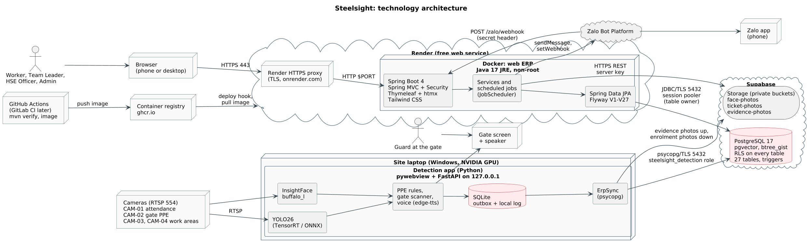

*Figure 1: Technology architecture*  
[Image Detail](docs/diagrams/png/1-1-architecture.png) · [PlantUML source](docs/diagrams/src/1-1-architecture.puml)

#### 1.1.2 Technology Stack and Component Matrix

| Layer | Component/Tool | Tech/Version | Description | Purpose |
| --- | --- | --- | --- | --- |
| Frontend | Page templates | Thymeleaf 3.1.3 | HTML pages rendered on the server, with no separate frontend app | Keeps the frontend inside the Spring Boot app, so there's one thing to build and deploy |
| Frontend | Security in templates | thymeleaf-extras-springsecurity6 3.1.3 | Shows or hides links and buttons by the signed-in user's permissions | Users only see the actions they're allowed to take |
| Frontend | Partial page updates | htmx 2.0.7, htmx-spring-boot-thymeleaf 5.1.0 | Links and forms swap the page content instead of reloading the whole page | Removes the blink and full reload on every click and form submit |
| Frontend | Styling | Tailwind CSS 4.1.13 | Utility CSS, built once into `static/css/app.css` and committed | Responsive layout, Odoo-style look, and light and dark themes |
| Frontend | Icons | Lucide (lucide-static 0.544.0) | One SVG sprite built by `scripts/build-icons.mjs` | Consistent icons for the sidebar, bell and buttons |
| Frontend | Page script | Plain JavaScript (`static/js/app.js`) | Theme toggle, mobile sidebar and closing the account menu | Small interactions with no framework |
| Frontend | Languages | Spring `MessageSource`, `messages.properties` and `messages_vi.properties` | Every label in English and Vietnamese; the choice is kept in a cookie for a year | Supports Vietnamese and English speakers |
| Frontend | Dashboard charts | Server-side bars (`web/Charts.java`) with CSS | Bars are worked out in Java and drawn with HTML and CSS | Informative dashboard with no chart library |
| Backend | Language and runtime | Java 17 (Eclipse Temurin in Docker) | The language the ERP is written in | Long-term support version the team knows |
| Backend | Application framework | Spring Boot 4.0.0 (Spring Framework 7.0.1) | Web app, configuration and dependency injection | The base of the ERP |
| Backend | Web layer | Spring Web MVC 7.0.1 on embedded Tomcat 11.0.14 | Page controllers and the Zalo webhook (the REST alert API was removed in V26, CR-02) | Serves pages to browsers and takes messages from the Zalo bot |
| Backend | Security | Spring Security 7.0.0, BCrypt | Sign-in by employee code, permission and scope checks, CSRF, an API key for `/api/**` | Each role only sees and changes what it's allowed to |
| Backend | Sign-in limit | Caffeine 3.2.3 | In-memory count of failed sign-ins | Slows password guessing on the public site |
| Backend | Data access | Spring Data JPA, Hibernate 7.1.8 | Entities and repositories over PostgreSQL | Reads and writes data without hand-written SQL for common cases |
| Backend | Connection pool | HikariCP 7.0.2 | Reuses database connections | Stays within Supabase's connection limit |
| Backend | Schema migrations | Flyway 11.14.1 | Versioned SQL migrations `V1` to `V27`, plus row level security after each run | Only the ERP changes the schema, in a repeatable order |
| Backend | JDBC driver | PostgreSQL JDBC 42.7.8 | Connects Java to PostgreSQL | Database access |
| Backend | JSON | Jackson 3.0.2 | Reads and writes JSON | Zalo webhook and Bot API bodies, notification parameters |
| Backend | Health check | Spring Boot Actuator 4.0.0 | Only `/actuator/health` is public | Render checks that a new release started before switching to it |
| Backend | Logging | SLF4J with Logback 1.5.21 | Request, error and sign-in logs, all sharing a request ID | Find what broke and for whom |
| Backend | Photo storage | Local disk or Supabase Storage REST API | `PhotoStorage` with a local version for development and a Supabase version for production, keeping ticket, face and evidence photos apart | Photos survive restarts on Render |
| Backend | Scheduled jobs | Spring `@Scheduled` (every 60 s) with a `job_run` table | Day end 23:00, morning 07:00, hourly (pending overtime, stale visits, completing ended shifts), Saturday 18:00 schedule, month end and month lock; each run is logged once and missed runs are caught up after Render wakes | Routine status changes happen without anyone clicking (CR-12) |
| Backend | Messaging | Zalo Bot Platform API over HTTPS, Spring `RestClient` | `sendMessage` to each linked user; a webhook takes the 6-digit link codes people send to the bot; retries after 1, 5 and 15 minutes | Notices reach people on Zalo; every notice is saved in the web ERP first (BR-15, BR-16) |
| Backend | QR code | qrcodegen 1.8.0 (Nayuki) | Draws the Zalo bot link as an inline SVG QR code on the server | Employees scan it with Zalo to open the bot and send their link code (CR-10) |
| Backend | Excel export | fastexcel 0.18.4 | Writes the monthly report as an `.xlsx` file by streaming, with the sheets Site summary, Office summary, Violations, Attendance and Absences (BR-71) | Team leaders send safety and attendance figures to accounting for pay and bonuses |
| Backend | Boilerplate | Lombok 1.18.42 | Generates getters, setters and constructors at compile time | Shorter entity and service code |
| Database | Relational database | PostgreSQL 17 | 27 tables, with triggers (violation suggestion and HSE alert, shift attachment, check-in and check-out notices, shift completion, notification delivery, zone codes) and `can_*` permission functions | The shared record for the ERP and the detection service |
| Database | Vector extension | pgvector | Stores face embeddings | Face matching at the gate, and suggestions in work zones |
| Database | Range extension | btree_gist | Supports an exclusion constraint | Stops a worker having overlapping shifts |
| Database | Row level security | PostgreSQL RLS | On for every table, with policies only for the detection role | Blocks Supabase's public Data API, and limits what detection can read and write |
| Detection | Language and app | Python 3.10, Windows desktop app (FastAPI + Uvicorn, pywebview window) | The detection app, run on the site laptop; its dashboard and gate screen are local web pages | Runs the computer vision models next to the cameras |
| Detection | PPE detection | YOLO26 (Ultralytics), TensorRT or ONNX Runtime | Finds people, hard hats and vests (gloves and harnesses are out of scope, OR-04) | Detects PPE violations |
| Detection | Face matching | InsightFace `buffalo_l` (SCRFD + ArcFace) | Confirms faces at the attendance camera and suggests the person on PPE cameras | Check-in by face (BR-28); suggestions for HSE (BR-47) |
| Detection | Voice | edge-tts, with Windows SAPI (pyttsx3) offline | Vietnamese reminders and alerts on the site speaker | Spoken reminders (BR-42) |
| Detection | Database access | psycopg 3 | Writes check-ins, check-outs and violations (with a suggested person) as the limited detection role | Sends detection results to the shared database |
| Detection | Local outbox and history | SQLite through SQLAlchemy 2 | Holds events while the internet is down, plus the local violation and gate log | Nothing is lost when the laptop is offline (BR-74) |
| Detection | Cameras | RTSP | CAM-01 attendance, CAM-02 gate PPE, CAM-03 and CAM-04 work zones; a zone can have several cameras | Video input |
| Hosting | ERP hosting | Render free web service | Runs the ERP container behind Render's HTTPS proxy | Public site with HTTPS and nothing to install |
| Hosting | Container image | Docker, multi-stage `Dockerfile` | Builds with the JDK and runs on the JRE as a non-root user, sized for 512 MB | The same image runs on Render and the laptop |
| Hosting | Production settings | `application-prod.yaml` | Secure cookie, template cache, small connection pool, Supabase Storage | Turned on by the Dockerfile, so production can't miss them |
| Hosting | Database hosting | Supabase, session pooler | Managed PostgreSQL over TLS and IPv4 | Reachable from both Render and the laptop |
| Hosting | File hosting | Supabase Storage, private buckets | `ticket-photos`, `face-photos` and `evidence-photos` (violation and check-in photos from the detection app) | Durable file storage that Render's disk can't provide |
| Hosting | Detection hosting | Site laptop, Windows, NVIDIA GPU | Installed with `setup.bat`, started with `run.bat` (a Windows app, not Docker) | The only machine with a GPU, next to the cameras |
| Hosting | Uptime monitor | External monitor calling `/actuator/health` every 5 minutes | Keeps the free Render service awake | Jobs and Zalo messages aren't delayed by Render sleeping (CR-13) |
| Hosting | Demo backup | Cloudflare Tunnel (`cloudflared`) | Exposes the ERP running on the laptop | Fallback if Render is too slow on demo day |
| CI/CD | Pipeline | GitLab CI/CD with a shared runner | Test, scan, build and deploy stages; merge requests stop after the scan | Only tested and scanned code reaches the live site |
| CI/CD | Code scan | Semgrep, in GitLab CI/CD | Static analysis of the code | Finds security bugs before merge |
| CI/CD | Dependency scan | Trivy, in GitLab CI/CD | Checks dependencies and the image for known vulnerabilities | Blocks known vulnerable libraries |
| CI/CD | Image registry | GitLab Container Registry | Stores the ERP image tagged by commit | Render pulls the exact image that was tested |
| CI/CD | Deploy | Render deploy hook, called by GitLab CI/CD from `main` | Tells Render which image to run | Releases happen only from the main branch |
| CI/CD | Testing and images, for now | GitHub Actions | Runs `mvn verify` on pushes and pull requests. From `master`, or by hand, it also builds the image and calls Render's deploy hook with that commit's tag | Keeps tests and releases running until the move to GitLab |
| CI/CD | Image registry, for now | GitHub Container Registry (`ghcr.io/owochiii/steelsight_erp`) | Holds the ERP image, tagged by commit, by branch, and `latest` for `master` | Render pulls the exact image that passed the tests |
| Testing | Test framework | JUnit 6.0.1, AssertJ 3.27.6, Hamcrest 3.0, Mockito 5.20.0 | Unit and integration tests | Check behaviour before every release |
| Testing | Real database in tests | Testcontainers 2.0.2 with `pgvector/pgvector:pg17` | Starts a real PostgreSQL for the tests | Tests the triggers, constraints and functions that an in-memory database can't run |
| Testing | Excel checks | fastexcel-reader 0.18.4 | Reads the exported report back in tests | Checks the figures accounting will see |
| Testing | Web tests | Spring MockMvc, Spring Security Test | Calls pages and the API as each role | Checks permissions and pages without a browser |
| Build | Java build | Maven 3.10.0 through the Maven Wrapper | Compiles, tests and packages the ERP | Same build on every machine and in CI |
| Build | Frontend build | Node.js with the Tailwind CLI | Builds the stylesheet and icon sprite, whose output is committed | Only needed when styles change, not to build the app |
| Integrations | Zalo | Zalo Bot Platform (bot.zaloplatforms.com) | The SteelSight bot; set up with `ZALO_BOT_TOKEN`, `ZALO_BOT_LINK`, `ZALO_WEBHOOK_SECRET`, `ZALO_WEBHOOK_URL` | The only outside messaging channel (Telegram was removed) |
| Integrations | Email, planned | Email API over HTTPS | Password reset and notices | Render blocks SMTP ports, so email has to go over HTTPS |

*Table 2: Technology Stack and Component Matrix*

#### 1.1.3 Communication Protocols and Ports

| Protocol | Port | Source -> Destination | Description |
| --- | --- | --- | --- |
| HTTPS | 443 | Browser -> Render proxy | Users open the ERP; Render holds the TLS certificate for the onrender.com address |
| HTTP | Render's `PORT` (8080 locally) | Render proxy -> ERP | Render ends TLS and forwards the request to the container; the app listens on whatever port Render gives it |
| PostgreSQL over TLS (JDBC) | 5432 | ERP -> Supabase session pooler | The ERP's database connection, as the table owner |
| PostgreSQL over TLS (psycopg) | 5432 | Detection app -> Supabase session pooler | Writes check-ins, check-outs and violations, as the limited detection role |
| HTTPS (REST) | 443 | ERP -> Supabase Storage | Uploads, reads and deletes ticket and face photos, and reads evidence photos, with the server key |
| HTTPS (REST) | 443 | ERP -> Zalo Bot API (`bot-api.zaloplatforms.com`) | `sendMessage` for each notice, and `setWebhook` at startup |
| HTTPS (webhook) | 443 | Zalo -> ERP `/zalo/webhook` | Messages people send to the bot (link codes), with the `X-Bot-Api-Secret-Token` header |
| HTTPS | 443 | Uptime monitor -> ERP `/actuator/health` | Every 5 minutes, so the free service stays awake |
| HTTPS (REST) | 443 | Detection app -> Supabase Storage | Uploads violation and check-in photos to `evidence-photos`, downloads enrolment photos |
| RTSP | 554 (camera default) | Cameras -> Detection app | Video from the attendance, gate PPE and work-zone cameras, on the site network |
| HTTPS | 443 | Browser -> ERP -> Supabase Storage | Photos go through the ERP, which checks permission before fetching them |
| HTTP | Render's `PORT` | Render -> ERP `/actuator/health` | Render checks inside its network that a new release started, before switching traffic to it |
| HTTPS | 443 | GitLab CI/CD -> Render deploy hook | Starts a deploy after the pipeline passes on `main` |
| HTTPS | 443 | Render -> GitHub Container Registry | Render pulls the ERP image tagged by commit; GitLab Container Registry after the move |
| HTTPS | 443 | Developer or laptop -> GitLab | `git pull` and `git push`; the laptop only connects outwards, with no open ports |
| HTTPS | 443 | GitHub Actions runner -> GitHub | Runs the tests on each push and pull request while the code is on GitHub |
| HTTPS | 443 | ERP -> Email API | **Planned:** password reset and notices; Render blocks SMTP ports |
| QUIC or HTTP/2 (Cloudflare Tunnel) | 7844 outbound | Laptop -> Cloudflare | **Demo backup only:** exposes the ERP running on the laptop with no open ports |
| PostgreSQL | 55433 | ERP -> local Docker database | **Development only:** the `steelsight-db` container on the developer's machine |
| PostgreSQL | Random | Tests -> Testcontainers database | **Tests only:** a throwaway pgvector database for each test run |

*Table 3: Communication Protocols and Ports*

#### 1.1.4 Software Architecture

The web ERP is a single Spring Boot application in six layers. A request goes down the layers and
never skips one: pages never reach the database except through a service.

1. **Client layer:** the browser shows server-rendered HTML (Thymeleaf), swaps parts of a page with htmx
   and is styled with the committed Tailwind stylesheet. There is no separate frontend application.
2. **Web layer** (`web`): page controllers, form objects and helpers (`Display`, `SiteTime`, `Charts`,
   `MonthlyReportWorkbook`), and `ZaloController` for the bot's webhook. Controllers hold no business rule.
3. **Security layer** (`security`): two filter chains, one for the pages (form login by employee code,
   CSRF, sessions, the sign-in limit and the forced password change) and one for `/api/**` (API key).
4. **Business layer** (the feature packages `identity`, `scheduling`, `attendance`, `ppe`, `ticketing`,
   `notification`, `reporting`, `jobs`): services with the business rules and transactions; every
   record-level check goes through `AccessPolicy`.
5. **Persistence layer:** Spring Data JPA repositories, `JdbcTemplate` for set-based queries, and
   `PhotoStorage` for files.
6. **Data layer:** PostgreSQL 17 on Supabase, which also enforces rules with triggers, constraints, the
   `can_*()` permission functions, `safety_scores()` and row level security; and Supabase Storage.

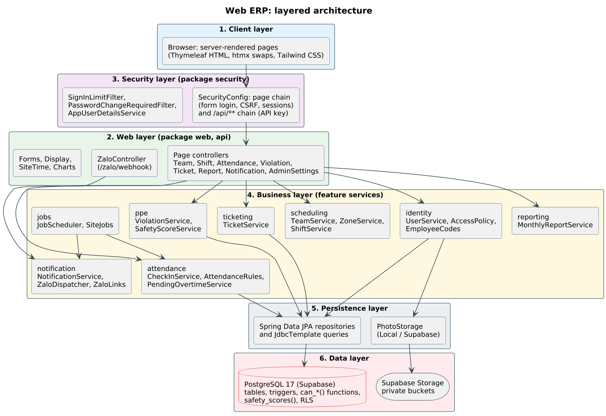

*Figure 2: Layered software architecture of the web ERP*  
[Image Detail](docs/diagrams/png/1-2-layers.png) · [PlantUML source](docs/diagrams/src/1-2-layers.puml)

#### 1.1.5 Monitoring Zones and Cameras

The site is divided into monitoring zones, each with a fixed code (V26):

| Code | Kind | Cameras | What happens there |
| --- | --- | --- | --- |
| GATE-IN | GATE_ATTENDANCE | CAM-01 | Face check-in and check-out (BR-27 to BR-29) |
| GATE-PPE | GATE_PPE | CAM-02 | PPE check at the gate; the person is suggested from the latest gate scan (BR-46) |
| AREA-A, AREA-B | WORK_AREA | CAM-03, CAM-04 | PPE monitoring in the work areas; each area belongs to a team, and HSE picks the person from that team first |

*Table 4: Monitoring Zones and Cameras*

A zone can have several cameras, and each camera's role (ATTENDANCE or PPE) follows its zone. This
differs from the SRS, which has one camera per zone (team decision).

### 1.2 Package Diagram

#### 1.2.1 Web ERP

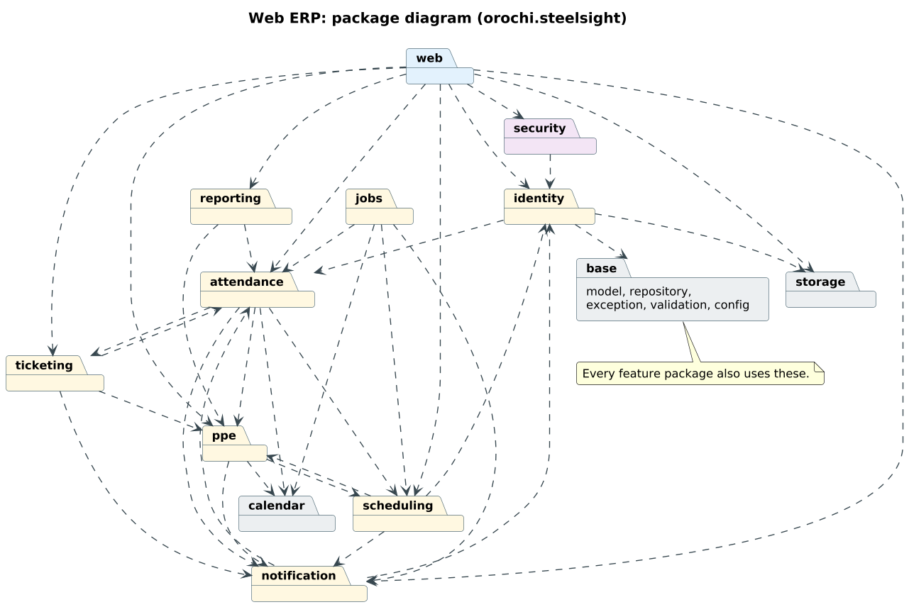

*Figure 3: Package diagram of the web ERP*  
[Image Detail](docs/diagrams/png/1-3-erp-packages.png) · [PlantUML source](docs/diagrams/src/1-3-erp-packages.puml)

The ERP is one Spring Boot application, `orochi.steelsight`, split by feature. Each feature package has
its own `model` (JPA entities), `repository` (Spring Data) and `service` (business rules and
transactions). The `web` package holds the page controllers and form objects, with no business rule.
Arrows are dependencies, taken from the imports in the code. Every feature package also uses the base
packages (`model`, `repository`, `exception`, `validation`), which aren't drawn.

The features aren't strictly layered. Some depend on each other both ways: `attendance` and `ticketing`
(a ticket approves a correction, and a correction names its ticket), `scheduling` and `ppe` (zones and
cameras), `identity` and `attendance` (face enrolment), and `notification` with the features it
describes. Several packages also use `web.SiteTime` for the site's time zone, `security` uses
`web.RequestLogFilter`, and `scheduling` reads `web.ShiftForm`. Moving `SiteTime` into `calendar`
would remove most of the arrows back to `web`.

| No | Package | Description |
| --- | --- | --- |
| 01 | `config` | Locale (English and Vietnamese, kept in a cookie), BCrypt password encoder, `@EnableScheduling` |
| 02 | `security` | `SecurityConfig` with two filter chains (`/api/**` and the pages), `AppUserDetailsService` (permission codes as authorities), `SignInLimiter` and `SignInLimitFilter`, `PasswordChangeRequiredFilter`, `FirstSignInHandler`, `UserSessions`, `AdminBootstrap`, `ApiKeyFilter` and `ApiLimiter` |
| 03 | `web` | Page controllers that return Thymeleaf pages or htmx fragments, the form objects, `Display`, `SiteTime`, `Charts` (dashboard bars in HTML and CSS), `QrCodes`, `MonthlyReportWorkbook` (.xlsx), request logging and error pages |
| 04 | `identity` | `AppUser`, `Role`, `Permission`, `StaffGroup`; `UserService`, `AccessPolicy` (every "may this user do this to that record" check), `Permissions`, `CompanySettings` |
| 05 | `scheduling` | `Team`, `Zone`, `ZoneKind`, `Shift`, `ShiftKind`, `ShiftStatus`; `TeamService`, `ZoneService`, `ShiftService` |
| 06 | `attendance` | `CheckIn`, `CheckInCorrection`, `FaceEmbedding`, `FacePose`; `CheckInService`, `AttendanceRules` (late and early), `AttendanceCalculator` and `ShiftAttendance` (paid hours), `CheckOutHours`, `PendingOvertimeService` |
| 07 | `ppe` | `Camera`, `Violation`, `ReviewStatus`, `ViolationType`, `DismissReason`, `DisputeStatus`, `SafetyLevel`; `ViolationService`, `SafetyScoreService` |
| 08 | `ticketing` | `Ticket`, `TicketCategory`, `CategoryCode`, `TicketComment`, `TicketStatus`, `TicketOutcome`; `TicketService` |
| 09 | `notification` | `Notification`, `NotificationKind`; `NotificationService`, `Notices`, `NoticeText`, `ZaloDispatcher`; the `zalo` sub-package: `ZaloBot`, `ZaloLinks`, `ZaloStore`, `ZaloCommands` |
| 10 | `reporting` | `MonthlyReportService`: the month's figures for the report and the export log |
| 11 | `storage` | `PhotoStorage` with `LocalPhotoStorage` (development) and `SupabasePhotoStorage` (production); `PhotoAlbum` keeps faces, tickets and evidence apart |
| 12 | `calendar` | `SiteCalendar` (Vietnam time, working days) and `MonthLocks` |
| 13 | `jobs` | `JobScheduler` (every 60 seconds, with the `job_run` log) and `SiteJobs` (the jobs of SRS 3.2.38) |
| 14 | `model`, `repository`, `exception`, `validation` | Base entities (id equality, timestamps, soft delete, version), base repositories, `BusinessRuleException`, `NotFoundException`, `StaleEditException`, text checks |
| 15 | resources | `templates/` (Thymeleaf), `static/css/app.css` (Tailwind), `static/js/app.js`, the icon sprite, `messages.properties` and `messages_vi.properties`, `db/migration` V1 to V27 (Flyway) |

*Table 5: Web ERP*

#### 1.2.2 Detection App

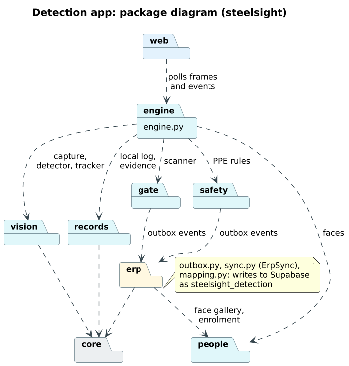

*Figure 4: Package diagram of the detection app*  
[Image Detail](docs/diagrams/png/1-4-detection-packages.png) · [PlantUML source](docs/diagrams/src/1-4-detection-packages.puml)

The detection app lives in its own repository (`steelsight-demo`); its own design is in that
repository's `03_implement/STEELSIGHT-DET-*-IMP-001_TDS.md`.

| No | Package | Description |
| --- | --- | --- |
| 01 | `steelsight/engine.py` | Starts the camera threads and the batched inference loop |
| 02 | `core` | Settings (`settings.json`), the local SQLite database, shared domain types |
| 03 | `vision` | RTSP and webcam capture keeping only the newest frame, camera discovery, the YOLO26 detector (TensorRT, ONNX Runtime or PyTorch), the tracker, drawing |
| 04 | `people` | Face recognition (InsightFace), identity of tracked people, local vest markers |
| 05 | `gate` | The gate scanner (check-in and check-out decision) and the gate screen |
| 06 | `safety` | The PPE rules and timers (BR-40 to BR-45), the alarm and the Vietnamese voice (edge-tts, pyttsx3) |
| 07 | `records` | Local violation history, evidence photos, reports, disk clean-up |
| 08 | `erp` | `outbox.py` (local outbox), `sync.py` (writes to Supabase as `steelsight_detection`, uploads photos, enrols faces, calls `close_stale_check_ins()`), `mapping.py` (local events to ERP rows) |
| 09 | `web` | The FastAPI routes and pages of the desktop window: live view, gate log, violation history, cameras, settings, local sign-in |

*Table 6: Detection App*

### 1.3 Deployment Diagram

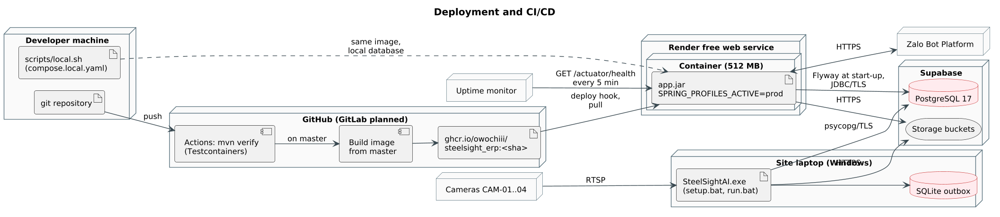

*Figure 5: Deployment diagram*  
[Image Detail](docs/diagrams/png/1-5-deployment.png) · [PlantUML source](docs/diagrams/src/1-5-deployment.puml)

| # | Node | Description |
| --- | --- | --- |
| 1 | Render free web service | One container of the ERP image (Java 17 JRE, non-root, sized for 512 MB) behind Render's HTTPS proxy, on `$PORT`. Render checks `/actuator/health` before switching to a new release. Flyway migrates the schema at start-up. The service sleeps after 15 minutes idle; an uptime monitor keeps it awake |
| 2 | Supabase | PostgreSQL 17 with pgvector and btree_gist, reached through the session pooler over TLS; private Storage buckets |
| 3 | Site laptop | Windows with an NVIDIA GPU. The detection app is installed with `setup.bat` and started with `run.bat`, or packaged as `SteelSightAI.exe` |
| 4 | Cameras | Hikvision IP cameras on the site network, RTSP on port 554: CAM-01 attendance, CAM-02 gate PPE, CAM-03 and CAM-04 work areas |
| 5 | Zalo Bot Platform | The Steelsight bot. The ERP registers its webhook at start-up |
| 6 | GitHub (for now) | GitHub Actions runs `mvn verify` on every push and pull request; from `master` it builds the image into `ghcr.io/owochiii/steelsight_erp` and calls Render's deploy hook |
| 7 | GitLab (planned main repository) | The same pipeline with Semgrep and Trivy scans, the GitLab Container Registry and deploys from `main` |
| 8 | Cloudflare Tunnel (demo backup) | Exposes an ERP running on the laptop if Render is too slow on demo day |

*Table 7: Deployment Diagram*

Release order: deploy the ERP before a detection app that depends on a new migration, because only the
ERP changes the schema.

## 2. Database Design

### 2.1 Overall

The Steelsight database has 27 tables in 7 logical domains, stored in PostgreSQL 17 on Supabase with the
pgvector and btree_gist extensions. It is the shared record for the web ERP and the detection app. Only
the ERP changes the schema, with the Flyway migrations V1 to V27 in `src/main/resources/db/migration`.
This document describes the schema after V27, which changed only role permissions after V26.

V26 applied the data model of the SRS (3.1.5, CR-01, CR-02, CR-23): the vest tables `ppe_vest` and
`ppe_linking`, the burst alert table `safety_alert` and the column `team.late_after_minutes` are gone,
and each zone has a fixed `code`.

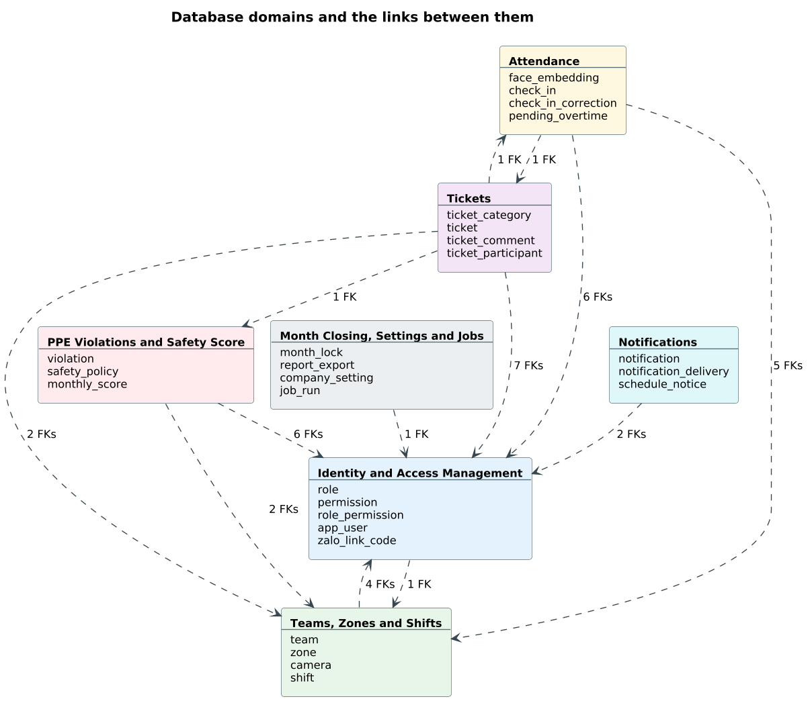

*Figure 6: Database domains and the links between them*  
[Image Detail](docs/diagrams/png/2-0-domains.png) · [PlantUML source](docs/diagrams/src/2-0-domains.puml)

The overview shows the main links only. Every table and all 52 foreign keys are in the domain diagrams
of Section 2.2. The tables `safety_policy`, `company_setting`, `month_lock` and `job_run` have no foreign
keys.

| No. | Domain | Tables | Description |
| --- | --- | --- | --- |
| 1 | Identity and Access Management | role, permission, role_permission, app_user, zalo_link_code | User accounts, what each role may do, and the link of each person's Zalo chat. |
| 2 | Teams, Zones and Shifts | team, zone, camera, shift | Teams with their leader, the monitoring zones and their cameras, and the timetable. |
| 3 | Attendance | face_embedding, check_in, check_in_correction, pending_overtime | Face enrolment, every site visit, every hand correction of one, and time worked after a shift. |
| 4 | PPE Violations and Safety Score | violation, safety_policy, monthly_score | The violations the cameras find, their review and appeal, and each site employee's monthly score. |
| 5 | Tickets | ticket_category, ticket, ticket_comment, ticket_participant | Requests to the Admin: PPE appeals, attendance errors, missing check-outs, leave and others. |
| 6 | Notifications | notification, notification_delivery, schedule_notice | Every notice saved in the ERP first, its Zalo delivery, and which schedules were sent. |
| 7 | Month Closing, Settings and Jobs | month_lock, report_export, company_setting, job_run | Locked months, the log of report exports, company options and the run log of scheduled jobs. |

*Table 8: Overall*

In the field tables, Field Size gives bytes for fixed-size types and precision,scale for numeric, and
Variable means no declared limit. Unique says Partial when uniqueness applies only to some rows, and the
description gives the condition. Every `created_at`, `updated_at`, `corrected_at` and similar column
defaults to now(), and every `updated_at` is set by a trigger.

### 2.2 Data Dictionary

#### 2.2.1 Identity and Access Management

Each user has one role, and a role holds many permissions, one row per action. The seeded roles are
WORKER, MANAGER (team leader), HSE_OFFICER and ADMIN, and the Admin holds every permission. Only the
Admin creates or changes accounts and face photos. Users sign in with their employee code. A person
links their own Zalo chat with a one-time code; from then on every notice is also sent there.

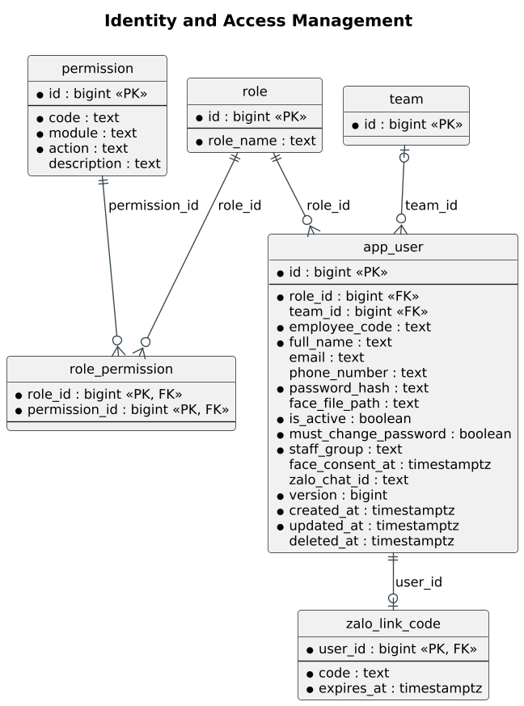

*Figure 7: Entity relationship diagram: Identity and Access Management*  
[Image Detail](docs/diagrams/png/2-1-erd.png) · [PlantUML source](docs/diagrams/src/2-1-erd.puml)

##### 2.2.1.1 role

The job roles a user can hold. Seeded by the migrations; there is no screen to change them.

| No. | Field Name | Data Type | Field Size | P/F Key | Nullable | Unique | Description |
| --- | --- | --- | --- | --- | --- | --- | --- |
| 1 | id | bigint | 8 bytes | PK | No | Yes | Generated role ID |
| 2 | role_name | text | Variable |  | No | Yes | WORKER, MANAGER, HSE_OFFICER or ADMIN |

*Table 9: role*

##### 2.2.1.2 permission

One action in the system, such as TICKET_CREATE.

| No. | Field Name | Data Type | Field Size | P/F Key | Nullable | Unique | Description |
| --- | --- | --- | --- | --- | --- | --- | --- |
| 1 | id | bigint | 8 bytes | PK | No | Yes | Generated permission ID |
| 2 | code | text | Variable |  | No | Yes | Code loaded by Spring Security as an authority |
| 3 | module | text | Variable |  | No | No | Area the action belongs to, such as TICKET, SHIFT, VIOLATION, USER, CHECKIN or REPORT |
| 4 | action | text | Variable |  | No | No | Type of action, such as READ, CREATE, UPDATE, DELETE, REVIEW or MANAGE |
| 5 | description | text | Variable |  | Yes | No | Plain-language explanation of the permission |

*Table 10: permission*

##### 2.2.1.3 role_permission

Links each role to the permissions it holds.

| No. | Field Name | Data Type | Field Size | P/F Key | Nullable | Unique | Description |
| --- | --- | --- | --- | --- | --- | --- | --- |
| 1 | role_id | bigint | 8 bytes | PK, FK → role(id) | No | Composite | The role; deleted with it |
| 2 | permission_id | bigint | 8 bytes | PK, FK → permission(id) | No | Composite | The permission; deleted with it |

*Table 11: role_permission*

##### 2.2.1.4 app_user

Every person who uses the system.

| No. | Field Name | Data Type | Field Size | P/F Key | Nullable | Unique | Description |
| --- | --- | --- | --- | --- | --- | --- | --- |
| 1 | id | bigint | 8 bytes | PK | No | Yes | Generated user ID |
| 2 | role_id | bigint | 8 bytes | FK → role(id) | No | No | The user's role |
| 3 | team_id | bigint | 8 bytes | FK → team(id) | Yes | No | The team of a site worker or team leader |
| 4 | employee_code | text | Variable |  | No | Yes | Employee code used to sign in (BR-06) |
| 5 | full_name | text | Variable |  | No | No | Full name |
| 6 | email | text | Variable |  | Yes | Yes | Email address |
| 7 | phone_number | text | Variable |  | Yes | No | Phone number, 10 digits (BR-06) |
| 8 | password_hash | text | Variable |  | No | No | BCrypt hash of the password; never the password itself |
| 9 | face_file_path | text | Variable |  | Yes | No | The FRONT face photo in the private face photo bucket; only the Admin sets it |
| 10 | is_active | boolean | 1 byte |  | No | No | False blocks sign-in; defaults to true |
| 11 | must_change_password | boolean | 1 byte |  | No | No | True when the Admin chose the password; the user must pick their own at the next sign-in (BR-03). Defaults to false |
| 12 | staff_group | text | Variable |  | No | No | SITE (default) or OFFICE. Only SITE staff have a safety score; an OFFICE violation is a reminder (BR-56, CR-08) |
| 13 | face_consent_at | timestamptz | 8 bytes |  | Yes | No | When the Admin confirmed the signed consent to face recognition (BR-10, BR-11) |
| 14 | zalo_chat_id | text | Variable |  | Yes | Partial | The user's own Zalo chat; unique when set (BR-14). Empty means no Zalo messages |
| 15 | version | bigint | 8 bytes |  | No | No | Optimistic lock counter; defaults to 0 |
| 16 | created_at | timestamptz | 8 bytes |  | No | No | When the row was created |
| 17 | updated_at | timestamptz | 8 bytes |  | No | No | When the row last changed |
| 18 | deleted_at | timestamptz | 8 bytes |  | Yes | No | When the user was soft-deleted; a trigger then erases their face embeddings (BR-07) |

*Table 12: app_user*

##### 2.2.1.5 zalo_link_code

The one-time code that links a user's Zalo chat (BR-13). The user sends it to the Steelsight bot, and
Zalo passes it to the ERP's webhook.

| No. | Field Name | Data Type | Field Size | P/F Key | Nullable | Unique | Description |
| --- | --- | --- | --- | --- | --- | --- | --- |
| 1 | user_id | bigint | 8 bytes | PK, FK → app_user(id) | No | Yes | Whose chat the code links. One code per user, and a new one replaces the old. Deleted with the user |
| 2 | code | text | Variable |  | No | Yes | 6 random digits; used up when the chat is linked |
| 3 | expires_at | timestamptz | 8 bytes |  | No | No | 24 hours after the code was made |

*Table 13: zalo_link_code*

#### 2.2.2 Teams, Zones and Shifts

Each team has at most one leader, a MANAGER, and a manager leads at most one team (BR-20). The site is
divided into monitoring zones: the gate attendance zone, the gate PPE zone and the work areas. A zone
can have several cameras, and a work area belongs to the team that works there, so HSE picks a violator
from that team first (team decision; the SRS says one camera per zone). A shift is one planned work
period of one person; a day off is a day with no shift.

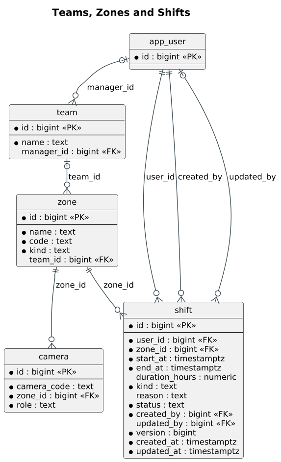

*Figure 8: Entity relationship diagram: Teams, Zones and Shifts*  
[Image Detail](docs/diagrams/png/2-2-erd.png) · [PlantUML source](docs/diagrams/src/2-2-erd.puml)

##### 2.2.2.1 team

A group of site workers under one leader. The late tolerance is 5 minutes for every team (BR-31), so
teams no longer have their own (V26).

| No. | Field Name | Data Type | Field Size | P/F Key | Nullable | Unique | Description |
| --- | --- | --- | --- | --- | --- | --- | --- |
| 1 | id | bigint | 8 bytes | PK | No | Yes | Generated team ID |
| 2 | name | text | Variable |  | No | Yes | Team name |
| 3 | manager_id | bigint | 8 bytes | FK → app_user(id) | Yes | Partial | The team leader; unique when set, so a manager leads one team |

*Table 14: team*

##### 2.2.2.2 zone

A monitoring zone, used by cameras, shifts, violations and tickets.

| No. | Field Name | Data Type | Field Size | P/F Key | Nullable | Unique | Description |
| --- | --- | --- | --- | --- | --- | --- | --- |
| 1 | id | bigint | 8 bytes | PK | No | Yes | Generated zone ID |
| 2 | name | text | Variable |  | No | Yes | The name every alert, report and Zalo message uses; 2 to 50 characters; the Admin can change it (BR-55) |
| 3 | code | text | Variable |  | No | Yes | Fixed code: GATE-IN, GATE-PPE, AREA-A, AREA-B ... The database gives the next free code of the kind when a zone is added and refuses any change, because the desktop app's camera settings name the zone by it (SRS 3.2.23, 3.2.30; V26) |
| 4 | kind | text | Variable |  | No | No | GATE_ATTENDANCE, GATE_PPE or WORK_AREA (default) |
| 5 | team_id | bigint | 8 bytes | FK → team(id) | Yes | No | The team that works in this area; only a WORK_AREA can have one. Set to empty if the team is deleted |

*Table 15: zone*

##### 2.2.2.3 camera

A site camera and the zone it watches.

| No. | Field Name | Data Type | Field Size | P/F Key | Nullable | Unique | Description |
| --- | --- | --- | --- | --- | --- | --- | --- |
| 1 | id | bigint | 8 bytes | PK | No | Yes | Generated camera ID |
| 2 | camera_code | text | Variable |  | No | Yes | The code entered for the camera in the desktop app, such as CAM-01 |
| 3 | zone_id | bigint | 8 bytes | FK → zone(id) | No | No | Zone the camera covers |
| 4 | role | text | Variable |  | No | No | ATTENDANCE for a camera in the gate attendance zone (BR-27), PPE (default) for every other |

*Table 16: camera*

##### 2.2.2.4 shift

One planned work period of one person. An exclusion constraint refuses two overlapping shifts of one
person that aren't cancelled (BR-22).

| No. | Field Name | Data Type | Field Size | P/F Key | Nullable | Unique | Description |
| --- | --- | --- | --- | --- | --- | --- | --- |
| 1 | id | bigint | 8 bytes | PK | No | Yes | Generated shift ID |
| 2 | user_id | bigint | 8 bytes | FK → app_user(id) | No | No | The person working |
| 3 | zone_id | bigint | 8 bytes | FK → zone(id) | No | No | Where the person is assigned |
| 4 | start_at | timestamptz | 8 bytes |  | No | No | Shift start |
| 5 | end_at | timestamptz | 8 bytes |  | No | No | Shift end; after the start, and 30 minutes to 12 hours long (BR-21) |
| 6 | duration_hours | numeric | Variable |  | Yes | No | Length in hours; generated by the database from start and end |
| 7 | kind | text | Variable |  | No | No | REGULAR (default) or OVERTIME (BR-23) |
| 8 | reason | text | Variable |  | Yes | No | Why the overtime is needed; required for OVERTIME, 10 to 500 characters |
| 9 | status | text | Variable |  | No | No | SCHEDULED (default), COMPLETED or CANCELLED. COMPLETED is set at check-out (V25) or by a job once the shift ends |
| 10 | created_by | bigint | 8 bytes | FK → app_user(id) | No | No | Who created the shift |
| 11 | updated_by | bigint | 8 bytes | FK → app_user(id) | Yes | No | Who last changed the shift |
| 12 | version | bigint | 8 bytes |  | No | No | Optimistic lock counter; defaults to 0 |
| 13 | created_at | timestamptz | 8 bytes |  | No | No | When the row was created |
| 14 | updated_at | timestamptz | 8 bytes |  | No | No | When the row last changed |

*Table 17: shift*

#### 2.2.3 Attendance

Enrolment runs through `face_embedding`: the ERP queues a photo, and the detection app computes the
vector. A `check_in` row is one site visit, written by the detection app when a face is matched at the
gate, or entered by hand by an HSE Officer. A hand correction keeps what the visit said before in
`check_in_correction`, because visits feed the monthly report. Time worked after a shift without an
overtime shift waits in `pending_overtime` for the Admin.

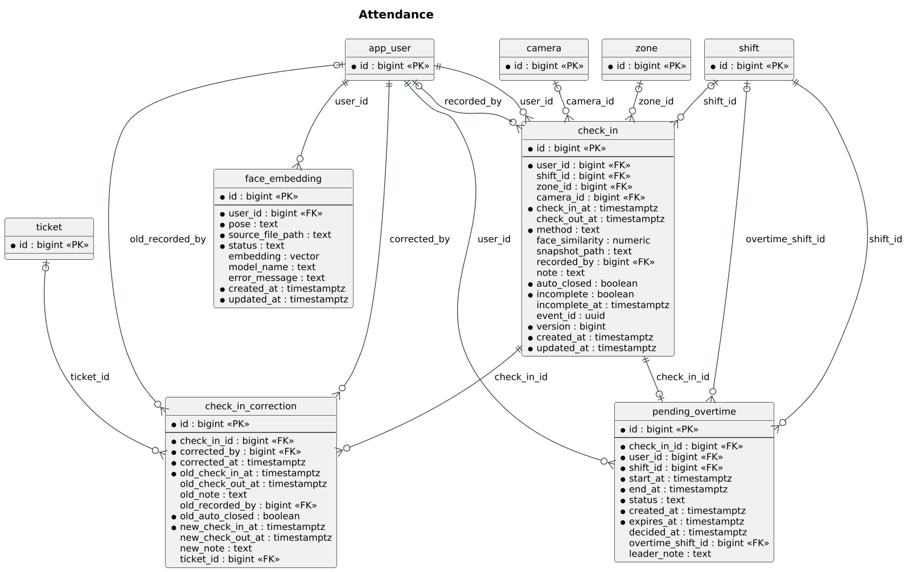

*Figure 9: Entity relationship diagram: Attendance*  
[Image Detail](docs/diagrams/png/2-3-erd.png) · [PlantUML source](docs/diagrams/src/2-3-erd.puml)

##### 2.2.3.1 face_embedding

One row per person and angle, which is also the enrolment queue. Every enrolled person has a FRONT row,
the photo on their account. The Admin can add LEFT and RIGHT photos, so the gate camera still knows a
person who isn't looking straight at it; the detection app keeps the best score of all READY rows (V14).
Face vectors are biometric data: the rows are erased when the account is soft-deleted (BR-07).

| No. | Field Name | Data Type | Field Size | P/F Key | Nullable | Unique | Description |
| --- | --- | --- | --- | --- | --- | --- | --- |
| 1 | id | bigint | 8 bytes | PK | No | Yes | Generated row ID |
| 2 | user_id | bigint | 8 bytes | FK → app_user(id) | No | Yes, with pose | The person; the rows are deleted with the user |
| 3 | pose | text | Variable |  | No | Yes, with user_id | FRONT (default), LEFT or RIGHT |
| 4 | source_file_path | text | Variable |  | No | No | The photo this row was made from, in the private face photo bucket |
| 5 | status | text | Variable |  | No | No | PENDING (default), READY or FAILED |
| 6 | embedding | vector | 512 dimensions |  | Yes | No | InsightFace vector; required when READY |
| 7 | model_name | text | Variable |  | Yes | No | Model that made the vector, because vectors of different models don't compare; required when READY |
| 8 | error_message | text | Variable |  | Yes | No | Why enrolment failed, such as no face found |
| 9 | created_at | timestamptz | 8 bytes |  | No | No | When the row was created |
| 10 | updated_at | timestamptz | 8 bytes |  | No | No | When the row last changed |

*Table 18: face_embedding*

##### 2.2.3.2 check_in

One visit to site, from check-in to check-out. A trigger attaches a new visit to the person's own shift
when it starts at most 60 minutes before the shift and before its end (BR-30), and closes any visit of
the person still open from an earlier day.

| No. | Field Name | Data Type | Field Size | P/F Key | Nullable | Unique | Description |
| --- | --- | --- | --- | --- | --- | --- | --- |
| 1 | id | bigint | 8 bytes | PK | No | Yes | Generated visit ID |
| 2 | user_id | bigint | 8 bytes | FK → app_user(id) | No | Partial | The person; unique among open visits, so a person is checked in only once at a time |
| 3 | shift_id | bigint | 8 bytes | FK → shift(id) | Yes | No | The shift of the visit; must belong to the same person |
| 4 | zone_id | bigint | 8 bytes | FK → zone(id) | Yes | No | Zone of the visit |
| 5 | camera_id | bigint | 8 bytes | FK → camera(id) | Yes | No | Camera that recognised the face; empty for a visit entered by hand |
| 6 | check_in_at | timestamptz | 8 bytes |  | No | No | Arrival time; defaults to now |
| 7 | check_out_at | timestamptz | 8 bytes |  | Yes | No | Departure time; after the check-in; empty means still on site |
| 8 | method | text | Variable |  | No | No | FACE (default) or MANUAL |
| 9 | face_similarity | numeric | 5,2 |  | Yes | No | Face match score from 0 to 100; required for FACE |
| 10 | snapshot_path | text | Variable |  | Yes | No | The face image taken at the gate |
| 11 | recorded_by | bigint | 8 bytes | FK → app_user(id) | Yes | No | Who entered or last corrected the visit; required for MANUAL |
| 12 | note | text | Variable |  | Yes | No | Free-text note, such as the reason for a hand entry |
| 13 | auto_closed | boolean | 1 byte |  | No | No | True when the system closed the visit because nobody checked out; its check_out_at is only the moment of closing and is never paid (BR-35). Defaults to false |
| 14 | incomplete | boolean | 1 byte |  | No | No | True for Incomplete attendance: no check-out 20 minutes after the shift end (BR-35). Defaults to false |
| 15 | incomplete_at | timestamptz | 8 bytes |  | Yes | No | When the visit was flagged Incomplete; set exactly when incomplete is true |
| 16 | event_id | uuid | 16 bytes |  | Yes | Yes | Outbox event ID from the detection app; makes retries safe (BR-74) |
| 17 | version | bigint | 8 bytes |  | No | No | Optimistic lock, so a stale correction fails; a trigger also counts changes made with plain SQL. Defaults to 0 |
| 18 | created_at | timestamptz | 8 bytes |  | No | No | When the row was created |
| 19 | updated_at | timestamptz | 8 bytes |  | No | No | When the row last changed |

*Table 19: check_in*

##### 2.2.3.3 check_in_correction

What one hand correction of a visit changed (BR-39). Rows are only ever added.

| No. | Field Name | Data Type | Field Size | P/F Key | Nullable | Unique | Description |
| --- | --- | --- | --- | --- | --- | --- | --- |
| 1 | id | bigint | 8 bytes | PK | No | Yes | Generated correction ID |
| 2 | check_in_id | bigint | 8 bytes | FK → check_in(id) | No | No | The visit that was corrected |
| 3 | corrected_by | bigint | 8 bytes | FK → app_user(id) | No | No | Who made the correction |
| 4 | corrected_at | timestamptz | 8 bytes |  | No | No | When it was made |
| 5 | old_check_in_at | timestamptz | 8 bytes |  | No | No | Arrival time before |
| 6 | old_check_out_at | timestamptz | 8 bytes |  | Yes | No | Departure time before; empty means the visit was open |
| 7 | old_note | text | Variable |  | Yes | No | Note before |
| 8 | old_recorded_by | bigint | 8 bytes | FK → app_user(id) | Yes | No | Who had entered or corrected the visit before; empty for a face check-in nobody had changed |
| 9 | old_auto_closed | boolean | 1 byte |  | No | No | True when the system had closed the visit |
| 10 | new_check_in_at | timestamptz | 8 bytes |  | No | No | Arrival time after |
| 11 | new_check_out_at | timestamptz | 8 bytes |  | Yes | No | Departure time after; empty means still on site |
| 12 | new_note | text | Variable |  | Yes | No | Note after, with the reason |
| 13 | ticket_id | bigint | 8 bytes | FK → ticket(id) | Yes | No | The attendance error or missing check-out ticket that asked for the change |

*Table 20: check_in_correction*

##### 2.2.3.4 pending_overtime

Time worked after the shift end plus 20 minutes without an overtime shift (BR-34). It is paid at 0%
until the Admin adds an OVERTIME shift that covers it; it is cancelled after 48 hours or on the 2nd of
the next month, whichever is first (BR-37).

| No. | Field Name | Data Type | Field Size | P/F Key | Nullable | Unique | Description |
| --- | --- | --- | --- | --- | --- | --- | --- |
| 1 | id | bigint | 8 bytes | PK | No | Yes | Generated row ID |
| 2 | check_in_id | bigint | 8 bytes | FK → check_in(id) | No | Yes | The visit that ran over; one row per visit |
| 3 | user_id | bigint | 8 bytes | FK → app_user(id) | No | No | The person |
| 4 | shift_id | bigint | 8 bytes | FK → shift(id) | No | No | The shift that was overrun |
| 5 | start_at | timestamptz | 8 bytes |  | No | No | Start of the extra time: the shift end plus 20 minutes |
| 6 | end_at | timestamptz | 8 bytes |  | No | No | End of the extra time: the check-out; after start_at |
| 7 | status | text | Variable |  | No | No | PENDING (default), VALID or CANCELLED |
| 8 | created_at | timestamptz | 8 bytes |  | No | No | When the row was created |
| 9 | expires_at | timestamptz | 8 bytes |  | No | No | When a PENDING row is cancelled |
| 10 | decided_at | timestamptz | 8 bytes |  | Yes | No | When it became VALID or CANCELLED; empty exactly while PENDING |
| 11 | overtime_shift_id | bigint | 8 bytes | FK → shift(id) | Yes | No | The overtime shift that made it valid; set exactly when VALID (BR-38) |
| 12 | leader_note | text | Variable |  | Yes | No | The team leader's note for the Admin, up to 500 characters |

*Table 21: pending_overtime*

#### 2.2.4 PPE Violations and Safety Score

The detection app writes violations straight to the database. Every violation starts PENDING_REVIEW
with no person; the person the camera suggests is only a suggestion (BR-47, BR-48). An HSE Officer, or
the Admin, takes it, then confirms the person, marks a stranger, or dismisses it (BR-49 to BR-53). A
violation not reviewed the same day becomes OVERDUE. Only a confirmed violation of an employee counts,
and it can be appealed with a ticket (BR-64).

The monthly score of each active SITE employee with the role WORKER or MANAGER is 100 minus 5 points
for each confirmed violation that wasn't overturned (BR-56, BR-57). The `safety_scores()` function
works it out from the violation rows, so it returns to 100 on the 1st with no job. A locked month
reads the frozen rows of `monthly_score` instead (BR-70). The bonus level comes from the thresholds in
`safety_policy`; the reductions 2%, 4% and 6% are fixed in the ERP (`SafetyLevel`).

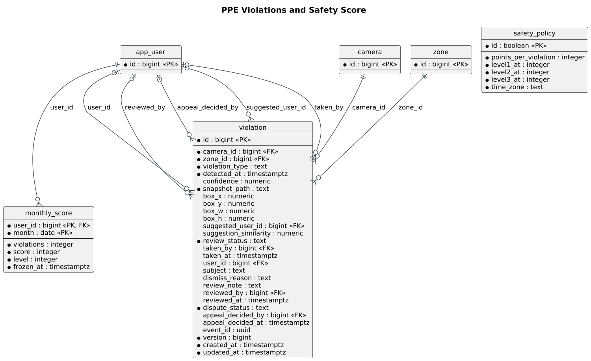

*Figure 10: Entity relationship diagram: PPE Violations and Safety Score*  
[Image Detail](docs/diagrams/png/2-4-erd.png) · [PlantUML source](docs/diagrams/src/2-4-erd.puml)

##### 2.2.4.1 violation

One PPE violation found by a camera, with its review and appeal.

| No. | Field Name | Data Type | Field Size | P/F Key | Nullable | Unique | Description |
| --- | --- | --- | --- | --- | --- | --- | --- |
| 1 | id | bigint | 8 bytes | PK | No | Yes | Generated violation ID |
| 2 | camera_id | bigint | 8 bytes | FK → camera(id) | No | No | Camera that saw it |
| 3 | zone_id | bigint | 8 bytes | FK → zone(id) | No | No | Zone of the camera at that moment; filled by a trigger, so a camera moved later doesn't change it |
| 4 | violation_type | text | Variable |  | No | No | NO_HARD_HAT, NO_VEST or NO_HARD_HAT_AND_VEST when both are missing (BR-45). NO_GLOVES and NO_HARNESS remain on older rows |
| 5 | detected_at | timestamptz | 8 bytes |  | No | No | When the camera saw it |
| 6 | confidence | numeric | 5,2 |  | Yes | No | Detection confidence from 0 to 100 |
| 7 | snapshot_path | text | Variable |  | No | No | The evidence photo in the private evidence bucket |
| 8 | box_x | numeric | 5,2 |  | Yes | No | Person box X position, as a % of the image |
| 9 | box_y | numeric | 5,2 |  | Yes | No | Person box Y position, as a % of the image |
| 10 | box_w | numeric | 5,2 |  | Yes | No | Person box width, as a % of the image |
| 11 | box_h | numeric | 5,2 |  | Yes | No | Person box height, as a % of the image |
| 12 | suggested_user_id | bigint | 8 bytes | FK → app_user(id) | Yes | No | The person the camera or the gate suggests (BR-46, BR-47); never a decision |
| 13 | suggestion_similarity | numeric | 4,3 |  | Yes | No | Face similarity of the suggestion, from 0 to 1 |
| 14 | review_status | text | Variable |  | No | No | PENDING_REVIEW (default), OVERDUE, CONFIRMED, REMINDER (an OFFICE employee) or DISMISSED |
| 15 | taken_by | bigint | 8 bytes | FK → app_user(id) | Yes | No | The HSE Officer who took it for review, so two don't review the same violation |
| 16 | taken_at | timestamptz | 8 bytes |  | Yes | No | When it was taken |
| 17 | user_id | bigint | 8 bytes | FK → app_user(id) | Yes | No | The confirmed person; set exactly when the review names an employee (CONFIRMED or REMINDER with subject EMPLOYEE) |
| 18 | subject | text | Variable |  | Yes | No | EMPLOYEE or STRANGER; set exactly when CONFIRMED or REMINDER |
| 19 | dismiss_reason | text | Variable |  | Yes | No | FALSE_DETECTION, OUTSIDE_PERSON, ALLOWED_REMOVAL or OTHER; set exactly when DISMISSED (BR-50) |
| 20 | review_note | text | Variable |  | Yes | No | The reviewer's note; 10 to 500 characters when the reason is OTHER |
| 21 | reviewed_by | bigint | 8 bytes | FK → app_user(id) | Yes | No | Who made the review decision |
| 22 | reviewed_at | timestamptz | 8 bytes |  | Yes | No | When the review decision was made |
| 23 | dispute_status | text | Variable |  | No | No | NONE (default), DISPUTED, UPHELD or OVERTURNED; anything but NONE only on a CONFIRMED violation of an employee |
| 24 | appeal_decided_by | bigint | 8 bytes | FK → app_user(id) | Yes | No | The Admin who decided the appeal; required for UPHELD or OVERTURNED |
| 25 | appeal_decided_at | timestamptz | 8 bytes |  | Yes | No | When the appeal was decided; required for UPHELD or OVERTURNED |
| 26 | event_id | uuid | 16 bytes |  | Yes | Yes | Outbox event ID from the detection app; makes retries safe |
| 27 | version | bigint | 8 bytes |  | No | No | Optimistic lock counter; defaults to 0 |
| 28 | created_at | timestamptz | 8 bytes |  | No | No | When the row was created |
| 29 | updated_at | timestamptz | 8 bytes |  | No | No | When the row last changed |

*Table 22: violation*

##### 2.2.4.2 safety_policy

The rules of the safety score, in a single row.

| No. | Field Name | Data Type | Field Size | P/F Key | Nullable | Unique | Description |
| --- | --- | --- | --- | --- | --- | --- | --- |
| 1 | id | boolean | 1 byte | PK | No | Yes | Always true, so the table holds one row |
| 2 | points_per_violation | integer | 4 bytes |  | No | No | Points lost per counted violation; defaults to 5, above 0 |
| 3 | level1_at | integer | 4 bytes |  | No | No | A score at or below this is level 1 (bonus -2%); defaults to 80 |
| 4 | level2_at | integer | 4 bytes |  | No | No | Level 2 (bonus -4%); defaults to 70 |
| 5 | level3_at | integer | 4 bytes |  | No | No | Level 3 (bonus -6%); defaults to 60. 0 ≤ level3_at < level2_at < level1_at < 100 |
| 6 | time_zone | text | Variable |  | No | No | Decides when a day and a month start; defaults to Asia/Ho_Chi_Minh |

*Table 23: safety_policy*

##### 2.2.4.3 monthly_score

The score and bonus level of each site employee for a locked month, frozen when the month is locked, so
a later change can't alter it (BR-58, BR-70). An open month is worked out live by `safety_scores()`.

| No. | Field Name | Data Type | Field Size | P/F Key | Nullable | Unique | Description |
| --- | --- | --- | --- | --- | --- | --- | --- |
| 1 | user_id | bigint | 8 bytes | PK, FK → app_user(id) | No | Composite | The employee |
| 2 | month | date | 4 bytes | PK | No | Composite | The 1st of the month |
| 3 | violations | integer | 4 bytes |  | No | No | Counted violations, 0 or more |
| 4 | score | integer | 4 bytes |  | No | No | 0 to 100 |
| 5 | level | integer | 4 bytes |  | No | No | Bonus level 0 to 3 |
| 6 | frozen_at | timestamptz | 8 bytes |  | No | No | When the row was frozen |

*Table 24: monthly_score*

#### 2.2.5 Tickets

Every ticket goes to the Admin (BR-61): each category's handler role is ADMIN, and an Admin can't
handle a ticket they opened. The team leader of the person who opened a ticket can read it and comment,
but not decide it. The Admin can ask an HSE Officer for the facts of a shift, who can then read and
comment on that ticket (SRS 3.2.22). A PPE appeal links to one confirmed violation, and deciding it
decides the appeal in the same transaction.

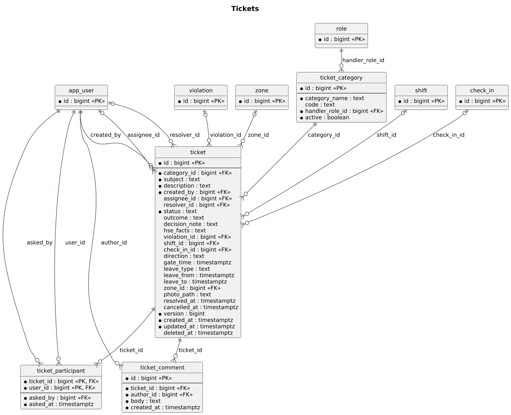

*Figure 11: Entity relationship diagram: Tickets*  
[Image Detail](docs/diagrams/png/2-5-erd.png) · [PlantUML source](docs/diagrams/src/2-5-erd.puml)

##### 2.2.5.1 ticket_category

A kind of ticket. The five categories of BR-60 have a code: PPE appeal, Attendance error, Missing
check-out, Leave request and Other. Older categories stay for the tickets that use them, but can't be
chosen for a new ticket.

| No. | Field Name | Data Type | Field Size | P/F Key | Nullable | Unique | Description |
| --- | --- | --- | --- | --- | --- | --- | --- |
| 1 | id | bigint | 8 bytes | PK | No | Yes | Generated category ID |
| 2 | category_name | text | Variable |  | No | Yes | Category name |
| 3 | code | text | Variable |  | Yes | Yes | PPE_APPEAL, ATTENDANCE_ERROR, MISSING_CHECK_OUT, LEAVE or OTHER; says what the category does |
| 4 | handler_role_id | bigint | 8 bytes | FK → role(id) | No | No | Role that handles it; ADMIN for every category (V20) |
| 5 | active | boolean | 1 byte |  | No | No | False for an old category that can't be chosen any more; defaults to true |

*Table 25: ticket_category*

##### 2.2.5.2 ticket

One request to the Admin. Which of the extra columns are filled depends on the category.

| No. | Field Name | Data Type | Field Size | P/F Key | Nullable | Unique | Description |
| --- | --- | --- | --- | --- | --- | --- | --- |
| 1 | id | bigint | 8 bytes | PK | No | Yes | Generated ticket ID |
| 2 | category_id | bigint | 8 bytes | FK → ticket_category(id) | No | No | The ticket's category |
| 3 | subject | text | Variable |  | No | No | Short title |
| 4 | description | text | Variable |  | No | No | Full details |
| 5 | created_by | bigint | 8 bytes | FK → app_user(id) | No | No | Who opened the ticket |
| 6 | assignee_id | bigint | 8 bytes | FK → app_user(id) | Yes | No | The Admin working on it |
| 7 | resolver_id | bigint | 8 bytes | FK → app_user(id) | Yes | No | Who decided it; set exactly when RESOLVED |
| 8 | status | text | Variable |  | No | No | OPEN (default), IN_PROGRESS, RESOLVED or CANCELLED |
| 9 | outcome | text | Variable |  | Yes | No | APPROVED or REJECTED, or UPHELD or OVERTURNED for an appeal; only when RESOLVED |
| 10 | decision_note | text | Variable |  | Yes | No | The Admin's reason for the decision |
| 11 | hse_facts | text | Variable |  | Yes | No | What the HSE Officer of that shift said, up to 1,000 characters |
| 12 | violation_id | bigint | 8 bytes | FK → violation(id) | Yes | Partial | The appealed violation; unique among tickets not soft-deleted, so one live appeal per violation |
| 13 | shift_id | bigint | 8 bytes | FK → shift(id) | Yes | Partial | The shift of an attendance error, missing check-out or leave request; one open ticket per shift and category (MSG45) |
| 14 | check_in_id | bigint | 8 bytes | FK → check_in(id) | Yes | No | The visit of a missing check-out |
| 15 | direction | text | Variable |  | Yes | No | IN or OUT: which gate scan an attendance error is about |
| 16 | gate_time | timestamptz | 8 bytes |  | Yes | No | The time the person says they passed the gate |
| 17 | leave_type | text | Variable |  | Yes | No | PAID or UNPAID for a leave request |
| 18 | leave_from | timestamptz | 8 bytes |  | Yes | No | Start of the leave |
| 19 | leave_to | timestamptz | 8 bytes |  | Yes | No | End of the leave; required with leave_from, and after it |
| 20 | zone_id | bigint | 8 bytes | FK → zone(id) | Yes | No | Where the problem is |
| 21 | photo_path | text | Variable |  | Yes | No | A photo in the private ticket photo bucket |
| 22 | resolved_at | timestamptz | 8 bytes |  | Yes | No | When it was decided; set exactly when RESOLVED |
| 23 | cancelled_at | timestamptz | 8 bytes |  | Yes | No | When the author cancelled it; set exactly when CANCELLED |
| 24 | version | bigint | 8 bytes |  | No | No | Optimistic lock counter; defaults to 0 |
| 25 | created_at | timestamptz | 8 bytes |  | No | No | When the row was created |
| 26 | updated_at | timestamptz | 8 bytes |  | No | No | When the row last changed |
| 27 | deleted_at | timestamptz | 8 bytes |  | Yes | No | When the ticket was soft-deleted |

*Table 26: ticket*

##### 2.2.5.3 ticket_comment

A message on a ticket.

| No. | Field Name | Data Type | Field Size | P/F Key | Nullable | Unique | Description |
| --- | --- | --- | --- | --- | --- | --- | --- |
| 1 | id | bigint | 8 bytes | PK | No | Yes | Generated comment ID |
| 2 | ticket_id | bigint | 8 bytes | FK → ticket(id) | No | No | The ticket; comments are deleted with it |
| 3 | author_id | bigint | 8 bytes | FK → app_user(id) | No | No | Who wrote the comment |
| 4 | body | text | Variable |  | No | No | Comment text |
| 5 | created_at | timestamptz | 8 bytes |  | No | No | When it was written |

*Table 27: ticket_comment*

##### 2.2.5.4 ticket_participant

An HSE Officer the Admin asked for the facts of a ticket; they may read it and comment (SRS 3.1.3).

| No. | Field Name | Data Type | Field Size | P/F Key | Nullable | Unique | Description |
| --- | --- | --- | --- | --- | --- | --- | --- |
| 1 | ticket_id | bigint | 8 bytes | PK, FK → ticket(id) | No | Composite | The ticket; deleted with it |
| 2 | user_id | bigint | 8 bytes | PK, FK → app_user(id) | No | Composite | The HSE Officer who was asked |
| 3 | asked_by | bigint | 8 bytes | FK → app_user(id) | No | No | The Admin who asked |
| 4 | asked_at | timestamptz | 8 bytes |  | No | No | When they asked |

*Table 28: ticket_participant*

#### 2.2.6 Notifications

Every notice is saved in the ERP first and shown in the web ERP; then a delivery row says whether Zalo
still has to send it (BR-15, BR-16). A notice stores its kind and parameters, not words, so each page
shows it in the reader's language and the Zalo copy is written in Vietnamese when it is sent. Some
notices come from database triggers, because the detection app writes violations and check-ins
directly and the ERP may be asleep: one VIOLATION_ALERT per violation to the HSE Officers on duty
(BR-54), and CHECK_IN and CHECK_OUT after each gate scan.

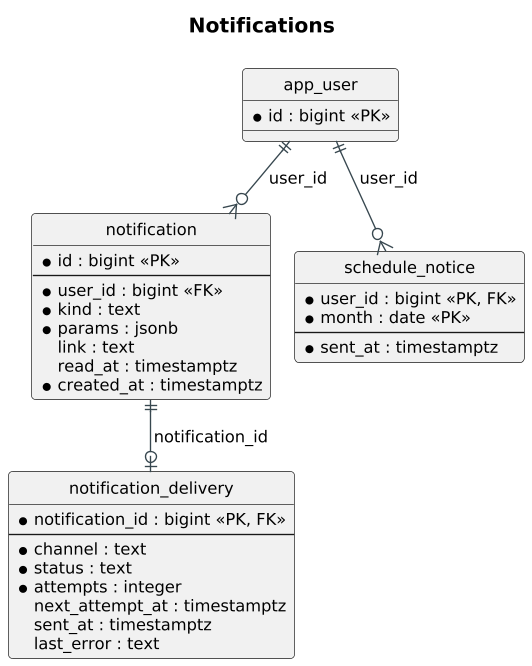

*Figure 12: Entity relationship diagram: Notifications*  
[Image Detail](docs/diagrams/png/2-6-erd.png) · [PlantUML source](docs/diagrams/src/2-6-erd.puml)

##### 2.2.6.1 notification

One notice to one person.

| No. | Field Name | Data Type | Field Size | P/F Key | Nullable | Unique | Description |
| --- | --- | --- | --- | --- | --- | --- | --- |
| 1 | id | bigint | 8 bytes | PK | No | Yes | Generated notification ID |
| 2 | user_id | bigint | 8 bytes | FK → app_user(id) | No | No | Who it's for |
| 3 | kind | text | Variable |  | No | No | Upper-case name of the notice, such as CHECK_IN, CHECK_OUT, VIOLATION_ALERT, VIOLATION_CONFIRMED, APPEAL_DECIDED, SHIFT_CHANGED, TICKET_DECIDED or INCOMPLETE_ATTENDANCE (see `NotificationKind`) |
| 4 | params | jsonb | Variable |  | No | No | The values the text needs, such as the time and the shift; defaults to {} |
| 5 | link | text | Variable |  | Yes | No | The page the notice opens |
| 6 | read_at | timestamptz | 8 bytes |  | Yes | No | When the reader marked it as read; empty means unread |
| 7 | created_at | timestamptz | 8 bytes |  | No | No | When it was made |

*Table 29: notification*

##### 2.2.6.2 notification_delivery

The Zalo delivery of one notice. A trigger adds it with the notice: PENDING for someone with a linked
Zalo chat, SKIPPED for everyone else. The ERP retries after 1, 5 and 15 minutes, then gives up (BR-16).

| No. | Field Name | Data Type | Field Size | P/F Key | Nullable | Unique | Description |
| --- | --- | --- | --- | --- | --- | --- | --- |
| 1 | notification_id | bigint | 8 bytes | PK, FK → notification(id) | No | Yes | The notice; deleted with it |
| 2 | channel | text | Variable |  | No | No | Always ZALO |
| 3 | status | text | Variable |  | No | No | PENDING, SENT, FAILED or SKIPPED |
| 4 | attempts | integer | 4 bytes |  | No | No | Tries so far; defaults to 0 |
| 5 | next_attempt_at | timestamptz | 8 bytes |  | Yes | No | When to try next; set exactly while PENDING |
| 6 | sent_at | timestamptz | 8 bytes |  | Yes | No | When Zalo accepted it; set exactly when SENT |
| 7 | last_error | text | Variable |  | Yes | No | Why the last try failed |

*Table 30: notification_delivery*

##### 2.2.6.3 schedule_notice

Which people were sent which month's schedule, so a later shift change is sent on its own only for a
month the person already has (BR-18, BR-19).

| No. | Field Name | Data Type | Field Size | P/F Key | Nullable | Unique | Description |
| --- | --- | --- | --- | --- | --- | --- | --- |
| 1 | user_id | bigint | 8 bytes | PK, FK → app_user(id) | No | Composite | The person; deleted with the user |
| 2 | month | date | 4 bytes | PK | No | Composite | The 1st of the month that was sent |
| 3 | sent_at | timestamptz | 8 bytes |  | No | No | When it was last sent |

*Table 31: schedule_notice*

#### 2.2.7 Month Closing, Settings and Jobs

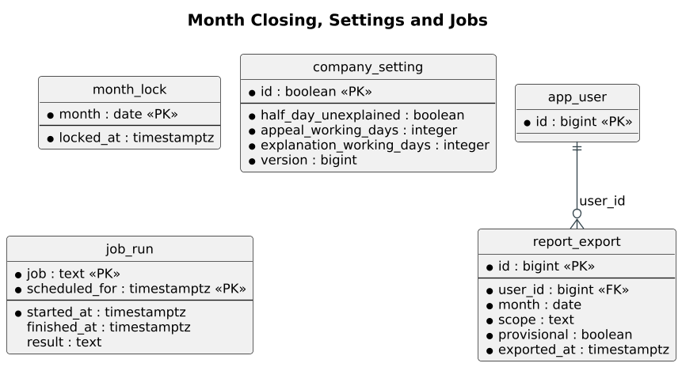

*Figure 13: Entity relationship diagram: Month Closing, Settings and Jobs*  
[Image Detail](docs/diagrams/png/2-7-erd.png) · [PlantUML source](docs/diagrams/src/2-7-erd.puml)

##### 2.2.7.1 month_lock

A locked month. Shifts, visits and scores of a locked month no longer change (BR-70).

| No. | Field Name | Data Type | Field Size | P/F Key | Nullable | Unique | Description |
| --- | --- | --- | --- | --- | --- | --- | --- |
| 1 | month | date | 4 bytes | PK | No | Yes | The 1st of the month |
| 2 | locked_at | timestamptz | 8 bytes |  | No | No | When it was locked |

*Table 32: month_lock*

##### 2.2.7.2 report_export

The log of every monthly report export (BR-71).

| No. | Field Name | Data Type | Field Size | P/F Key | Nullable | Unique | Description |
| --- | --- | --- | --- | --- | --- | --- | --- |
| 1 | id | bigint | 8 bytes | PK | No | Yes | Generated export ID |
| 2 | user_id | bigint | 8 bytes | FK → app_user(id) | No | No | Who exported it |
| 3 | month | date | 4 bytes |  | No | No | The 1st of the month of the report |
| 4 | scope | text | Variable |  | No | No | SITE or the name of the team |
| 5 | provisional | boolean | 1 byte |  | No | No | True when the month wasn't locked yet, so the figures may still change |
| 6 | exported_at | timestamptz | 8 bytes |  | No | No | When it was exported |

*Table 33: report_export*

##### 2.2.7.3 company_setting

The company options, in a single row.

| No. | Field Name | Data Type | Field Size | P/F Key | Nullable | Unique | Description |
| --- | --- | --- | --- | --- | --- | --- | --- |
| 1 | id | boolean | 1 byte | PK | No | Yes | Always true, so the table holds one row |
| 2 | half_day_unexplained | boolean | 1 byte |  | No | No | On: an unexplained missing check-out is paid 50% of the shift; off: 0 hours and To review (BR-36). The Admin sets it on Company Settings. Defaults to false |
| 3 | appeal_working_days | integer | 4 bytes |  | No | No | Working days to appeal a confirmed violation, 1 to 10; defaults to 3 |
| 4 | explanation_working_days | integer | 4 bytes |  | No | No | Working days to explain a missing check-out, 1 to 10; defaults to 3 |
| 5 | version | bigint | 8 bytes |  | No | No | Optimistic lock counter; defaults to 0 |

*Table 34: company_setting*

##### 2.2.7.4 job_run

One row per run of a scheduled job and the time it was due, so a job never runs twice for the same
time, and a run missed while the ERP slept is caught up once (SRS 3.2.38, CR-12).

| No. | Field Name | Data Type | Field Size | P/F Key | Nullable | Unique | Description |
| --- | --- | --- | --- | --- | --- | --- | --- |
| 1 | job | text | Variable | PK | No | Composite | Name of the job |
| 2 | scheduled_for | timestamptz | 8 bytes | PK | No | Composite | The time the run was due |
| 3 | started_at | timestamptz | 8 bytes |  | No | No | When it started |
| 4 | finished_at | timestamptz | 8 bytes |  | Yes | No | When it finished; empty while running or after a crash |
| 5 | result | text | Variable |  | Yes | No | What it did, or the error |

*Table 35: job_run*

### 2.3 Functions, Triggers and Row Level Security

Some rules live in the database, because the detection app writes straight to it and the ERP may be
asleep on Render's free tier.

| # | Name | Kind | Description |
| --- | --- | --- | --- |
| 1 | `safety_scores(at)` | Function | Score, bonus level and counted violations of each scored employee for the month of `at`: live for an open month, the frozen `monthly_score` rows for a locked one |
| 2 | `safety_time_slots(from, to)` | Function | Ranks shift time slots by violations per 100 worker-hours for the HSE view |
| 3 | `close_stale_check_ins(time_zone)` | Function | Flags a visit Incomplete 20 minutes after its shift end and closes it 4 hours after; a visit with no shift closes once its day has passed (BR-35). Called by the detection app and the 23:00 job |
| 4 | `has_permission()`, `can_*()`, `ticket_from_my_team()` | Functions | Permission checks used by the ERP, such as whether a user may read or update a ticket |
| 5 | `zone_next_code(kind)` | Function | The first free zone code of a kind (V26) |
| 6 | `shift_label(shift)` | Function | A shift written as "T3 24/11 08:00–17:00" for check-in and check-out notices |
| 7 | updated_at triggers | Trigger | Set `updated_at` on every change; on `check_in` a trigger also raises `version` for changes made with plain SQL |
| 8 | `trg_zone_code` | Trigger | Gives a new zone its code and refuses any change of it (V26) |
| 9 | `trg_check_in_worker` | Trigger | The shift of a visit must belong to the person on the visit |
| 10 | `trg_check_in_attach_shift` | Trigger | Attaches a new visit to the person's shift (BR-30) and closes their visit left open from an earlier day |
| 11 | `trg_check_in_notify`, `trg_check_out_notify` | Trigger | CHECK_IN and CHECK_OUT notices for gate scans written by the detection role |
| 12 | `trg_check_out_complete_shift` | Trigger | A real check-out marks its SCHEDULED shift COMPLETED, unless the month is locked (V25) |
| 13 | `trg_violation_worker` | Trigger | On a new violation: the zone comes from the camera, and any person the detection app names becomes the suggestion (BR-48) |
| 14 | `trg_violation_alert` | Trigger | One VIOLATION_ALERT per new violation to the HSE Officers on duty, or to every HSE Officer and Admin when nobody is (BR-54) |
| 15 | `trg_notification_delivery` | Trigger | Adds the Zalo delivery row of each new notice (BR-16) |
| 16 | `trg_user_erase_embedding` | Trigger | Erases a person's face embeddings when the account is soft-deleted (BR-07) |
| 17 | Exclusion constraint on `shift` | Constraint | btree_gist: no two overlapping shifts of one person that aren't cancelled (BR-22) |
| 18 | Partial unique indexes | Constraint | One open visit per person; one leader per team; one live appeal per violation; one open ticket per shift and category; one Zalo chat per account |
| 19 | Row level security | Policy | On for every table, set after each migration by `afterMigrate__enable_rls.sql`. Policies exist only for the `steelsight_detection` role. The ERP connects as the table owner. With no policies for anon and authenticated, Supabase's public Data API returns nothing |

*Table 36: Functions, Triggers and Row Level Security*

The `steelsight_detection` role can read the cameras, zones (code, name, kind), shifts, face embeddings
and the employee code and full name of each user. It can insert violations (camera, type, time,
confidence, box, photo, event ID, suggestion) and visits, update check-outs and face embeddings, and call
`close_stale_check_ins()`. It can't read passwords, emails, phone numbers or tickets, and can't change a
review or an appeal.

### 2.4 Local Outbox of the Detection App

The detection app keeps every event in a local SQLite database (through SQLAlchemy) before sending it.
Each event has a UUID `event_id` made on the laptop. The same value is stored in `check_in.event_id` or
`violation.event_id`, which are unique, so an event sent twice after a network error is stored once
(`ON CONFLICT (event_id) DO NOTHING`). Events are sent oldest first, so a check-out never arrives before
its check-in, and an evidence photo is uploaded before its violation row (see Section 3.13.2).

### 2.5 File Storage Design

Photos are files in three private Supabase Storage buckets, and tables store only their path:
`face-photos` (written by the ERP, Admin only), `ticket-photos` (written by the ERP for the ticket's
author) and `evidence-photos` (written by the detection app). Browsers never get a Storage URL; each
photo goes through an ERP route that checks the permission first. Section 4.3 lists which column refers
to which bucket and the route that serves it.

### 2.6 Differences from the SRS Data Model

The ERD of the SRS (3.1.5, 24 tables) is the target model. The schema matches it except for these
points, which the SRS should take over, because the code and its tests already rely on them.

| Table | SRS 3.1.5 | Schema | Why |
| --- | --- | --- | --- |
| safety_policy | warning_at, danger_at, repeat_limit, level3_at, level1_cut_pct, level2_cut_pct, level3_cut_pct | level1_at, level2_at, level3_at; the reductions 2/4/6% are fixed in the ERP | The old warning and danger levels were replaced by the bonus levels (V21) |
| notification | keeps score and period | params and link only | Every notice keeps its values in params (V21) |
| notification_delivery | own id; next_try_at | notification_id is the key, one delivery per notice; next_attempt_at | One channel (Zalo), so one row per notice |
| zalo_link_code | own id; used_at | user_id is the key; no used_at | One code per user; a new code replaces the old, and a used code is deleted |
| monthly_score | own id; bonus_level; locked | (user_id, month) is the key; level; frozen_at | A row exists only for a locked month |
| company_setting | key and value | one row with named columns | The settings are typed and checked |
| pending_overtime | hours; check_in_id one to many | no hours (worked out from start_at and end_at); check_in_id unique; also user_id, overtime_shift_id, leader_note, decided_at | One pending period per visit, and the shift that made it valid |
| violation | suggested_similarity | suggestion_similarity; also taken_by, taken_at, appeal_decided_by, appeal_decided_at | Taking a violation for review, and an appeal decision kept apart from the review |
| ticket | leave_start, leave_end | leave_from, leave_to; also cancelled_at | A ticket can be cancelled (status CANCELLED) |
| ticket_category | category_name, handler_role_id | also code and active | The five categories of BR-60 are found by code; old ones stay for their tickets |
| check_in | incomplete | also incomplete_at | When the visit was flagged |
| zone | code, kind | also team_id | Team decision: a work area belongs to a team |
| (not in the SRS) | | ticket_participant, schedule_notice, job_run | Asking HSE for facts (3.2.22), the schedule notices (BR-18, BR-19) and the job run log (CR-12) |

*Table 37: Differences from the SRS Data Model*

## 3. Detailed Design

This section gives the detailed design of the 13 features of the web ERP and the detection app. Each feature has a class diagram with its class specification, its sequence diagrams and, where its data has a lifecycle, its state diagrams. In the class diagrams, colours show the stereotype: blue for controllers, green for services, yellow for repositories, grey for entities, purple for components and interfaces, red for database objects, cyan for the detection app's Python classes. A dashed arrow is a dependency, a solid line an association, a dashed arrow with a hollow head an implementation. In the sequence diagrams, solid arrows are calls, dashed arrows are returns, and alt, opt and loop frames show conditions.

| # | Feature | Runs in | Main tables | TDS |
| --- | --- | --- | --- | --- |
| 3.1 | Sign-in and session | Web ERP | app_user, role, permission | IAM |
| 3.2 | Accounts, face photos and Zalo link | Web ERP | app_user, face_embedding, zalo_link_code | IAM, STO, NTF |
| 3.3 | Teams, zones and cameras | Web ERP | team, zone, camera | SCH |
| 3.4 | Shift planning and timetable | Web ERP | shift, schedule_notice | SCH |
| 3.5 | Attendance and pending overtime | Web ERP, database | check_in, check_in_correction, pending_overtime | ATT |
| 3.6 | Violation review and appeal | Web ERP, database | violation | PPE |
| 3.7 | Safety score and bonus level | Web ERP, database | violation, safety_policy, monthly_score | PPE, RPT |
| 3.8 | Tickets | Web ERP | ticket, ticket_category, ticket_comment, ticket_participant | TKT |
| 3.9 | Notifications and the Zalo bot | Web ERP, database | notification, notification_delivery | NTF |
| 3.10 | Scheduled jobs and month closing | Web ERP | job_run, month_lock, monthly_score | PLT |
| 3.11 | Home page and monthly report | Web ERP | all of the above, report_export | RPT |
| 3.12 | Photo storage | Web ERP | (files) | STO |
| 3.13 | Detection: gate check-in, PPE monitoring, outbox and sync | Detection app | check_in, violation, face_embedding | DET-* |

*Table 38: Detailed Design*

### 3.1 Sign-in and Session

People sign in with their employee code and password. Each permission code a role holds becomes a
Spring Security authority. Someone whose password an Admin chose must pick their own first.

#### 3.1.1 Class Diagram

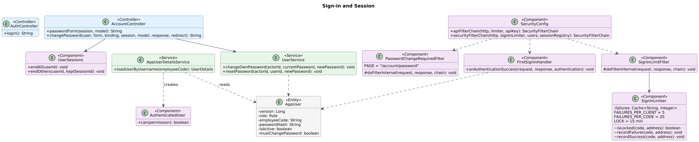

*Figure 14: Class diagram for Sign-in and Session*  
[Image Detail](docs/diagrams/png/3-1-class.png) · [PlantUML source](docs/diagrams/src/3-1-class.puml)

**Class specifications of Sign-in and Session**

| Class | Stereotype | Main operations |
| --- | --- | --- |
| `AuthController`, `AccountController` | Controller | Sign-in page; the forced password change page |
| `SecurityConfig` | Configuration | Two filter chains: `/api/**` (API key, no session) and the pages (form login, CSRF, sessions) |
| `AppUserDetailsService` | Service | `loadUserByUsername(code)`: active, not deleted, authorities = permission codes |
| `SignInLimiter`, `SignInLimitFilter` | Component | Locks sign-in for 15 minutes after 5 failures from one client or 20 for one code (BR-04) |
| `PasswordChangeRequiredFilter`, `FirstSignInHandler` | Component | Send a user with `must_change_password` to the change page until they choose a password (BR-03) |
| `UserSessions` | Component | `endAll(user)`, `endOthers(user)`: ends sessions when an account is deactivated, deleted or its password changes |
| `AdminBootstrap` | Component | Creates the first Admin from the environment when there is none |
| `AuthenticatedUser` | Model | The signed-in user, with `can(permission)` |

*Table 39: Class specifications of Sign-in and Session*

#### 3.1.2 Sequence Diagrams

##### 3.1.2.1 Sequence diagram for Sign in

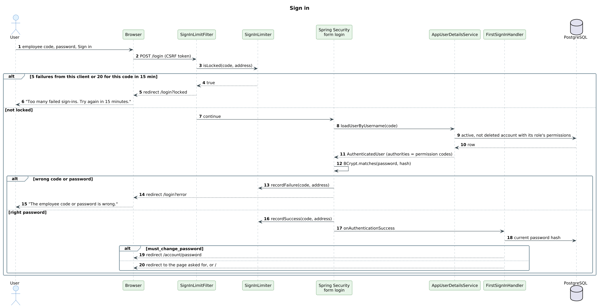

*Figure 15: Sequence diagram for Sign in*  
[Image Detail](docs/diagrams/png/3-1-seq-signin.png) · [PlantUML source](docs/diagrams/src/3-1-seq-signin.puml)

##### 3.1.2.2 Sequence diagram for Change password

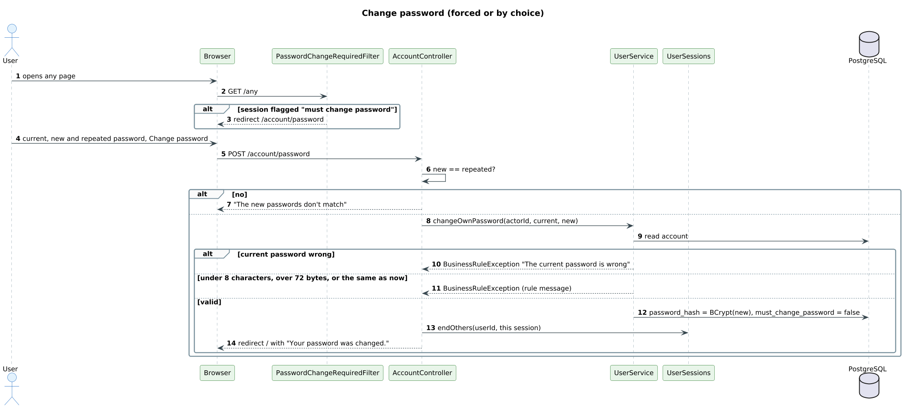

*Figure 16: Sequence diagram for Change password*  
[Image Detail](docs/diagrams/png/3-1-seq-password.png) · [PlantUML source](docs/diagrams/src/3-1-seq-password.puml)

#### 3.1.3 State Diagrams

##### 3.1.3.1 Account lifecycle

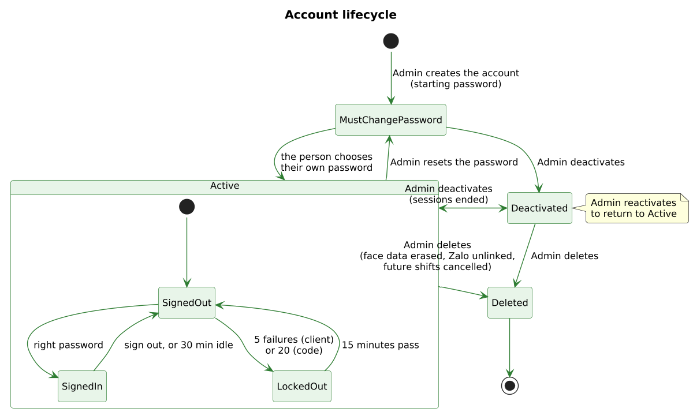

*Figure 17: Account lifecycle*  
[Image Detail](docs/diagrams/png/3-1-state-account.png) · [PlantUML source](docs/diagrams/src/3-1-state-account.puml)

### 3.2 Accounts, Face Photos and Zalo Link

Only the Admin creates and changes accounts, face photos, roles, teams and staff groups. A new FRONT
face photo needs the signed consent and queues a PENDING `face_embedding` row, which the detection app
turns into a vector (Section 3.13). LEFT and RIGHT photos are optional. Soft-deleting an account erases its
embeddings (trigger), unlinks Zalo and cancels its future shifts (BR-07).

#### 3.2.1 Class Diagram

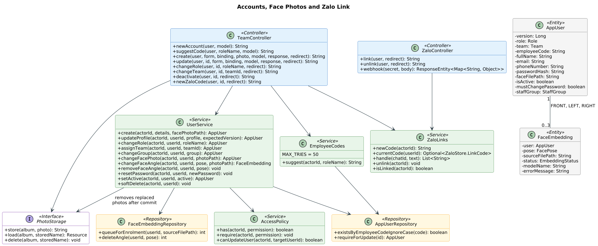

*Figure 18: Class diagram for Accounts, Face Photos and Zalo Link*  
[Image Detail](docs/diagrams/png/3-2-class.png) · [PlantUML source](docs/diagrams/src/3-2-class.puml)

**Class specifications of Accounts, Face Photos and Zalo Link**

| Class | Stereotype | Main operations |
| --- | --- | --- |
| `TeamController` (`/team/*`), `WorkerController` | Controller | Account list and form, role, team, group, password reset, deactivate, delete, face photos by pose, Zalo code |
| `UserService` | Service | `create`, `updateProfile`, `changeRole`, `assignTeam`, `changeGroup`, `changeFacePhoto`, `changeFaceAngle`, `removeFaceAngle`, `resetPassword`, `setActive`, `softDelete`, `changeOwnPassword`, `faceEnrolment` |
| `AccessPolicy` | Service | `has`, `require`, `canUpdateUser`, `canAssignShift`, `canReadTicket`, `canUpdateTicket`, `canCommentTicket`: every record-level check, mostly through the database `can_*()` functions |
| `ZaloController`, `ZaloLinks`, `ZaloStore` | Controller, Service | `newCode`, `currentCode`, `handle` (a code sent to the bot), `unlink`; 6-digit codes valid for 24 hours, used once (BR-13) |
| `PhotoStorage` | Interface | See Section 3.12 |
| `AppUser`, `FaceEmbedding` | Entity | See Sections 2.2.1.4 and 2.2.3.1 |

*Table 40: Class specifications of Accounts, Face Photos and Zalo Link*

#### 3.2.2 Sequence Diagrams

##### 3.2.2.1 Sequence diagram for Create an account

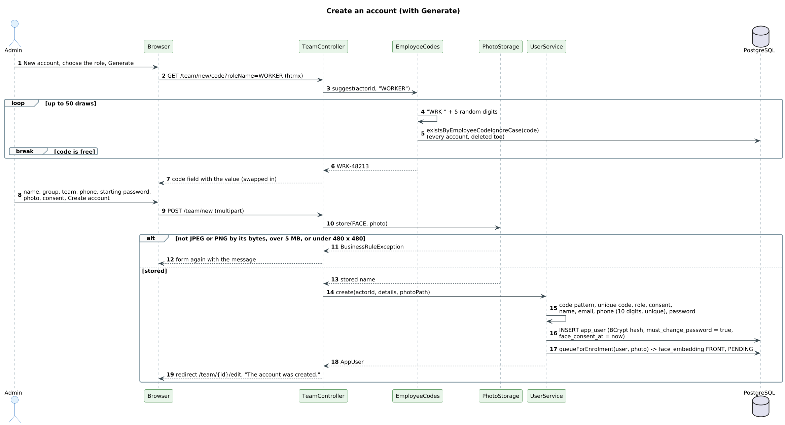

*Figure 19: Sequence diagram for Create an account*  
[Image Detail](docs/diagrams/png/3-2-seq-create.png) · [PlantUML source](docs/diagrams/src/3-2-seq-create.puml)

##### 3.2.2.2 Sequence diagram for Face enrolment

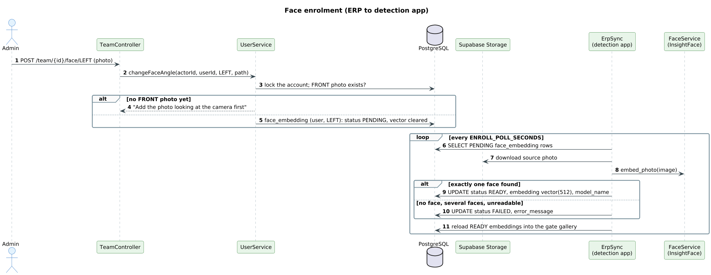

*Figure 20: Sequence diagram for Face enrolment*  
[Image Detail](docs/diagrams/png/3-2-seq-enrol.png) · [PlantUML source](docs/diagrams/src/3-2-seq-enrol.puml)

##### 3.2.2.3 Sequence diagram for Link Zalo

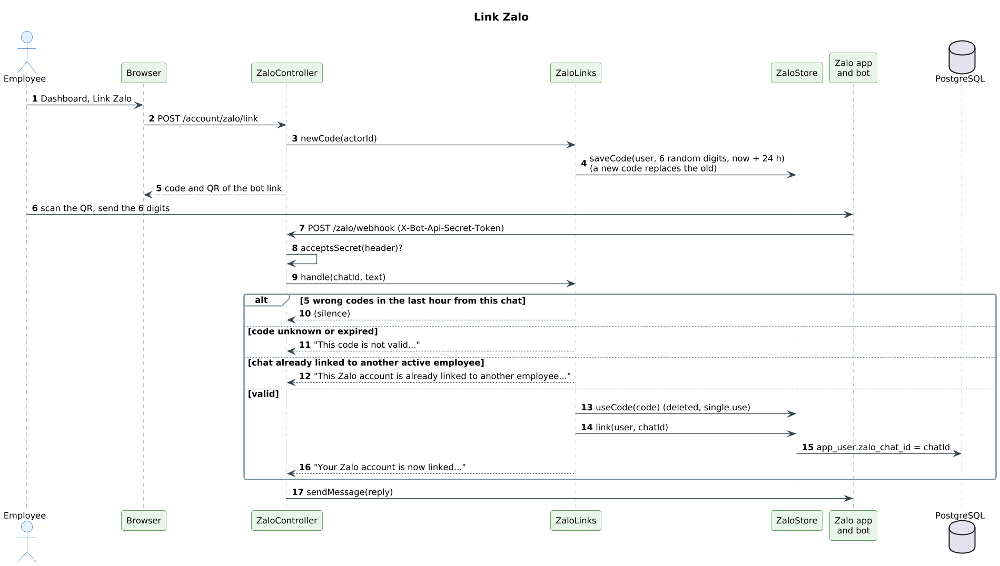

*Figure 21: Sequence diagram for Link Zalo*  
[Image Detail](docs/diagrams/png/3-2-seq-zalo.png) · [PlantUML source](docs/diagrams/src/3-2-seq-zalo.puml)

#### 3.2.3 State Diagrams

##### 3.2.3.1 Face enrolment lifecycle

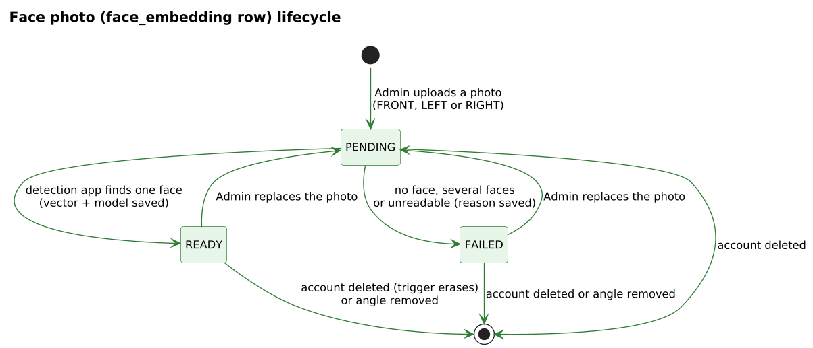

*Figure 22: Face enrolment lifecycle*  
[Image Detail](docs/diagrams/png/3-2-state-face.png) · [PlantUML source](docs/diagrams/src/3-2-state-face.puml)

##### 3.2.3.2 Zalo link lifecycle

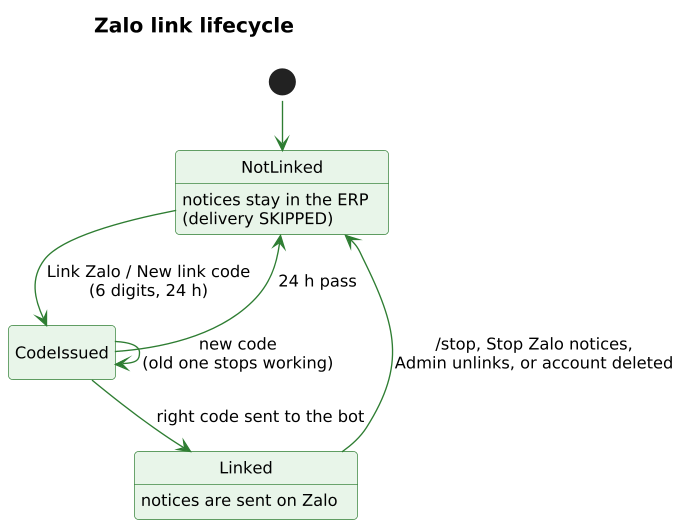

*Figure 23: Zalo link lifecycle*  
[Image Detail](docs/diagrams/png/3-2-state-zalo.png) · [PlantUML source](docs/diagrams/src/3-2-state-zalo.puml)

### 3.3 Teams, Zones and Cameras

The Admin creates teams and picks each one's leader, a MANAGER who leads at most one team. The Admin
adds zones (the database gives each its fixed code), renames them, gives each work area its team, and
links each camera code from the detection app to a zone. A camera in the gate attendance zone records
check-ins; every other camera records violations.

#### 3.3.1 Class Diagram

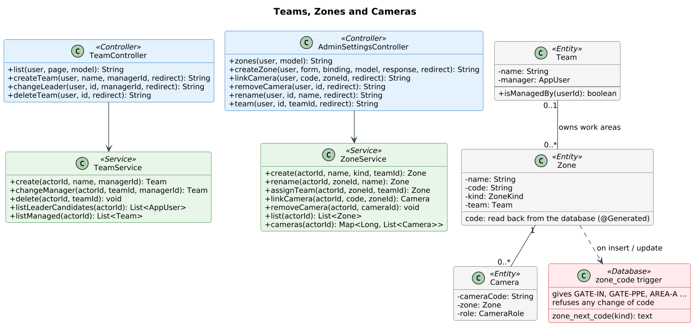

*Figure 24: Class diagram for Teams, Zones and Cameras*  
[Image Detail](docs/diagrams/png/3-3-class.png) · [PlantUML source](docs/diagrams/src/3-3-class.puml)

**Class specifications of Teams, Zones and Cameras**

| Class | Stereotype | Main operations |
| --- | --- | --- |
| `TeamController` (`/teams`), `AdminSettingsController` (`/zones`) | Controller | Teams and leaders; zones, their team and cameras |
| `TeamService` | Service | `create`, `changeManager`, `delete`, `listManaged`, `listLeaderCandidates` |
| `ZoneService` | Service | `create`, `rename`, `assignTeam`, `linkCamera`, `removeCamera` (only a camera with no records), `list`, `cameras` |
| `Team`, `Zone`, `Camera` | Entity | `Zone.code` is read back from the database (`@Generated`) and never written |

*Table 41: Class specifications of Teams, Zones and Cameras*

#### 3.3.2 Sequence Diagrams

##### 3.3.2.1 Sequence diagram for Add a zone and link a camera

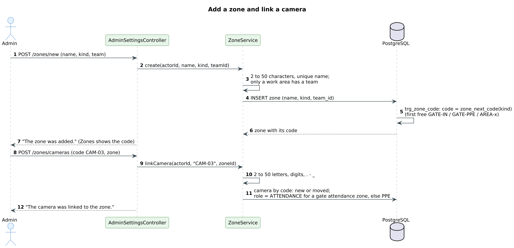

*Figure 25: Sequence diagram for Add a zone and link a camera*  
[Image Detail](docs/diagrams/png/3-3-seq-zone.png) · [PlantUML source](docs/diagrams/src/3-3-seq-zone.puml)

### 3.4 Shift Planning and Timetable

A team leader plans regular shifts for their own team on a week grid, before Saturday 18:00 of the week
before; the Admin plans anyone and adds overtime shifts with a reason (BR-21 to BR-24). A shift is 30
minutes to 12 hours, can't overlap another of the same person, and is locked once it starts. On Saturday
at 18:00 everyone gets next week's schedule; a later change to the current or next week is sent on its
own (BR-18, BR-19). A check-out completes the shift (V25); the hourly job completes the rest.

#### 3.4.1 Class Diagram

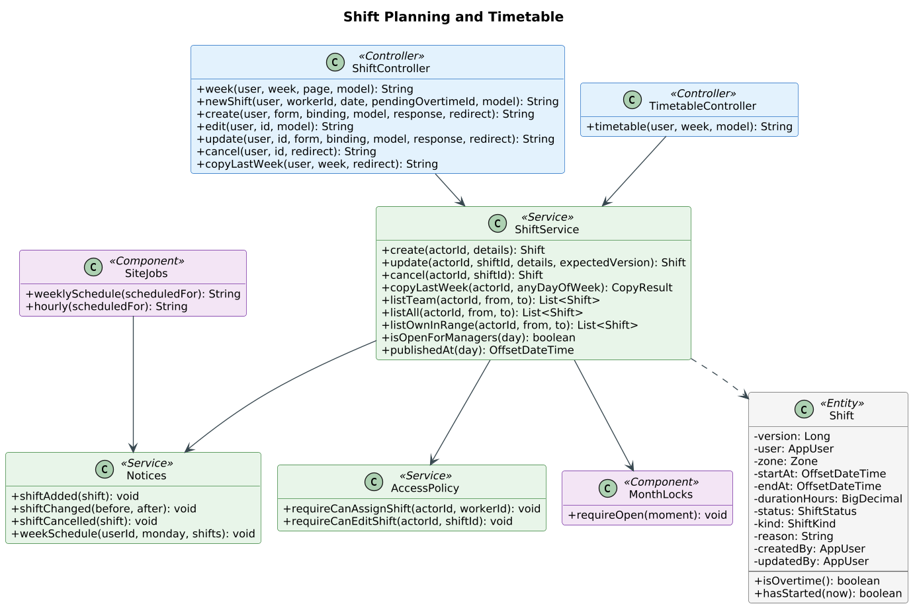

*Figure 26: Class diagram for Shift Planning and Timetable*  
[Image Detail](docs/diagrams/png/3-4-class.png) · [PlantUML source](docs/diagrams/src/3-4-class.puml)

**Class specifications of Shift Planning and Timetable**

| Class | Stereotype | Main operations |
| --- | --- | --- |
| `ShiftController`, `TimetableController` | Controller | Week grid, add, edit, cancel, copy last week; own timetable |
| `ShiftService` | Service | `create`, `update`, `cancel`, `copyLastWeek`, `listTeam`, `listAll`, `listOwn`, `isOpenForManagers`, `publishedAt` |
| `ShiftGrid`, `ShiftForm` | Web helper | The grid rows and the form |
| `Notices` | Service | `shiftAdded`, `shiftChanged`, `shiftCancelled`, `weekSchedule` |
| `Shift` | Entity | `durationHours` is generated by the database |

*Table 42: Class specifications of Shift Planning and Timetable*

#### 3.4.2 Sequence Diagrams

##### 3.4.2.1 Sequence diagram for Plan a shift

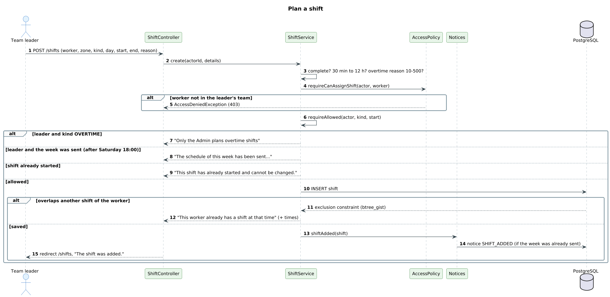

*Figure 27: Sequence diagram for Plan a shift*  
[Image Detail](docs/diagrams/png/3-4-seq-plan.png) · [PlantUML source](docs/diagrams/src/3-4-seq-plan.puml)

##### 3.4.2.2 Sequence diagram for Weekly schedule

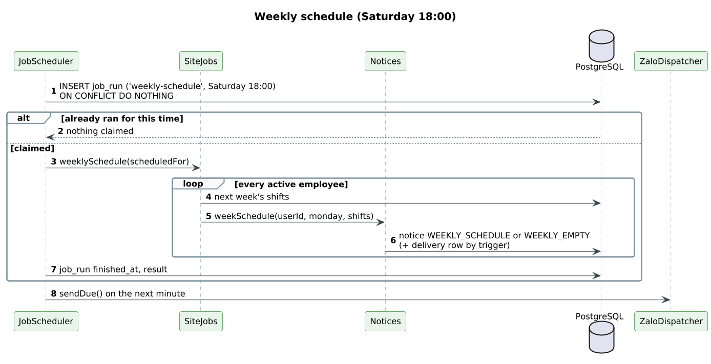

*Figure 28: Sequence diagram for Weekly schedule*  
[Image Detail](docs/diagrams/png/3-4-seq-weekly.png) · [PlantUML source](docs/diagrams/src/3-4-seq-weekly.puml)

#### 3.4.3 State Diagrams

##### 3.4.3.1 Shift lifecycle

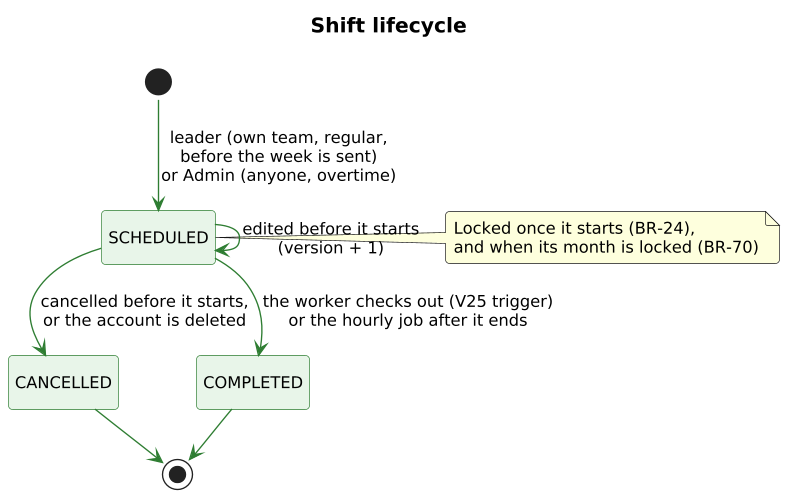

*Figure 29: Shift lifecycle*  
[Image Detail](docs/diagrams/png/3-4-state-shift.png) · [PlantUML source](docs/diagrams/src/3-4-state-shift.puml)

### 3.5 Attendance and Pending Overtime

The detection app records face check-ins and check-outs (Section 3.13). A database trigger attaches each visit
to the person's shift if it starts at most 60 minutes before (BR-30). The ERP judges each visit against
its shift: late after 5 minutes, early leave, paid hours by the shift frame, visits under 10 minutes
ignored (BR-31 to BR-33). A visit with no check-out 20 minutes after the shift is flagged Incomplete and
closed 4 hours after, with no guessed time (BR-35). An HSE Officer, or the Admin, records or corrects a
visit by hand with a reason, and each correction is kept (BR-39). Time after the shift end plus 20
minutes becomes pending overtime until the Admin adds an overtime shift (BR-34, BR-37).

#### 3.5.1 Class Diagram

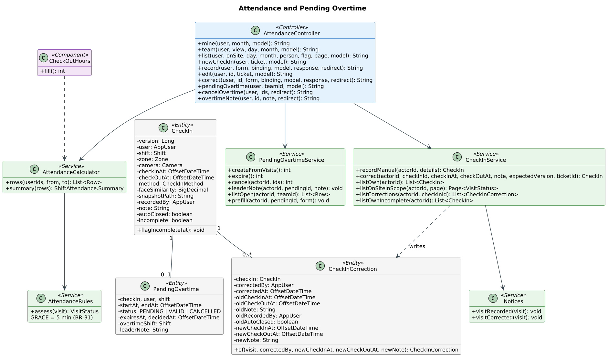

*Figure 30: Class diagram for Attendance and Pending Overtime*  
[Image Detail](docs/diagrams/png/3-5-class.png) · [PlantUML source](docs/diagrams/src/3-5-class.puml)

**Class specifications of Attendance and Pending Overtime**

| Class | Stereotype | Main operations |
| --- | --- | --- |
| `AttendanceController` | Controller | My attendance, team attendance, the attendance list, record and correct a visit, pending overtime |
| `CheckInService` | Service | `recordManual`, `correct`, `listOwn`, `listTeam`, `listOnSite`, `listCorrections`, `listOwnIncomplete` |
| `AttendanceRules` | Service | `assess(visit)`: late, early, missing check-out, too short |
| `AttendanceCalculator`, `ShiftAttendance` | Service | Paid hours, absences, half day for an unexplained missing check-out (company setting, BR-36), valid and pending overtime |
| `CheckOutHours` | Component | `fill`: adds the paid hours to CHECK_OUT notices before Zalo sends them |
| `PendingOvertimeService` | Service | `createFromVisits`, `expire`, `cancel`, `leaderNote`, `listOpen` |
| `CheckIn`, `CheckInCorrection`, `PendingOvertime` | Entity | See Section 2.2.3 |

*Table 43: Class specifications of Attendance and Pending Overtime*

#### 3.5.2 Sequence Diagrams

##### 3.5.2.1 Sequence diagram for Gate check-in and check-out

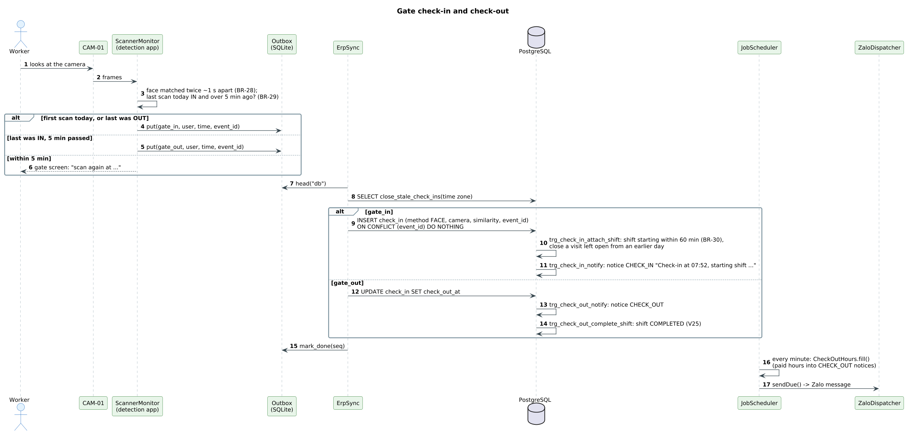

*Figure 31: Sequence diagram for Gate check-in and check-out*  
[Image Detail](docs/diagrams/png/3-5-seq-gate.png) · [PlantUML source](docs/diagrams/src/3-5-seq-gate.puml)

##### 3.5.2.2 Sequence diagram for Correct a visit

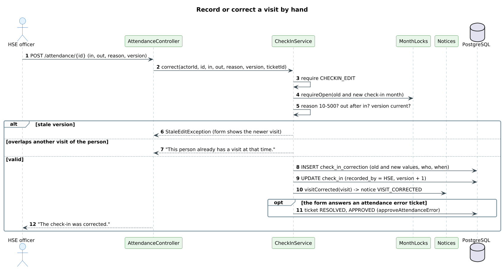

*Figure 32: Sequence diagram for Correct a visit*  
[Image Detail](docs/diagrams/png/3-5-seq-correct.png) · [PlantUML source](docs/diagrams/src/3-5-seq-correct.puml)

##### 3.5.2.3 Sequence diagram for Day end at 23:00

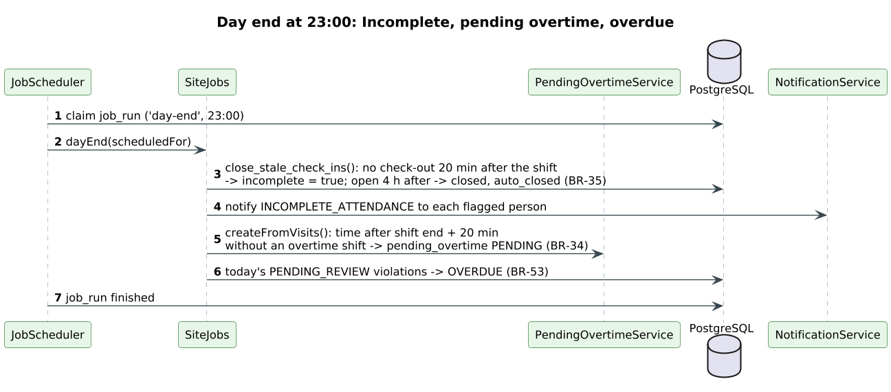

*Figure 33: Sequence diagram for Day end at 23:00*  
[Image Detail](docs/diagrams/png/3-5-seq-dayend.png) · [PlantUML source](docs/diagrams/src/3-5-seq-dayend.puml)

#### 3.5.3 State Diagrams

##### 3.5.3.1 Visit lifecycle

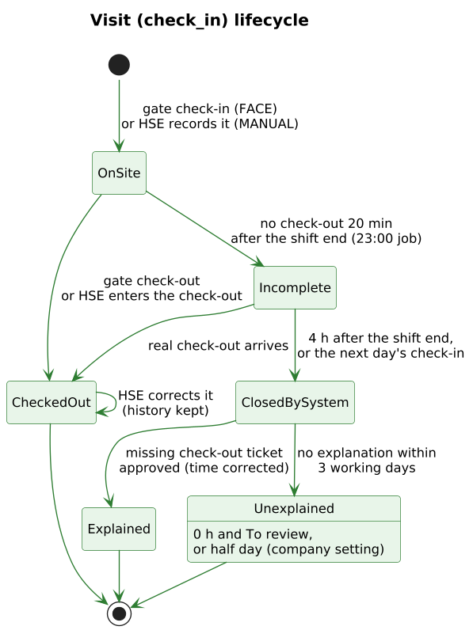

*Figure 34: Visit lifecycle*  
[Image Detail](docs/diagrams/png/3-5-state-visit.png) · [PlantUML source](docs/diagrams/src/3-5-state-visit.puml)

##### 3.5.3.2 Pending overtime lifecycle

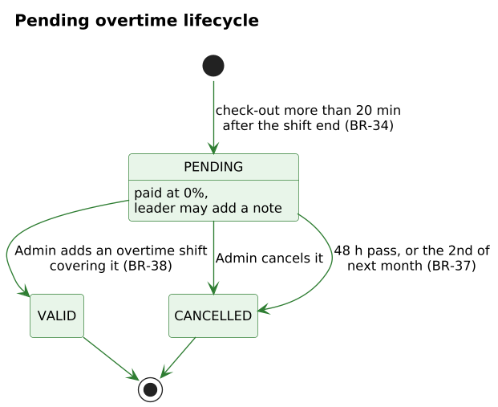

*Figure 35: Pending overtime lifecycle*  
[Image Detail](docs/diagrams/png/3-5-state-overtime.png) · [PlantUML source](docs/diagrams/src/3-5-state-overtime.puml)

### 3.6 Violation Review and Appeal

The detection app writes each violation with only a suggested person (Section 3.13). A trigger fills the zone
from the camera, makes any named person a suggestion, and alerts the HSE Officers on duty (BR-54). The
review is:

1. An HSE Officer, or the Admin, opens the Review Queue and **takes** a violation (`taken_by`), so two
   people don't review the same one.
2. They **confirm** the person (from the work area's team first, or the gate suggestion within 30
   seconds, BR-46), mark a **stranger**, or **dismiss** it with a reason (BR-49 to BR-52). An OFFICE
   employee's violation becomes a REMINDER, which doesn't count.
3. A violation not reviewed by the end of its day becomes **OVERDUE** (BR-53).
4. The confirmed person can **appeal** within the company's appeal period (3 working days by default).
   The appeal opens a PPE appeal ticket; the Admin decides it as **UPHELD** or **OVERTURNED** (Section 3.8).

#### 3.6.1 Class Diagram

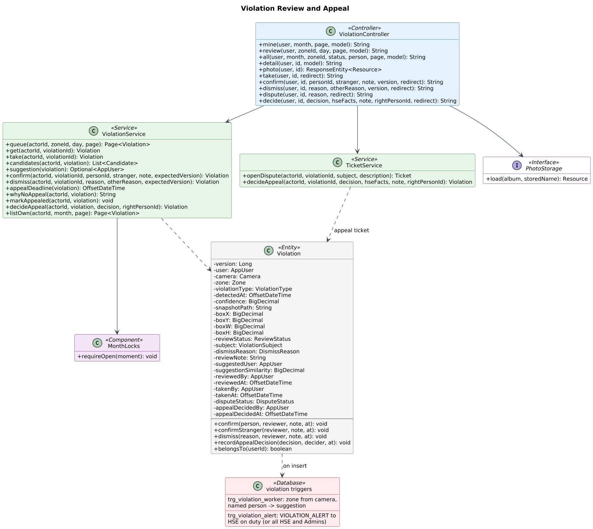

*Figure 36: Class diagram for Violation Review and Appeal*  
[Image Detail](docs/diagrams/png/3-6-class.png) · [PlantUML source](docs/diagrams/src/3-6-class.puml)

**Class specifications of Violation Review and Appeal**

| Class | Stereotype | Main operations |
| --- | --- | --- |
| `ViolationController` | Controller | My violations, Review Queue, violation list, detail, photo, take, confirm, dismiss, appeal |
| `ViolationService` | Service | `queue`, `take`, `candidates`, `suggestion`, `confirm`, `dismiss`, `appealDeadline`, `whyNoAppeal`, `markAppealed`, `decideAppeal`, `list`, `listOwn`, `countOpen`, `countOverdue` |
| `MonthLocks` | Component | `requireOpen`: nothing in a locked month changes (BR-70) |
| `Violation` | Entity | See Section 2.2.4.1 |

*Table 44: Class specifications of Violation Review and Appeal*

#### 3.6.2 Sequence Diagrams

##### 3.6.2.1 Sequence diagram for Detect and alert

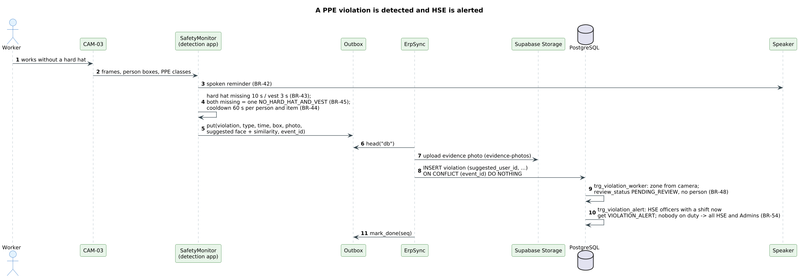

*Figure 37: Sequence diagram for Detect and alert*  
[Image Detail](docs/diagrams/png/3-6-seq-detect.png) · [PlantUML source](docs/diagrams/src/3-6-seq-detect.puml)

##### 3.6.2.2 Sequence diagram for Review and confirm

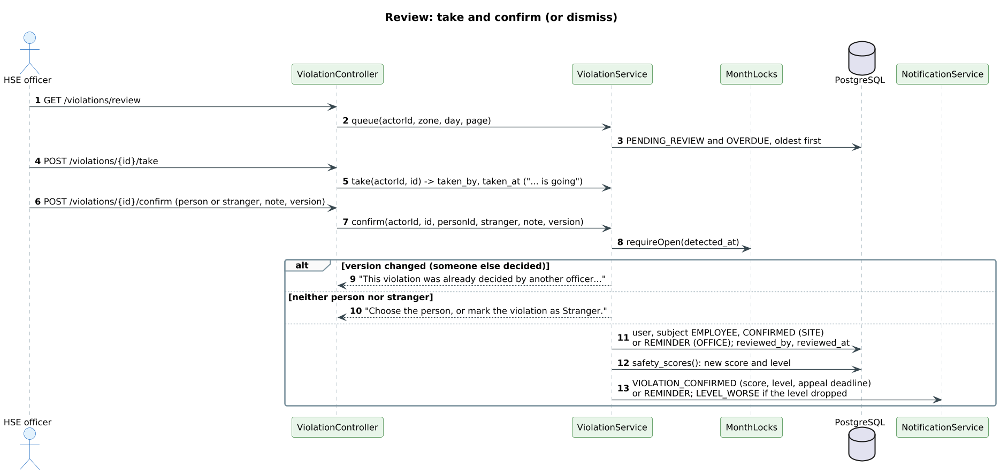

*Figure 38: Sequence diagram for Review and confirm*  
[Image Detail](docs/diagrams/png/3-6-seq-review.png) · [PlantUML source](docs/diagrams/src/3-6-seq-review.puml)

##### 3.6.2.3 Sequence diagram for Appeal and decision

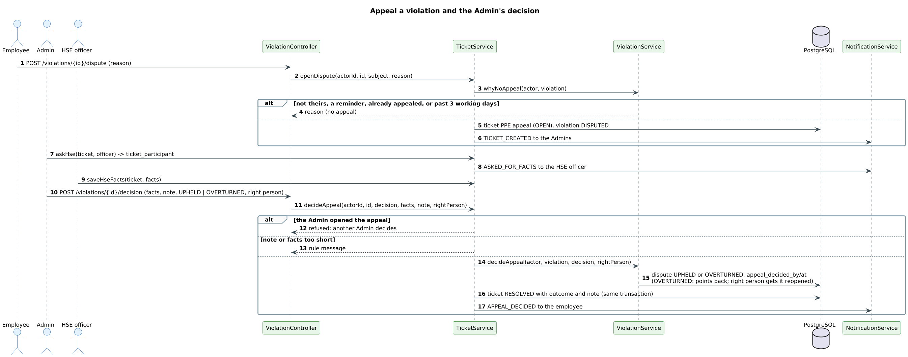

*Figure 39: Sequence diagram for Appeal and decision*  
[Image Detail](docs/diagrams/png/3-6-seq-appeal.png) · [PlantUML source](docs/diagrams/src/3-6-seq-appeal.puml)

#### 3.6.3 State Diagrams

##### 3.6.3.1 Violation review lifecycle

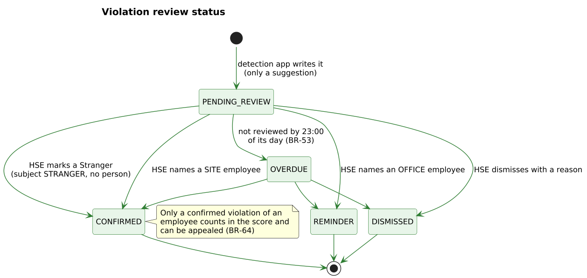

*Figure 40: Violation review lifecycle*  
[Image Detail](docs/diagrams/png/3-6-state-review.png) · [PlantUML source](docs/diagrams/src/3-6-state-review.puml)

##### 3.6.3.2 Appeal lifecycle

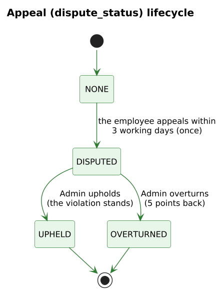

*Figure 41: Appeal lifecycle*  
[Image Detail](docs/diagrams/png/3-6-state-dispute.png) · [PlantUML source](docs/diagrams/src/3-6-state-dispute.puml)

### 3.7 Safety Score and Bonus Level

Each active SITE employee with the role WORKER or MANAGER starts the month on 100 and loses 5 points for
each confirmed violation that isn't overturned (BR-56, BR-57). The score gives a bonus level: 0 above 80,
then 1, 2 and 3 at 80, 70 and 60 and below, which reduce the monthly safety bonus by 2%, 4% and 6%
(BR-58). The score is worked out by `safety_scores()` in the database; a locked month reads its frozen
`monthly_score` rows.

#### 3.7.1 Class Diagram

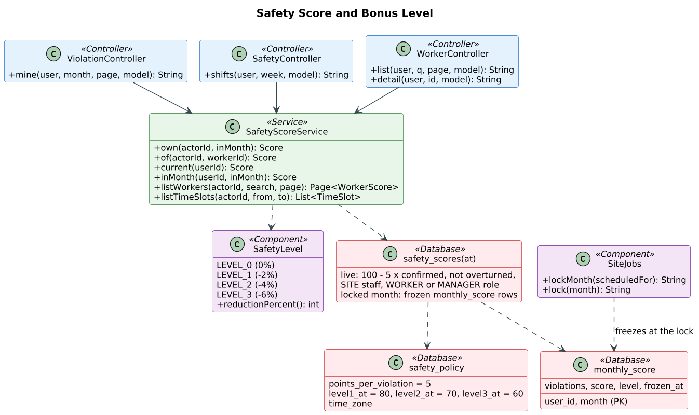

*Figure 42: Class diagram for Safety Score and Bonus Level*  
[Image Detail](docs/diagrams/png/3-7-class.png) · [PlantUML source](docs/diagrams/src/3-7-class.puml)

**Class specifications of Safety Score and Bonus Level**

| Class | Stereotype | Main operations |
| --- | --- | --- |
| `SafetyScoreService` | Service | `own`, `of`, `current`, `inMonth`, `listWorkers`, `listTimeSlots` (violations per 100 worker-hours) |
| `SafetyController` | Controller | Unsafe time slots for HSE |
| `SafetyLevel` | Enum | LEVEL_0 to LEVEL_3 with their reduction |

*Table 45: Class specifications of Safety Score and Bonus Level*

#### 3.7.2 Sequence Diagrams

##### 3.7.2.1 Sequence diagram for View my violations and score

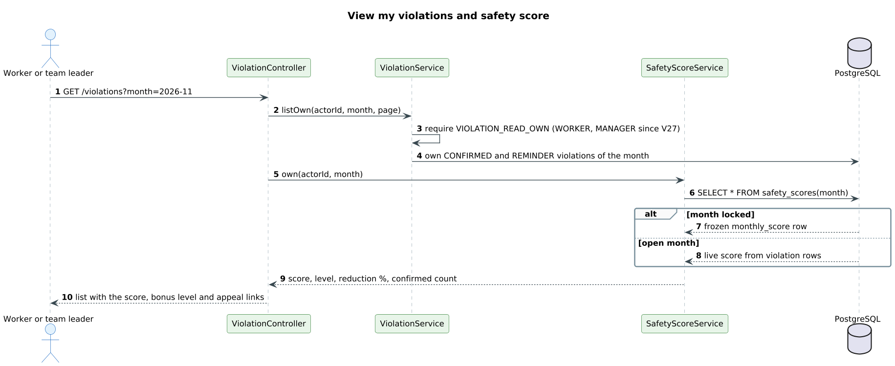

*Figure 43: Sequence diagram for View my violations and score*  
[Image Detail](docs/diagrams/png/3-7-seq-score.png) · [PlantUML source](docs/diagrams/src/3-7-seq-score.puml)

### 3.8 Tickets

Anyone can open a ticket in one of five categories: PPE appeal, attendance error, missing check-out,
leave request and other (BR-60). Every ticket goes to the Admin (BR-61), and an Admin can't handle a
ticket they opened. The team leader of the author can read and comment. The Admin can ask an HSE
Officer for the facts of a shift, who can then read and comment. The author can cancel an open ticket.
The Admin decides: APPROVED or REJECTED, or UPHELD or OVERTURNED for an appeal. Approving an attendance
error or a missing check-out corrects the visit, and the correction names the ticket.

#### 3.8.1 Class Diagram

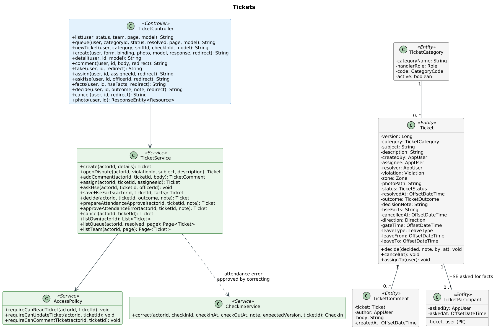

*Figure 44: Class diagram for Tickets*  
[Image Detail](docs/diagrams/png/3-8-class.png) · [PlantUML source](docs/diagrams/src/3-8-class.puml)

**Class specifications of Tickets**

| Class | Stereotype | Main operations |
| --- | --- | --- |
| `TicketController` | Controller | My tickets, the queue, new ticket, detail, comment, take, assign, ask HSE, HSE facts, decide, resolve, cancel, photo |
| `TicketService` | Service | `create`, `openDispute`, `addComment`, `assign`, `askHse`, `saveHseFacts`, `decide`, `decideAppeal`, `prepareAttendanceApproval`, `approveAttendanceError`, `resolve`, `cancel`, `listOwn`, `listQueue`, `listTeam`, `listCategoriesForNewTicket` |
| `Ticket`, `TicketCategory`, `TicketComment` | Entity | See Section 2.2.5 |

*Table 46: Class specifications of Tickets*

#### 3.8.2 Sequence Diagrams

##### 3.8.2.1 Sequence diagram for Attendance error report

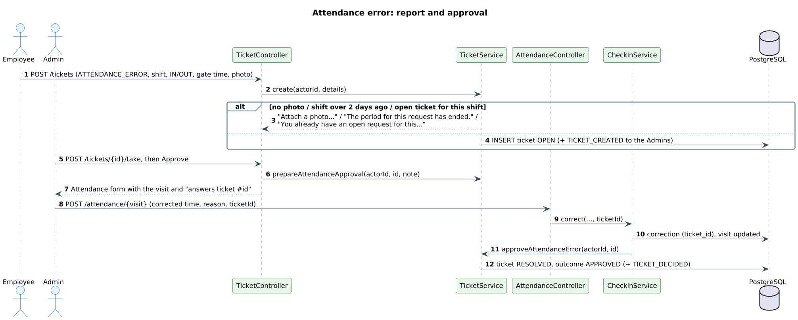

*Figure 45: Sequence diagram for Attendance error report*  
[Image Detail](docs/diagrams/png/3-8-seq-error.png) · [PlantUML source](docs/diagrams/src/3-8-seq-error.puml)

#### 3.8.3 State Diagrams

##### 3.8.3.1 Ticket lifecycle

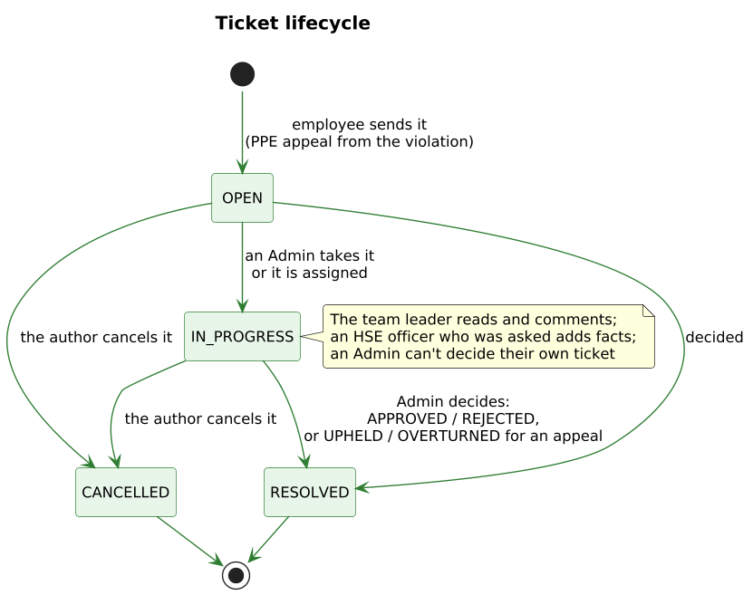

*Figure 46: Ticket lifecycle*  
[Image Detail](docs/diagrams/png/3-8-state-ticket.png) · [PlantUML source](docs/diagrams/src/3-8-state-ticket.puml)

### 3.9 Notifications and the Zalo Bot

Every notice is saved first and shown in the web ERP (the bell and the Notifications page), then a
delivery row says whether Zalo must send it (BR-15, BR-16). Notices store a kind and parameters, so each
reader sees them in their own language; the Zalo copy is Vietnamese. Violation alerts and gate check-in
and check-out notices are made by database triggers; the rest by the ERP.

1. A notice is inserted (by a service through `NotificationService.notify`, or by a trigger).
2. A trigger adds its delivery row: PENDING if the person linked Zalo, otherwise SKIPPED.
3. Every minute, `JobScheduler` runs `CheckOutHours.fill`, then `ZaloDispatcher.sendDue`, which sends
   each due notice with `ZaloBot.send` and retries after 1, 5 and 15 minutes before FAILED. A text over
   1,900 characters is cut, with a link to the page (BR-17).
4. Messages people send to the bot reach `ZaloController` on `/zalo/webhook`: a 6-digit link code,
   `/stop`, or the commands `/help`, `/lich [tuantoi]` and `/chamcong [thangtruoc]` (team addition).

#### 3.9.1 Class Diagram

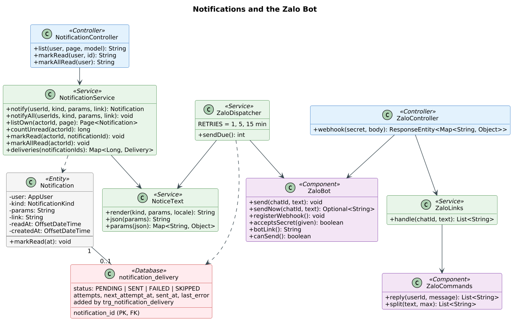

*Figure 47: Class diagram for Notifications and the Zalo Bot*  
[Image Detail](docs/diagrams/png/3-9-class.png) · [PlantUML source](docs/diagrams/src/3-9-class.puml)

**Class specifications of Notifications and the Zalo Bot**

| Class | Stereotype | Main operations |
| --- | --- | --- |
| `NotificationController` | Controller | Notifications page, mark read, mark all read |
| `NotificationService` | Service | `notify`, `notifyAll`, `listOwn`, `countUnread`, `markRead`, `markAllRead`, `deliveries` |
| `Notices`, `NoticeText` | Service | Build the parameters of each kind; `render` the text in a language |
| `ZaloDispatcher` | Service | `sendDue` |
| `ZaloBot` | Component | `send`, `registerWebhook`, `acceptsSecret`, `botLink` |
| `ZaloCommands` | Component | `reply`, `split` (replies over 2,000 characters are split at line ends) |
| `NotificationKind` | Enum | Every kind and the parameters it needs |

*Table 47: Class specifications of Notifications and the Zalo Bot*

#### 3.9.2 Sequence Diagrams

##### 3.9.2.1 Sequence diagram for Notice delivery

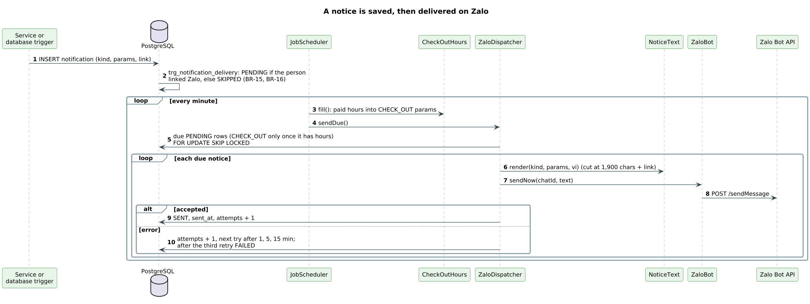

*Figure 48: Sequence diagram for Notice delivery*  
[Image Detail](docs/diagrams/png/3-9-seq-deliver.png) · [PlantUML source](docs/diagrams/src/3-9-seq-deliver.puml)

##### 3.9.2.2 Sequence diagram for Bot commands

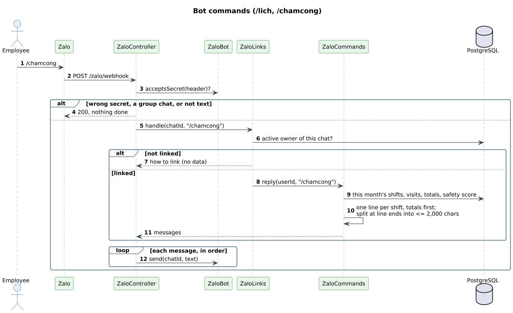

*Figure 49: Sequence diagram for Bot commands*  
[Image Detail](docs/diagrams/png/3-9-seq-bot.png) · [PlantUML source](docs/diagrams/src/3-9-seq-bot.puml)

#### 3.9.3 State Diagrams

##### 3.9.3.1 Notice delivery lifecycle

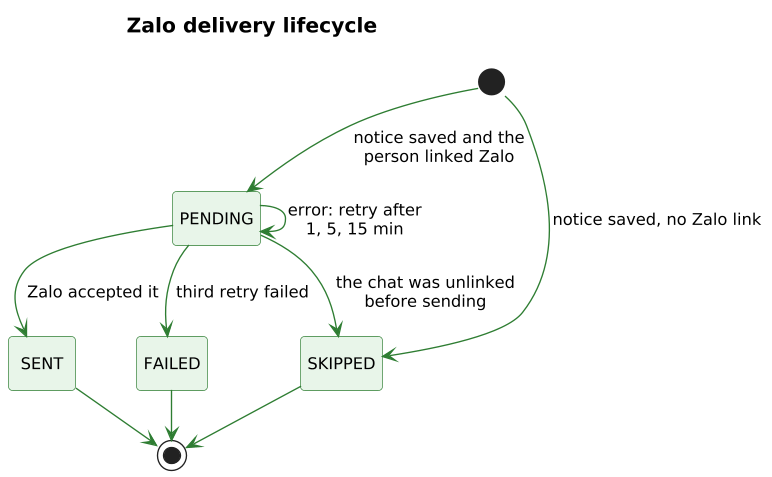

*Figure 50: Notice delivery lifecycle*  
[Image Detail](docs/diagrams/png/3-9-state-delivery.png) · [PlantUML source](docs/diagrams/src/3-9-state-delivery.puml)

### 3.10 Scheduled Jobs and Month Closing

`JobScheduler` ticks every 60 seconds in Vietnam time. For each job it works out the latest time it was
due; a `job_run` row for that time means it already ran, so a job never runs twice and a run missed while
Render slept runs once on the next tick (CR-12).

| Job | When | What `SiteJobs` does |
| --- | --- | --- |
| hourly | Every hour | Cancels pending overtime past its 48 hours, closes visits open 4 hours after their shift, marks ended shifts COMPLETED |
| day-end | 23:00 | Flags Incomplete attendance and closes stale visits (BR-35), splits time after the shift end plus 20 minutes into pending overtime (BR-34), sets the day's PENDING_REVIEW violations to OVERDUE (BR-53) |
| morning | 07:00 | Tells the Admins how many violations are overdue and how much overtime is pending, and each team leader their team's pending overtime |
| old-tickets | 08:00 | Tells the Admins how many tickets have been open too long |
| weekly-schedule | Saturday 18:00 | Sends next week's schedule to everyone (BR-18) |
| month-end | Last working day | Tells the Admins the open tickets and the HSE Officers the overdue violations, before the month is locked |
| cancel-last-month-overtime | 2nd of the month, after midnight | Cancels last month's pending overtime (BR-37) |
| month-lock | 23:59 of the 2nd working day | Locks last month and freezes every SITE employee's score and bonus level in `monthly_score` (BR-70) |

*Table 48: Scheduled Jobs and Month Closing*

#### 3.10.1 Class Diagram

*Figure 51: Class diagram for Scheduled Jobs and Month Closing*  
[Image Detail](docs/diagrams/png/3-10-class.png) · [PlantUML source](docs/diagrams/src/3-10-class.puml)

#### 3.10.2 Sequence Diagrams

##### 3.10.2.1 Sequence diagram for Job tick and catch-up

*Figure 52: Sequence diagram for Job tick and catch-up*  
[Image Detail](docs/diagrams/png/3-10-seq-tick.png) · [PlantUML source](docs/diagrams/src/3-10-seq-tick.puml)

#### 3.10.3 State Diagrams

##### 3.10.3.1 Month lifecycle

*Figure 53: Month lifecycle*  
[Image Detail](docs/diagrams/png/3-10-state-month.png) · [PlantUML source](docs/diagrams/src/3-10-state-month.puml)

### 3.11 Home Page and Monthly Report

The home page shows each role what it needs today: own shift, tickets and violations; HSE's queue and
on-site list; the Admin's open tickets and failed face photos; team rosters for leaders. Charts are bars
worked out in Java (`Charts`) and drawn in HTML and CSS.

The monthly report is exported by a team leader for their own team or by the Admin for the site
(BR-71). Before the month is locked it says "Provisional". Each export is logged. The sheets are in
Section 5.4.

#### 3.11.1 Class Diagram

*Figure 54: Class diagram for Home Page and Monthly Report*  
[Image Detail](docs/diagrams/png/3-11-class.png) · [PlantUML source](docs/diagrams/src/3-11-class.puml)

**Class specifications of Home Page and Monthly Report**

| Class | Stereotype | Main operations |
| --- | --- | --- |
| `HomeController`, `NavCounts`, `TodayRoster`, `Charts` | Controller, Web helper | The home page and the sidebar counts |
| `ReportController` | Controller | `/reports` (choose month and team) and `/team/report` (download) |
| `MonthlyReportService` | Service | `build(month, team)`, `logExport`, `exports` |
| `MonthlyReportWorkbook` | Component | `write`: streams the .xlsx with fastexcel; `fileName` |

*Table 49: Class specifications of Home Page and Monthly Report*

#### 3.11.2 Sequence Diagrams

##### 3.11.2.1 Sequence diagram for Export the monthly report

*Figure 55: Sequence diagram for Export the monthly report*  
[Image Detail](docs/diagrams/png/3-11-seq-export.png) · [PlantUML source](docs/diagrams/src/3-11-seq-export.puml)

### 3.12 Photo Storage

Photos are kept outside the database: on local disk in development and in private Supabase Storage
buckets in production. The type comes from the file's bytes (JPEG or PNG), names are random, and faces,
tickets and evidence are kept in separate albums. Callers check permissions first; browsers never get a
Storage URL.

#### 3.12.1 Class Diagram

*Figure 56: Class diagram for Photo Storage*  
[Image Detail](docs/diagrams/png/3-12-class.png) · [PlantUML source](docs/diagrams/src/3-12-class.puml)

**Class specifications of Photo Storage**

| Class | Stereotype | Main operations |
| --- | --- | --- |
| `PhotoStorage` | Interface | `store(album, photo)` returns the stored name; `load(album, name)`; `delete(album, name)`; `contentType(name)` |
| `LocalPhotoStorage`, `SupabasePhotoStorage` | Component | The two implementations, chosen by `steelsight.storage.type` |
| `PhotoAlbum`, `PhotoFormat` | Enum | TICKET, FACE and EVIDENCE, each with its bucket (the ERP only reads EVIDENCE); the image type from its bytes |

*Table 50: Class specifications of Photo Storage*

#### 3.12.2 Sequence Diagrams

##### 3.12.2.1 Sequence diagram for Show an evidence photo

*Figure 57: Sequence diagram for Show an evidence photo*  
[Image Detail](docs/diagrams/png/3-12-seq-photo.png) · [PlantUML source](docs/diagrams/src/3-12-seq-photo.puml)

### 3.13 Detection App

The detection app is designed in its own repository. In short:

- **Gate check-in (CAM-01):** a face matched twice, 1 second apart, against the READY embeddings is a
  check-in, or a check-out if the person is on site; the same person is ignored for 5 minutes (BR-27 to
  BR-29). The event goes to the outbox.
- **PPE monitoring (CAM-02 to CAM-04):** a person without a hard hat for 10 seconds or a vest for 3
  seconds gets a spoken reminder, then a violation with an evidence photo and a suggested person when
  the face is known; both missing is one NO_HARD_HAT_AND_VEST (BR-40 to BR-45).
- **Outbox and sync:** every event waits in SQLite with its own UUID. `ErpSync` uploads the photo to
  `evidence-photos`, then inserts the row with `ON CONFLICT (event_id) DO NOTHING`, oldest first. It
  also enrols PENDING face photos and calls `close_stale_check_ins()` on a timer.

The SQL it may run is fixed by [detection-app-contract.md](docs/detection-app-contract.md). Its own design is in the
detection repository's `03_implement/STEELSIGHT-DET-*` documents. `DET-IDG` and `DET-SYN` still mention vest numbers, which the
app no longer reads (CR-01).

#### 3.13.1 Class Diagram

*Figure 58: Class diagram for the Detection App*  
[Image Detail](docs/diagrams/png/3-13-class.png) · [PlantUML source](docs/diagrams/src/3-13-class.puml)

#### 3.13.2 Sequence Diagrams

##### 3.13.2.1 Sequence diagram for Offline outbox and sync

*Figure 59: Sequence diagram for Offline outbox and sync*  
[Image Detail](docs/diagrams/png/3-13-seq-sync.png) · [PlantUML source](docs/diagrams/src/3-13-seq-sync.puml)

## 4. Integration Design

It lists every interface between the parts of the system:
the routes of the web ERP, how the detection app works with Supabase, photo storage, the Zalo bot and
the cameras. Ports and protocols are in Section 1.1.3.

*Figure 60: Integration overview*  
[Image Detail](docs/diagrams/png/4-1-integration.png) · [PlantUML source](docs/diagrams/src/4-1-integration.puml)

### 4.1 ERP Routes

The ERP serves HTML pages and htmx fragments to browsers. Every page route needs a signed-in session,
and every POST needs the CSRF token, which htmx sends in a header. Spring Security checks that the user
is signed in; the service then checks the permission and the scope (own record, own team, or all)
through `AccessPolicy`. A route a role may not use answers 403 and shows the error page.

| # | Method | Route | Who | Scope and notes |
| --- | --- | --- | --- | --- |
| 1 | GET, POST | `/login`, `/logout` | Everyone | Sign-in by employee code; locked for 15 minutes after 5 failures per client or 20 per code |
| 2 | GET, POST | `/account/password` | Signed in | Forced after an Admin chose the password |
| 3 | POST | `/language` | Everyone | English or Vietnamese, kept in a cookie |
| 4 | GET | `/` | Signed in | Home page for the user's role |
| 5 | GET, POST | `/team`, `/team/new`, `/team/{id}/edit`, `/team/{id}`, `/team/{id}/role`, `/team/{id}/team`, `/team/{id}/group`, `/team/{id}/password`, `/team/{id}/deactivate`, `/team/{id}/reactivate`, `/team/{id}/delete` | Admin | Accounts. A team leader sees only their own team's list |
| 6 | GET, POST | `/team/{id}/face`, `/team/{id}/face/{pose}`, `/team/{id}/face/{pose}/delete` | Admin | Face photos FRONT, LEFT and RIGHT, with consent |
| 7 | POST | `/team/{id}/zalo-code`, `/team/{id}/zalo-unlink` | Admin | Make a Zalo link code for someone, or unlink them |
| 8 | GET | `/workers`, `/workers/{id}` | Admin, HSE Officer, Team Leader | Read-only employee list and profile |
| 9 | POST | `/teams`, `/teams/{id}/leader`, `/teams/{id}/delete` | Admin | Teams and their leader |
| 10 | GET, POST | `/zones`, `/zones/new`, `/zones/{id}`, `/zones/{id}/team`, `/zones/cameras`, `/zones/cameras/{id}/remove` | Admin | Zones (name, team) and cameras |
| 11 | GET, POST | `/settings` | Admin | Company settings (half day for an unexplained missing check-out) |
| 12 | GET, POST | `/shifts`, `/shifts/new`, `/shifts/copy`, `/shifts/{id}/edit`, `/shifts/{id}`, `/shifts/{id}/cancel` | Team Leader, Admin | Leader: regular shifts of their own team, before Saturday 18:00; Admin: anyone, and overtime |
| 13 | GET | `/timetable` | Everyone with shifts | Own shifts |
| 14 | GET | `/attendance/mine` | Everyone | Own visits and their status |
| 15 | GET | `/attendance/team` | Team Leader, Admin | The team's visits and pending overtime |
| 16 | GET, POST | `/attendance`, `/attendance/new`, `/attendance/{id}/edit`, `/attendance/{id}` | HSE Officer, Admin | Record or correct a visit, with a reason; the history is kept |
| 17 | GET, POST | `/overtime`, `/overtime/cancel`, `/overtime/{id}/note` | Admin; leader for the note | Pending overtime |
| 18 | GET, POST | `/violations`, `/violations/{id}`, `/violations/{id}/photo`, `/violations/{id}/dispute` | The person concerned | Own violations, the evidence photo, and an appeal within the appeal period |
| 19 | GET, POST | `/violations/review`, `/violations/all`, `/violations/{id}/take`, `/violations/{id}/confirm`, `/violations/{id}/dismiss` | HSE Officer, Admin | The Review Queue and the violation list |
| 20 | POST | `/violations/{id}/decision` | Admin | Decide an appeal, with the HSE facts |
| 21 | GET | `/safety/shifts` | HSE Officer, Admin | Unsafe time slots |
| 22 | GET, POST | `/tickets`, `/tickets/new`, `/tickets/{id}`, `/tickets/{id}/comments`, `/tickets/{id}/cancel`, `/tickets/{id}/photo` | Everyone | Own tickets; a team leader also reads and comments on the team's; an HSE Officer who was asked reads and comments |
| 23 | GET, POST | `/tickets/queue`, `/tickets/{id}/take`, `/tickets/{id}/assignee`, `/tickets/{id}/ask`, `/tickets/{id}/decide`, `/tickets/{id}/resolve` | Admin | The ticket queue; an Admin can't handle a ticket they opened |
| 24 | POST | `/tickets/{id}/facts` | HSE Officer who was asked | The facts of the shift |
| 25 | GET | `/reports`, `/team/report` | Team Leader, Admin | Monthly report: leader for their own team, Admin for any team or the site |
| 26 | GET, POST | `/notifications`, `/notifications/{id}/read`, `/notifications/read-all` | Everyone | Own notices |
| 27 | POST | `/account/zalo/link`, `/account/zalo/unlink` | Everyone | Own Zalo link code and QR, or unlink |
| 28 | POST | `/zalo/webhook` | Zalo Bot Platform | No session or CSRF; refused unless the `X-Bot-Api-Secret-Token` header matches |
| 29 | GET | `/actuator/health` | Public | For Render and the uptime monitor |
| 30 | any | `/api/**` | API key | No endpoint since V26 (the burst alert API was removed, CR-02). The chain still refuses any call without the `X-Api-Key` |

*Table 51: ERP Routes*

### 4.2 Detection App and Supabase

The detection app connects to PostgreSQL through Supabase's session pooler with psycopg, over TLS, as
`steelsight_detection`. That role can only touch the columns below, and row level security limits its
rows. Every event has a UUID `event_id` made on the laptop and waits in the local outbox until it is
stored, so an event sent twice is stored once and nothing is lost while the internet is down. Events go
oldest first, so a check-out never arrives before its check-in. The full contract is
[detection-app-contract.md](docs/detection-app-contract.md).

| # | Event | What the detection app writes | What the database does |
| --- | --- | --- | --- |
| 1 | Gate check-in (CAM-01) | `INSERT check_in` (user, camera, zone, check-in time, `method = FACE`, face similarity, photo, event_id) | Attaches the visit to the person's shift if it starts at most 60 minutes before (BR-30), closes a visit left open from an earlier day, and sends the CHECK_IN notice |
| 2 | Gate check-out | `UPDATE check_in SET check_out_at` on the open visit | Sends the CHECK_OUT notice (the ERP adds the paid hours), and marks the shift COMPLETED (V25) |
| 3 | Violation (CAM-02 to CAM-04) | Photo to `evidence-photos`, then `INSERT violation` (camera, type, time, confidence, person box, photo, `suggested_user_id`, `suggestion_similarity`, event_id) | Fills the zone from the camera, starts it PENDING_REVIEW with no person, and alerts the HSE Officers on duty (BR-54) |
| 4 | Face enrolment | Reads PENDING `face_embedding` rows, downloads the photo, then `UPDATE face_embedding` to READY (vector, model) or FAILED (reason) | READY vectors are used at the gate and for suggestions |
| 5 | Stale visits | `SELECT close_stale_check_ins(time_zone)` on a timer and before each check-in | Flags Incomplete after 20 minutes and closes a visit 4 hours after its shift (BR-35) |
| 6 | Reference data | Reads cameras, zones (code, name, kind), shifts, and each READY embedding with the employee code and full name | |

*Table 52: Detection App and Supabase*

The role can't read passwords, emails, phone numbers or tickets, and can't change a review, an appeal
or a notice. The ERP connects as the table owner.

### 4.3 Photo Storage

Photos are kept in three private Supabase Storage buckets and reached over the Storage REST API with the
server key. Tables store only the path. Browsers never get a Storage URL: each photo goes through an ERP
route that checks the permission first.

| # | Bucket | Referenced by | Written by | Read through |
| --- | --- | --- | --- | --- |
| 1 | `face-photos` | `app_user.face_file_path`, `face_embedding.source_file_path` | ERP (Admin only) | `/team/{id}/face`, and the detection app for enrolment. Deleted with the account |
| 2 | `ticket-photos` | `ticket.photo_path` | ERP (the ticket's author) | `/tickets/{id}/photo` |
| 3 | `evidence-photos` | `violation.snapshot_path`, `check_in.snapshot_path` | Detection app | `/violations/{id}/photo`; the detection app clears old local copies (SRS 3.2.41) |

*Table 53: Photo Storage*

A photo is JPEG or PNG, decided from its bytes, at most 5 MB, and gets a random name.

### 4.4 Zalo Bot

The ERP talks to the Zalo Bot Platform at `https://bot-api.zaloplatforms.com/bot<token>`.

| # | Direction | Call | Purpose |
| --- | --- | --- | --- |
| 1 | ERP → Zalo | `POST /setWebhook` with `url` and `secret_token` | At start-up, registers `<ZALO_WEBHOOK_URL>` with the shared secret |
| 2 | ERP → Zalo | `POST /sendMessage` with `chat_id` and `text` | Sends each due notice (texts over the limit are cut with a link) and each bot reply, one at a time in order |
| 3 | Zalo → ERP | `POST /zalo/webhook` with header `X-Bot-Api-Secret-Token` | Each `message.text.received` event in a private chat: a 6-digit link code, `/stop`, `/help`, `/lich [tuantoi]` or `/chamcong [thangtruoc]` |

*Table 54: Zalo Bot*

A person links their chat by scanning the QR code on their home page (it opens the bot) and sending the
code shown there. The settings are `ZALO_BOT_TOKEN`, `ZALO_BOT_LINK`, `ZALO_WEBHOOK_SECRET`,
`ZALO_WEBHOOK_URL` and `APP_BASE_URL` (for the links in messages). Without a token and link the bot is
off, and every delivery is SKIPPED.

### 4.5 Cameras

The detection app opens each camera over RTSP (port 554, path `/Streaming/Channels/101` for the
Hikvision cameras) on the site network. Readers keep only the newest frame, so a slow model never builds
a backlog, and reconnect when a stream drops. Each camera has a code in the desktop settings that must
equal `camera.camera_code` in the ERP, and its zone is chosen by the zone's code (SRS 3.2.30).

| Camera | Zone | Role |
| --- | --- | --- |
| CAM-01 | GATE-IN | Attendance: face check-in and check-out |
| CAM-02 | GATE-PPE | PPE at the gate, in and out, at any time |
| CAM-03, CAM-04 | AREA-A, AREA-B | PPE in the work areas |

*Table 55: Cameras*

## 5. Security and Report Design

How people sign in, what each role may do, how personal data is protected, and what the monthly report contains.

### 5.1 Authentication and Session

| # | Item | Design |
| --- | --- | --- |
| 1 | Sign-in | Employee code and password. Passwords are 8 characters to 72 bytes, stored as BCrypt hashes (BR-02). Every failed sign-in gets the same message (BR-01) |
| 2 | Sign-in limit | `SignInLimiter`, in memory with Caffeine: 5 failures from one client or 20 for one employee code lock sign-in for 15 minutes (BR-04). A restart clears the counts |
| 3 | First sign-in | When the Admin creates an account or resets a password, `must_change_password` is set, and `PasswordChangeRequiredFilter` sends the user to `/account/password` until they choose their own (BR-03) |
| 4 | Session | Server session, 30 minutes idle (BR-05). The cookie is `SameSite=Lax`, and `Secure` in production (`application-prod.yaml`). A deactivated or deleted user can't sign in, and `UserSessions` ends their open sessions; changing a password ends the others |
| 5 | First Admin | `AdminBootstrap` creates one from `ADMIN_EMPLOYEE_CODE` and `ADMIN_PASSWORD` when there is none |
| 6 | CSRF and XSS | A CSRF token on every page POST, sent by htmx in a header. Thymeleaf escapes all output |
| 7 | Zalo webhook | No session and no CSRF; every call must carry the `X-Bot-Api-Secret-Token` chosen at `setWebhook`, or it is refused |
| 8 | API key | The `/api/**` chain needs the `X-Api-Key` and limits calls per minute (`ApiKeyFilter`, `ApiLimiter`). No endpoint is left there since V26 |
| 9 | Secrets | Render environment variables, the GitHub (later GitLab) masked variables, and the laptop's `.env`. The Supabase server key is only in the ERP |
| 10 | Transport | HTTPS for browsers, Zalo and Storage; TLS for PostgreSQL. The laptop opens no ports, and the desktop app's own server listens only on `127.0.0.1` |
| 11 | Logs | Request, error and sign-in logs share a request ID. Passwords, keys and tokens are never logged |
| 12 | Desktop app | Its own local accounts, stored as PBKDF2 hashes with a salt on the laptop, with a lock against guessing (BR-73). The gate screen needs no sign-in |

*Table 56: Authentication and Session*

### 5.2 Authorization Matrix

Each role holds a set of permissions (`role_permission`), and the Admin holds every one. Spring Security
loads them as authorities, Thymeleaf hides the links and buttons a user can't use, and every request is
checked again in the service by `AccessPolicy`, including the record's scope. The table shows the
permissions after V27.

| Function | Worker | Team Leader (MANAGER) | HSE Officer | Admin | Permission |
| --- | --- | --- | --- | --- | --- |
| Create and change accounts, face photos, roles, teams | - | - | - | Yes | USER_MANAGE |
| View employees | - | Yes | Yes | Yes | USER_READ_ALL |
| Zones, cameras, company settings | - | - | - | Yes | USER_MANAGE |
| View own shifts and timetable | Yes | Yes | Yes | Yes | SHIFT_READ_OWN |
| View and plan the team's regular shifts | - | Own team | - | Yes | SHIFT_READ_TEAM, SHIFT_UPDATE_TEAM |
| Plan anyone, overtime shifts, pending overtime | - | - | - | Yes | SHIFT_READ_ALL, SHIFT_UPDATE_ALL |
| View own attendance | Yes | Yes | Yes | Yes | CHECKIN_READ_OWN |
| View team attendance | - | Own team | - | Yes | CHECKIN_READ_TEAM |
| View all attendance, record or correct a visit | - | - | Yes | Yes | CHECKIN_READ_ALL, CHECKIN_EDIT |
| View own violations and safety score, appeal | Yes | Yes | - | Yes | VIOLATION_READ_OWN |
| Review violations, view all, unsafe time slots | - | - | Yes | Yes | VIOLATION_REVIEW, VIOLATION_READ_ALL |
| Create a ticket, view own tickets | Yes | Yes | Yes | Yes | TICKET_CREATE, TICKET_READ_OWN |
| Read and comment on the team's tickets | - | Own team | - | Yes | TICKET_READ_TEAM |
| Read and comment on a ticket when asked for facts | - | - | When asked | - | (ticket_participant) |
| Handle and decide tickets, decide appeals | - | - | - | Yes, not their own | TICKET_READ_ALL, TICKET_UPDATE_ALL, TICKET_DELETE_ALL |
| Monthly report | - | Own team | - | Any team or the site | REPORT_EXPORT_TEAM, REPORT_EXPORT_ALL |
| Notifications, Zalo link | Yes | Yes | Yes | Yes | (any signed-in user) |

*Table 57: Authorization Matrix*

Team leaders were given VIOLATION_READ_OWN in V27 (25/11/2026), as the SRS (3.1.3) says: they work on
site and have a safety score, so they see their own violations and can appeal them. The permission is
own-only; reviewing and seeing everyone's violations still needs VIOLATION_REVIEW and VIOLATION_READ_ALL.

The ERP connects to the database as the table owner. The detection app's role, `steelsight_detection`,
is limited by column grants and row level security; its rights are listed in
Section 4.2.

*Figure 61: Authorization by role*  
[Image Detail](docs/diagrams/png/5-1-authz.png) · [PlantUML source](docs/diagrams/src/5-1-authz.puml)

### 5.3 Data Protection

- **Face data is biometric.** Only the Admin sets face photos, and only after the person's signed consent
  is confirmed (`face_consent_at`, BR-10, BR-11). The photos are in their own private bucket. When an
  account is soft-deleted, a trigger erases its face embeddings, and the ERP deletes its photos and
  unlinks Zalo (BR-07).
- **Photos are never public.** Face, ticket and evidence photos are fetched by the ERP after a
  permission check and streamed to the browser; the browser never gets a Storage URL.
- **The detection role sees only what it needs:** employee code, full name and face vectors, never
  passwords, emails, phone numbers or tickets.
- **Supabase's public Data API returns nothing,** because row level security is on for every table and
  the only policies are for the detection role.
- **Optimistic locking** (`version`) on accounts, visits, shifts, violations, tickets and company
  settings stops a stale form from overwriting a newer change.
- **History is kept:** every hand correction of a visit (`check_in_correction`), every review and appeal
  decision with who and when, every report export (`report_export`), and every scheduled job run
  (`job_run`).
- **Locked months don't change** (BR-70): shifts, visits, violations and scores of a month are frozen on
  the 2nd working day of the next month.

### 5.4 Report and Excel Design

The monthly report gives accounting the figures for pay and bonuses; Steelsight doesn't calculate pay. A
team leader exports their own team and the Admin exports any team or the whole site (BR-71). The file is
written by streaming with fastexcel, in the downloader's language, in Vietnam time, with hours to 2
decimals. A file made before the month is locked says "Provisional" above the header. Every export is
logged in `report_export`. Tests read the file back with fastexcel-reader.

| # | Sheet | Columns |
| --- | --- | --- |
| 1 | Site summary | Employee code, full name, team, shifts scheduled, shifts worked, absences, paid hours, valid overtime (h), pending overtime (h), times late, minutes late, times left early, minutes left early, Incomplete attendance, paid leave (h), unpaid leave (h), violations, safety score, safety level, bonus reduction % |
| 2 | Office summary | The same as Site summary up to unpaid leave, then reminders instead of the score columns, because OFFICE staff have no safety score (BR-56) |
| 3 | Violations | Detected, zone, violation type, status, employee code, full name, reviewer, appeal |
| 4 | Attendance | One row per visit: check-in, check-out, employee code, full name, shift start, shift end, method, Incomplete |
| 5 | Absences | One row per scheduled shift with no visit: shift start, shift end, employee code, full name, zone |

*Table 58: Report and Excel Design*

The safety score, level and reduction come from `safety_scores()`: live for an open month, frozen in
`monthly_score` for a locked one. Paid hours follow the attendance rules (late after 5 minutes, paid by
the shift frame, visits under 10 minutes ignored, half day for an unexplained missing check-out when the
company setting is on).

