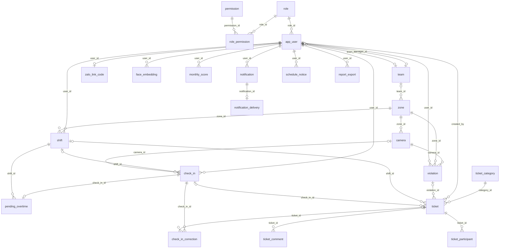
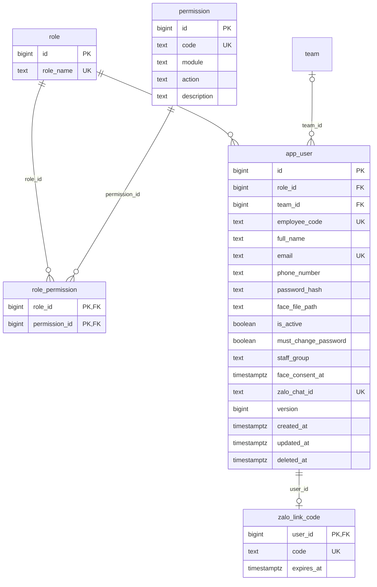
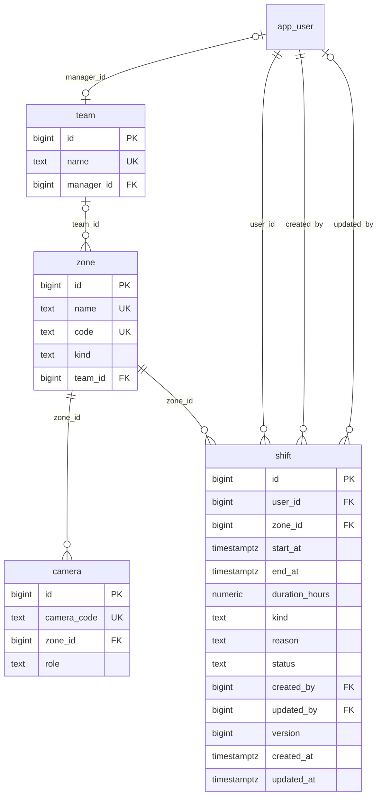
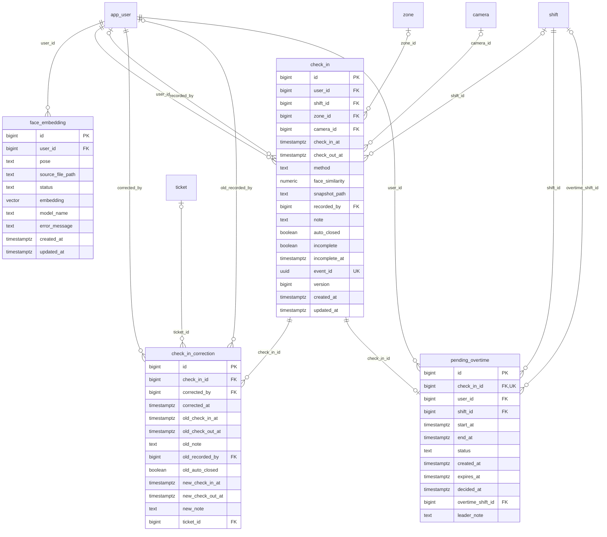
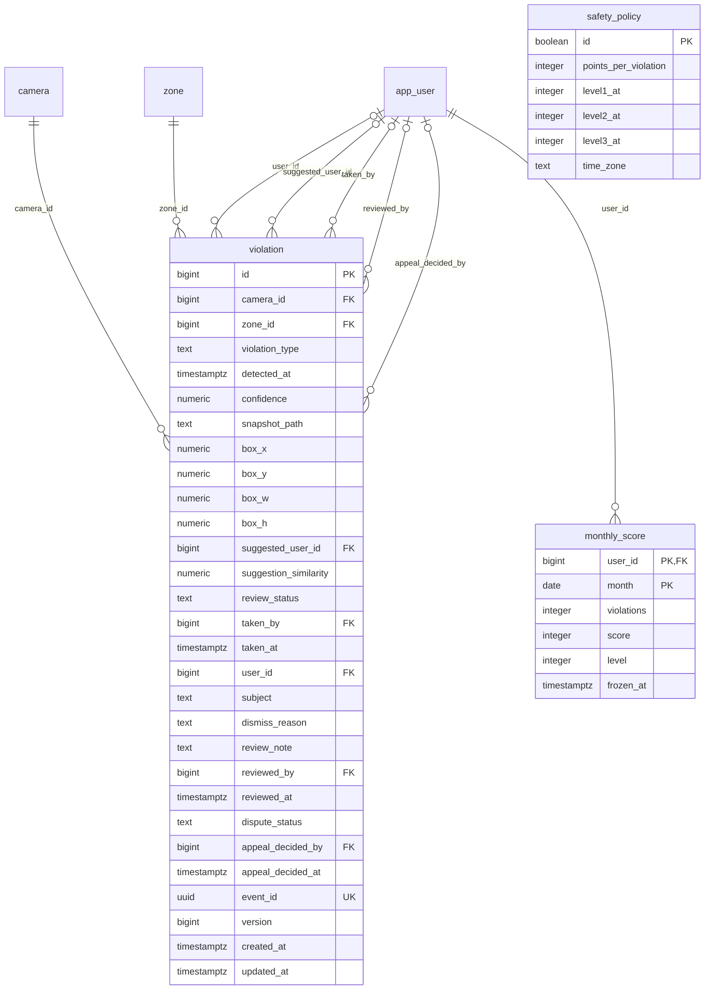
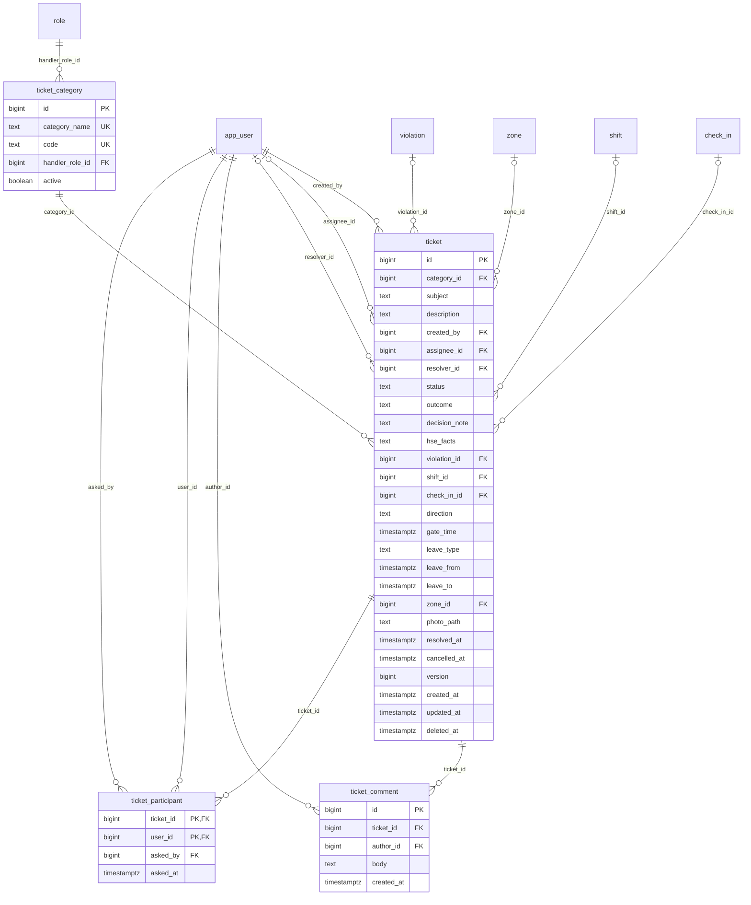
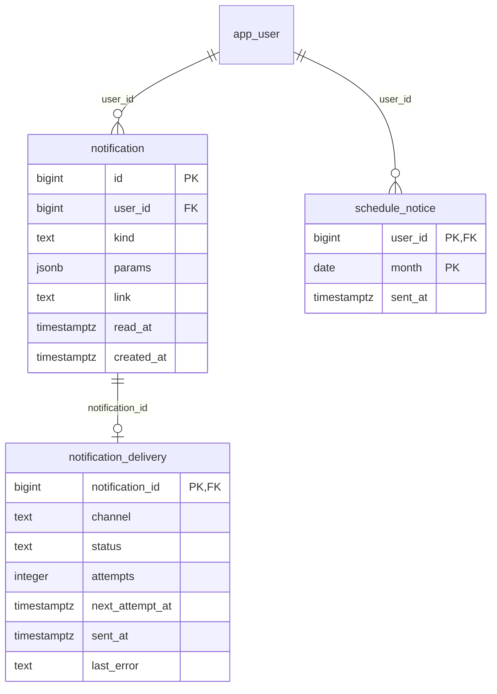
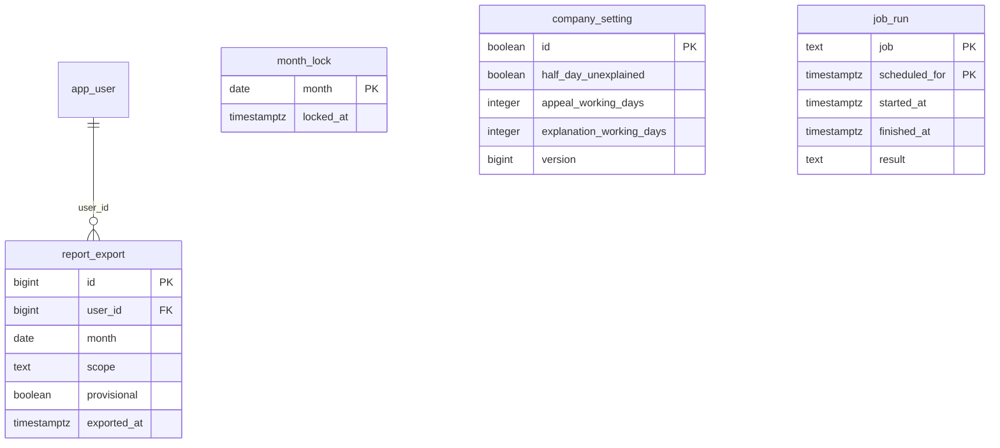

# Steelsight: Database Design

## 1. Overall

The Steelsight database has 27 tables in 7 logical domains, stored in PostgreSQL 17 on Supabase with the
pgvector and btree_gist extensions. It is the shared record for the web ERP and the detection app. Only
the ERP changes the schema, with the Flyway migrations V1 to V27 in `src/main/resources/db/migration`.
This document describes the schema after V27, which changed only role permissions after V26.

V26 applied the data model of the SRS (3.1.5, CR-01, CR-02, CR-23): the vest tables `ppe_vest` and
`ppe_linking`, the burst alert table `safety_alert` and the column `team.late_after_minutes` are gone,
and each zone has a fixed `code`.

The overview shows the main links only. Every table and all 52 foreign keys are in the domain diagrams
of Section 2. The tables `safety_policy`, `company_setting`, `month_lock` and `job_run` have no foreign
keys.

| No. | Domain | Tables | Description |
| --- | --- | --- | --- |
| 1 | Identity and Access Management | role, permission, role_permission, app_user, zalo_link_code | User accounts, what each role may do, and the link of each person's Zalo chat. |
| 2 | Teams, Zones and Shifts | team, zone, camera, shift | Teams with their leader, the monitoring zones and their cameras, and the timetable. |
| 3 | Attendance | face_embedding, check_in, check_in_correction, pending_overtime | Face enrolment, every site visit, every hand correction of one, and time worked after a shift. |
| 4 | PPE Violations and Safety Score | violation, safety_policy, monthly_score | The violations the cameras find, their review and appeal, and each site employee's monthly score. |
| 5 | Tickets | ticket_category, ticket, ticket_comment, ticket_participant | Requests to the Admin: PPE appeals, attendance errors, missing check-outs, leave and others. |
| 6 | Notifications | notification, notification_delivery, schedule_notice | Every notice saved in the ERP first, its Zalo delivery, and which schedules were sent. |
| 7 | Month Closing, Settings and Jobs | month_lock, report_export, company_setting, job_run | Locked months, the log of report exports, company options and the run log of scheduled jobs. |

In the field tables, Field Size gives bytes for fixed-size types and precision,scale for numeric, and
Variable means no declared limit. Unique says Partial when uniqueness applies only to some rows, and the
description gives the condition. Every `created_at`, `updated_at`, `corrected_at` and similar column
defaults to now(), and every `updated_at` is set by a trigger.

## 2. Data Dictionary

### 2.1 Identity and Access Management

Each user has one role, and a role holds many permissions, one row per action. The seeded roles are
WORKER, MANAGER (team leader), HSE_OFFICER and ADMIN, and the Admin holds every permission. Only the
Admin creates or changes accounts and face photos. Users sign in with their employee code. A person
links their own Zalo chat with a one-time code; from then on every notice is also sent there.

#### 2.1.1 role

The job roles a user can hold. Seeded by the migrations; there is no screen to change them.

| No. | Field Name | Data Type | Field Size | P/F Key | Nullable | Unique | Description |
| --- | --- | --- | --- | --- | --- | --- | --- |
| 1 | id | bigint | 8 bytes | PK | No | Yes | Generated role ID |
| 2 | role_name | text | Variable |  | No | Yes | WORKER, MANAGER, HSE_OFFICER or ADMIN |

#### 2.1.2 permission

One action in the system, such as TICKET_CREATE.

| No. | Field Name | Data Type | Field Size | P/F Key | Nullable | Unique | Description |
| --- | --- | --- | --- | --- | --- | --- | --- |
| 1 | id | bigint | 8 bytes | PK | No | Yes | Generated permission ID |
| 2 | code | text | Variable |  | No | Yes | Code loaded by Spring Security as an authority |
| 3 | module | text | Variable |  | No | No | Area the action belongs to, such as TICKET, SHIFT, VIOLATION, USER, CHECKIN or REPORT |
| 4 | action | text | Variable |  | No | No | Type of action, such as READ, CREATE, UPDATE, DELETE, REVIEW or MANAGE |
| 5 | description | text | Variable |  | Yes | No | Plain-language explanation of the permission |

#### 2.1.3 role_permission

Links each role to the permissions it holds.

| No. | Field Name | Data Type | Field Size | P/F Key | Nullable | Unique | Description |
| --- | --- | --- | --- | --- | --- | --- | --- |
| 1 | role_id | bigint | 8 bytes | PK, FK → role(id) | No | Composite | The role; deleted with it |
| 2 | permission_id | bigint | 8 bytes | PK, FK → permission(id) | No | Composite | The permission; deleted with it |

#### 2.1.4 app_user

Every person who uses the system.

| No. | Field Name | Data Type | Field Size | P/F Key | Nullable | Unique | Description |
| --- | --- | --- | --- | --- | --- | --- | --- |
| 1 | id | bigint | 8 bytes | PK | No | Yes | Generated user ID |
| 2 | role_id | bigint | 8 bytes | FK → role(id) | No | No | The user's role |
| 3 | team_id | bigint | 8 bytes | FK → team(id) | Yes | No | The team of a site worker or team leader |
| 4 | employee_code | text | Variable |  | No | Yes | Employee code used to sign in (BR-06) |
| 5 | full_name | text | Variable |  | No | No | Full name |
| 6 | email | text | Variable |  | Yes | Yes | Email address |
| 7 | phone_number | text | Variable |  | Yes | No | Phone number, 10 digits (BR-06) |
| 8 | password_hash | text | Variable |  | No | No | BCrypt hash of the password; never the password itself |
| 9 | face_file_path | text | Variable |  | Yes | No | The FRONT face photo in the private face photo bucket; only the Admin sets it |
| 10 | is_active | boolean | 1 byte |  | No | No | False blocks sign-in; defaults to true |
| 11 | must_change_password | boolean | 1 byte |  | No | No | True when the Admin chose the password; the user must pick their own at the next sign-in (BR-03). Defaults to false |
| 12 | staff_group | text | Variable |  | No | No | SITE (default) or OFFICE. Only SITE staff have a safety score; an OFFICE violation is a reminder (BR-56, CR-08) |
| 13 | face_consent_at | timestamptz | 8 bytes |  | Yes | No | When the Admin confirmed the signed consent to face recognition (BR-10, BR-11) |
| 14 | zalo_chat_id | text | Variable |  | Yes | Partial | The user's own Zalo chat; unique when set (BR-14). Empty means no Zalo messages |
| 15 | version | bigint | 8 bytes |  | No | No | Optimistic lock counter; defaults to 0 |
| 16 | created_at | timestamptz | 8 bytes |  | No | No | When the row was created |
| 17 | updated_at | timestamptz | 8 bytes |  | No | No | When the row last changed |
| 18 | deleted_at | timestamptz | 8 bytes |  | Yes | No | When the user was soft-deleted; a trigger then erases their face embeddings (BR-07) |

#### 2.1.5 zalo_link_code

The one-time code that links a user's Zalo chat (BR-13). The user sends it to the Steelsight bot, and
Zalo passes it to the ERP's webhook.

| No. | Field Name | Data Type | Field Size | P/F Key | Nullable | Unique | Description |
| --- | --- | --- | --- | --- | --- | --- | --- |
| 1 | user_id | bigint | 8 bytes | PK, FK → app_user(id) | No | Yes | Whose chat the code links. One code per user, and a new one replaces the old. Deleted with the user |
| 2 | code | text | Variable |  | No | Yes | 6 random digits; used up when the chat is linked |
| 3 | expires_at | timestamptz | 8 bytes |  | No | No | 24 hours after the code was made |

### 2.2 Teams, Zones and Shifts

Each team has at most one leader, a MANAGER, and a manager leads at most one team (BR-20). The site is
divided into monitoring zones: the gate attendance zone, the gate PPE zone and the work areas. A zone
can have several cameras, and a work area belongs to the team that works there, so HSE picks a violator
from that team first (team decision; the SRS says one camera per zone). A shift is one planned work
period of one person; a day off is a day with no shift.

#### 2.2.1 team

A group of site workers under one leader. The late tolerance is 5 minutes for every team (BR-31), so
teams no longer have their own (V26).

| No. | Field Name | Data Type | Field Size | P/F Key | Nullable | Unique | Description |
| --- | --- | --- | --- | --- | --- | --- | --- |
| 1 | id | bigint | 8 bytes | PK | No | Yes | Generated team ID |
| 2 | name | text | Variable |  | No | Yes | Team name |
| 3 | manager_id | bigint | 8 bytes | FK → app_user(id) | Yes | Partial | The team leader; unique when set, so a manager leads one team |

#### 2.2.2 zone

A monitoring zone, used by cameras, shifts, violations and tickets.

| No. | Field Name | Data Type | Field Size | P/F Key | Nullable | Unique | Description |
| --- | --- | --- | --- | --- | --- | --- | --- |
| 1 | id | bigint | 8 bytes | PK | No | Yes | Generated zone ID |
| 2 | name | text | Variable |  | No | Yes | The name every alert, report and Zalo message uses; 2 to 50 characters; the Admin can change it (BR-55) |
| 3 | code | text | Variable |  | No | Yes | Fixed code: GATE-IN, GATE-PPE, AREA-A, AREA-B ... The database gives the next free code of the kind when a zone is added and refuses any change, because the desktop app's camera settings name the zone by it (SRS 3.2.23, 3.2.30; V26) |
| 4 | kind | text | Variable |  | No | No | GATE_ATTENDANCE, GATE_PPE or WORK_AREA (default) |
| 5 | team_id | bigint | 8 bytes | FK → team(id) | Yes | No | The team that works in this area; only a WORK_AREA can have one. Set to empty if the team is deleted |

#### 2.2.3 camera

A site camera and the zone it watches.

| No. | Field Name | Data Type | Field Size | P/F Key | Nullable | Unique | Description |
| --- | --- | --- | --- | --- | --- | --- | --- |
| 1 | id | bigint | 8 bytes | PK | No | Yes | Generated camera ID |
| 2 | camera_code | text | Variable |  | No | Yes | The code entered for the camera in the desktop app, such as CAM-01 |
| 3 | zone_id | bigint | 8 bytes | FK → zone(id) | No | No | Zone the camera covers |
| 4 | role | text | Variable |  | No | No | ATTENDANCE for a camera in the gate attendance zone (BR-27), PPE (default) for every other |

#### 2.2.4 shift

One planned work period of one person. An exclusion constraint refuses two overlapping shifts of one
person that aren't cancelled (BR-22).

| No. | Field Name | Data Type | Field Size | P/F Key | Nullable | Unique | Description |
| --- | --- | --- | --- | --- | --- | --- | --- |
| 1 | id | bigint | 8 bytes | PK | No | Yes | Generated shift ID |
| 2 | user_id | bigint | 8 bytes | FK → app_user(id) | No | No | The person working |
| 3 | zone_id | bigint | 8 bytes | FK → zone(id) | No | No | Where the person is assigned |
| 4 | start_at | timestamptz | 8 bytes |  | No | No | Shift start |
| 5 | end_at | timestamptz | 8 bytes |  | No | No | Shift end; after the start, and 30 minutes to 12 hours long (BR-21) |
| 6 | duration_hours | numeric | Variable |  | Yes | No | Length in hours; generated by the database from start and end |
| 7 | kind | text | Variable |  | No | No | REGULAR (default) or OVERTIME (BR-23) |
| 8 | reason | text | Variable |  | Yes | No | Why the overtime is needed; required for OVERTIME, 10 to 500 characters |
| 9 | status | text | Variable |  | No | No | SCHEDULED (default), COMPLETED or CANCELLED. COMPLETED is set at check-out (V25) or by a job once the shift ends |
| 10 | created_by | bigint | 8 bytes | FK → app_user(id) | No | No | Who created the shift |
| 11 | updated_by | bigint | 8 bytes | FK → app_user(id) | Yes | No | Who last changed the shift |
| 12 | version | bigint | 8 bytes |  | No | No | Optimistic lock counter; defaults to 0 |
| 13 | created_at | timestamptz | 8 bytes |  | No | No | When the row was created |
| 14 | updated_at | timestamptz | 8 bytes |  | No | No | When the row last changed |

### 2.3 Attendance

Enrolment runs through `face_embedding`: the ERP queues a photo, and the detection app computes the
vector. A `check_in` row is one site visit, written by the detection app when a face is matched at the
gate, or entered by hand by an HSE Officer. A hand correction keeps what the visit said before in
`check_in_correction`, because visits feed the monthly report. Time worked after a shift without an
overtime shift waits in `pending_overtime` for the Admin.

#### 2.3.1 face_embedding

One row per person and angle, which is also the enrolment queue. Every enrolled person has a FRONT row,
the photo on their account. The Admin can add LEFT and RIGHT photos, so the gate camera still knows a
person who isn't looking straight at it; the detection app keeps the best score of all READY rows (V14).
Face vectors are biometric data: the rows are erased when the account is soft-deleted (BR-07).

| No. | Field Name | Data Type | Field Size | P/F Key | Nullable | Unique | Description |
| --- | --- | --- | --- | --- | --- | --- | --- |
| 1 | id | bigint | 8 bytes | PK | No | Yes | Generated row ID |
| 2 | user_id | bigint | 8 bytes | FK → app_user(id) | No | Yes, with pose | The person; the rows are deleted with the user |
| 3 | pose | text | Variable |  | No | Yes, with user_id | FRONT (default), LEFT or RIGHT |
| 4 | source_file_path | text | Variable |  | No | No | The photo this row was made from, in the private face photo bucket |
| 5 | status | text | Variable |  | No | No | PENDING (default), READY or FAILED |
| 6 | embedding | vector | 512 dimensions |  | Yes | No | InsightFace vector; required when READY |
| 7 | model_name | text | Variable |  | Yes | No | Model that made the vector, because vectors of different models don't compare; required when READY |
| 8 | error_message | text | Variable |  | Yes | No | Why enrolment failed, such as no face found |
| 9 | created_at | timestamptz | 8 bytes |  | No | No | When the row was created |
| 10 | updated_at | timestamptz | 8 bytes |  | No | No | When the row last changed |

#### 2.3.2 check_in

One visit to site, from check-in to check-out. A trigger attaches a new visit to the person's own shift
when it starts at most 60 minutes before the shift and before its end (BR-30), and closes any visit of
the person still open from an earlier day.

| No. | Field Name | Data Type | Field Size | P/F Key | Nullable | Unique | Description |
| --- | --- | --- | --- | --- | --- | --- | --- |
| 1 | id | bigint | 8 bytes | PK | No | Yes | Generated visit ID |
| 2 | user_id | bigint | 8 bytes | FK → app_user(id) | No | Partial | The person; unique among open visits, so a person is checked in only once at a time |
| 3 | shift_id | bigint | 8 bytes | FK → shift(id) | Yes | No | The shift of the visit; must belong to the same person |
| 4 | zone_id | bigint | 8 bytes | FK → zone(id) | Yes | No | Zone of the visit |
| 5 | camera_id | bigint | 8 bytes | FK → camera(id) | Yes | No | Camera that recognised the face; empty for a visit entered by hand |
| 6 | check_in_at | timestamptz | 8 bytes |  | No | No | Arrival time; defaults to now |
| 7 | check_out_at | timestamptz | 8 bytes |  | Yes | No | Departure time; after the check-in; empty means still on site |
| 8 | method | text | Variable |  | No | No | FACE (default) or MANUAL |
| 9 | face_similarity | numeric | 5,2 |  | Yes | No | Face match score from 0 to 100; required for FACE |
| 10 | snapshot_path | text | Variable |  | Yes | No | The face image taken at the gate |
| 11 | recorded_by | bigint | 8 bytes | FK → app_user(id) | Yes | No | Who entered or last corrected the visit; required for MANUAL |
| 12 | note | text | Variable |  | Yes | No | Free-text note, such as the reason for a hand entry |
| 13 | auto_closed | boolean | 1 byte |  | No | No | True when the system closed the visit because nobody checked out; its check_out_at is only the moment of closing and is never paid (BR-35). Defaults to false |
| 14 | incomplete | boolean | 1 byte |  | No | No | True for Incomplete attendance: no check-out 20 minutes after the shift end (BR-35). Defaults to false |
| 15 | incomplete_at | timestamptz | 8 bytes |  | Yes | No | When the visit was flagged Incomplete; set exactly when incomplete is true |
| 16 | event_id | uuid | 16 bytes |  | Yes | Yes | Outbox event ID from the detection app; makes retries safe (BR-74) |
| 17 | version | bigint | 8 bytes |  | No | No | Optimistic lock, so a stale correction fails; a trigger also counts changes made with plain SQL. Defaults to 0 |
| 18 | created_at | timestamptz | 8 bytes |  | No | No | When the row was created |
| 19 | updated_at | timestamptz | 8 bytes |  | No | No | When the row last changed |

#### 2.3.3 check_in_correction

What one hand correction of a visit changed (BR-39). Rows are only ever added.

| No. | Field Name | Data Type | Field Size | P/F Key | Nullable | Unique | Description |
| --- | --- | --- | --- | --- | --- | --- | --- |
| 1 | id | bigint | 8 bytes | PK | No | Yes | Generated correction ID |
| 2 | check_in_id | bigint | 8 bytes | FK → check_in(id) | No | No | The visit that was corrected |
| 3 | corrected_by | bigint | 8 bytes | FK → app_user(id) | No | No | Who made the correction |
| 4 | corrected_at | timestamptz | 8 bytes |  | No | No | When it was made |
| 5 | old_check_in_at | timestamptz | 8 bytes |  | No | No | Arrival time before |
| 6 | old_check_out_at | timestamptz | 8 bytes |  | Yes | No | Departure time before; empty means the visit was open |
| 7 | old_note | text | Variable |  | Yes | No | Note before |
| 8 | old_recorded_by | bigint | 8 bytes | FK → app_user(id) | Yes | No | Who had entered or corrected the visit before; empty for a face check-in nobody had changed |
| 9 | old_auto_closed | boolean | 1 byte |  | No | No | True when the system had closed the visit |
| 10 | new_check_in_at | timestamptz | 8 bytes |  | No | No | Arrival time after |
| 11 | new_check_out_at | timestamptz | 8 bytes |  | Yes | No | Departure time after; empty means still on site |
| 12 | new_note | text | Variable |  | Yes | No | Note after, with the reason |
| 13 | ticket_id | bigint | 8 bytes | FK → ticket(id) | Yes | No | The attendance error or missing check-out ticket that asked for the change |

#### 2.3.4 pending_overtime

Time worked after the shift end plus 20 minutes without an overtime shift (BR-34). It is paid at 0%
until the Admin adds an OVERTIME shift that covers it; it is cancelled after 48 hours or on the 2nd of
the next month, whichever is first (BR-37).

| No. | Field Name | Data Type | Field Size | P/F Key | Nullable | Unique | Description |
| --- | --- | --- | --- | --- | --- | --- | --- |
| 1 | id | bigint | 8 bytes | PK | No | Yes | Generated row ID |
| 2 | check_in_id | bigint | 8 bytes | FK → check_in(id) | No | Yes | The visit that ran over; one row per visit |
| 3 | user_id | bigint | 8 bytes | FK → app_user(id) | No | No | The person |
| 4 | shift_id | bigint | 8 bytes | FK → shift(id) | No | No | The shift that was overrun |
| 5 | start_at | timestamptz | 8 bytes |  | No | No | Start of the extra time: the shift end plus 20 minutes |
| 6 | end_at | timestamptz | 8 bytes |  | No | No | End of the extra time: the check-out; after start_at |
| 7 | status | text | Variable |  | No | No | PENDING (default), VALID or CANCELLED |
| 8 | created_at | timestamptz | 8 bytes |  | No | No | When the row was created |
| 9 | expires_at | timestamptz | 8 bytes |  | No | No | When a PENDING row is cancelled |
| 10 | decided_at | timestamptz | 8 bytes |  | Yes | No | When it became VALID or CANCELLED; empty exactly while PENDING |
| 11 | overtime_shift_id | bigint | 8 bytes | FK → shift(id) | Yes | No | The overtime shift that made it valid; set exactly when VALID (BR-38) |
| 12 | leader_note | text | Variable |  | Yes | No | The team leader's note for the Admin, up to 500 characters |

### 2.4 PPE Violations and Safety Score

The detection app writes violations straight to the database. Every violation starts PENDING_REVIEW
with no person; the person the camera suggests is only a suggestion (BR-47, BR-48). An HSE Officer, or
the Admin, takes it, then confirms the person, marks a stranger, or dismisses it (BR-49 to BR-53). A
violation not reviewed the same day becomes OVERDUE. Only a confirmed violation of an employee counts,
and it can be appealed with a ticket (BR-64).

The monthly score of each active SITE employee with the role WORKER or MANAGER is 100 minus 5 points
for each confirmed violation that wasn't overturned (BR-56, BR-57). The `safety_scores()` function
works it out from the violation rows, so it returns to 100 on the 1st with no job. A locked month
reads the frozen rows of `monthly_score` instead (BR-70). The bonus level comes from the thresholds in
`safety_policy`; the reductions 2%, 4% and 6% are fixed in the ERP (`SafetyLevel`).

#### 2.4.1 violation

One PPE violation found by a camera, with its review and appeal.

| No. | Field Name | Data Type | Field Size | P/F Key | Nullable | Unique | Description |
| --- | --- | --- | --- | --- | --- | --- | --- |
| 1 | id | bigint | 8 bytes | PK | No | Yes | Generated violation ID |
| 2 | camera_id | bigint | 8 bytes | FK → camera(id) | No | No | Camera that saw it |
| 3 | zone_id | bigint | 8 bytes | FK → zone(id) | No | No | Zone of the camera at that moment; filled by a trigger, so a camera moved later doesn't change it |
| 4 | violation_type | text | Variable |  | No | No | NO_HARD_HAT, NO_VEST or NO_HARD_HAT_AND_VEST when both are missing (BR-45). NO_GLOVES and NO_HARNESS remain on older rows |
| 5 | detected_at | timestamptz | 8 bytes |  | No | No | When the camera saw it |
| 6 | confidence | numeric | 5,2 |  | Yes | No | Detection confidence from 0 to 100 |
| 7 | snapshot_path | text | Variable |  | No | No | The evidence photo in the private evidence bucket |
| 8 | box_x | numeric | 5,2 |  | Yes | No | Person box X position, as a % of the image |
| 9 | box_y | numeric | 5,2 |  | Yes | No | Person box Y position, as a % of the image |
| 10 | box_w | numeric | 5,2 |  | Yes | No | Person box width, as a % of the image |
| 11 | box_h | numeric | 5,2 |  | Yes | No | Person box height, as a % of the image |
| 12 | suggested_user_id | bigint | 8 bytes | FK → app_user(id) | Yes | No | The person the camera or the gate suggests (BR-46, BR-47); never a decision |
| 13 | suggestion_similarity | numeric | 4,3 |  | Yes | No | Face similarity of the suggestion, from 0 to 1 |
| 14 | review_status | text | Variable |  | No | No | PENDING_REVIEW (default), OVERDUE, CONFIRMED, REMINDER (an OFFICE employee) or DISMISSED |
| 15 | taken_by | bigint | 8 bytes | FK → app_user(id) | Yes | No | The HSE Officer who took it for review, so two don't review the same violation |
| 16 | taken_at | timestamptz | 8 bytes |  | Yes | No | When it was taken |
| 17 | user_id | bigint | 8 bytes | FK → app_user(id) | Yes | No | The confirmed person; set exactly when the review names an employee (CONFIRMED or REMINDER with subject EMPLOYEE) |
| 18 | subject | text | Variable |  | Yes | No | EMPLOYEE or STRANGER; set exactly when CONFIRMED or REMINDER |
| 19 | dismiss_reason | text | Variable |  | Yes | No | FALSE_DETECTION, OUTSIDE_PERSON, ALLOWED_REMOVAL or OTHER; set exactly when DISMISSED (BR-50) |
| 20 | review_note | text | Variable |  | Yes | No | The reviewer's note; 10 to 500 characters when the reason is OTHER |
| 21 | reviewed_by | bigint | 8 bytes | FK → app_user(id) | Yes | No | Who made the review decision |
| 22 | reviewed_at | timestamptz | 8 bytes |  | Yes | No | When the review decision was made |
| 23 | dispute_status | text | Variable |  | No | No | NONE (default), DISPUTED, UPHELD or OVERTURNED; anything but NONE only on a CONFIRMED violation of an employee |
| 24 | appeal_decided_by | bigint | 8 bytes | FK → app_user(id) | Yes | No | The Admin who decided the appeal; required for UPHELD or OVERTURNED |
| 25 | appeal_decided_at | timestamptz | 8 bytes |  | Yes | No | When the appeal was decided; required for UPHELD or OVERTURNED |
| 26 | event_id | uuid | 16 bytes |  | Yes | Yes | Outbox event ID from the detection app; makes retries safe |
| 27 | version | bigint | 8 bytes |  | No | No | Optimistic lock counter; defaults to 0 |
| 28 | created_at | timestamptz | 8 bytes |  | No | No | When the row was created |
| 29 | updated_at | timestamptz | 8 bytes |  | No | No | When the row last changed |

#### 2.4.2 safety_policy

The rules of the safety score, in a single row.

| No. | Field Name | Data Type | Field Size | P/F Key | Nullable | Unique | Description |
| --- | --- | --- | --- | --- | --- | --- | --- |
| 1 | id | boolean | 1 byte | PK | No | Yes | Always true, so the table holds one row |
| 2 | points_per_violation | integer | 4 bytes |  | No | No | Points lost per counted violation; defaults to 5, above 0 |
| 3 | level1_at | integer | 4 bytes |  | No | No | A score at or below this is level 1 (bonus -2%); defaults to 80 |
| 4 | level2_at | integer | 4 bytes |  | No | No | Level 2 (bonus -4%); defaults to 70 |
| 5 | level3_at | integer | 4 bytes |  | No | No | Level 3 (bonus -6%); defaults to 60. 0 ≤ level3_at < level2_at < level1_at < 100 |
| 6 | time_zone | text | Variable |  | No | No | Decides when a day and a month start; defaults to Asia/Ho_Chi_Minh |

#### 2.4.3 monthly_score

The score and bonus level of each site employee for a locked month, frozen when the month is locked, so
a later change can't alter it (BR-58, BR-70). An open month is worked out live by `safety_scores()`.

| No. | Field Name | Data Type | Field Size | P/F Key | Nullable | Unique | Description |
| --- | --- | --- | --- | --- | --- | --- | --- |
| 1 | user_id | bigint | 8 bytes | PK, FK → app_user(id) | No | Composite | The employee |
| 2 | month | date | 4 bytes | PK | No | Composite | The 1st of the month |
| 3 | violations | integer | 4 bytes |  | No | No | Counted violations, 0 or more |
| 4 | score | integer | 4 bytes |  | No | No | 0 to 100 |
| 5 | level | integer | 4 bytes |  | No | No | Bonus level 0 to 3 |
| 6 | frozen_at | timestamptz | 8 bytes |  | No | No | When the row was frozen |

### 2.5 Tickets

Every ticket goes to the Admin (BR-61): each category's handler role is ADMIN, and an Admin can't
handle a ticket they opened. The team leader of the person who opened a ticket can read it and comment,
but not decide it. The Admin can ask an HSE Officer for the facts of a shift, who can then read and
comment on that ticket (SRS 3.2.22). A PPE appeal links to one confirmed violation, and deciding it
decides the appeal in the same transaction.

#### 2.5.1 ticket_category

A kind of ticket. The five categories of BR-60 have a code: PPE appeal, Attendance error, Missing
check-out, Leave request and Other. Older categories stay for the tickets that use them, but can't be
chosen for a new ticket.

| No. | Field Name | Data Type | Field Size | P/F Key | Nullable | Unique | Description |
| --- | --- | --- | --- | --- | --- | --- | --- |
| 1 | id | bigint | 8 bytes | PK | No | Yes | Generated category ID |
| 2 | category_name | text | Variable |  | No | Yes | Category name |
| 3 | code | text | Variable |  | Yes | Yes | PPE_APPEAL, ATTENDANCE_ERROR, MISSING_CHECK_OUT, LEAVE or OTHER; says what the category does |
| 4 | handler_role_id | bigint | 8 bytes | FK → role(id) | No | No | Role that handles it; ADMIN for every category (V20) |
| 5 | active | boolean | 1 byte |  | No | No | False for an old category that can't be chosen any more; defaults to true |

#### 2.5.2 ticket

One request to the Admin. Which of the extra columns are filled depends on the category.

| No. | Field Name | Data Type | Field Size | P/F Key | Nullable | Unique | Description |
| --- | --- | --- | --- | --- | --- | --- | --- |
| 1 | id | bigint | 8 bytes | PK | No | Yes | Generated ticket ID |
| 2 | category_id | bigint | 8 bytes | FK → ticket_category(id) | No | No | The ticket's category |
| 3 | subject | text | Variable |  | No | No | Short title |
| 4 | description | text | Variable |  | No | No | Full details |
| 5 | created_by | bigint | 8 bytes | FK → app_user(id) | No | No | Who opened the ticket |
| 6 | assignee_id | bigint | 8 bytes | FK → app_user(id) | Yes | No | The Admin working on it |
| 7 | resolver_id | bigint | 8 bytes | FK → app_user(id) | Yes | No | Who decided it; set exactly when RESOLVED |
| 8 | status | text | Variable |  | No | No | OPEN (default), IN_PROGRESS, RESOLVED or CANCELLED |
| 9 | outcome | text | Variable |  | Yes | No | APPROVED or REJECTED, or UPHELD or OVERTURNED for an appeal; only when RESOLVED |
| 10 | decision_note | text | Variable |  | Yes | No | The Admin's reason for the decision |
| 11 | hse_facts | text | Variable |  | Yes | No | What the HSE Officer of that shift said, up to 1,000 characters |
| 12 | violation_id | bigint | 8 bytes | FK → violation(id) | Yes | Partial | The appealed violation; unique among tickets not soft-deleted, so one live appeal per violation |
| 13 | shift_id | bigint | 8 bytes | FK → shift(id) | Yes | Partial | The shift of an attendance error, missing check-out or leave request; one open ticket per shift and category (MSG45) |
| 14 | check_in_id | bigint | 8 bytes | FK → check_in(id) | Yes | No | The visit of a missing check-out |
| 15 | direction | text | Variable |  | Yes | No | IN or OUT: which gate scan an attendance error is about |
| 16 | gate_time | timestamptz | 8 bytes |  | Yes | No | The time the person says they passed the gate |
| 17 | leave_type | text | Variable |  | Yes | No | PAID or UNPAID for a leave request |
| 18 | leave_from | timestamptz | 8 bytes |  | Yes | No | Start of the leave |
| 19 | leave_to | timestamptz | 8 bytes |  | Yes | No | End of the leave; required with leave_from, and after it |
| 20 | zone_id | bigint | 8 bytes | FK → zone(id) | Yes | No | Where the problem is |
| 21 | photo_path | text | Variable |  | Yes | No | A photo in the private ticket photo bucket |
| 22 | resolved_at | timestamptz | 8 bytes |  | Yes | No | When it was decided; set exactly when RESOLVED |
| 23 | cancelled_at | timestamptz | 8 bytes |  | Yes | No | When the author cancelled it; set exactly when CANCELLED |
| 24 | version | bigint | 8 bytes |  | No | No | Optimistic lock counter; defaults to 0 |
| 25 | created_at | timestamptz | 8 bytes |  | No | No | When the row was created |
| 26 | updated_at | timestamptz | 8 bytes |  | No | No | When the row last changed |
| 27 | deleted_at | timestamptz | 8 bytes |  | Yes | No | When the ticket was soft-deleted |

#### 2.5.3 ticket_comment

A message on a ticket.

| No. | Field Name | Data Type | Field Size | P/F Key | Nullable | Unique | Description |
| --- | --- | --- | --- | --- | --- | --- | --- |
| 1 | id | bigint | 8 bytes | PK | No | Yes | Generated comment ID |
| 2 | ticket_id | bigint | 8 bytes | FK → ticket(id) | No | No | The ticket; comments are deleted with it |
| 3 | author_id | bigint | 8 bytes | FK → app_user(id) | No | No | Who wrote the comment |
| 4 | body | text | Variable |  | No | No | Comment text |
| 5 | created_at | timestamptz | 8 bytes |  | No | No | When it was written |

#### 2.5.4 ticket_participant

An HSE Officer the Admin asked for the facts of a ticket; they may read it and comment (SRS 3.1.3).

| No. | Field Name | Data Type | Field Size | P/F Key | Nullable | Unique | Description |
| --- | --- | --- | --- | --- | --- | --- | --- |
| 1 | ticket_id | bigint | 8 bytes | PK, FK → ticket(id) | No | Composite | The ticket; deleted with it |
| 2 | user_id | bigint | 8 bytes | PK, FK → app_user(id) | No | Composite | The HSE Officer who was asked |
| 3 | asked_by | bigint | 8 bytes | FK → app_user(id) | No | No | The Admin who asked |
| 4 | asked_at | timestamptz | 8 bytes |  | No | No | When they asked |

### 2.6 Notifications

Every notice is saved in the ERP first and shown in the web ERP; then a delivery row says whether Zalo
still has to send it (BR-15, BR-16). A notice stores its kind and parameters, not words, so each page
shows it in the reader's language and the Zalo copy is written in Vietnamese when it is sent. Some
notices come from database triggers, because the detection app writes violations and check-ins
directly and the ERP may be asleep: one VIOLATION_ALERT per violation to the HSE Officers on duty
(BR-54), and CHECK_IN and CHECK_OUT after each gate scan.

#### 2.6.1 notification

One notice to one person.

| No. | Field Name | Data Type | Field Size | P/F Key | Nullable | Unique | Description |
| --- | --- | --- | --- | --- | --- | --- | --- |
| 1 | id | bigint | 8 bytes | PK | No | Yes | Generated notification ID |
| 2 | user_id | bigint | 8 bytes | FK → app_user(id) | No | No | Who it's for |
| 3 | kind | text | Variable |  | No | No | Upper-case name of the notice, such as CHECK_IN, CHECK_OUT, VIOLATION_ALERT, VIOLATION_CONFIRMED, APPEAL_DECIDED, SHIFT_CHANGED, TICKET_DECIDED or INCOMPLETE_ATTENDANCE (see `NotificationKind`) |
| 4 | params | jsonb | Variable |  | No | No | The values the text needs, such as the time and the shift; defaults to {} |
| 5 | link | text | Variable |  | Yes | No | The page the notice opens |
| 6 | read_at | timestamptz | 8 bytes |  | Yes | No | When the reader marked it as read; empty means unread |
| 7 | created_at | timestamptz | 8 bytes |  | No | No | When it was made |

#### 2.6.2 notification_delivery

The Zalo delivery of one notice. A trigger adds it with the notice: PENDING for someone with a linked
Zalo chat, SKIPPED for everyone else. The ERP retries after 1, 5 and 15 minutes, then gives up (BR-16).

| No. | Field Name | Data Type | Field Size | P/F Key | Nullable | Unique | Description |
| --- | --- | --- | --- | --- | --- | --- | --- |
| 1 | notification_id | bigint | 8 bytes | PK, FK → notification(id) | No | Yes | The notice; deleted with it |
| 2 | channel | text | Variable |  | No | No | Always ZALO |
| 3 | status | text | Variable |  | No | No | PENDING, SENT, FAILED or SKIPPED |
| 4 | attempts | integer | 4 bytes |  | No | No | Tries so far; defaults to 0 |
| 5 | next_attempt_at | timestamptz | 8 bytes |  | Yes | No | When to try next; set exactly while PENDING |
| 6 | sent_at | timestamptz | 8 bytes |  | Yes | No | When Zalo accepted it; set exactly when SENT |
| 7 | last_error | text | Variable |  | Yes | No | Why the last try failed |

#### 2.6.3 schedule_notice

Which people were sent which month's schedule, so a later shift change is sent on its own only for a
month the person already has (BR-18, BR-19).

| No. | Field Name | Data Type | Field Size | P/F Key | Nullable | Unique | Description |
| --- | --- | --- | --- | --- | --- | --- | --- |
| 1 | user_id | bigint | 8 bytes | PK, FK → app_user(id) | No | Composite | The person; deleted with the user |
| 2 | month | date | 4 bytes | PK | No | Composite | The 1st of the month that was sent |
| 3 | sent_at | timestamptz | 8 bytes |  | No | No | When it was last sent |

### 2.7 Month Closing, Settings and Jobs

#### 2.7.1 month_lock

A locked month. Shifts, visits and scores of a locked month no longer change (BR-70).

| No. | Field Name | Data Type | Field Size | P/F Key | Nullable | Unique | Description |
| --- | --- | --- | --- | --- | --- | --- | --- |
| 1 | month | date | 4 bytes | PK | No | Yes | The 1st of the month |
| 2 | locked_at | timestamptz | 8 bytes |  | No | No | When it was locked |

#### 2.7.2 report_export

The log of every monthly report export (BR-71).

| No. | Field Name | Data Type | Field Size | P/F Key | Nullable | Unique | Description |
| --- | --- | --- | --- | --- | --- | --- | --- |
| 1 | id | bigint | 8 bytes | PK | No | Yes | Generated export ID |
| 2 | user_id | bigint | 8 bytes | FK → app_user(id) | No | No | Who exported it |
| 3 | month | date | 4 bytes |  | No | No | The 1st of the month of the report |
| 4 | scope | text | Variable |  | No | No | SITE or the name of the team |
| 5 | provisional | boolean | 1 byte |  | No | No | True when the month wasn't locked yet, so the figures may still change |
| 6 | exported_at | timestamptz | 8 bytes |  | No | No | When it was exported |

#### 2.7.3 company_setting

The company options, in a single row.

| No. | Field Name | Data Type | Field Size | P/F Key | Nullable | Unique | Description |
| --- | --- | --- | --- | --- | --- | --- | --- |
| 1 | id | boolean | 1 byte | PK | No | Yes | Always true, so the table holds one row |
| 2 | half_day_unexplained | boolean | 1 byte |  | No | No | On: an unexplained missing check-out is paid 50% of the shift; off: 0 hours and To review (BR-36). The Admin sets it on Company Settings. Defaults to false |
| 3 | appeal_working_days | integer | 4 bytes |  | No | No | Working days to appeal a confirmed violation, 1 to 10; defaults to 3 |
| 4 | explanation_working_days | integer | 4 bytes |  | No | No | Working days to explain a missing check-out, 1 to 10; defaults to 3 |
| 5 | version | bigint | 8 bytes |  | No | No | Optimistic lock counter; defaults to 0 |

#### 2.7.4 job_run

One row per run of a scheduled job and the time it was due, so a job never runs twice for the same
time, and a run missed while the ERP slept is caught up once (SRS 3.2.38, CR-12).

| No. | Field Name | Data Type | Field Size | P/F Key | Nullable | Unique | Description |
| --- | --- | --- | --- | --- | --- | --- | --- |
| 1 | job | text | Variable | PK | No | Composite | Name of the job |
| 2 | scheduled_for | timestamptz | 8 bytes | PK | No | Composite | The time the run was due |
| 3 | started_at | timestamptz | 8 bytes |  | No | No | When it started |
| 4 | finished_at | timestamptz | 8 bytes |  | Yes | No | When it finished; empty while running or after a crash |
| 5 | result | text | Variable |  | Yes | No | What it did, or the error |

## 3. Functions, Triggers and Row Level Security

Some rules live in the database, because the detection app writes straight to it and the ERP may be
asleep on Render's free tier.

| # | Name | Kind | Description |
| --- | --- | --- | --- |
| 1 | `safety_scores(at)` | Function | Score, bonus level and counted violations of each scored employee for the month of `at`: live for an open month, the frozen `monthly_score` rows for a locked one |
| 2 | `safety_time_slots(from, to)` | Function | Ranks shift time slots by violations per 100 worker-hours for the HSE view |
| 3 | `close_stale_check_ins(time_zone)` | Function | Flags a visit Incomplete 20 minutes after its shift end and closes it 4 hours after; a visit with no shift closes once its day has passed (BR-35). Called by the detection app and the 23:00 job |
| 4 | `has_permission()`, `can_*()`, `ticket_from_my_team()` | Functions | Permission checks used by the ERP, such as whether a user may read or update a ticket |
| 5 | `zone_next_code(kind)` | Function | The first free zone code of a kind (V26) |
| 6 | `shift_label(shift)` | Function | A shift written as "T3 24/11 08:00–17:00" for check-in and check-out notices |
| 7 | updated_at triggers | Trigger | Set `updated_at` on every change; on `check_in` a trigger also raises `version` for changes made with plain SQL |
| 8 | `trg_zone_code` | Trigger | Gives a new zone its code and refuses any change of it (V26) |
| 9 | `trg_check_in_worker` | Trigger | The shift of a visit must belong to the person on the visit |
| 10 | `trg_check_in_attach_shift` | Trigger | Attaches a new visit to the person's shift (BR-30) and closes their visit left open from an earlier day |
| 11 | `trg_check_in_notify`, `trg_check_out_notify` | Trigger | CHECK_IN and CHECK_OUT notices for gate scans written by the detection role |
| 12 | `trg_check_out_complete_shift` | Trigger | A real check-out marks its SCHEDULED shift COMPLETED, unless the month is locked (V25) |
| 13 | `trg_violation_worker` | Trigger | On a new violation: the zone comes from the camera, and any person the detection app names becomes the suggestion (BR-48) |
| 14 | `trg_violation_alert` | Trigger | One VIOLATION_ALERT per new violation to the HSE Officers on duty, or to every HSE Officer and Admin when nobody is (BR-54) |
| 15 | `trg_notification_delivery` | Trigger | Adds the Zalo delivery row of each new notice (BR-16) |
| 16 | `trg_user_erase_embedding` | Trigger | Erases a person's face embeddings when the account is soft-deleted (BR-07) |
| 17 | Exclusion constraint on `shift` | Constraint | btree_gist: no two overlapping shifts of one person that aren't cancelled (BR-22) |
| 18 | Partial unique indexes | Constraint | One open visit per person; one leader per team; one live appeal per violation; one open ticket per shift and category; one Zalo chat per account |
| 19 | Row level security | Policy | On for every table, set after each migration by `afterMigrate__enable_rls.sql`. Policies exist only for the `steelsight_detection` role. The ERP connects as the table owner. With no policies for anon and authenticated, Supabase's public Data API returns nothing |

The `steelsight_detection` role can read the cameras, zones (code, name, kind), shifts, face embeddings
and the employee code and full name of each user. It can insert violations (camera, type, time,
confidence, box, photo, event ID, suggestion) and visits, update check-outs and face embeddings, and call
`close_stale_check_ins()`. It can't read passwords, emails, phone numbers or tickets, and can't change a
review or an appeal.

## 4. Differences from the SRS data model

The ERD of the SRS (3.1.5, 24 tables) is the target model. The schema matches it except for these
points, which the SRS should take over, because the code and its tests already rely on them.

| Table | SRS 3.1.5 | Schema | Why |
| --- | --- | --- | --- |
| safety_policy | warning_at, danger_at, repeat_limit, level3_at, level1_cut_pct, level2_cut_pct, level3_cut_pct | level1_at, level2_at, level3_at; the reductions 2/4/6% are fixed in the ERP | The old warning and danger levels were replaced by the bonus levels (V21) |
| notification | keeps score and period | params and link only | Every notice keeps its values in params (V21) |
| notification_delivery | own id; next_try_at | notification_id is the key, one delivery per notice; next_attempt_at | One channel (Zalo), so one row per notice |
| zalo_link_code | own id; used_at | user_id is the key; no used_at | One code per user; a new code replaces the old, and a used code is deleted |
| monthly_score | own id; bonus_level; locked | (user_id, month) is the key; level; frozen_at | A row exists only for a locked month |
| company_setting | key and value | one row with named columns | The settings are typed and checked |
| pending_overtime | hours; check_in_id one to many | no hours (worked out from start_at and end_at); check_in_id unique; also user_id, overtime_shift_id, leader_note, decided_at | One pending period per visit, and the shift that made it valid |
| violation | suggested_similarity | suggestion_similarity; also taken_by, taken_at, appeal_decided_by, appeal_decided_at | Taking a violation for review, and an appeal decision kept apart from the review |
| ticket | leave_start, leave_end | leave_from, leave_to; also cancelled_at | A ticket can be cancelled (status CANCELLED) |
| ticket_category | category_name, handler_role_id | also code and active | The five categories of BR-60 are found by code; old ones stay for their tickets |
| check_in | incomplete | also incomplete_at | When the visit was flagged |
| zone | code, kind | also team_id | Team decision: a work area belongs to a team |
| (not in the SRS) | | ticket_participant, schedule_notice, job_run | Asking HSE for facts (3.2.22), the schedule notices (BR-18, BR-19) and the job run log (CR-12) |
