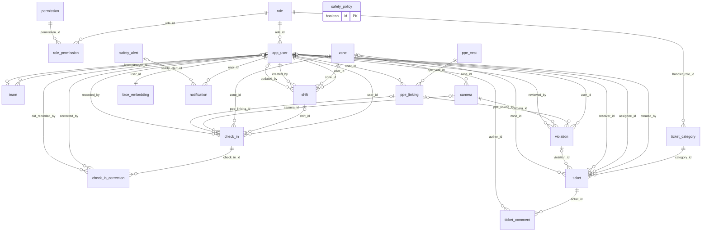
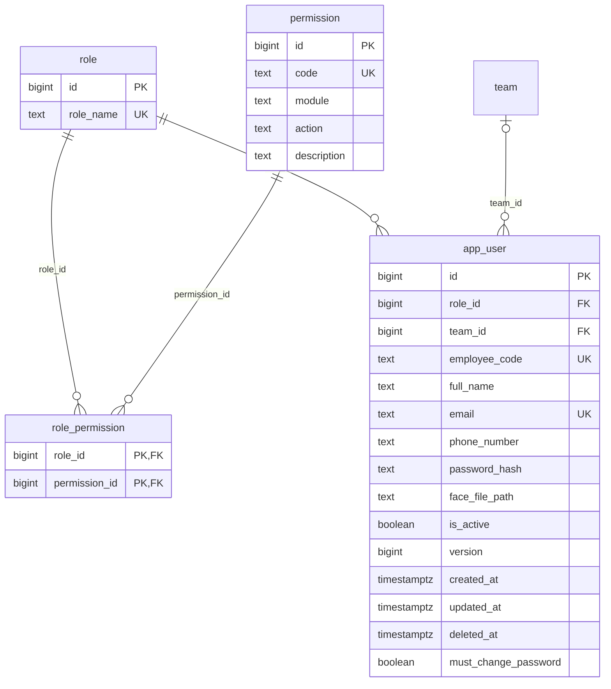
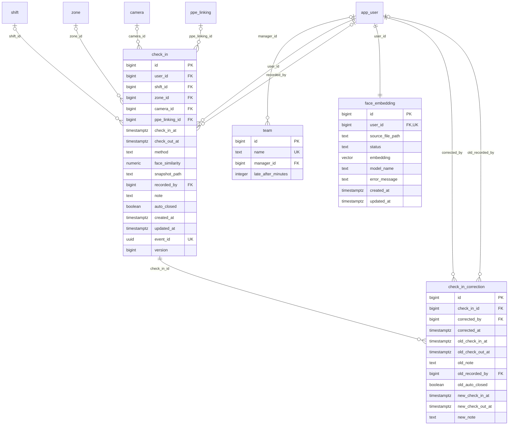
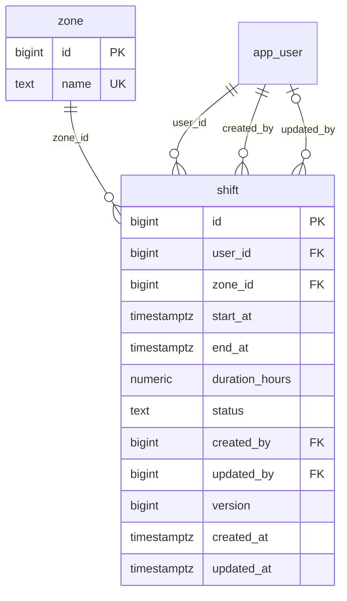
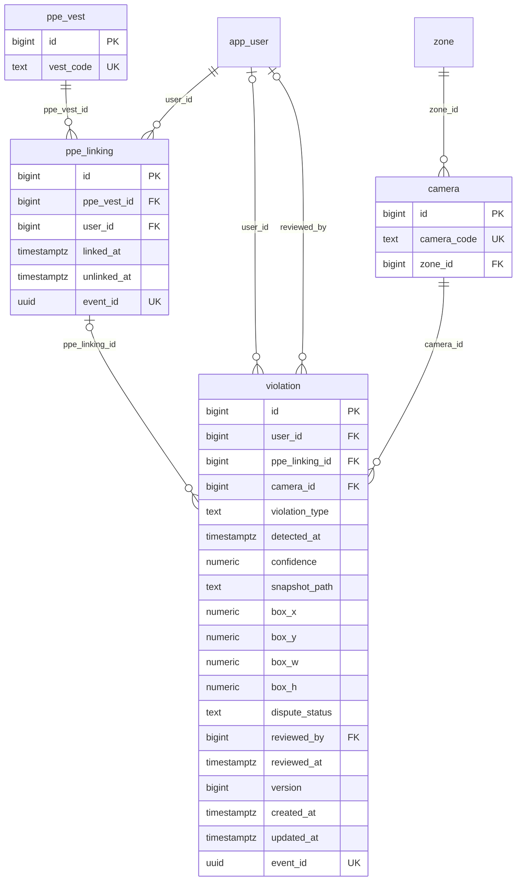
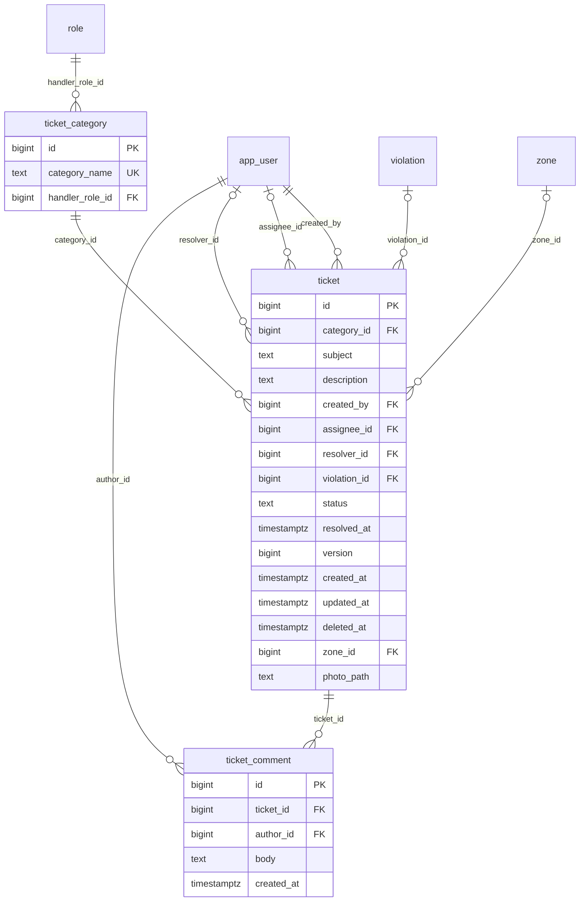
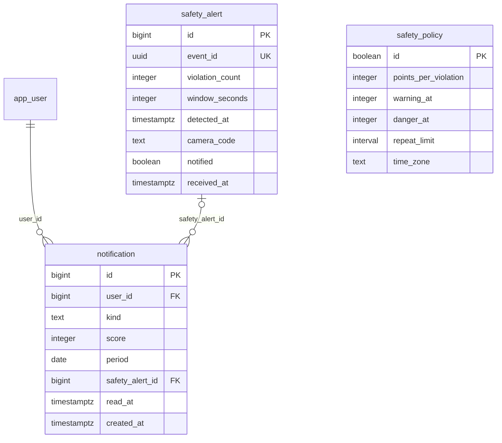

# Steelsight: Database Design

## 1. Overall

The Steelsight database has 20 tables in 6 logical domains, stored in PostgreSQL 17 with the pgvector extension. It is the shared record for the ERP web app and the Python detection service.

The schema is grouped into 6 logical domains:

| No. | Domain | Tables | Description |
| --- | --- | --- | --- |
| 1.1 | Identity and Access Management | role, permission, role_permission, app_user | Stores user accounts and what each one may do. A user has one role and a role holds many permissions. |
| 1.2 | Worker Management | team, check_in, face_embedding, check_in_correction | Groups workers into teams, records each site visit and every hand correction of one, and holds face enrolment for gate check-in. |
| 1.3 | Shift Management | zone, shift | Holds the timetable: which worker is in which site zone, and when. |
| 1.4 | PPE and Safety Monitoring | ppe_vest, ppe_linking, camera, violation | Records vests, cameras and the PPE violations the detection service finds, including dispute decisions. |
| 1.5 | Ticket Management | ticket_category, ticket, ticket_comment | Handles requests, hazard reports and PPE disputes, each routed to the role that handles its category. |
| 1.6 | Safety Score and Notifications | safety_policy, safety_alert, notification | Sets the rules of each worker's monthly safety score, records detection alerts, and holds in-app notifications. |

In the entity tables, Field Size gives bytes for fixed-size types and precision,scale for numeric, and Variable means no declared limit. Unique says Partial when uniqueness applies only to some rows, and the description gives the condition.

### 1.1 Identity and Access Management

This domain stores user accounts and decides what each one may do. Each user has one role, and a role holds many permissions, with one row per action. The seeded roles are WORKER, HSE_OFFICER, MANAGER and ADMIN, and Admin holds every permission. Only Admin creates or changes accounts, including face photos. Managers can see every worker, but only plan shifts for the teams they run. Users sign in with their employee code.

#### 1.1.1 role

The job roles a user can hold.

| No. | Field Name | Data Type | Field Size | P/F Key | Nullable | Unique | Description |
| --- | --- | --- | --- | --- | --- | --- | --- |
| 1 | id | bigint | 8 bytes | PK | No | Yes | Generated role ID |
| 2 | role_name | text | Variable |  | No | Yes | Role name: WORKER, HSE_OFFICER, MANAGER or ADMIN |

#### 1.1.2 permission

One action in the system, such as TICKET_CREATE.

| No. | Field Name | Data Type | Field Size | P/F Key | Nullable | Unique | Description |
| --- | --- | --- | --- | --- | --- | --- | --- |
| 1 | id | bigint | 8 bytes | PK | No | Yes | Generated permission ID |
| 2 | code | text | Variable |  | No | Yes | Code loaded by Spring Security as an authority |
| 3 | module | text | Variable |  | No | No | Area the action belongs to: TICKET, SHIFT, VIOLATION, USER, CHECKIN or REPORT |
| 4 | action | text | Variable |  | No | No | Type of action: READ, CREATE, UPDATE, DELETE, REVIEW or MANAGE |
| 5 | description | text | Variable |  | Yes | No | Plain-language explanation of the permission |

#### 1.1.3 role_permission

Links each role to the permissions it holds.

| No. | Field Name | Data Type | Field Size | P/F Key | Nullable | Unique | Description |
| --- | --- | --- | --- | --- | --- | --- | --- |
| 1 | role_id | bigint | 8 bytes | PK, FK → role(id) | No | Composite | The role; part of the composite primary key |
| 2 | permission_id | bigint | 8 bytes | PK, FK → permission(id) | No | Composite | The permission; part of the composite primary key |

#### 1.1.4 app_user

Every person who uses the system.

| No. | Field Name | Data Type | Field Size | P/F Key | Nullable | Unique | Description |
| --- | --- | --- | --- | --- | --- | --- | --- |
| 1 | id | bigint | 8 bytes | PK | No | Yes | Generated user ID |
| 2 | role_id | bigint | 8 bytes | FK → role(id) | No | No | The user's role |
| 3 | team_id | bigint | 8 bytes | FK → team(id) | Yes | No | The team the user belongs to |
| 4 | employee_code | text | Variable |  | No | Yes | Employee code used to sign in |
| 5 | full_name | text | Variable |  | No | No | User's full name |
| 6 | email | text | Variable |  | Yes | Yes | User's email address |
| 7 | phone_number | text | Variable |  | Yes | No | User's phone number |
| 8 | password_hash | text | Variable |  | No | No | BCrypt hash of the password; never the password itself |
| 9 | face_file_path | text | Variable |  | Yes | No | Name of the enrolment photo in the private face photo bucket; only an admin sets it |
| 10 | is_active | boolean | 1 byte |  | No | No | False blocks sign-in; defaults to true |
| 11 | version | bigint | 8 bytes |  | No | No | Optimistic lock counter; defaults to 0 |
| 12 | created_at | timestamptz | 8 bytes |  | No | No | When the row was created |
| 13 | updated_at | timestamptz | 8 bytes |  | No | No | When the row last changed; set by a trigger |
| 14 | deleted_at | timestamptz | 8 bytes |  | Yes | No | When the user was soft-deleted; a trigger then erases their face embedding |
| 15 | must_change_password | boolean | 1 byte |  | No | No | True when an admin chose the password, on a new account or a reset; they must pick their own at the next sign-in. Defaults to false |

### 1.2 Worker Management

This domain groups workers into teams and records when they are on site. Admin puts each worker in a team. Each team has one leader, a manager, and a manager leads at most one team. The leader plans shifts only for that team's workers, and exports its monthly report for accounting. A check-in row is one site visit, created by face match at the gate or entered by hand by HSE. Enrolment runs through face_embedding: the ERP queues a photo, and the detection service computes the vector. When HSE or Admin corrects a visit by hand, check_in_correction keeps what it said before, because a correction overwrites the visit and these times feed the monthly report. The account fields for each worker are in app_user, under Identity and Access Management.

#### 1.2.1 team

A group of workers under one manager.

| No. | Field Name | Data Type | Field Size | P/F Key | Nullable | Unique | Description |
| --- | --- | --- | --- | --- | --- | --- | --- |
| 1 | id | bigint | 8 bytes | PK | No | Yes | Generated team ID |
| 2 | name | text | Variable |  | No | Yes | Team name |
| 3 | manager_id | bigint | 8 bytes | FK → app_user(id) | Yes | Partial | The team's leader; unique when set, so a manager leads one team |
| 4 | late_after_minutes | integer | 4 bytes |  | No | No | Minutes after a shift starts before a check-in is tagged late, 0 to 240; defaults to 15 |

#### 1.2.2 check_in

One visit to site, from check-in to check-out.

| No. | Field Name | Data Type | Field Size | P/F Key | Nullable | Unique | Description |
| --- | --- | --- | --- | --- | --- | --- | --- |
| 1 | id | bigint | 8 bytes | PK | No | Yes | Generated visit ID |
| 2 | user_id | bigint | 8 bytes | FK → app_user(id) | No | Partial | The worker; unique among open visits, so a worker can be checked in only once at a time |
| 3 | shift_id | bigint | 8 bytes | FK → shift(id) | Yes | No | Planned shift for this visit; must belong to the same worker |
| 4 | zone_id | bigint | 8 bytes | FK → zone(id) | Yes | No | Zone of the visit |
| 5 | camera_id | bigint | 8 bytes | FK → camera(id) | Yes | No | Camera that recognised the face; empty for manual entries |
| 6 | ppe_linking_id | bigint | 8 bytes | FK → ppe_linking(id) | Yes | No | Vest worn at check-in; must belong to the same worker |
| 7 | check_in_at | timestamptz | 8 bytes |  | No | No | Arrival time; defaults to now |
| 8 | check_out_at | timestamptz | 8 bytes |  | Yes | No | Departure time; must be after check-in; empty means still on site |
| 9 | method | text | Variable |  | No | No | How it was recorded: FACE (default) or MANUAL |
| 10 | face_similarity | numeric | 5,2 |  | Yes | No | InsightFace match score from 0 to 100; required for FACE |
| 11 | snapshot_path | text | Variable |  | Yes | No | Path of the face image taken at the gate |
| 12 | recorded_by | bigint | 8 bytes | FK → app_user(id) | Yes | No | Who entered or corrected the visit; required for MANUAL |
| 13 | note | text | Variable |  | Yes | No | Free-text note |
| 14 | auto_closed | boolean | 1 byte |  | No | No | True when check-out is an estimate because the worker never checked out; defaults to false |
| 15 | created_at | timestamptz | 8 bytes |  | No | No | When the row was created |
| 16 | updated_at | timestamptz | 8 bytes |  | No | No | When the row last changed; set by a trigger |
| 17 | event_id | uuid | 16 bytes |  | Yes | Yes | Outbox event ID from the detection service; makes retries safe |
| 18 | version | bigint | 8 bytes |  | No | No | Optimistic lock, so a stale correction fails; a trigger also counts changes made with plain SQL; defaults to 0 |

#### 1.2.3 face_embedding

One row per worker, which also acts as the enrolment queue.

| No. | Field Name | Data Type | Field Size | P/F Key | Nullable | Unique | Description |
| --- | --- | --- | --- | --- | --- | --- | --- |
| 1 | id | bigint | 8 bytes | PK | No | Yes | Generated row ID |
| 2 | user_id | bigint | 8 bytes | FK → app_user(id) | No | Yes | The worker; the row is deleted with the user |
| 3 | source_file_path | text | Variable |  | No | No | Photo this row was made from |
| 4 | status | text | Variable |  | No | No | PENDING (default), READY or FAILED |
| 5 | embedding | vector | 512 dimensions |  | Yes | No | InsightFace vector; required when READY; biometric data |
| 6 | model_name | text | Variable |  | Yes | No | Model that made the vector, because vectors from different models do not compare; required when READY |
| 7 | error_message | text | Variable |  | Yes | No | Why enrolment failed, such as no face found |
| 8 | created_at | timestamptz | 8 bytes |  | No | No | When the row was created |
| 9 | updated_at | timestamptz | 8 bytes |  | No | No | When the row last changed; set by a trigger |

#### 1.2.4 check_in_correction

What one hand correction of a visit changed. Rows are only ever added, and the visit's edit page shows them to users who can correct visits. Corrections made before this table existed have no history.

| No. | Field Name | Data Type | Field Size | P/F Key | Nullable | Unique | Description |
| --- | --- | --- | --- | --- | --- | --- | --- |
| 1 | id | bigint | 8 bytes | PK | No | Yes | Generated correction ID |
| 2 | check_in_id | bigint | 8 bytes | FK → check_in(id) | No | No | The visit that was corrected |
| 3 | corrected_by | bigint | 8 bytes | FK → app_user(id) | No | No | Who made the correction |
| 4 | corrected_at | timestamptz | 8 bytes |  | No | No | When it was made; defaults to now |
| 5 | old_check_in_at | timestamptz | 8 bytes |  | No | No | Arrival time before the correction |
| 6 | old_check_out_at | timestamptz | 8 bytes |  | Yes | No | Departure time before the correction; empty means the visit was still open |
| 7 | old_note | text | Variable |  | Yes | No | Note before the correction |
| 8 | old_recorded_by | bigint | 8 bytes | FK → app_user(id) | Yes | No | Who had entered or corrected the visit before; empty for a face check-in nobody had changed |
| 9 | old_auto_closed | boolean | 1 byte |  | No | No | True when the old check-out was an estimate |
| 10 | new_check_in_at | timestamptz | 8 bytes |  | No | No | Arrival time after the correction |
| 11 | new_check_out_at | timestamptz | 8 bytes |  | Yes | No | Departure time after the correction; empty means still on site |
| 12 | new_note | text | Variable |  | Yes | No | Note after the correction |

### 1.3 Shift Management

This domain holds the timetable: which worker is in which zone, and when. Managers edit shifts for their own team, and Admin can edit any shift. A day off is simply a day with no row. An exclusion constraint stops one worker having two overlapping active shifts, and cancelled shifts do not count.

#### 1.3.1 zone

A named area of the site, used by shifts, cameras, check-ins and tickets.

| No. | Field Name | Data Type | Field Size | P/F Key | Nullable | Unique | Description |
| --- | --- | --- | --- | --- | --- | --- | --- |
| 1 | id | bigint | 8 bytes | PK | No | Yes | Generated zone ID |
| 2 | name | text | Variable |  | No | Yes | Zone name, such as Zone A |

#### 1.3.2 shift

One planned work period for one worker.

| No. | Field Name | Data Type | Field Size | P/F Key | Nullable | Unique | Description |
| --- | --- | --- | --- | --- | --- | --- | --- |
| 1 | id | bigint | 8 bytes | PK | No | Yes | Generated shift ID |
| 2 | user_id | bigint | 8 bytes | FK → app_user(id) | No | No | The worker |
| 3 | zone_id | bigint | 8 bytes | FK → zone(id) | No | No | Where the worker is assigned |
| 4 | start_at | timestamptz | 8 bytes |  | No | No | Shift start |
| 5 | end_at | timestamptz | 8 bytes |  | No | No | Shift end; must be after the start |
| 6 | duration_hours | numeric | Variable |  | Yes | No | Length in hours; generated by the database from start and end |
| 7 | status | text | Variable |  | No | No | SCHEDULED (default), COMPLETED or CANCELLED |
| 8 | created_by | bigint | 8 bytes | FK → app_user(id) | No | No | Who created the shift |
| 9 | updated_by | bigint | 8 bytes | FK → app_user(id) | Yes | No | Who last changed the shift |
| 10 | version | bigint | 8 bytes |  | No | No | Optimistic lock counter; defaults to 0 |
| 11 | created_at | timestamptz | 8 bytes |  | No | No | When the row was created |
| 12 | updated_at | timestamptz | 8 bytes |  | No | No | When the row last changed; set by a trigger |

### 1.4 PPE and Safety Monitoring

This domain records what the cameras detect and which worker it concerns. The detection service writes violations using YOLO26 for PPE and EasyOCR for vest IDs. A vest read names the worker through ppe_linking, and a trigger fills in violation.user_id from that link. Without a readable vest the worker stays empty until HSE assigns one. A detection stands unless the worker disputes it, and HSE then decides.

#### 1.4.1 ppe_vest

A physical vest with a readable ID.

| No. | Field Name | Data Type | Field Size | P/F Key | Nullable | Unique | Description |
| --- | --- | --- | --- | --- | --- | --- | --- |
| 1 | id | bigint | 8 bytes | PK | No | Yes | Generated vest ID |
| 2 | vest_code | text | Variable |  | No | Yes | Code printed on the vest and read by OCR |

#### 1.4.2 ppe_linking

Who wore which vest, and when.

| No. | Field Name | Data Type | Field Size | P/F Key | Nullable | Unique | Description |
| --- | --- | --- | --- | --- | --- | --- | --- |
| 1 | id | bigint | 8 bytes | PK | No | Yes | Generated link ID |
| 2 | ppe_vest_id | bigint | 8 bytes | FK → ppe_vest(id) | No | Partial | The vest; unique among active links, so a vest has one wearer at a time |
| 3 | user_id | bigint | 8 bytes | FK → app_user(id) | No | Partial | The worker; unique among active links, so a worker has one vest at a time |
| 4 | linked_at | timestamptz | 8 bytes |  | No | No | When the link started; defaults to now |
| 5 | unlinked_at | timestamptz | 8 bytes |  | Yes | No | When the link ended; empty means still active |
| 6 | event_id | uuid | 16 bytes |  | Yes | Yes | Outbox event ID from the detection service; makes retries safe |

#### 1.4.3 camera

A site camera and the zone it watches.

| No. | Field Name | Data Type | Field Size | P/F Key | Nullable | Unique | Description |
| --- | --- | --- | --- | --- | --- | --- | --- |
| 1 | id | bigint | 8 bytes | PK | No | Yes | Generated camera ID |
| 2 | camera_code | text | Variable |  | No | Yes | Camera code, such as CAM-B2 |
| 3 | zone_id | bigint | 8 bytes | FK → zone(id) | No | No | Zone the camera covers |

#### 1.4.4 violation

One PPE violation detected by a camera.

| No. | Field Name | Data Type | Field Size | P/F Key | Nullable | Unique | Description |
| --- | --- | --- | --- | --- | --- | --- | --- |
| 1 | id | bigint | 8 bytes | PK | No | Yes | Generated violation ID |
| 2 | user_id | bigint | 8 bytes | FK → app_user(id) | Yes | No | The worker; empty until identified; required before a dispute |
| 3 | ppe_linking_id | bigint | 8 bytes | FK → ppe_linking(id) | Yes | No | Vest read by OCR; empty for no vest or an unreadable one |
| 4 | camera_id | bigint | 8 bytes | FK → camera(id) | No | No | Camera that saw it |
| 5 | violation_type | text | Variable |  | No | No | NO_HARD_HAT, NO_VEST, NO_GLOVES or NO_HARNESS |
| 6 | detected_at | timestamptz | 8 bytes |  | No | No | When the camera saw it |
| 7 | confidence | numeric | 5,2 |  | Yes | No | Detection confidence from 0 to 100 |
| 8 | snapshot_path | text | Variable |  | No | No | Path of the camera image shown to the worker |
| 9 | box_x | numeric | 5,2 |  | Yes | No | Detection box X position, as a % of the image |
| 10 | box_y | numeric | 5,2 |  | Yes | No | Detection box Y position, as a % of the image |
| 11 | box_w | numeric | 5,2 |  | Yes | No | Detection box width, as a % of the image |
| 12 | box_h | numeric | 5,2 |  | Yes | No | Detection box height, as a % of the image |
| 13 | dispute_status | text | Variable |  | No | No | NONE (default), DISPUTED, UPHELD or OVERTURNED |
| 14 | reviewed_by | bigint | 8 bytes | FK → app_user(id) | Yes | No | Reviewer who decided; required for UPHELD or OVERTURNED |
| 15 | reviewed_at | timestamptz | 8 bytes |  | Yes | No | When it was decided; required for UPHELD or OVERTURNED |
| 16 | version | bigint | 8 bytes |  | No | No | Optimistic lock counter; defaults to 0 |
| 17 | created_at | timestamptz | 8 bytes |  | No | No | When the row was created |
| 18 | updated_at | timestamptz | 8 bytes |  | No | No | When the row last changed; set by a trigger |
| 19 | event_id | uuid | 16 bytes |  | Yes | Yes | Outbox event ID from the detection service; makes retries safe |

### 1.5 Ticket Management

This domain handles requests and reports raised by users. Each category names the role that handles it, and that link sets who can see and resolve its tickets. HSE officers handle PPE disputes and safety concerns, and see no other tickets. Admin handles every other category, such as leave requests, and can also open HSE's tickets. Managers only open and read their own tickets. A PPE dispute ticket links to one violation and closes only when that dispute is decided, in the same transaction.

#### 1.5.1 ticket_category

A type of ticket and the role that handles it. The categories are PPE dispute and Safety concern (HSE_OFFICER), and Shift or timetable issue, Equipment request, Leave request and Account or access (ADMIN).

| No. | Field Name | Data Type | Field Size | P/F Key | Nullable | Unique | Description |
| --- | --- | --- | --- | --- | --- | --- | --- |
| 1 | id | bigint | 8 bytes | PK | No | Yes | Generated category ID |
| 2 | category_name | text | Variable |  | No | Yes | Category name |
| 3 | handler_role_id | bigint | 8 bytes | FK → role(id) | No | No | Role that handles this category |

#### 1.5.2 ticket

One request or report.

| No. | Field Name | Data Type | Field Size | P/F Key | Nullable | Unique | Description |
| --- | --- | --- | --- | --- | --- | --- | --- |
| 1 | id | bigint | 8 bytes | PK | No | Yes | Generated ticket ID |
| 2 | category_id | bigint | 8 bytes | FK → ticket_category(id) | No | No | The ticket's category |
| 3 | subject | text | Variable |  | No | No | Short title |
| 4 | description | text | Variable |  | No | No | Full details |
| 5 | created_by | bigint | 8 bytes | FK → app_user(id) | No | No | Who opened the ticket |
| 6 | assignee_id | bigint | 8 bytes | FK → app_user(id) | Yes | No | Who is working on it |
| 7 | resolver_id | bigint | 8 bytes | FK → app_user(id) | Yes | No | Who closed it; set exactly when RESOLVED |
| 8 | violation_id | bigint | 8 bytes | FK → violation(id) | Yes | Partial | Disputed violation; unique among tickets not soft-deleted, so one live dispute per violation |
| 9 | status | text | Variable |  | No | No | OPEN (default), IN_PROGRESS or RESOLVED |
| 10 | resolved_at | timestamptz | 8 bytes |  | Yes | No | When it was closed; set exactly when RESOLVED |
| 11 | version | bigint | 8 bytes |  | No | No | Optimistic lock counter; defaults to 0 |
| 12 | created_at | timestamptz | 8 bytes |  | No | No | When the row was created |
| 13 | updated_at | timestamptz | 8 bytes |  | No | No | When the row last changed; set by a trigger |
| 14 | deleted_at | timestamptz | 8 bytes |  | Yes | No | When the ticket was soft-deleted |
| 15 | zone_id | bigint | 8 bytes | FK → zone(id) | Yes | No | Where the problem is, such as the location of a hazard |
| 16 | photo_path | text | Variable |  | Yes | No | Path of a photo in private storage |

#### 1.5.3 ticket_comment

A message on a ticket.

| No. | Field Name | Data Type | Field Size | P/F Key | Nullable | Unique | Description |
| --- | --- | --- | --- | --- | --- | --- | --- |
| 1 | id | bigint | 8 bytes | PK | No | Yes | Generated comment ID |
| 2 | ticket_id | bigint | 8 bytes | FK → ticket(id) | No | No | The ticket; comments are deleted with it |
| 3 | author_id | bigint | 8 bytes | FK → app_user(id) | No | No | Who wrote the comment |
| 4 | body | text | Variable |  | No | No | Comment text |
| 5 | created_at | timestamptz | 8 bytes |  | No | No | When it was written |

### 1.6 Safety Score and Notifications

This domain turns violations into consequences. Each worker starts the month on 100 and loses points for each counted violation, with a warning and then a danger level. The score is never stored: the `safety_scores()` function works it out from the violation rows. That way it returns to 100 on the 1st with no scheduled job, and an overturned violation gives its points back. Only users with the WORKER role have a score.

The same worker and violation type counts once per `repeat_limit` block, because a camera can report someone standing in view over and over. A violation with no worker loses no points until HSE assigns one.

A trigger on `violation` sends the warning or danger notification. It's a trigger because the detection service writes violations straight to the database, and the ERP may be asleep. It runs as the table owner, because the detection role can't write notifications.

The detection service reports a burst of violations through the ERP's alert API, which stores a `safety_alert` and notifies every active HSE officer. `safety_time_slots()` ranks shift time slots by violations per 100 worker-hours for the HSE view.

#### 1.6.1 safety_policy

The rules of the safety score, in a single row.

| No. | Field Name | Data Type | Field Size | P/F Key | Nullable | Unique | Description |
| --- | --- | --- | --- | --- | --- | --- | --- |
| 1 | id | boolean | 1 byte | PK | No | Yes | Always true, so the table can hold only one row |
| 2 | points_per_violation | integer | 4 bytes |  | No | No | Points lost per counted violation; defaults to 10 and must be above 0 |
| 3 | warning_at | integer | 4 bytes |  | No | No | A score at or below this is WARNING; defaults to 70 |
| 4 | danger_at | integer | 4 bytes |  | No | No | A score at or below this is DANGER; defaults to 40, and must be below warning_at |
| 5 | repeat_limit | interval | 16 bytes |  | No | No | The same worker and type counts once per block of this length; defaults to 30 minutes |
| 6 | time_zone | text | Variable |  | No | No | Decides when a month starts; defaults to Asia/Ho_Chi_Minh and should match the app's time zone |

#### 1.6.2 safety_alert

A report from the detection service that too many violations are happening.

| No. | Field Name | Data Type | Field Size | P/F Key | Nullable | Unique | Description |
| --- | --- | --- | --- | --- | --- | --- | --- |
| 1 | id | bigint | 8 bytes | PK | No | Yes | Generated alert ID |
| 2 | event_id | uuid | 16 bytes |  | No | Yes | Event ID from the detection service; makes retries safe |
| 3 | violation_count | integer | 4 bytes |  | No | No | Violations the detection service counted; above 0 |
| 4 | window_seconds | integer | 4 bytes |  | No | No | Length of the time window they were counted in; above 0 |
| 5 | detected_at | timestamptz | 8 bytes |  | No | No | When the detection service raised the alert |
| 6 | camera_code | text | Variable |  | Yes | No | Camera code as sent; not a foreign key, so a mistyped code can't lose an alert |
| 7 | notified | boolean | 1 byte |  | No | No | True when HSE was notified. False when the same source was notified within the last 15 minutes, or the alert was detected over 1 hour ago or over 5 minutes ahead. Each registered camera is its own source, and all other codes share one |
| 8 | received_at | timestamptz | 8 bytes |  | No | No | When the ERP received it; defaults to now |

#### 1.6.3 notification

One in-app notification. Its words aren't stored, so each reader sees it in their own language.

| No. | Field Name | Data Type | Field Size | P/F Key | Nullable | Unique | Description |
| --- | --- | --- | --- | --- | --- | --- | --- |
| 1 | id | bigint | 8 bytes | PK | No | Yes | Generated notification ID |
| 2 | user_id | bigint | 8 bytes | FK → app_user(id) | No | Partial | Who it's for; unique with kind and period when period is set, so each level reaches a worker once a month |
| 3 | kind | text | Variable |  | No | Partial | SAFETY_WARNING, SAFETY_DANGER or HSE_VIOLATION_ALERT |
| 4 | score | integer | 4 bytes |  | Yes | No | The worker's score when it was sent; set exactly for safety notices |
| 5 | period | date | 4 bytes |  | Yes | Partial | The 1st of the month it belongs to; set exactly for safety notices |
| 6 | safety_alert_id | bigint | 8 bytes | FK → safety_alert(id) | Yes | No | The alert behind an HSE notice; set exactly for HSE_VIOLATION_ALERT |
| 7 | read_at | timestamptz | 8 bytes |  | Yes | No | When the reader marked it as read; empty means unread |
| 8 | created_at | timestamptz | 8 bytes |  | No | No | When it was sent |
