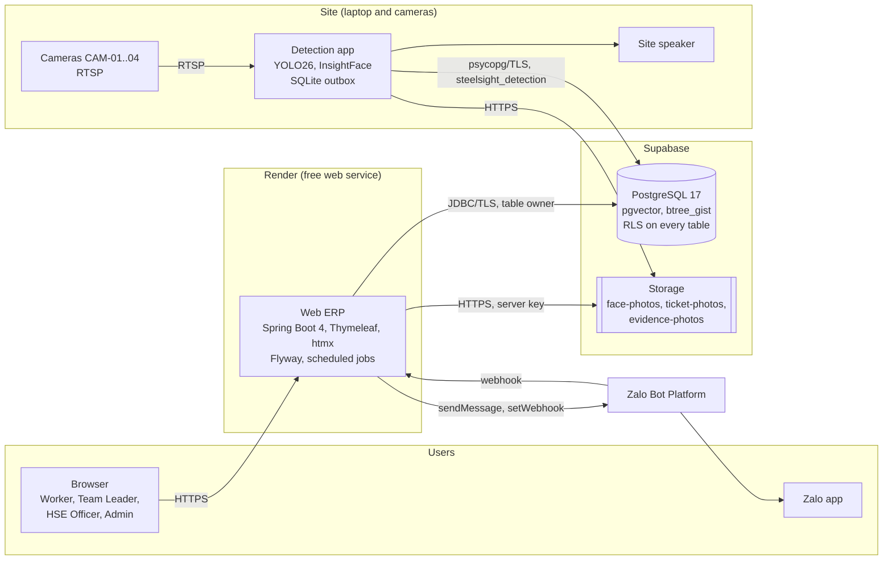
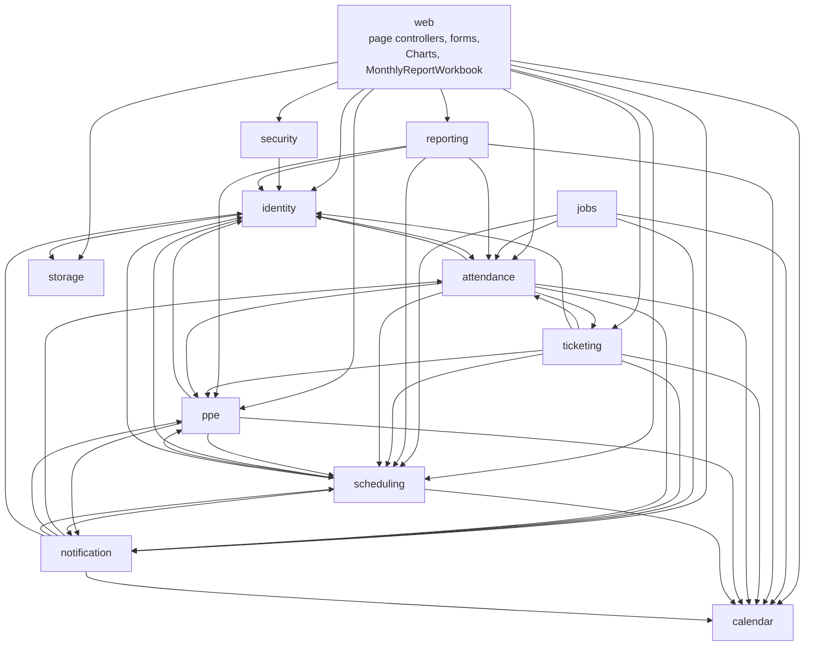

# Steelsight: System Design

This is section 1 of the design (Report 4). It describes the system as built, after migration V27
(25 November 2026). The versions of every tool and the ports of every connection are in
[tech-stack.md](tech-stack.md), and how to deploy is in [deployment.md](deployment.md).

## 1. System Architecture

Steelsight has two applications that share one PostgreSQL database on Supabase:

- **The web ERP** runs in a Docker container on Render. Every enterprise role (Worker, Team Leader,
  HSE Officer, Admin) uses it in a browser. Pages are rendered on the server with Thymeleaf and htmx, so
  there is no separate frontend app. It owns the schema (Flyway), holds every business rule that isn't
  in the database, runs the scheduled jobs and sends every notice, in the web ERP first and then on Zalo.
- **The detection app** is a Windows desktop app on the site laptop, which has the NVIDIA GPU. It reads
  the cameras over RTSP, runs YOLO26 for hard hats and vests and InsightFace for faces, and writes
  check-ins, check-outs and violations straight to the database as the limited role
  `steelsight_detection`. It keeps every event in a local SQLite outbox while the internet is down. Its
  window is a pywebview window over a FastAPI server that listens only on `127.0.0.1`. It doesn't call
  the ERP; the ERP reacts through database triggers.
- **Supabase** holds the database (PostgreSQL 17 with pgvector and btree_gist) and three private Storage
  buckets: `face-photos`, `ticket-photos` and `evidence-photos`. The public Data API returns nothing,
  because row level security is on for every table.
- **Zalo** carries the notices: the ERP calls the Zalo Bot API, and Zalo calls the ERP's webhook with
  the messages people send to the bot.

The laptop only connects outwards and has no open ports.

Rules that must hold even while the ERP sleeps on Render's free tier live in the database: attaching a
visit to its shift, turning a named person into a suggestion, alerting the HSE Officers on duty about a
new violation, the check-in and check-out notices, and a check-out completing its shift. They are
listed in [database-design.md](database-design.md), section 3.

### 1.1 Monitoring zones and cameras

The site is divided into monitoring zones, each with a fixed code (V26):

| Code | Kind | Cameras | What happens there |
| --- | --- | --- | --- |
| GATE-IN | GATE_ATTENDANCE | CAM-01 | Face check-in and check-out (BR-27 to BR-29) |
| GATE-PPE | GATE_PPE | CAM-02 | PPE check at the gate; the person is suggested from the latest gate scan (BR-46) |
| AREA-A, AREA-B | WORK_AREA | CAM-03, CAM-04 | PPE monitoring in the work areas; each area belongs to a team, and HSE picks the person from that team first |

A zone can have several cameras, and each camera's role (ATTENDANCE or PPE) follows its zone. This
differs from the SRS, which has one camera per zone (team decision).

## 2. Package Diagram

### 2.1 Web ERP

The ERP is one Spring Boot application, `orochi.steelsight`, split by feature. Each feature package has
its own `model` (JPA entities), `repository` (Spring Data) and `service` (business rules and
transactions). The `web` package holds the page controllers and form objects, with no business rule.
Arrows are dependencies, taken from the imports in the code. Every feature package also uses the base
packages (`model`, `repository`, `exception`, `validation`), which aren't drawn.

The features aren't strictly layered. Some depend on each other both ways: `attendance` and `ticketing`
(a ticket approves a correction, and a correction names its ticket), `scheduling` and `ppe` (zones and
cameras), `identity` and `attendance` (face enrolment), and `notification` with the features it
describes. Several packages also use `web.SiteTime` for the site's time zone, `security` uses
`web.RequestLogFilter`, and `scheduling` reads `web.ShiftForm`. Moving `SiteTime` into `calendar`
would remove most of the arrows back to `web`.

| No | Package | Description |
| --- | --- | --- |
| 01 | `config` | Locale (English and Vietnamese, kept in a cookie), BCrypt password encoder, `@EnableScheduling` |
| 02 | `security` | `SecurityConfig` with two filter chains (`/api/**` and the pages), `AppUserDetailsService` (permission codes as authorities), `SignInLimiter` and `SignInLimitFilter`, `PasswordChangeRequiredFilter`, `FirstSignInHandler`, `UserSessions`, `AdminBootstrap`, `ApiKeyFilter` and `ApiLimiter` |
| 03 | `web` | Page controllers that return Thymeleaf pages or htmx fragments, the form objects, `Display`, `SiteTime`, `Charts` (dashboard bars in HTML and CSS), `QrCodes`, `MonthlyReportWorkbook` (.xlsx), request logging and error pages |
| 04 | `identity` | `AppUser`, `Role`, `Permission`, `StaffGroup`; `UserService`, `AccessPolicy` (every "may this user do this to that record" check), `Permissions`, `CompanySettings` |
| 05 | `scheduling` | `Team`, `Zone`, `ZoneKind`, `Shift`, `ShiftKind`, `ShiftStatus`; `TeamService`, `ZoneService`, `ShiftService` |
| 06 | `attendance` | `CheckIn`, `CheckInCorrection`, `FaceEmbedding`, `FacePose`; `CheckInService`, `AttendanceRules` (late and early), `AttendanceCalculator` and `ShiftAttendance` (paid hours), `CheckOutHours`, `PendingOvertimeService` |
| 07 | `ppe` | `Camera`, `Violation`, `ReviewStatus`, `ViolationType`, `DismissReason`, `DisputeStatus`, `SafetyLevel`; `ViolationService`, `SafetyScoreService` |
| 08 | `ticketing` | `Ticket`, `TicketCategory`, `CategoryCode`, `TicketComment`, `TicketStatus`, `TicketOutcome`; `TicketService` |
| 09 | `notification` | `Notification`, `NotificationKind`; `NotificationService`, `Notices`, `NoticeText`, `ZaloDispatcher`; the `zalo` sub-package: `ZaloBot`, `ZaloLinks`, `ZaloStore`, `ZaloCommands` |
| 10 | `reporting` | `MonthlyReportService`: the month's figures for the report and the export log |
| 11 | `storage` | `PhotoStorage` with `LocalPhotoStorage` (development) and `SupabasePhotoStorage` (production); `PhotoAlbum` keeps faces, tickets and evidence apart |
| 12 | `calendar` | `SiteCalendar` (Vietnam time, working days) and `MonthLocks` |
| 13 | `jobs` | `JobScheduler` (every 60 seconds, with the `job_run` log) and `SiteJobs` (the jobs of SRS 3.2.38) |
| 14 | `model`, `repository`, `exception`, `validation` | Base entities (id equality, timestamps, soft delete, version), base repositories, `BusinessRuleException`, `NotFoundException`, `StaleEditException`, text checks |
| 15 | resources | `templates/` (Thymeleaf), `static/css/app.css` (Tailwind), `static/js/app.js`, the icon sprite, `messages.properties` and `messages_vi.properties`, `db/migration` V1 to V27 (Flyway) |

### 2.2 Detection app

The detection app lives in its own repository (`steelsight-demo`); its own design is in that
repository's `03_implement/STEELSIGHT-DET-*-IMP-001_TDS.md`.

| No | Package | Description |
| --- | --- | --- |
| 01 | `steelsight/engine.py` | Starts the camera threads and the batched inference loop |
| 02 | `core` | Settings (`settings.json`), the local SQLite database, shared domain types |
| 03 | `vision` | RTSP and webcam capture keeping only the newest frame, camera discovery, the YOLO26 detector (TensorRT, ONNX Runtime or PyTorch), the tracker, drawing |
| 04 | `people` | Face recognition (InsightFace), identity of tracked people, local vest markers |
| 05 | `gate` | The gate scanner (check-in and check-out decision) and the gate screen |
| 06 | `safety` | The PPE rules and timers (BR-40 to BR-45), the alarm and the Vietnamese voice (edge-tts, pyttsx3) |
| 07 | `records` | Local violation history, evidence photos, reports, disk clean-up |
| 08 | `erp` | `outbox.py` (local outbox), `sync.py` (writes to Supabase as `steelsight_detection`, uploads photos, enrols faces, calls `close_stale_check_ins()`), `mapping.py` (local events to ERP rows) |
| 09 | `web` | The FastAPI routes and pages of the desktop window: live view, gate log, violation history, cameras, settings, local sign-in |

## 3. Deployment

| # | Node | Description |
| --- | --- | --- |
| 1 | Render free web service | One container of the ERP image (Java 17 JRE, non-root, sized for 512 MB) behind Render's HTTPS proxy, on `$PORT`. Render checks `/actuator/health` before switching to a new release. Flyway migrates the schema at start-up. The service sleeps after 15 minutes idle; an uptime monitor keeps it awake |
| 2 | Supabase | PostgreSQL 17 with pgvector and btree_gist, reached through the session pooler over TLS; private Storage buckets |
| 3 | Site laptop | Windows with an NVIDIA GPU. The detection app is installed with `setup.bat` and started with `run.bat`, or packaged as `SteelSightAI.exe` |
| 4 | Cameras | Hikvision IP cameras on the site network, RTSP on port 554: CAM-01 attendance, CAM-02 gate PPE, CAM-03 and CAM-04 work areas |
| 5 | Zalo Bot Platform | The Steelsight bot. The ERP registers its webhook at start-up |
| 6 | GitHub (for now) | GitHub Actions runs `mvn verify` on every push and pull request; from `master` it builds the image into `ghcr.io/owochiii/steelsight_erp` and calls Render's deploy hook |
| 7 | GitLab (planned main repository) | The same pipeline with Semgrep and Trivy scans, the GitLab Container Registry and deploys from `main` |
| 8 | Cloudflare Tunnel (demo backup) | Exposes an ERP running on the laptop if Render is too slow on demo day |

Release order: deploy the ERP before a detection app that depends on a new migration, because only the
ERP changes the schema.

## 4. Technology Stack and Ports

See [tech-stack.md](tech-stack.md): section 1 is the component matrix with versions, and section 2 lists
every connection with its protocol, port and direction.
